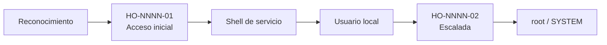

# Informe de pentest profesional

Convierte la evidencia cruda de una auditoría de laboratorio en un informe con calidad
de entrega a cliente, siguiendo un formato fijo. El objetivo es que el usuario pegue lo
que tenga (salidas de `nmap`, comandos usados, capturas, notas) y reciba un `.md`
terminado, coherente y sin huecos silenciosos.

## Contexto de uso

Todos los reportes se generan sobre **entornos de laboratorio autorizados** (Hack The Box,
labs propios, máquinas retiradas) con fines educativos y de portfolio. Por eso el informe
siempre incluye un aviso legal que lo deja explícito. Esto es documentación de seguridad
estándar; redáctala con naturalidad y rigor técnico.

## Principio rector: no inventar

Un informe entregable pierde todo su valor si tiene datos falsos.

- Usá **solo** lo que surja de la evidencia aportada o sea una inferencia técnica
  defendible a partir de ella (ej.: TTL 64 → Linux).
- **Nunca** inventes flags, IPs, versiones, credenciales, CVEs ni comandos que el usuario
  no haya ejecutado.
- Donde falte un dato y no se pueda inferir, dejá un marcador visible:
  `⚠️ PENDIENTE: <qué falta>` — nunca lo rellenes con algo plausible.

## Proceso

1. **Leer toda la evidencia** aportada (texto, archivos, capturas) y extraer:
   nombre de la máquina, IP, SO, dificultad, puertos/servicios, tecnología web,
   vector de acceso inicial, movimiento lateral, vector de escalada, flags,
   información sensible hallada, herramientas usadas.

2. **Detectar faltantes críticos.** Si falta alguno de estos y no se puede inferir,
   pedilos en **una sola tanda** antes de redactar: nombre, IP, SO, vector de acceso
   inicial, vector de escalada. Si el usuario pidió que se genere igual, continuá y
   marcá esos puntos con `⚠️ PENDIENTE`.

3. **Puntuar cada hallazgo** con CVSS v3.1: calculá el vector completo y el puntaje, y
   asigná la severidad según la tabla. Justificá brevemente el vector en la ficha.

4. **Redactar** cada sección respetando el formato de abajo al pie de la letra
   (IDs, tablas, orden).

5. **Entregar** el archivo con `SendUserFile`.

## Reglas de redacción

- **Idioma:** español neutro, profesional. Nada de jerga innecesaria ni muletillas.
- **Resumen ejecutivo:** sin tecnicismos, entendible por alguien no técnico. Explica el
  riesgo de negocio, no el comando.
- **Hallazgos técnicos:** voz impersonal ("se identificó", "el servicio expone"). Cada
  hallazgo explica la **causa raíz**, no solo el exploit.
- **Flags y credenciales:** mostrarlas **parcialmente censuradas** (primeros caracteres +
  asteriscos). Nunca la flag completa.
- **Severidad coherente:** el "nivel de riesgo global" del resumen = la severidad más alta
  entre los hallazgos.
- **IDs:** formato `HO-NNNN-MM` (NNNN = nº de informe, MM = nº de hallazgo). Si el usuario
  no da número de informe, usar `0000` y marcarlo como `⚠️ PENDIENTE: asignar ID`.
- **Imágenes:** referenciarlas en `./img/NN-descripcion.png` relativo al informe, con pie
  de figura numerado. Si una captura se describió pero no se adjuntó, dejar el marcador de
  imagen y una nota `⚠️ PENDIENTE: adjuntar captura`.
- **CVE/CWE:** incluir solo si corresponde y es verificable; si no, poner `—`.

## Severidad (CVSS v3.1)

| Severidad | Puntaje | Criterio |
|-----------|:-------:|----------|
| Crítica | 9.0–10.0 | Compromiso total, remoto y sin autenticación. |
| Alta | 7.0–8.9 | Compromiso significativo o escalada de privilegios. |
| Media | 4.0–6.9 | Impacto limitado o con condiciones previas. |
| Baja | 0.1–3.9 | Impacto mínimo. |
| Informativa | 0.0 | Buena práctica, sin impacto directo. |

## Salida

- Nombre del archivo: `<nombre-maquina-en-minúsculas>.md` (o `index.md` si va en su propia
  carpeta dentro del repo).
- Markdown estándar (tablas, `<details>`, Mermaid): se renderiza en GitHub y en MkDocs sin
  extensiones especiales.

---

## FORMATO DEL INFORME (reproducir exactamente)

````markdown
---
report_id: HO-NNNN-00
target: NombreMaquina
platform: Hack The Box
os: Linux
difficulty: Easy
ip: 10.10.11.XXX
date: AAAA-MM-DD
version: 1.0
author: Francisco Nieto
status: Final
tags: [htb, linux, easy]
---

# Informe de Prueba de Penetración — NombreMaquina

| | |
|---|---|
| **ID de informe** | HO-NNNN-00 |
| **Objetivo** | NombreMaquina (`10.10.11.XXX`) |
| **Plataforma** | Hack The Box — máquina retirada |
| **Tipo de prueba** | Caja negra (black box) |
| **Fecha de ejecución** | AAAA-MM-DD |
| **Autor** | Francisco Nieto — [@NiettoFrann](https://github.com/NiettoFrann) |
| **Versión** | 1.0 |
| **Clasificación** | Público — uso educativo |

> **Aviso legal.** Las pruebas se realizaron sobre un entorno de laboratorio autorizado
> (Hack The Box) y sobre una máquina retirada. Ninguna técnica descrita debe aplicarse
> sobre sistemas sin autorización expresa por escrito de su propietario.

### Control de versiones

| Versión | Fecha | Descripción |
|---------|-------|-------------|
| 1.0 | AAAA-MM-DD | Versión inicial |

---

## Índice

1. [Resumen ejecutivo](#1-resumen-ejecutivo)
2. [Alcance y metodología](#2-alcance-y-metodología)
3. [Narrativa del ataque](#3-narrativa-del-ataque)
4. [Hallazgos técnicos](#4-hallazgos-técnicos)
5. [Post-explotación](#5-post-explotación)
6. [Conclusiones](#6-conclusiones)
7. [Anexos](#7-anexos)

---

## 1. Resumen ejecutivo

### 1.1 Objetivo

Evaluar la seguridad del host **NombreMaquina** simulando un atacante externo sin
credenciales ni conocimiento previo, para obtener el máximo nivel de privilegios posible.

### 1.2 Resultado

> 3–5 líneas, sin tecnicismos, para público no técnico. Qué servicio estaba expuesto,
> qué falla permitió entrar, hasta dónde se llegó y qué podría hacer un atacante real.

**Nivel de riesgo global:** `CRÍTICO`

### 1.3 Distribución de hallazgos

| Crítica | Alta | Media | Baja | Informativa |
|:-------:|:----:|:-----:|:----:|:-----------:|
| 0 | 0 | 0 | 0 | 0 |

### 1.4 Resumen de hallazgos

| ID | Hallazgo | Severidad | CVSS |
|----|----------|-----------|------|
| HO-NNNN-01 | Título del hallazgo | Crítica | 9.8 |
| HO-NNNN-02 | Título del hallazgo | Alta | 7.8 |

### 1.5 Recomendaciones prioritarias

1. Acción más urgente (corrige el acceso inicial).
2. Segunda acción (corrige la escalada).
3. Medida general de hardening.

---

## 2. Alcance y metodología

### 2.1 Alcance

| Activo | Dirección | Incluido |
|--------|-----------|:--------:|
| NombreMaquina | `10.10.11.XXX` | Sí |

**Fuera de alcance:** denegación de servicio, infraestructura de la plataforma y otros jugadores.

### 2.2 Metodología

Prueba basada en **PTES**, apoyada en **OWASP WSTG** para los componentes web:
reconocimiento, enumeración, análisis de vulnerabilidades, explotación,
post-explotación y reporte.

### 2.3 Entorno del auditor

| Componente | Detalle |
|------------|---------|
| Sistema | Distribución / versión |
| Conexión | VPN de Hack The Box |
| Herramientas | nmap, whatweb, ffuf, Burp Suite, netcat, linpeas |

### 2.4 Clasificación de severidad

Las vulnerabilidades se puntúan con **CVSS v3.1** (ver tabla de criterios estándar).

---

## 3. Narrativa del ataque

### 3.1 Cadena de compromiso



### 3.2 Reconocimiento

```bash
sudo nmap -p- --open -sS --min-rate 5000 -n -Pn 10.10.11.XXX -oG allPorts
nmap -sCV -p<puertos> 10.10.11.XXX -oN targeted
```

| Puerto | Servicio | Versión | Observaciones |
|--------|----------|---------|---------------|
| 22/tcp | SSH | OpenSSH X.X | |
| 80/tcp | HTTP | nginx X.X | Principal superficie de ataque. |

> Salida completa en el [Anexo A](#a-salida-completa-de-escaneos).

### 3.3 Enumeración

Prosa: qué se encontró y por qué se tomó cada decisión.


*Figura 1 — Descripción.*

### 3.4 Acceso inicial

Ver **HO-NNNN-01**.

### 3.5 Movimiento lateral

Cómo se pasó de un usuario a otro (si aplica).

### 3.6 Escalada de privilegios

Ver **HO-NNNN-02**.

---

## 4. Hallazgos técnicos

### HO-NNNN-01 — Título del hallazgo

| | |
|---|---|
| **Severidad** | Crítica |
| **CVSS v3.1** | 9.8 — `CVSS:3.1/AV:N/AC:L/PR:N/UI:N/S:U/C:H/I:H/A:H` |
| **CWE** | CWE-XX — Nombre |
| **CVE** | — |
| **Componente afectado** | `http://10.10.11.XXX/ruta` |
| **Estado** | Explotada |

#### Descripción
Qué es y por qué existe (causa raíz).

#### Prueba de concepto
Pasos numerados con comandos/payloads reales y capturas.

#### Impacto
Consecuencias sobre confidencialidad, integridad y disponibilidad.

#### Remediación
- **Corto plazo:** medida inmediata.
- **Largo plazo:** corrección de fondo.

#### Referencias
- Enlaces verificables.

---

### HO-NNNN-02 — Título del hallazgo

(misma estructura de ficha)

---

## 5. Post-explotación

### 5.1 Acceso obtenido

| Nivel | Usuario | Método | Prueba |
|-------|---------|--------|--------|
| Usuario | `usuario` | HO-NNNN-01 | `user.txt` — `a1b2c3d4****` |
| Administrador | `root` | HO-NNNN-02 | `root.txt` — `e5f6g7h8****` |

### 5.2 Información sensible expuesta

| Tipo | Ubicación | Observación |
|------|-----------|-------------|

### 5.3 Limpieza

| Artefacto | Ubicación | Estado |
|-----------|-----------|--------|

---

## 6. Conclusiones

### 6.1 Conclusión técnica
Qué falló en la postura de seguridad y cómo se encadenaron las vulnerabilidades.

### 6.2 Aprendizajes del auditor
- Técnica nueva aplicada.
- Dónde se trabó y cómo lo resolvió.
- Qué haría distinto.

---

## 7. Anexos

### A. Salida completa de escaneos
<details><summary>nmap</summary>

```text
```
</details>

### B. Scripts y exploits
<details><summary>exploit.py</summary>

```python
```
</details>

### C. Mapeo MITRE ATT&CK

| Táctica | Técnica | ID |
|---------|---------|----|
| Initial Access | Exploit Public-Facing Application | T1190 |
| Privilege Escalation | Abuse Elevation Control Mechanism | T1548 |

### D. Referencias generales
- PTES, OWASP WSTG, calculadora CVSS v3.1 de FIRST, MITRE ATT&CK.
````

---

## Nota sobre el modelo

Para esta tarea conviene usar el modelo más capaz disponible (Opus). Una skill no cambia
el modelo por sí sola: se selecciona en el selector de la app antes de redactar el informe.
