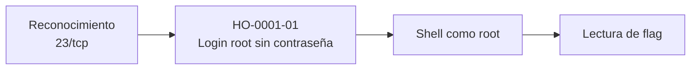

# Informe de Prueba de Penetración — Meow

| | |
|---|---|
| **ID de informe** | HO-0001-00 |
| **Objetivo** | Meow (`10.129.58.25`) |
| **Plataforma** | Hack The Box — Starting Point (Tier 0) |
| **Tipo de prueba** | Caja negra (black box) |
| **Fecha de ejecución** | 2026-10-17 |
| **Autor** | Francisco Nieto — [@NiettoFrann](https://github.com/NiettoFrann) |
| **Versión** | 1.0 |
| **Clasificación** | Público — uso educativo |

> **Aviso legal.** Las pruebas se realizaron sobre un entorno de laboratorio autorizado
> (Hack The Box). Ninguna técnica descrita debe aplicarse sobre sistemas sin autorización
> expresa por escrito de su propietario.

### Control de versiones

| Versión | Fecha | Descripción |
|---------|-------|-------------|
| 1.0 | 2026-10-17 | Versión inicial |

---

## Índice

1. [Resumen ejecutivo](#1-resumen-ejecutivo)
2. [Alcance y metodología](#2-alcance-y-metodología)
3. [Narrativa del ataque](#3-narrativa-del-ataque)
4. [Hallazgos técnicos](#4-hallazgos-técnicos)
5. [Post-explotación](#5-post-explotación)
6. [Conclusiones](#6-conclusiones)
7. [Anexos](#7-anexos)

---

## 1. Resumen ejecutivo

### 1.1 Objetivo

Evaluar la seguridad del host **Meow** simulando un atacante externo sin credenciales ni
conocimiento previo del entorno, con el fin de obtener el máximo nivel de privilegios
posible.

### 1.2 Resultado

> El servidor ofrece un servicio de administración remota antiguo y sin cifrado. La
> cuenta de administrador de ese servicio no tiene contraseña, por lo que cualquier
> persona con acceso a la red puede entrar con control total en pocos segundos, sin
> necesidad de conocimientos avanzados. Un atacante real podría leer, modificar o
> eliminar toda la información del equipo y utilizarlo como punto de apoyo hacia otros
> sistemas.

**Nivel de riesgo global:** `CRÍTICO`

### 1.3 Distribución de hallazgos

| Crítica | Alta | Media | Baja | Informativa |
|:-------:|:----:|:-----:|:----:|:-----------:|
| 1 | 0 | 0 | 0 | 0 |

### 1.4 Resumen de hallazgos

| ID | Hallazgo | Severidad | CVSS |
|----|----------|-----------|------|
| [HO-0001-01](#ho-0001-01--cuenta-root-sin-contraseña-expuesta-por-telnet) | Cuenta `root` sin contraseña expuesta por Telnet | Crítica | 9.8 |

### 1.5 Recomendaciones prioritarias

1. Deshabilitar el servicio Telnet y sustituirlo por SSH.
2. Establecer una contraseña robusta en todas las cuentas, en especial las privilegiadas.
3. Deshabilitar el inicio de sesión remoto directo de `root` y usar cuentas nominales con `sudo`.

---

## 2. Alcance y metodología

### 2.1 Alcance

| Activo | Dirección | Incluido |
|--------|-----------|:--------:|
| Meow | `10.129.58.25` | Sí |

**Fuera de alcance:** ataques de denegación de servicio, infraestructura de la
plataforma y otros jugadores.

### 2.2 Metodología

La prueba siguió las fases del estándar **PTES** (Penetration Testing Execution
Standard):

1. **Reconocimiento** — descubrimiento de puertos y servicios.
2. **Enumeración** — identificación de versiones y superficie de ataque.
3. **Análisis de vulnerabilidades** — validación manual de configuraciones débiles.
4. **Explotación** — obtención de acceso inicial.
5. **Post-explotación** — verificación del nivel de acceso y recolección de evidencia.
6. **Reporte** — documentación de hallazgos y recomendaciones.

### 2.3 Entorno del auditor

| Componente | Detalle |
|------------|---------|
| Sistema | Linux (kernel 7.2.11-zen1-1-zen) |
| Conexión | VPN de Hack The Box |
| Herramientas | ping, nmap 7.991, telnet |

### 2.4 Clasificación de severidad

Las vulnerabilidades se puntúan con **CVSS v3.1** (ver tabla de criterios estándar).

---

## 3. Narrativa del ataque

### 3.1 Cadena de compromiso



### 3.2 Reconocimiento

Verificación de conectividad:

```bash
ping -c 1 10.129.58.25
```

El host responde con TTL 63, cercano al valor por defecto de Linux (64), lo que indica
un sistema operativo **Linux** a un salto de distancia.

Descubrimiento de puertos abiertos:

```bash
nmap -p- --min-rate=5000 -T4 -Pn -n 10.129.58.25 -oN loot/puertos.txt
```

Detección de servicios y versiones:

```bash
nmap -p23 -sCV -Pn -n -T4 10.129.58.25 -oN loot/puertos_detallados.txt
```

| Puerto | Servicio | Versión | Observaciones |
|--------|----------|---------|---------------|
| 23/tcp | Telnet | Linux telnetd | Único puerto abierto; protocolo sin cifrado. |
| 10281/tcp | — | — | Filtrado, sin respuesta útil. |
| 31744/tcp | — | — | Filtrado, sin respuesta útil. |

> Salida completa en el [Anexo A](#a-salida-completa-de-escaneos).

### 3.3 Enumeración

Telnet es el único servicio accesible y transmite toda la información, incluidas las
credenciales, en texto plano. Por tratarse de un servicio de administración expuesto, se
probaron nombres de usuario habituales en configuraciones por defecto: `admin`,
`administrator` y `root`.

```bash
telnet 10.129.58.25
```

### 3.4 Acceso inicial

Al autenticarse con el usuario `root` el servicio no solicita contraseña y entrega una
shell directamente. Ver **[HO-0001-01](#ho-0001-01--cuenta-root-sin-contraseña-expuesta-por-telnet)**.

### 3.5 Movimiento lateral

No aplica: el acceso inicial ya se obtuvo con el usuario de mayor privilegio.

### 3.6 Escalada de privilegios

No aplica: el acceso inicial corresponde a `root`.

---

## 4. Hallazgos técnicos

### HO-0001-01 — Cuenta `root` sin contraseña expuesta por Telnet

| | |
|---|---|
| **Severidad** | Crítica |
| **CVSS v3.1** | 9.8 — `CVSS:3.1/AV:N/AC:L/PR:N/UI:N/S:U/C:H/I:H/A:H` |
| **CWE** | [CWE-258](https://cwe.mitre.org/data/definitions/258.html) — Empty Password in Configuration File |
| **CVE** | — |
| **Componente afectado** | Servicio Telnet — `10.129.58.25:23/tcp` |
| **Estado** | Explotada |

#### Descripción

El servicio Telnet está expuesto a la red y permite autenticarse como `root` sin
contraseña. La causa raíz es una configuración insegura: una cuenta privilegiada sin
credencial y un servicio de administración remota que, además, no cifra el tráfico
(CWE-319). No se trata de un fallo de software, por lo que no corresponde ningún CVE.

**Justificación del vector:** acceso por red (`AV:N`), sin condiciones especiales
(`AC:L`), sin autenticación ni interacción (`PR:N`/`UI:N`) y con compromiso total de
confidencialidad, integridad y disponibilidad.

#### Prueba de concepto

**Paso 1.** Conexión al servicio Telnet.

```bash
telnet 10.129.58.25
```

**Paso 2.** Autenticación con el usuario `root` sin ingresar contraseña; el servicio
concede una shell.

**Paso 3.** Verificación del nivel de acceso y lectura de la flag.

```bash
id
cat user.txt
```

#### Impacto

- **Confidencialidad:** lectura de cualquier archivo del sistema.
- **Integridad:** modificación de archivos y configuración con privilegios máximos.
- **Disponibilidad:** posibilidad de detener servicios o apagar el equipo.

#### Remediación

- **Corto plazo:** deshabilitar Telnet y asignar una contraseña robusta a `root`.
- **Largo plazo:** administrar el equipo únicamente por SSH con autenticación por clave,
  denegar el login directo de `root` y auditar periódicamente los servicios expuestos.

#### Referencias

- [CWE-258 — Empty Password in Configuration File](https://cwe.mitre.org/data/definitions/258.html)
- [CWE-319 — Cleartext Transmission of Sensitive Information](https://cwe.mitre.org/data/definitions/319.html)
- [CWE-521 — Weak Password Requirements](https://cwe.mitre.org/data/definitions/521.html)

---

## 5. Post-explotación

### 5.1 Acceso obtenido

| Nivel | Usuario | Método | Prueba |
|-------|---------|--------|--------|
| Administrador | `root` | HO-0001-01 | `user.txt` — `b40abdfe************************` |

> La máquina entrega la flag en el home de `root`; no existe una `root.txt` separada.

### 5.2 Información sensible expuesta

| Tipo | Ubicación | Observación |
|------|-----------|-------------|
| Acceso administrativo | Telnet `23/tcp` | Cuenta `root` sin contraseña. |

> Las flags se muestran parcialmente censuradas.

### 5.3 Limpieza

| Artefacto | Ubicación | Estado |
|-----------|-----------|--------|
| — | — | No se cargaron archivos ni herramientas en el objetivo. |

---

## 6. Conclusiones

### 6.1 Conclusión técnica

El compromiso total se logró con una sola mala práctica de configuración: una cuenta
privilegiada sin contraseña en un servicio de administración sin cifrado y accesible
desde la red. No fue necesaria ninguna explotación de software ni escalada de
privilegios.

### 6.2 Aprendizajes del auditor

- Probar siempre usuarios típicos (`root`, `admin`, `administrator`) con contraseña vacía.
- Telnet transmite todo en texto claro: debe reemplazarse por SSH.
- Una contraseña robusta combina longitud, mayúsculas, minúsculas, números y símbolos.

---

## 7. Anexos

### A. Salida completa de escaneos

<details>
<summary>nmap — todos los puertos</summary>

```text
# Nmap 7.991 scan initiated Sat Oct 17 11:16:12 2026 as: nmap -p- --min-rate=5000 -T4 -Pn -n -oN loot/puertos.txt 10.129.58.25
Warning: 10.129.58.25 giving up on port because retransmission cap hit (6).
Nmap scan report for 10.129.58.25
Host is up (0.24s latency).
Not shown: 65532 closed tcp ports (conn-refused)
PORT      STATE    SERVICE
23/tcp    open     telnet
10281/tcp filtered unknown
31744/tcp filtered unknown

# Nmap done at Sat Oct 17 11:16:31 2026 -- 1 IP address (1 host up) scanned in 19.01 seconds
```

</details>

<details>
<summary>nmap — escaneo de servicios</summary>

```text
# Nmap 7.991 scan initiated Sat Oct 17 11:17:32 2026 as: nmap -p23 -sCV -Pn -n -T4 -oN loot/puertos_detallados.txt 10.129.58.25
Nmap scan report for 10.129.58.25
Host is up (0.23s latency).

PORT   STATE SERVICE VERSION
23/tcp open  telnet  Linux telnetd
Service Info: OS: Linux; CPE: cpe:/o:linux:linux_kernel

Service detection performed. Please report any incorrect results at https://nmap.org/submit/ .
# Nmap done at Sat Oct 17 11:17:53 2026 -- 1 IP address (1 host up) scanned in 21.37 seconds
```

</details>

### B. Scripts y exploits

No se utilizaron scripts ni exploits.

### C. Mapeo MITRE ATT&CK

| Táctica | Técnica | ID |
|---------|---------|----|
| Initial Access | Valid Accounts: Default Accounts | [T1078.001](https://attack.mitre.org/techniques/T1078/001/) |
| Initial Access | External Remote Services | [T1133](https://attack.mitre.org/techniques/T1133/) |

### D. Referencias generales

- [Página de la máquina en HTB](https://app.hackthebox.com/machines/Meow)
- [PTES — Penetration Testing Execution Standard](http://www.pentest-standard.org/)
- [Calculadora CVSS v3.1 — FIRST](https://www.first.org/cvss/calculator/3.1)
- [MITRE ATT&CK](https://attack.mitre.org/)
