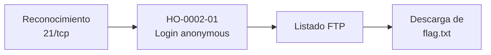

# Informe de Prueba de Penetración — Fawn

| | |
|---|---|
| **ID de informe** | HO-0002-00 |
| **Objetivo** | Fawn (`10.129.1.14`) |
| **Plataforma** | Hack The Box — Starting Point (Tier 0) |
| **Tipo de prueba** | Caja negra (black box) |
| **Fecha de ejecución** | 2026-10-17 |
| **Autor** | Francisco Nieto — [@NiettoFrann](https://github.com/NiettoFrann) |
| **Versión** | 1.0 |
| **Clasificación** | Público — uso educativo |

> **Aviso legal.** Las pruebas se realizaron sobre un entorno de laboratorio autorizado
> (Hack The Box). Ninguna técnica descrita debe aplicarse sobre sistemas sin autorización
> expresa por escrito de su propietario.

### Control de versiones

| Versión | Fecha | Descripción |
|---------|-------|-------------|
| 1.0 | 2026-10-17 | Versión inicial |

---

## Índice

1. [Resumen ejecutivo](#1-resumen-ejecutivo)
2. [Alcance y metodología](#2-alcance-y-metodología)
3. [Narrativa del ataque](#3-narrativa-del-ataque)
4. [Hallazgos técnicos](#4-hallazgos-técnicos)
5. [Post-explotación](#5-post-explotación)
6. [Conclusiones](#6-conclusiones)
7. [Anexos](#7-anexos)

---

## 1. Resumen ejecutivo

### 1.1 Objetivo

Evaluar la seguridad del host **Fawn** simulando un atacante externo sin credenciales ni
conocimiento previo del entorno, con el fin de obtener el máximo nivel de acceso posible.

### 1.2 Resultado

> El servidor ofrece un servicio de transferencia de archivos que permite entrar sin
> usuario ni contraseña. Cualquier persona con acceso a la red puede ver y descargar los
> archivos que allí se almacenan; en este caso, un archivo con información reservada. Un
> atacante real podría robar información que el propietario no pretendía publicar y,
> según la configuración, eventualmente subir archivos propios.

**Nivel de riesgo global:** `ALTO`

### 1.3 Distribución de hallazgos

| Crítica | Alta | Media | Baja | Informativa |
|:-------:|:----:|:-----:|:----:|:-----------:|
| 0 | 2 | 1 | 0 | 0 |

### 1.4 Resumen de hallazgos

| ID | Hallazgo | Severidad | CVSS |
|----|----------|-----------|------|
| [HO-0002-01](#ho-0002-01--acceso-ftp-anónimo-habilitado) | Acceso FTP anónimo habilitado | Alta | 7.5 |
| [HO-0002-02](#ho-0002-02--versión-de-vsftpd-afectada-por-cve-2021-30047) | Versión de vsftpd afectada por CVE-2021-30047 | Alta | 7.5 |
| [HO-0002-03](#ho-0002-03--tráfico-ftp-sin-cifrar) | Tráfico FTP sin cifrar | Media | 5.9 |

### 1.5 Recomendaciones prioritarias

1. Deshabilitar el acceso anónimo (`anonymous_enable=NO`) salvo necesidad justificada.
2. Sustituir FTP por SFTP o FTPS y actualizar `vsftpd`.
3. Restringir el puerto 21 por firewall y no almacenar información sensible en el FTP.

---

## 2. Alcance y metodología

### 2.1 Alcance

| Activo | Dirección | Incluido |
|--------|-----------|:--------:|
| Fawn | `10.129.1.14` | Sí |

**Fuera de alcance:** ataques de denegación de servicio, infraestructura de la
plataforma y otros jugadores.

### 2.2 Metodología

La prueba siguió las fases del estándar **PTES** (Penetration Testing Execution
Standard):

1. **Reconocimiento** — descubrimiento de puertos y servicios.
2. **Enumeración** — identificación de versiones y superficie de ataque.
3. **Análisis de vulnerabilidades** — validación manual de posibles fallos.
4. **Explotación** — obtención de acceso inicial.
5. **Post-explotación** — recolección de evidencia.
6. **Reporte** — documentación de hallazgos y recomendaciones.

### 2.3 Entorno del auditor

| Componente | Detalle |
|------------|---------|
| Sistema | Linux (kernel 7.2.11-zen1-1-zen) |
| Conexión | VPN de Hack The Box |
| Herramientas | ping, nmap 7.991, ftp |

### 2.4 Clasificación de severidad

Las vulnerabilidades se puntúan con **CVSS v3.1** (ver tabla de criterios estándar).

---

## 3. Narrativa del ataque

### 3.1 Cadena de compromiso



### 3.2 Reconocimiento

Verificación de conectividad:

```bash
ping -c 1 10.129.1.14 | tee loot/ping.txt
```

El TTL de respuesta es 63; los sistemas Linux parten de 64 y el valor restante indica un
salto intermedio (VPN), por lo que se infiere un sistema **Linux**.

Descubrimiento de puertos abiertos:

```bash
nmap -p- --min-rate=5000 -T4 -Pn -n 10.129.1.14 -oN loot/puertos.txt
```

Detección de servicios y versiones:

```bash
nmap -p21 -sCV -Pn -n -T4 10.129.1.14 -oN loot/detallado.txt
```

| Puerto | Servicio | Versión | Observaciones |
|--------|----------|---------|---------------|
| 21/tcp | FTP | vsftpd 3.0.3 | Login anónimo permitido; control y datos en texto plano. |

> Salida completa en el [Anexo A](#a-salida-completa-de-escaneos).

### 3.3 Enumeración

La salida de `nmap` (script `ftp-anon`) indica que el login anónimo está permitido (código
FTP 230) y lista un archivo en la raíz: `flag.txt`, propiedad de root, legible por todos
y de 32 bytes. También informa que las conexiones de control y de datos no están
cifradas.

Se verificó el acceso de forma manual:

```bash
ftp 10.129.1.14
# Name: anonymous
# Password: (vacía)
ftp> ls
```

Sobre la versión `vsftpd 3.0.3` se identificó el **CVE-2021-30047**, que permite una
denegación de servicio por agotamiento de recursos. No otorga acceso ni ejecución de
código, por lo que se descartó para la intrusión y no se probó. La puerta trasera de
`vsftpd 2.3.4` no aplica a esta versión.

### 3.4 Acceso inicial

Autenticación como `anonymous` y descarga de `flag.txt`. Ver
**[HO-0002-01](#ho-0002-01--acceso-ftp-anónimo-habilitado)**.

### 3.5 Movimiento lateral

No aplica.

### 3.6 Escalada de privilegios

No aplica: el objetivo de la máquina se cumple con el acceso anónimo inicial y no se
obtuvo una shell en el sistema.

---

## 4. Hallazgos técnicos

### HO-0002-01 — Acceso FTP anónimo habilitado

| | |
|---|---|
| **Severidad** | Alta |
| **CVSS v3.1** | 7.5 — `CVSS:3.1/AV:N/AC:L/PR:N/UI:N/S:U/C:H/I:N/A:N` |
| **CWE** | [CWE-284](https://cwe.mitre.org/data/definitions/284.html) — Improper Access Control |
| **CVE** | — |
| **Componente afectado** | `ftp://10.129.1.14:21` — vsftpd 3.0.3 |
| **Estado** | Explotada |

#### Descripción

El servidor vsftpd acepta el usuario `anonymous` sin contraseña y expone archivos de la
raíz a cualquier visitante. La causa raíz es una configuración insegura (acceso anónimo
habilitado), no un fallo de software.

**Justificación del vector:** acceso por red, sin autenticación ni interacción y con
pérdida total de confidencialidad sobre los archivos expuestos. No se probó la escritura,
por lo que la integridad se considera sin impacto.

#### Prueba de concepto

**Paso 1.** Conexión y autenticación anónima.

```bash
ftp 10.129.1.14
# Name: anonymous
```

**Paso 2.** Listado y descarga del archivo.

```bash
ftp> ls
ftp> get flag.txt
ftp> bye
```

**Paso 3.** Lectura local de la flag.

```bash
cat flag.txt
```

#### Impacto

- **Confidencialidad:** lectura de cualquier archivo ubicado en el área anónima.
- **Integridad / disponibilidad:** no verificadas; dependen de si el servidor permite
  escritura anónima.

#### Remediación

- **Corto plazo:** establecer `anonymous_enable=NO` en `vsftpd.conf`.
- **Largo plazo:** si el FTP debe ser público, limitarlo a solo lectura sobre un
  directorio sin información sensible y restringir el puerto 21 por firewall.

#### Referencias

- [CWE-284 — Improper Access Control](https://cwe.mitre.org/data/definitions/284.html)
- [CWE-287 — Improper Authentication](https://cwe.mitre.org/data/definitions/287.html)
- [vsftpd — sitio oficial](https://security.appspot.com/vsftpd.html)

---

### HO-0002-02 — Versión de vsftpd afectada por CVE-2021-30047

| | |
|---|---|
| **Severidad** | Alta |
| **CVSS v3.1** | 7.5 — `CVSS:3.1/AV:N/AC:L/PR:N/UI:N/S:U/C:N/I:N/A:H` |
| **CWE** | [CWE-400](https://cwe.mitre.org/data/definitions/400.html) — Uncontrolled Resource Consumption |
| **CVE** | [CVE-2021-30047](https://www.cve.org/CVERecord?id=CVE-2021-30047) |
| **Componente afectado** | `vsftpd 3.0.3` — `10.129.1.14:21` |
| **Estado** | Identificada, no explotada |

#### Descripción

La versión `vsftpd 3.0.3`, detectada por `nmap`, está afectada por una denegación de
servicio por agotamiento de recursos. La causa raíz es el uso de un software sin
actualizar. Esta debilidad no fue probada para no afectar la disponibilidad del
laboratorio y no contribuye a la intrusión.

#### Prueba de concepto

No se ejecutó. La versión se obtuvo de la detección de servicios:

```bash
nmap -p21 -sCV -Pn -n -T4 10.129.1.14 -oN loot/detallado.txt
```

#### Impacto

- **Disponibilidad:** un atacante remoto sin autenticación podría dejar el servicio FTP
  fuera de línea.

#### Remediación

- **Corto plazo:** actualizar `vsftpd` a una versión corregida.
- **Largo plazo:** mantener un proceso de gestión de parches para los servicios expuestos.

#### Referencias

- [CVE-2021-30047](https://www.cve.org/CVERecord?id=CVE-2021-30047)

---

### HO-0002-03 — Tráfico FTP sin cifrar

| | |
|---|---|
| **Severidad** | Media |
| **CVSS v3.1** | 5.9 — `CVSS:3.1/AV:N/AC:H/PR:N/UI:N/S:U/C:H/I:N/A:N` |
| **CWE** | [CWE-319](https://cwe.mitre.org/data/definitions/319.html) — Cleartext Transmission of Sensitive Information |
| **CVE** | — |
| **Componente afectado** | `ftp://10.129.1.14:21` — vsftpd 3.0.3 |
| **Estado** | Identificada |

#### Descripción

La salida de `ftp-syst` confirma `Control connection is plain text` y
`Data connections will be plain text`: el servicio no ofrece TLS, de modo que
credenciales y datos viajan sin cifrar.

**Justificación del vector:** requiere posición de intermediario en la red
(`AC:H`), de ahí la complejidad alta.

#### Prueba de concepto

Observado en la salida de `nmap -sCV` (ver [Anexo A](#a-salida-completa-de-escaneos)).

#### Impacto

- **Confidencialidad:** un atacante con visibilidad del tráfico podría capturar
  credenciales y contenido transferido.

#### Remediación

- **Corto plazo:** habilitar FTPS (TLS) en vsftpd.
- **Largo plazo:** reemplazar FTP por SFTP.

#### Referencias

- [CWE-319](https://cwe.mitre.org/data/definitions/319.html)

---

## 5. Post-explotación

### 5.1 Acceso obtenido

| Nivel | Usuario | Método | Prueba |
|-------|---------|--------|--------|
| Lectura FTP | `anonymous` | HO-0002-01 | `flag.txt` — `035db21c************************` |

> Fawn pertenece a Starting Point: solo existe una flag y no hay `user.txt` / `root.txt`.

### 5.2 Información sensible expuesta

| Tipo | Ubicación | Observación |
|------|-----------|-------------|
| Archivo reservado | FTP anónimo — `/flag.txt` | Legible por cualquier visitante. |

> Las flags se muestran parcialmente censuradas.

### 5.3 Limpieza

| Artefacto | Ubicación | Estado |
|-----------|-----------|--------|
| `flag.txt` descargada | Equipo del auditor — `loot/flag.txt` | Conservada como evidencia. |

---

## 6. Conclusiones

### 6.1 Conclusión técnica

La postura de seguridad falló por una configuración permisiva: el servicio FTP acepta
sesiones anónimas y expone un archivo reservado. No hizo falta explotar ninguna
vulnerabilidad de software; el CVE existente solo permite denegación de servicio y no
aportaba a la intrusión.

### 6.2 Aprendizajes del auditor

- Probar siempre el login `anonymous` ante un FTP expuesto; `nmap -sC` lo detecta con
  `ftp-anon`.
- Una configuración insegura puede ser más grave que una versión vulnerable.
- Escanear primero todos los puertos y profundizar solo en los abiertos ahorra tiempo.

---

## 7. Anexos

### A. Salida completa de escaneos

<details>
<summary>nmap — todos los puertos</summary>

```text
# Nmap 7.991 scan initiated Sat Oct 17 12:07:08 2026 as: nmap -p- --min-rate=5000 -T4 -Pn -n -oN puertos.txt 10.129.1.14
Nmap scan report for 10.129.1.14
Host is up (0.23s latency).
Not shown: 65534 closed tcp ports (conn-refused)
PORT   STATE SERVICE
21/tcp open  ftp

# Nmap done at Sat Oct 17 12:07:26 2026 -- 1 IP address (1 host up) scanned in 17.72 seconds
```

</details>

<details>
<summary>nmap — escaneo de servicios</summary>

```text
# Nmap 7.991 scan initiated Sat Oct 17 12:07:50 2026 as: nmap -p21 -sCV -Pn -n -T4 -oN detallado.txt 10.129.1.14
Nmap scan report for 10.129.1.14
Host is up (0.24s latency).

PORT   STATE SERVICE VERSION
21/tcp open  ftp     vsftpd 3.0.3
| ftp-anon: Anonymous FTP login allowed (FTP code 230)
|_-rw-r--r--    1 0        0              32 Jun 04  2021 flag.txt
| ftp-syst: 
|   STAT: 
| FTP server status:
|      Connected to ::ffff:10.10.14.175
|      Logged in as ftp
|      TYPE: ASCII
|      No session bandwidth limit
|      Session timeout in seconds is 300
|      Control connection is plain text
|      Data connections will be plain text
|      At session startup, client count was 1
|      vsFTPd 3.0.3 - secure, fast, stable
|_End of status
Service Info: OS: Unix

Service detection performed. Please report any incorrect results at https://nmap.org/submit/ .
# Nmap done at Sat Oct 17 12:07:57 2026 -- 1 IP address (1 host up) scanned in 6.24 seconds
```

</details>

### B. Scripts y exploits

No se utilizaron scripts ni exploits.

### C. Mapeo MITRE ATT&CK

| Táctica | Técnica | ID |
|---------|---------|----|
| Initial Access | Valid Accounts: Default Accounts | [T1078.001](https://attack.mitre.org/techniques/T1078/001/) |
| Collection | Data from Information Repositories | [T1213](https://attack.mitre.org/techniques/T1213/) |

### D. Referencias generales

- [Página de la máquina en HTB](https://app.hackthebox.com/machines/Fawn)
- [PTES — Penetration Testing Execution Standard](http://www.pentest-standard.org/)
- [Calculadora CVSS v3.1 — FIRST](https://www.first.org/cvss/calculator/3.1)
- [MITRE ATT&CK](https://attack.mitre.org/)
