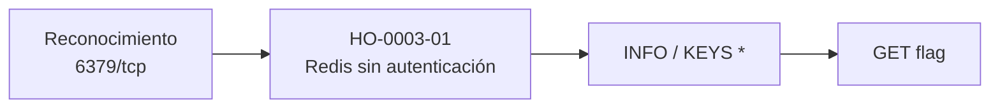

# Informe de Prueba de Penetración — Redeemer

| | |
|---|---|
| **ID de informe** | HO-0003-00 |
| **Objetivo** | Redeemer (`10.129.136.187`) |
| **Plataforma** | Hack The Box — Starting Point (Tier 0) |
| **Tipo de prueba** | Caja negra (black box) |
| **Fecha de ejecución** | 2026-10-17 |
| **Autor** | Francisco Nieto — [@NiettoFrann](https://github.com/NiettoFrann) |
| **Versión** | 1.0 |
| **Clasificación** | Público — uso educativo |

> **Aviso legal.** Las pruebas se realizaron sobre un entorno de laboratorio autorizado
> (Hack The Box). Ninguna técnica descrita debe aplicarse sobre sistemas sin autorización
> expresa por escrito de su propietario.

### Control de versiones

| Versión | Fecha | Descripción |
|---------|-------|-------------|
| 1.0 | 2026-10-17 | Versión inicial |

---

## Índice

1. [Resumen ejecutivo](#1-resumen-ejecutivo)
2. [Alcance y metodología](#2-alcance-y-metodología)
3. [Narrativa del ataque](#3-narrativa-del-ataque)
4. [Hallazgos técnicos](#4-hallazgos-técnicos)
5. [Post-explotación](#5-post-explotación)
6. [Conclusiones](#6-conclusiones)
7. [Anexos](#7-anexos)

---

## 1. Resumen ejecutivo

### 1.1 Objetivo

Evaluar la seguridad del host **Redeemer** simulando un atacante externo sin credenciales
ni conocimiento previo del entorno, con el fin de obtener el máximo nivel de acceso
posible.

### 1.2 Resultado

> El servidor expone una base de datos a la red sin pedir ningún tipo de contraseña. Con
> solo conectarse, cualquier persona puede ver, modificar o borrar toda la información
> almacenada. Un atacante real podría robar datos, destruirlos o alterarlos, y en
> configuraciones más permisivas podría llegar a tomar control del propio servidor.

**Nivel de riesgo global:** `CRÍTICO`

### 1.3 Distribución de hallazgos

| Crítica | Alta | Media | Baja | Informativa |
|:-------:|:----:|:-----:|:----:|:-----------:|
| 1 | 0 | 1 | 0 | 0 |

### 1.4 Resumen de hallazgos

| ID | Hallazgo | Severidad | CVSS |
|----|----------|-----------|------|
| [HO-0003-01](#ho-0003-01--redis-expuesto-sin-autenticación) | Redis expuesto sin autenticación | Crítica | 9.8 |
| [HO-0003-02](#ho-0003-02--tráfico-redis-sin-cifrar) | Tráfico Redis sin cifrar | Media | 5.9 |

### 1.5 Recomendaciones prioritarias

1. Configurar `requirepass` (o ACLs en Redis 6+) con una contraseña robusta.
2. Vincular Redis a una interfaz interna (`bind 127.0.0.1`) y restringir el puerto 6379 por firewall.
3. Cifrar el tráfico (TLS o túnel SSH/VPN) y deshabilitar comandos peligrosos con `rename-command`.

---

## 2. Alcance y metodología

### 2.1 Alcance

| Activo | Dirección | Incluido |
|--------|-----------|:--------:|
| Redeemer | `10.129.136.187` | Sí |

**Fuera de alcance:** ataques de denegación de servicio, infraestructura de la
plataforma y otros jugadores.

### 2.2 Metodología

La prueba siguió las fases del estándar **PTES** (Penetration Testing Execution
Standard):

1. **Reconocimiento** — descubrimiento de puertos y servicios.
2. **Enumeración** — identificación de versiones y superficie de ataque.
3. **Análisis de vulnerabilidades** — validación manual de posibles fallos.
4. **Explotación** — obtención de acceso inicial.
5. **Post-explotación** — recolección de evidencia.
6. **Reporte** — documentación de hallazgos y recomendaciones.

### 2.3 Entorno del auditor

| Componente | Detalle |
|------------|---------|
| Sistema | Linux (kernel 7.2.11-zen1-1-zen) |
| Conexión | VPN de Hack The Box |
| Herramientas | ping, nmap 7.991, redis-cli |

### 2.4 Clasificación de severidad

Las vulnerabilidades se puntúan con **CVSS v3.1** (ver tabla de criterios estándar).

---

## 3. Narrativa del ataque

### 3.1 Cadena de compromiso



### 3.2 Reconocimiento

Verificación de conectividad:

```bash
ping -c 1 10.129.136.187 | tee loot/ping.txt
```

El TTL de respuesta es 63; los sistemas Linux parten de 64 y el valor restante indica un
salto intermedio (VPN), por lo que se infiere un sistema **Linux**.

Descubrimiento de puertos abiertos:

```bash
nmap -p- --min-rate=5000 -T4 -Pn -n 10.129.136.187 -oN loot/puertos.txt
```

Detección de servicios y versiones:

```bash
nmap -p6379 -sCV -Pn -n -T4 10.129.136.187 -oN loot/detallado.txt
```

| Puerto | Servicio | Versión | Observaciones |
|--------|----------|---------|---------------|
| 6379/tcp | Redis | Redis key-value store 5.0.7 | Único puerto abierto; principal superficie de ataque. |

> Salida completa en el [Anexo A](#a-salida-completa-de-escaneos).

### 3.3 Enumeración

Se utilizó `redis-cli` para comprobar si el servicio exigía autenticación:

```bash
redis-cli -h 10.129.136.187 -p 6379
10.129.136.187:6379> info
```

El comando `INFO` se ejecutó sin solicitar credenciales. Reveló `redis_version:5.0.7`,
`os:Linux 5.4.0-77-generic x86_64` y `config_file:/etc/redis/redis.conf`, además de que la
base de datos 0 contiene 4 claves (`db0:keys=4`).

### 3.4 Acceso inicial

Listado de claves y lectura de la clave `flag`. Ver
**[HO-0003-01](#ho-0003-01--redis-expuesto-sin-autenticación)**.

### 3.5 Movimiento lateral

No aplica.

### 3.6 Escalada de privilegios

No aplica: el objetivo de la máquina se cumple con el acceso no autenticado a Redis y no
se obtuvo una shell en el sistema.

---

## 4. Hallazgos técnicos

### HO-0003-01 — Redis expuesto sin autenticación

| | |
|---|---|
| **Severidad** | Crítica |
| **CVSS v3.1** | 9.8 — `CVSS:3.1/AV:N/AC:L/PR:N/UI:N/S:U/C:H/I:H/A:H` |
| **CWE** | [CWE-306](https://cwe.mitre.org/data/definitions/306.html) — Missing Authentication for Critical Function |
| **CVE** | — |
| **Componente afectado** | Redis 5.0.7 — `10.129.136.187:6379/tcp` |
| **Estado** | Explotada |

#### Descripción

La instancia de Redis acepta conexiones desde la red sin exigir contraseña: no está
configurada la directiva `requirepass` y el servicio no está limitado a una interfaz
interna. La causa raíz es una configuración insegura, no un fallo de software.

**Justificación del vector:** acceso por red, sin autenticación ni interacción y con
control completo de lectura y escritura sobre los datos y capacidad de afectar la
disponibilidad (por ejemplo, con comandos de borrado).

#### Prueba de concepto

**Paso 1.** Conexión sin credenciales y consulta de información del servidor.

```bash
redis-cli -h 10.129.136.187 -p 6379
10.129.136.187:6379> info
```

**Paso 2.** Selección de la base de datos y enumeración de claves.

```bash
10.129.136.187:6379> select 0
OK
10.129.136.187:6379> keys *
1) "temp"
2) "stor"
3) "numb"
4) "flag"
```

**Paso 3.** Lectura de la clave `flag`.

```bash
10.129.136.187:6379> get flag
```

#### Impacto

- **Confidencialidad:** lectura de todos los datos almacenados.
- **Integridad:** modificación de cualquier clave.
- **Disponibilidad:** borrado de datos.
- **Escalada potencial (no probada):** abuso de `CONFIG SET dir` / `dbfilename` para escribir
  un `authorized_keys` o un webshell, o `MODULE LOAD`, lo que permitiría ejecución remota
  de código.

#### Remediación

- **Corto plazo:** configurar `requirepass` (o ACLs) con una contraseña robusta y bloquear
  el puerto 6379 por firewall.
- **Largo plazo:** vincular Redis a `127.0.0.1` o a una red interna, deshabilitar
  comandos peligrosos (`CONFIG`, `FLUSHALL`, `MODULE LOAD`) con `rename-command` y no
  almacenar información sensible en claro.

#### Referencias

- [Redis — Security](https://redis.io/docs/management/security/)
- [CWE-306 — Missing Authentication for Critical Function](https://cwe.mitre.org/data/definitions/306.html)
- [HackTricks — Pentesting Redis](https://book.hacktricks.xyz/network-services-pentesting/6379-pentesting-redis)

---

### HO-0003-02 — Tráfico Redis sin cifrar

| | |
|---|---|
| **Severidad** | Media |
| **CVSS v3.1** | 5.9 — `CVSS:3.1/AV:N/AC:H/PR:N/UI:N/S:U/C:H/I:N/A:N` |
| **CWE** | [CWE-319](https://cwe.mitre.org/data/definitions/319.html) — Cleartext Transmission of Sensitive Information |
| **CVE** | — |
| **Componente afectado** | Redis 5.0.7 — `10.129.136.187:6379/tcp` |
| **Estado** | Identificada |

#### Descripción

Redis transmite comandos y datos sin cifrar. TLS no está disponible en la versión
5.0.7 (se incorporó en Redis 6). Esto fue inferido de la versión detectada y no se
verificó con una captura de tráfico.

**Justificación del vector:** requiere posición de intermediario en la red (`AC:H`).

#### Prueba de concepto

Versión obtenida de `nmap -sCV` e `INFO` (ver [Anexo A](#a-salida-completa-de-escaneos)).

#### Impacto

- **Confidencialidad:** un atacante con visibilidad del tráfico podría leer contenido y
  credenciales si se configuraran.

#### Remediación

- **Corto plazo:** acceder a Redis solo a través de un túnel SSH o VPN.
- **Largo plazo:** actualizar a una versión con soporte TLS y habilitarlo.

#### Referencias

- [Redis — TLS](https://redis.io/docs/management/security/encryption/)

---

## 5. Post-explotación

### 5.1 Acceso obtenido

| Nivel | Usuario | Método | Prueba |
|-------|---------|--------|--------|
| Datos Redis (sin shell) | — | HO-0003-01 | clave `flag` — `03e1d2b3************************` |

> Redeemer pertenece a Starting Point: solo existe una flag y no hay `user.txt` / `root.txt`.

### 5.2 Información sensible expuesta

| Tipo | Ubicación | Observación |
|------|-----------|-------------|
| Datos de aplicación | Redis db0 — claves `temp`, `stor`, `numb`, `flag` | Legibles sin autenticación. |
| Información del sistema | Salida de `INFO` | Versión del servicio, kernel y ruta de configuración. |

> Las flags se muestran parcialmente censuradas.

### 5.3 Limpieza

| Artefacto | Ubicación | Estado |
|-----------|-----------|--------|
| — | — | No se escribieron claves ni archivos en el objetivo. |

---

## 6. Conclusiones

### 6.1 Conclusión técnica

El compromiso se debió a un servicio de base de datos expuesto a la red sin
autenticación. Bastó con `INFO` y `KEYS *` para enumerar y leer la información; no fue
necesario ningún exploit.

### 6.2 Aprendizajes del auditor

- Redis no exige autenticación por defecto: ante el puerto 6379 conviene probar
  `redis-cli` directamente.
- `INFO` y `KEYS *` bastan para una enumeración rápida.
- El TTL del `ping` da una pista rápida del SO (64 ≈ Linux, 128 ≈ Windows).

---

## 7. Anexos

### A. Salida completa de escaneos

<details>
<summary>nmap — todos los puertos</summary>

```text
# Nmap 7.991 scan initiated Sat Oct 17 12:57:01 2026 as: nmap -p- --min-rate=5000 -T4 -Pn -n -oN puertos.txt 10.129.136.187
Nmap scan report for 10.129.136.187
Host is up (0.24s latency).
Not shown: 65534 closed tcp ports (conn-refused)
PORT     STATE SERVICE
6379/tcp open  redis

# Nmap done at Sat Oct 17 12:57:20 2026 -- 1 IP address (1 host up) scanned in 18.47 seconds
```

</details>

<details>
<summary>nmap — escaneo de servicios</summary>

```text
# Nmap 7.991 scan initiated Sat Oct 17 12:58:22 2026 as: nmap -p6379 -sCV -Pn -n -T4 -oN detallado.txt 10.129.136.187
Nmap scan report for 10.129.136.187
Host is up (0.24s latency).

PORT     STATE SERVICE VERSION
6379/tcp open  redis   Redis key-value store 5.0.7

Service detection performed. Please report any incorrect results at https://nmap.org/submit/ .
# Nmap done at Sat Oct 17 12:58:29 2026 -- 1 IP address (1 host up) scanned in 7.44 seconds
```

</details>

<details>
<summary>redis-cli — sesión completa (INFO, KEYS, GET)</summary>

Disponible en [`loot/redis.txt`](loot/redis.txt).

</details>

### B. Scripts y exploits

No se utilizaron scripts ni exploits.

### C. Mapeo MITRE ATT&CK

| Táctica | Técnica | ID |
|---------|---------|----|
| Initial Access | Exploit Public-Facing Application | [T1190](https://attack.mitre.org/techniques/T1190/) |
| Discovery | System Information Discovery | [T1082](https://attack.mitre.org/techniques/T1082/) |
| Collection | Data from Information Repositories | [T1213](https://attack.mitre.org/techniques/T1213/) |

### D. Referencias generales

- [Página de la máquina en HTB](https://app.hackthebox.com/machines/Redeemer)
- [PTES — Penetration Testing Execution Standard](http://www.pentest-standard.org/)
- [Calculadora CVSS v3.1 — FIRST](https://www.first.org/cvss/calculator/3.1)
- [MITRE ATT&CK](https://attack.mitre.org/)
