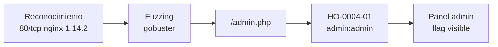

# Informe de Prueba de Penetración — Preignition

| | |
|---|---|
| **ID de informe** | HO-0004-00 |
| **Objetivo** | Preignition (`10.129.58.34`) |
| **Plataforma** | Hack The Box — Starting Point (Tier 0) |
| **Tipo de prueba** | Caja negra (black box) |
| **Fecha de ejecución** | 2026-10-17 |
| **Autor** | Francisco Nieto — [@NiettoFrann](https://github.com/NiettoFrann) |
| **Versión** | 1.0 |
| **Clasificación** | Público — uso educativo |

> **Aviso legal.** Las pruebas se realizaron sobre un entorno de laboratorio autorizado
> (Hack The Box). Ninguna técnica descrita debe aplicarse sobre sistemas sin autorización
> expresa por escrito de su propietario.

### Control de versiones

| Versión | Fecha | Descripción |
|---------|-------|-------------|
| 1.0 | 2026-10-17 | Versión inicial |

---

## Índice

1. [Resumen ejecutivo](#1-resumen-ejecutivo)
2. [Alcance y metodología](#2-alcance-y-metodología)
3. [Narrativa del ataque](#3-narrativa-del-ataque)
4. [Hallazgos técnicos](#4-hallazgos-técnicos)
5. [Post-explotación](#5-post-explotación)
6. [Conclusiones](#6-conclusiones)
7. [Anexos](#7-anexos)

---

## 1. Resumen ejecutivo

### 1.1 Objetivo

Evaluar la seguridad del host **Preignition** simulando un atacante externo sin
credenciales ni conocimiento previo del entorno, con el fin de obtener el máximo nivel de
acceso posible.

### 1.2 Resultado

> El servidor publica un sitio web cuya portada es genérica, pero que incluye un panel de
> administración oculto, no enlazado desde ninguna página. Ese panel está protegido con
> el usuario y la contraseña más comunes (`admin`/`admin`), por lo que cualquiera que lo
> encuentre puede entrar. Un atacante real podría manipular la aplicación y acceder a su
> información con privilegios de administrador.

**Nivel de riesgo global:** `CRÍTICO`

### 1.3 Distribución de hallazgos

| Crítica | Alta | Media | Baja | Informativa |
|:-------:|:----:|:-----:|:----:|:-----------:|
| 1 | 0 | 0 | 0 | 0 |

### 1.4 Resumen de hallazgos

| ID | Hallazgo | Severidad | CVSS |
|----|----------|-----------|------|
| [HO-0004-01](#ho-0004-01--panel-de-administración-con-credenciales-por-defecto) | Panel de administración con credenciales por defecto | Crítica | 9.8 |

### 1.5 Recomendaciones prioritarias

1. Cambiar de inmediato las credenciales por defecto y exigir contraseñas robustas con bloqueo tras intentos fallidos.
2. Restringir el acceso al panel de administración por VPN, firewall o lista de IP permitidas.
3. No depender de ocultar rutas como medida de seguridad; añadir autenticación multifactor.

---

## 2. Alcance y metodología

### 2.1 Alcance

| Activo | Dirección | Incluido |
|--------|-----------|:--------:|
| Preignition | `10.129.58.34` | Sí |

**Fuera de alcance:** ataques de denegación de servicio, infraestructura de la
plataforma y otros jugadores.

### 2.2 Metodología

La prueba siguió las fases del estándar **PTES** (Penetration Testing Execution
Standard), apoyándose en **OWASP WSTG** para los componentes web:

1. **Reconocimiento** — descubrimiento de puertos y servicios.
2. **Enumeración** — identificación de versiones y contenido web oculto.
3. **Análisis de vulnerabilidades** — validación manual de autenticación débil.
4. **Explotación** — obtención de acceso inicial.
5. **Post-explotación** — recolección de evidencia.
6. **Reporte** — documentación de hallazgos y recomendaciones.

### 2.3 Entorno del auditor

| Componente | Detalle |
|------------|---------|
| Sistema | Linux (kernel 7.2.11-zen1-1-zen) |
| Conexión | VPN de Hack The Box |
| Herramientas | ping, nmap 7.991, gobuster 3.8.2, navegador web |

### 2.4 Clasificación de severidad

Las vulnerabilidades se puntúan con **CVSS v3.1** (ver tabla de criterios estándar).

---

## 3. Narrativa del ataque

### 3.1 Cadena de compromiso



### 3.2 Reconocimiento

Verificación de conectividad:

```bash
ping -c 1 10.129.58.34 | tee loot/ping.txt
```

El TTL de respuesta es 63; los sistemas Linux parten de 64 y el valor restante indica un
salto intermedio (VPN), por lo que se infiere un sistema **Linux**.

Descubrimiento de puertos abiertos:

```bash
nmap -p- --min-rate=5000 -T4 -Pn -n 10.129.58.34 -oN loot/puertos.txt
```

Detección de servicios y versiones:

```bash
nmap -p80 -sCV -Pn -n -T4 10.129.58.34 -oN loot/detallado.txt
```

| Puerto | Servicio | Versión | Observaciones |
|--------|----------|---------|---------------|
| 80/tcp | HTTP | nginx 1.14.2 | Único puerto abierto; muestra la página por defecto «Welcome to nginx!». |

> Salida completa en el [Anexo A](#a-salida-completa-de-escaneos).

### 3.3 Enumeración

La raíz web solo muestra la página por defecto de nginx, lo que no descarta contenido en
otras rutas. Se buscaron archivos y directorios ocultos con `gobuster`, incluyendo la
extensión `.php` ante la posibilidad de una aplicación PHP:

```bash
gobuster dir -u http://10.129.58.34 \
  -w /usr/share/seclists/Discovery/Web-Content/DirBuster-2007_directory-list-2.3-medium.txt \
  -x php -t 200
```

```text
admin.php            (Status: 200) [Size: 999]
```

Se descubrió `/admin.php`, accesible (código 200) y no enlazado desde ninguna página
visible. Al abrirlo en el navegador se encontró un formulario de inicio de sesión de
administrador. El escaneo se interrumpió manualmente tras el hallazgo (0.27 % del
diccionario), por lo que no se enumeró el resto de rutas.

### 3.4 Acceso inicial

Autenticación en el panel con `admin:admin`. Ver
**[HO-0004-01](#ho-0004-01--panel-de-administración-con-credenciales-por-defecto)**.

### 3.5 Movimiento lateral

No aplica.

### 3.6 Escalada de privilegios

No aplica: el objetivo de la máquina se cumple con el acceso al panel y no se obtuvo una
shell en el sistema.

---

## 4. Hallazgos técnicos

### HO-0004-01 — Panel de administración con credenciales por defecto

| | |
|---|---|
| **Severidad** | Crítica |
| **CVSS v3.1** | 9.8 — `CVSS:3.1/AV:N/AC:L/PR:N/UI:N/S:U/C:H/I:H/A:H` |
| **CWE** | [CWE-1392](https://cwe.mitre.org/data/definitions/1392.html) — Use of Default Credentials |
| **CVE** | — |
| **Componente afectado** | `http://10.129.58.34/admin.php` |
| **Estado** | Explotada |

#### Descripción

El panel `/admin.php` está protegido por credenciales triviales (`admin` / `admin`). La
causa raíz es que no se cambiaron las credenciales por defecto antes de publicar la
aplicación y que se confió en que la ruta no estuviera enlazada como única barrera
(*security by obscurity*). Tampoco se observó un segundo factor de autenticación.

**Justificación del vector:** acceso por red, sin autenticación previa ni interacción. El
puntaje asume control administrativo completo de la aplicación; las funciones del panel
no se exploraron más allá de la lectura de la flag.

#### Prueba de concepto

**Paso 1.** Descubrir el panel mediante fuzzing de rutas (ver sección 3.3).

**Paso 2.** Abrir `http://10.129.58.34/admin.php` e ingresar las credenciales:

```text
Usuario:    admin
Contraseña: admin
```

**Paso 3.** El acceso es aceptado y el panel muestra la flag directamente en la página.

#### Impacto

- **Confidencialidad:** acceso a la información que gestiona el panel.
- **Integridad:** posibilidad de modificar contenido o configuración de la aplicación
  (no verificada).
- **Disponibilidad:** posibilidad de alterar el funcionamiento de la aplicación
  (no verificada).

#### Remediación

- **Corto plazo:** cambiar las credenciales por defecto y exigir una contraseña robusta
  con política de bloqueo tras intentos fallidos.
- **Largo plazo:** restringir el panel por VPN, firewall o lista de IP, añadir
  autenticación multifactor y proteger cada endpoint con autenticación real en lugar de
  depender de rutas no enlazadas.

#### Referencias

- [CWE-1392 — Use of Default Credentials](https://cwe.mitre.org/data/definitions/1392.html)
- [CWE-521 — Weak Password Requirements](https://cwe.mitre.org/data/definitions/521.html)
- [OWASP WSTG — Testing for Default Credentials](https://owasp.org/www-project-web-security-testing-guide/latest/4-Web_Application_Security_Testing/04-Authentication_Testing/02-Testing_for_Default_Credentials)

---

## 5. Post-explotación

### 5.1 Acceso obtenido

| Nivel | Usuario | Método | Prueba |
|-------|---------|--------|--------|
| Administrador de aplicación | `admin` | HO-0004-01 | `flag` — `6483bee0************************` |

> Preignition pertenece a Starting Point: solo existe una flag y no hay `user.txt` / `root.txt`.

### 5.2 Información sensible expuesta

| Tipo | Ubicación | Observación |
|------|-----------|-------------|
| Credenciales por defecto | `/admin.php` | `admin:admin` (valor por defecto). |
| Flag | Panel de administración | Visible tras autenticarse. |

> Las credenciales y flags se muestran parcialmente censuradas cuando corresponde.

### 5.3 Limpieza

| Artefacto | Ubicación | Estado |
|-----------|-----------|--------|
| — | — | No se cargaron archivos ni herramientas en el objetivo. |

---

## 6. Conclusiones

### 6.1 Conclusión técnica

La exposición se debió a una falla de gestión de credenciales: un panel administrativo
publicado con usuario y contraseña por defecto, protegido solo por no estar enlazado. Un
simple fuzzing de rutas bastó para descubrirlo y una credencial trivial para entrar; no se
explotó ninguna vulnerabilidad de software.

### 6.2 Aprendizajes del auditor

- Cuando la raíz web no aporta información, el fuzzing de rutas y extensiones suele
  revelar paneles ocultos.
- Probar credenciales triviales (`admin:admin`, `admin:password`) antes de buscar
  vulnerabilidades complejas.
- Dejar correr `gobuster` completo habría enumerado más superficie; aquí se detuvo al
  encontrar el objetivo.

---

## 7. Anexos

### A. Salida completa de escaneos

<details>
<summary>nmap — todos los puertos</summary>

```text
# Nmap 7.991 scan initiated Sat Oct 17 14:32:08 2026 as: nmap -p- --min-rate=5000 -T4 -Pn -n -oN puertos.txt 10.129.58.34
Nmap scan report for 10.129.58.34
Host is up (0.24s latency).
Not shown: 65534 closed tcp ports (conn-refused)
PORT   STATE SERVICE
80/tcp open  http

# Nmap done at Sat Oct 17 14:32:26 2026 -- 1 IP address (1 host up) scanned in 18.31 seconds
```

</details>

<details>
<summary>nmap — escaneo de servicios</summary>

```text
# Nmap 7.991 scan initiated Sat Oct 17 14:32:44 2026 as: nmap -p80 -sCV -Pn -n -T4 -oN detallado.txt 10.129.58.34
Nmap scan report for 10.129.58.34
Host is up (0.24s latency).

PORT   STATE SERVICE VERSION
80/tcp open  http    nginx 1.14.2
|_http-title: Welcome to nginx!
|_http-server-header: nginx/1.14.2

Service detection performed. Please report any incorrect results at https://nmap.org/submit/ .
# Nmap done at Sat Oct 17 14:32:56 2026 -- 1 IP address (1 host up) scanned in 12.32 seconds
```

</details>

<details>
<summary>gobuster — enumeración de rutas</summary>

```text
gobuster dir -u http://10.129.58.34 -w /usr/share/seclists/Discovery/Web-Content/DirBuster-2007_directory-list-2.3-medium.txt -x php -t 200
===============================================================
Gobuster v3.8.2
by OJ Reeves (@TheColonial) & Christian Mehlmauer (@firefart)
===============================================================
[+] Url:                     http://10.129.58.34
[+] Method:                  GET
[+] Threads:                 200
[+] Wordlist:                /usr/share/seclists/Discovery/Web-Content/DirBuster-2007_directory-list-2.3-medium.txt
[+] Negative Status codes:   404
[+] User Agent:              gobuster/3.8.2
[+] Extensions:              php
[+] Timeout:                 10s
===============================================================
Starting gobuster in directory enumeration mode
===============================================================
admin.php            (Status: 200) [Size: 999]
Progress: 1192 / 441116 (0.27%)
```

</details>

### B. Scripts y exploits

No se utilizaron scripts ni exploits.

### C. Mapeo MITRE ATT&CK

| Táctica | Técnica | ID |
|---------|---------|----|
| Discovery | Content and Directory Discovery | [T1083](https://attack.mitre.org/techniques/T1083/) |
| Initial Access | Valid Accounts: Default Accounts | [T1078.001](https://attack.mitre.org/techniques/T1078/001/) |

### D. Referencias generales

- [Página de la máquina en HTB](https://app.hackthebox.com/machines/Preignition)
- [PTES — Penetration Testing Execution Standard](http://www.pentest-standard.org/)
- [OWASP Web Security Testing Guide](https://owasp.org/www-project-web-security-testing-guide/)
- [Calculadora CVSS v3.1 — FIRST](https://www.first.org/cvss/calculator/3.1)
- [MITRE ATT&CK](https://attack.mitre.org/)
