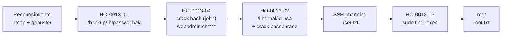

# Informe de Prueba de Penetración — Backstage

|                        |                                                                  |
| ---------------------- | ---------------------------------------------------------------- |
| **ID de informe**      | HO-0013-00                                                       |
| **Objetivo**           | Backstage (`127.0.0.1` — `helix.local`)                          |
| **Plataforma**         | Laboratorio propio — máquina Docker autocontenida                |
| **Tipo de prueba**     | Caja negra (black box)                                           |
| **Fecha de ejecución** | 2026-10-23                                                       |
| **Autor**              | Francisco Nieto — [@NiettoFrann](https://github.com/NiettoFrann) |
| **Versión**            | 1.0                                                              |
| **Clasificación**      | Público — uso educativo                                          |

> **Aviso legal.** Las pruebas se realizaron sobre un entorno de laboratorio propio,
> deliberadamente vulnerable, desplegado de forma local y aislada mediante Docker. La
> máquina fue construida por el propio autor con fines didácticos. Ninguna técnica descrita
> debe aplicarse sobre sistemas sin autorización expresa por escrito de su propietario.

### Control de versiones

| Versión | Fecha      | Descripción     |
| ------- | ---------- | --------------- |
| 1.0     | 2026-10-23 | Versión inicial |

---

## Índice

1. [Resumen ejecutivo](#1-resumen-ejecutivo)
2. [Alcance y metodología](#2-alcance-y-metodología)
3. [Narrativa del ataque](#3-narrativa-del-ataque)
4. [Hallazgos técnicos](#4-hallazgos-técnicos)
5. [Post-explotación](#5-post-explotación)
6. [Conclusiones](#6-conclusiones)
7. [Anexos](#7-anexos)

---

## 1. Resumen ejecutivo

### 1.1 Objetivo

Evaluar la seguridad del host **Backstage** simulando un atacante externo sin credenciales
ni conocimiento previo del entorno, con el fin de obtener el máximo nivel de privilegios
posible sobre el sistema.

### 1.2 Resultado

El servidor exponía una aplicación web que, por una mala configuración, dejaba accesible una
copia de respaldo de su archivo de contraseñas. A partir de ese archivo se recuperó la
contraseña de un usuario administrativo, y con ella se accedió a una zona "interna" del sitio
donde, de forma indebida, estaba guardada una clave privada de acceso remoto. Esa clave
permitió iniciar sesión en el servidor como un usuario del sistema. Finalmente, un permiso de
administrador mal otorgado permitió escalar hasta el control total de la máquina. En conjunto,
un atacante sin ninguna credencial inicial pudo tomar el control completo del servidor
encadenando cuatro descuidos de configuración habituales en entornos reales.

**Nivel de riesgo global:** `ALTO`

### 1.3 Distribución de hallazgos

| Crítica | Alta | Media | Baja | Informativa |
| :-----: | :--: | :---: | :--: | :---------: |
|    0    |  3   |   1   |  0   |      0      |

### 1.4 Resumen de hallazgos

| ID         | Hallazgo                                                               | Severidad | CVSS |
| ---------- | ---------------------------------------------------------------------- | --------- | ---- |
| HO-0013-01 | Respaldo de `.htpasswd` accesible sin autenticación en la raíz web     | Alta      | 7.5  |
| HO-0013-02 | Clave privada SSH almacenada en recurso web con passphrase débil       | Alta      | 8.8  |
| HO-0013-03 | Escalada a root por `sudo` mal configurado (`/usr/bin/find`, NOPASSWD) | Alta      | 7.8  |
| HO-0013-04 | Credencial con contraseña débil susceptible a crackeo offline          | Media     | 5.9  |

### 1.5 Recomendaciones prioritarias

1. Eliminar del _webroot_ todo archivo de respaldo (`.bak`, `.old`, `~`) y desactivar el
   listado de directorios; ningún archivo de credenciales debe ser servible por HTTP.
2. Retirar la clave privada SSH del servidor web y rotarla; las claves privadas nunca deben
   almacenarse en recursos accesibles por la aplicación, aun detrás de autenticación.
3. Restringir la configuración de `sudo`: eliminar la regla `NOPASSWD` sobre `/usr/bin/find`
   y, en general, no conceder binarios que permitan ejecución arbitraria (ver GTFOBins).

---

## 2. Alcance y metodología

### 2.1 Alcance

| Activo                    | Dirección                               | Incluido |
| ------------------------- | --------------------------------------- | :------: |
| Backstage (`helix.local`) | `127.0.0.1` (HTTP `:8080`, SSH `:2222`) |    Sí    |

**Fuera de alcance:** denegación de servicio, infraestructura del host anfitrión y cualquier
sistema distinto del contenedor del laboratorio.

### 2.2 Metodología

Prueba basada en **PTES**, apoyada en **OWASP WSTG** para los componentes web:
reconocimiento, enumeración, análisis de vulnerabilidades, explotación, post-explotación y
reporte.

### 2.3 Entorno del auditor

| Componente   | Detalle                                          |
| ------------ | ------------------------------------------------ |
| Sistema      | Linux (entorno local del auditor)                |
| Conexión     | Red local / Docker (`127.0.0.1`)                 |
| Herramientas | nmap, gobuster, john (con `ssh2john`), curl, ssh |
| Diccionarios | `rockyou.txt`, SecLists (`common.txt`)           |

### 2.4 Clasificación de severidad

Las vulnerabilidades se puntúan con **CVSS v3.1** según la tabla estándar: Crítica (9.0–10.0),
Alta (7.0–8.9), Media (4.0–6.9), Baja (0.1–3.9) e Informativa (0.0).

---

## 3. Narrativa del ataque

### 3.1 Cadena de compromiso



### 3.2 Reconocimiento

Se realizó un escaneo completo de puertos sobre el objetivo:

```bash
nmap -p- --min-rate=5000 -T4 -Pn -n 127.0.0.1
```

| Puerto   | Servicio | Versión                | Observaciones                                |
| -------- | -------- | ---------------------- | -------------------------------------------- |
| 8080/tcp | HTTP     | Apache (`helix.local`) | Principal superficie de ataque.              |
| 2222/tcp | SSH      | OpenSSH                | Sin credenciales iniciales no es utilizable. |

### 3.3 Enumeración

Se accedió al servicio web en `http://helix.local:8080` y se ejecutó fuzzing de directorios y
archivos sobre la raíz:

```bash
gobuster dir -u http://helix.local:8080 \
  -w /usr/share/seclists/Discovery/Web-Content/common.txt -t 100
```

El fuzzing reveló dos rutas de interés: **`/backup`** (con listado de directorio activo) y
**`/internal`** (protegida con autenticación HTTP _Basic Auth_). La primera se convirtió en el
punto de entrada; la segunda, en el segundo eslabón de la cadena.

<!-- 
_Figura 1 — Listado del directorio `/backup` con el respaldo del archivo de contraseñas._ -->

### 3.4 Acceso inicial

En `/backup` se encontró un respaldo del archivo `.htpasswd` que contenía el hash del usuario
`webadmin` (formato Apache MD5 / `md5crypt`). Tras crackearlo offline se obtuvo su contraseña
en claro, válida para el _Basic Auth_ de `/internal`. Dentro de esa zona se exponía una clave
privada SSH (`id_rsa`), cuyo _passphrase_ también se rompió por diccionario. Con la clave y su
_passphrase_ se inició sesión por SSH como el usuario `jmanning`.

Ver **HO-0013-01**, **HO-0013-04** y **HO-0013-02**.

### 3.5 Movimiento lateral

El acceso inicial ya se obtuvo directamente como el usuario `jmanning` (el usuario de la clave
privada filtrada), por lo que no fue necesario un movimiento lateral adicional entre cuentas.

### 3.6 Escalada de privilegios

La enumeración de `sudo` (`sudo -l`) mostró que `jmanning` podía ejecutar `/usr/bin/find` como
`root` sin contraseña. Se abusó de la opción `-exec` de `find` para obtener una shell con
privilegios de `root`.

Ver **HO-0013-03**.

---

## 4. Hallazgos técnicos

### HO-0013-01 — Respaldo de `.htpasswd` accesible sin autenticación en la raíz web

|                         |                                                      |
| ----------------------- | ---------------------------------------------------- |
| **Severidad**           | Alta                                                 |
| **CVSS v3.1**           | 7.5 — `CVSS:3.1/AV:N/AC:L/PR:N/UI:N/S:U/C:H/I:N/A:N` |
| **CWE**                 | CWE-530 — Exposed Backup File                        |
| **CVE**                 | —                                                    |
| **Componente afectado** | `http://helix.local:8080/backup/`                    |
| **Estado**              | Explotada                                            |

#### Descripción

El directorio `/backup` tenía el listado de directorios activo y servía una copia de respaldo
del archivo de control de acceso de Apache (`.htpasswd`). Dicho respaldo contenía el nombre de
usuario `webadmin` junto a su hash de contraseña en formato Apache `md5crypt` (`$apr1$...`). La
causa raíz es doble: la existencia de archivos de respaldo dentro del _webroot_ y un servidor
configurado para listar y servir esos archivos sin ninguna autenticación.

#### Prueba de concepto

1. Se descubre el directorio mediante fuzzing (ver §3.3).
2. Se accede a `http://helix.local:8080/backup/` y se descarga el respaldo del `.htpasswd`.
3. El archivo contiene la línea de credenciales del usuario `webadmin`:

   ```text
   webadmin:$apr1$....................   # hash Apache md5crypt (apr1)
   ```

4. El hash se guarda en `hash.txt` para su posterior crackeo (ver **HO-0013-04**).

#### Impacto

Divulgación de material de credenciales de un usuario administrativo sin necesidad de
autenticación. Combinado con una contraseña débil, habilita el acceso a la zona protegida
`/internal` y, en cadena, el compromiso del servidor.

#### Remediación

- **Corto plazo:** eliminar el archivo de respaldo del _webroot_ y desactivar el listado de
  directorios (`Options -Indexes`). Denegar el acceso por HTTP a archivos `.htpasswd`/`.bak`.
- **Largo plazo:** mantener los archivos de autenticación y sus respaldos fuera del árbol web;
  incorporar al despliegue una verificación que falle si existen archivos sensibles servibles.

#### Referencias

- OWASP WSTG — Review Old Backup and Unreferenced Files for Sensitive Information (WSTG-CONF-04).
- CWE-530: Exposed Backup File.

---

### HO-0013-02 — Clave privada SSH almacenada en recurso web con passphrase débil

|                         |                                                      |
| ----------------------- | ---------------------------------------------------- |
| **Severidad**           | Alta                                                 |
| **CVSS v3.1**           | 8.8 — `CVSS:3.1/AV:N/AC:L/PR:L/UI:N/S:U/C:H/I:H/A:H` |
| **CWE**                 | CWE-522 — Insufficiently Protected Credentials       |
| **CVE**                 | —                                                    |
| **Componente afectado** | `http://helix.local:8080/internal/id_rsa`            |
| **Estado**              | Explotada                                            |

#### Descripción

La zona `/internal`, protegida únicamente con _Basic Auth_, almacenaba una clave privada SSH
(`id_rsa`) descargable por cualquier usuario que superara esa autenticación. Guardar una clave
privada en un recurso servido por la aplicación web es la causa raíz: la autenticación _Basic_
no es una medida de protección adecuada para una credencial de este tipo, y el _passphrase_ de
la clave resultó débil (crackeable por diccionario), lo que anuló su única defensa restante.

#### Prueba de concepto

1. Con las credenciales obtenidas en **HO-0013-04**, se descarga la clave privada:

   ```bash
   curl -s -u webadmin:ch**** http://helix.local:8080/internal/id_rsa -o id_rsa
   chmod 600 id_rsa
   ```

2. Se extrae el hash del _passphrase_ y se craquea offline:

   ```bash
   ssh2john id_rsa > hash_id_rsa.txt
   john hash_id_rsa.txt --wordlist=/usr/share/seclists/Passwords/Leaked-Databases/rockyou.txt
   ```

3. Con la clave y su _passphrase_ se inicia sesión como `jmanning`:

   ```bash
   ssh -i id_rsa -p 2222 \
     -o StrictHostKeyChecking=no \
     -o UserKnownHostsFile=/dev/null \
     jmanning@127.0.0.1
   ```

#### Impacto

Acceso interactivo al sistema operativo como el usuario `jmanning`, estableciendo el punto de
apoyo necesario para la escalada de privilegios. Compromete confidencialidad, integridad y
disponibilidad de la cuenta y de los datos accesibles por ella.

#### Remediación

- **Corto plazo:** retirar `id_rsa` del servidor web y **rotar** la clave (considerarla
  comprometida); revocar la clave pública correspondiente en `authorized_keys`.
- **Largo plazo:** no almacenar claves privadas en sistemas accesibles por la aplicación;
  gestionar secretos en un almacén dedicado y proteger `/internal` con mecanismos más robustos
  que _Basic Auth_ (y sobre TLS).

#### Referencias

- OWASP WSTG — Testing for Credentials Transported over an Encrypted Channel / Weak Secrets.
- CWE-522: Insufficiently Protected Credentials.

---

### HO-0013-03 — Escalada a root por `sudo` mal configurado (`/usr/bin/find`, NOPASSWD)

|                         |                                                      |
| ----------------------- | ---------------------------------------------------- |
| **Severidad**           | Alta                                                 |
| **CVSS v3.1**           | 7.8 — `CVSS:3.1/AV:L/AC:L/PR:L/UI:N/S:U/C:H/I:H/A:H` |
| **CWE**                 | CWE-250 — Execution with Unnecessary Privileges      |
| **CVE**                 | —                                                    |
| **Componente afectado** | Configuración de `sudo` para el usuario `jmanning`   |
| **Estado**              | Explotada                                            |

#### Descripción

El usuario `jmanning` tenía permitido ejecutar `/usr/bin/find` como `root` sin contraseña
(`NOPASSWD`). `find` permite ejecutar comandos arbitrarios mediante su opción `-exec`; al
correr como `root`, cualquier comando lanzado por él hereda ese privilegio. La causa raíz es
una regla de `sudo` demasiado permisiva sobre un binario que permite ejecución de código
(documentado en GTFOBins).

#### Prueba de concepto

1. Enumeración de privilegios `sudo`:

   ```bash
   sudo -l
   ```

   ```text
   User jmanning may run the following commands on backstage:
       (root) NOPASSWD: /usr/bin/find
   ```

2. Abuso de `-exec` para obtener una shell como `root`:

   ```bash
   sudo /usr/bin/find . -exec /bin/bash \; -quit
   ```

3. Se confirma el acceso con privilegios máximos y se lee la flag de `root` (ver §5.1).

#### Impacto

Compromiso total del sistema: control como `root`, con acceso a todos los datos, capacidad de
persistencia y de alterar o destruir la configuración del servidor.

#### Remediación

- **Corto plazo:** eliminar la regla `NOPASSWD: /usr/bin/find` de la configuración de `sudo`.
- **Largo plazo:** aplicar el principio de mínimo privilegio; no conceder vía `sudo` binarios
  que permitan _shell escape_ (consultar GTFOBins antes de autorizar un binario) y exigir
  contraseña para las elevaciones estrictamente necesarias.

#### Referencias

- GTFOBins — `find`.
- CWE-250: Execution with Unnecessary Privileges.

---

### HO-0013-04 — Credencial con contraseña débil susceptible a crackeo offline

|                         |                                                      |
| ----------------------- | ---------------------------------------------------- |
| **Severidad**           | Media                                                |
| **CVSS v3.1**           | 5.9 — `CVSS:3.1/AV:N/AC:H/PR:N/UI:N/S:U/C:H/I:N/A:N` |
| **CWE**                 | CWE-521 — Weak Password Requirements                 |
| **CVE**                 | —                                                    |
| **Componente afectado** | Cuenta `webadmin` (hash Apache `md5crypt`)           |
| **Estado**              | Explotada                                            |

#### Descripción

La contraseña del usuario `webadmin`, almacenada con el algoritmo Apache `md5crypt` (`apr1`),
pudo recuperarse en claro mediante un ataque de diccionario con `rockyou.txt`. La debilidad es
doble: una contraseña presente en diccionarios públicos y un algoritmo de hashing con bajo
coste computacional, inadecuado para resistir el crackeo offline. Este hallazgo es el factor
que convierte la divulgación del hash (**HO-0013-01**) en un acceso efectivo.

#### Prueba de concepto

```bash
# Crackeo del hash extraído del .htpasswd
john --format=md5crypt hash.txt \
  --wordlist=/usr/share/seclists/Passwords/Leaked-Databases/rockyou.txt

# Recuperación de la credencial en claro
john --show --format=md5crypt hash.txt
# webadmin:ch****   (contraseña presente en rockyou.txt)
```

#### Impacto

Recuperación de la contraseña de un usuario administrativo, habilitando el acceso a `/internal`
y la descarga de la clave privada SSH. Sin esta debilidad, la exposición del hash tendría un
impacto considerablemente menor.

#### Remediación

- **Corto plazo:** cambiar la contraseña de `webadmin` por una larga y aleatoria, no presente
  en diccionarios.
- **Largo plazo:** aplicar una política de contraseñas robustas y migrar el almacenamiento a
  un algoritmo de hashing resistente (p. ej. `bcrypt`/`argon2`) con factor de coste adecuado.

#### Referencias

- CWE-521: Weak Password Requirements.
- CWE-916: Use of Password Hash With Insufficient Computational Effort.

---

## 5. Post-explotación

### 5.1 Acceso obtenido

| Nivel         | Usuario    | Método                                                        | Prueba                      |
| ------------- | ---------- | ------------------------------------------------------------- | --------------------------- |
| Usuario       | `jmanning` | HO-0013-02 (clave privada SSH filtrada + crack de passphrase) | `user.txt` — `0b35fc63****` |
| Administrador | `root`     | HO-0013-03 (`sudo /usr/bin/find`)                             | `root.txt` — `81982e98****` |

### 5.2 Información sensible expuesta

| Tipo                | Ubicación                                                   | Observación                                          |
| ------------------- | ----------------------------------------------------------- | ---------------------------------------------------- |
| Hash de contraseña  | `http://helix.local:8080/backup/` (`.htpasswd` de respaldo) | Usuario `webadmin`, formato `apr1`/md5crypt.         |
| Credencial en claro | Derivada del hash anterior                                  | `webadmin:ch****` (recuperada por diccionario).      |
| Clave privada SSH   | `http://helix.local:8080/internal/id_rsa`                   | Clave de `jmanning`, protegida por passphrase débil. |

### 5.3 Limpieza

| Artefacto                               | Ubicación          | Estado                                                             |
| --------------------------------------- | ------------------ | ------------------------------------------------------------------ |
| `id_rsa`, `hash.txt`, `hash_id_rsa.txt` | Equipo del auditor | Archivos locales del análisis; no se depositó nada en el objetivo. |

> Nota: al ser un laboratorio _stateless_ en Docker, el objetivo se restaura por completo con
> `docker compose down && docker compose up -d --build`. No se requirió limpieza en el host.

---

## 6. Conclusiones

### 6.1 Conclusión técnica

El compromiso total no dependió de ninguna vulnerabilidad de software con exploit, sino del
encadenamiento de cuatro malas configuraciones: un respaldo de credenciales servible por HTTP
(HO-0013-01), una contraseña débil y mal hasheada (HO-0013-04), una clave privada guardada en
un recurso web (HO-0013-02) y una regla de `sudo` que permitía _shell escape_ (HO-0013-03).
Cada eslabón, aislado, tendría un impacto acotado; combinados, llevaron de "atacante sin
credenciales" a `root`. Romper cualquiera de los eslabones (quitar el respaldo, usar una
contraseña fuerte, sacar la clave del webroot o cerrar el `sudo`) habría detenido la cadena.

### 6.2 Aprendizajes del auditor

- La enumeración web metódica (listado de directorios + fuzzing) fue decisiva: el acceso
  inicial estaba en un archivo "olvidado", no en una vulnerabilidad de código.
- Reutilizar la credencial crackeada entre el _Basic Auth_ y el material almacenado tras él
  aceleró el avance; conviene probar siempre cada credencial en todos los servicios.
- `sudo -l` como primer paso de post-explotación sigue siendo uno de los chequeos de escalada
  de mayor rendimiento, y GTFOBins es la referencia inmediata para binarios permitidos.

---

## 7. Anexos

### A. Salida completa de escaneos

<details><summary>nmap — escaneo de puertos</summary>

```text
# Comando ejecutado:
nmap -p- --min-rate=5000 -T4 -Pn -n 127.0.0.1

# Puertos abiertos observados:
8080/tcp open  http-proxy   (Apache — helix.local)
2222/tcp open  ssh          (OpenSSH)

⚠️ PENDIENTE: adjuntar la salida literal del escaneo y un barrido de versiones
   (nmap -sCV -p8080,2222 127.0.0.1 -oN targeted) para registrar versiones exactas.
```

</details>

### B. Scripts y exploits

No se emplearon exploits a medida. Las técnicas se ejecutaron con herramientas estándar
(`gobuster`, `john`/`ssh2john`, `curl`, `ssh`) según los comandos documentados en §4.

### C. Mapeo MITRE ATT&CK

| Táctica                           | Técnica                                                  | ID        |
| --------------------------------- | -------------------------------------------------------- | --------- |
| Reconnaissance                    | Active Scanning: Wordlist Scanning                       | T1595.003 |
| Credential Access                 | Unsecured Credentials: Private Keys                      | T1552.004 |
| Credential Access                 | Brute Force: Password Cracking                           | T1110.002 |
| Lateral Movement / Initial Access | Remote Services: SSH                                     | T1021.004 |
| Privilege Escalation              | Abuse Elevation Control Mechanism: Sudo and Sudo Caching | T1548.003 |

### D. Referencias generales

- PTES — Penetration Testing Execution Standard.
- OWASP WSTG — Web Security Testing Guide.
- Calculadora CVSS v3.1 de FIRST.
- MITRE ATT&CK.
- GTFOBins — `find`.
