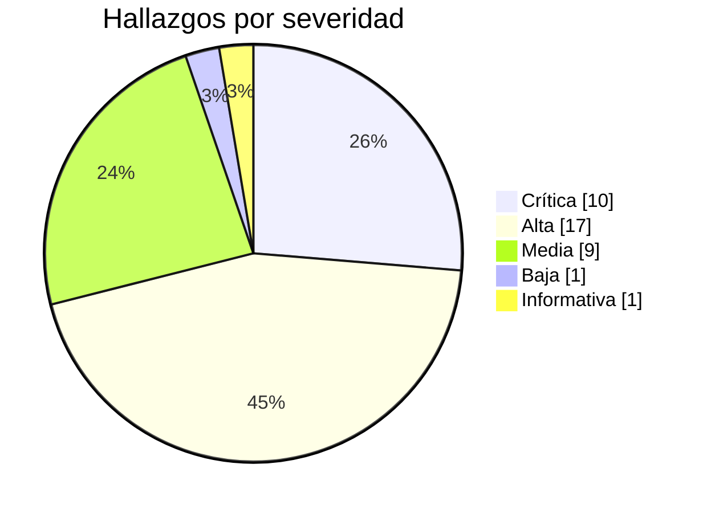
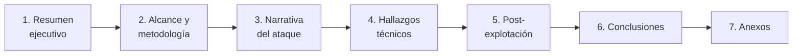

<div align="center">

# 🛡️ Hacker Odyssey

### Informes de pentest sobre Hack The Box

*Cada máquina documentada como una auditoría real: resumen ejecutivo, narrativa del ataque, hallazgos con severidad y remediación.*

<br>


<br>

[**Informes**](#-informes) ·
[**Labs propios**](#-labs-propios) ·
[**Estadísticas**](#-estadísticas) ·
[**Estructura**](#-estructura-del-repositorio) ·
[**Flujo de trabajo**](#-flujo-de-trabajo) ·
[**Aviso legal**](#%EF%B8%8F-aviso-legal)

</div>

---

<div align="center">

## 🎯 Sobre el proyecto

Este repositorio es mi bitácora de práctica ofensiva en **Hack The Box**.<br>
No son *write-ups* de "pegá este comando y listo": cada máquina se entrega<br>
como un **informe de prueba de penetración** con el formato que recibiría un cliente.

<br>

| Característica | Detalle |
|:---------------|:--------|
| 🧾 **Formato profesional** | Resumen ejecutivo para no técnicos + detalle técnico para el equipo |
| 🔎 **Evidencia real** | Salidas de herramientas, capturas y *loot* guardados junto a cada informe |
| 🧮 **Hallazgos clasificados** | Severidad, CVSS y recomendación de mitigación por cada vulnerabilidad |
| 🗺️ **Narrativa del ataque** | Reconocimiento → acceso inicial → escalada, paso a paso |
| 🧱 **Estructura reproducible** | Plantilla única y script que arma cada máquina nueva |
| 🧪 **Labs propios** | Máquinas vulnerables que construyo yo mismo en Docker, con informe y guía — ver [`02-labs/`](02-labs/) |

</div>

---

<div align="center">

## 📚 Informes

### 🟢 Starting Point — Tier 0

| ID | Máquina | Dificultad | Técnica clave | Riesgo |
|:--:|:-------:|:----------:|:--------------|:------:|
| `HO-0001` | [Meow](00-starting-point/tier-0/00-meow/README.md) |  | Telnet con credenciales por defecto | 🔴 Crítico |
| `HO-0002` | [Fawn](00-starting-point/tier-0/01-fawn/README.md) |  | FTP con login anónimo | 🟠 Alto |
| `HO-0003` | [Redeemer](00-starting-point/tier-0/03-redeemer/README.md) |  | Redis sin autenticación | 🔴 Crítico |
| `HO-0004` | [Preignition](00-starting-point/tier-0/05-preignition/README.md) |  | Panel web con credenciales por defecto | 🔴 Crítico |
| `HO-0005` | [Mongod](00-starting-point/tier-0/06-mongod/README.md) |  | MongoDB sin autenticación | 🔴 Crítico |
| `HO-0006` | [Synced](00-starting-point/tier-0/07-synced/README.md) |  | Rsync sin autenticación | 🟠 Alto |

### 🟢 Starting Point — Tier 2

| ID | Máquina | Dificultad | Técnica clave | Riesgo |
|:--:|:-------:|:----------:|:--------------|:------:|
| `HO-0011` | [Base](00-starting-point/tier-2/06-base/README.md) |  | Type Juggling (bypass de login) → webshell (RCE) → reutilización de credenciales → `sudo find` | 🔴 Crítico |

### 🟡 Machines — Easy

| ID | Máquina | Dificultad | Técnica clave | Riesgo |
|:--:|:-------:|:----------:|:--------------|:------:|
| `HO-0007` | [Cap](01-machines/01-easy/00-cap/README.md) |  | IDOR → PCAP con credenciales FTP → *Linux capabilities* | 🔴 Crítico |
| `HO-0008` | [FriendZone](01-machines/01-easy/01-frienzone/README.md) |  | Transferencia de zona DNS → SMB → LFI → *module hijacking* | 🔴 Crítico |
| `HO-0009` | [Inject](01-machines/01-easy/02-inject/README.md) |  | LFI → Spring Cloud Function RCE → Ansible privesc | 🔴 Crítico |
| `HO-0010` | [Shocker](01-machines/01-easy/03-shocker/README.md) |  | Shellshock en `cgi-bin` → `sudo` mal configurado | 🔴 Crítico |
| `HO-0012` | [Bounty Hunter](01-machines/01-easy/04-bounty-hunter/README.md) |  | XXE → lectura de archivos → reutilización de credenciales → inyección en `eval()` vía `sudo` | 🟠 Alto |

### 🧪 Labs propios

> Laboratorios **que construyo yo mismo**, estilo HTB, para correr en local con Docker.
> Cada uno trae su `Dockerfile`, `docker-compose.yml`, informe y guía por pistas. Ver [`02-labs/`](02-labs/).

| ID | Lab | Dificultad | Técnica clave | Riesgo |
|:--:|:---:|:----------:|:--------------|:------:|
| `HO-0013` | [Backstage](02-labs/backstage/informe.md) |  | `.htpasswd` filtrado → crack offline (`john`) → SSH → `sudo find` (GTFOBins) | 🟠 Alto |
| `HO-0014` | [Foundry](02-labs/foundry/informe.md) |  | *Autoindex* en nginx → clave SSH en artefacto de build → `cap_setuid` en Python | 🔴 Crítico |

</div>

> [!NOTE]
> Medium, Hard e Insane ya tienen su carpeta lista; se irán completando.
> El Tier 1 y el resto del Tier 2 de Starting Point están creados y pendientes de documentar.
> Más labs propios en camino.

---

<div align="center">

## 📊 Estadísticas

| Informes | Hallazgos totales | 🔴 Críticos | 🟠 Altos | 🟡 Medios | 🔵 Bajos | ⚪ Informativos |
|:--------:|:-----------------:|:----------:|:-------:|:--------:|:-------:|:--------------:|
| **14** | **38** | **10** | **17** | **9** | **1** | **1** |



<details>
<summary><b>🧩 Vulnerabilidades que más se repiten</b></summary>

<br>

| Patrón | Dónde aparece |
|:-------|:--------------|
| **Servicio expuesto sin autenticación** | Fawn, Redeemer, Mongod, Synced |
| **Credenciales por defecto o débiles** | Meow, Preignition, Base, Bounty Hunter, Backstage |
| **Crackeo offline de credenciales** (`john`/`hashcat`) | Backstage, Foundry |
| **Ejecución de código remoto (RCE)** | Inject, Shocker, FriendZone, Base |
| **Escalada de privilegios por mala configuración** | Cap, Shocker, Inject, FriendZone, Base, Bounty Hunter, Backstage, Foundry |
| **Divulgación de información / LFI / XXE** | Cap, FriendZone, Inject, Base, Bounty Hunter, Backstage, Foundry |

</details>

</div>

---

<div align="center">

## 🗂️ Estructura del repositorio

</div>

```text
hacker-odyssey/
├── 00-starting-point/        # Starting Point (Tier 0, 1 y 2)
│   └── tier-0/
│       └── 00-meow/
│           ├── README.md     # 📄 Informe completo
│           ├── loot/         # 🧰 Salidas de nmap, ping, flags, etc.
│           └── scripts/      # 🐍 Exploits y herramientas usadas
├── 01-machines/              # Máquinas por dificultad
│   ├── 01-easy/
│   ├── 02-medium/
│   ├── 03-hard/
│   └── 04-insane/
├── 02-labs/                  # 🧪 Labs propios vulnerables (Docker)
│   ├── teoria.md             # 📖 Guía de conceptos (sin spoilers)
│   ├── backstage/            # Dockerfile + informe.md + guia.md
│   ├── foundry/
│   └── switchboard/
├── assets/
│   └── images/screenshots/   # 📸 Capturas referenciadas en los informes
├── utils/
│   ├── new-machine.sh        # ⚙️ Genera la estructura de una máquina nueva
│   └── _template/            # 📝 Plantilla del informe
└── .claude/skills/           # 🤖 Skill que convierte evidencia en informe
```

---

<div align="center">

## 📝 Anatomía de un informe

Todos los informes comparten la misma estructura, con metadatos en *front matter*<br>
(ID, objetivo, OS, dificultad, etiquetas).



| Sección | Qué contiene |
|:-------:|:-------------|
| **Resumen ejecutivo** | Resultado en lenguaje claro, nivel de riesgo global y distribución de hallazgos |
| **Alcance y metodología** | Objetivo, tipo de prueba (caja negra) y herramientas |
| **Narrativa del ataque** | Reconocimiento, acceso inicial y escalada con evidencia |
| **Hallazgos técnicos** | Descripción, impacto, CVSS y remediación de cada vulnerabilidad |
| **Post-explotación** | Estado final del sistema y cómo se obtuvo cada flag |
| **Conclusiones y anexos** | Recomendaciones generales, comandos y referencias |

</div>

---

<div align="center">

## ⚙️ Flujo de trabajo

</div>

**1. Crear la estructura de una máquina nueva**

```bash
cd utils
./new-machine.sh <ruta-maquina> <S.O> <dificultad> <IP>
```

Genera `README.md` desde la plantilla, junto con las carpetas `loot/` y `scripts/` y el directorio de capturas.

**2. Documentar la evidencia** en `loot/` y `scripts/` mientras se trabaja la máquina.

**3. Redactar el informe** con la skill `informe-pentest` de Claude Code, que convierte comandos, salidas y notas en un informe terminado y **no inventa datos**: lo que falta queda marcado como `⚠️ PENDIENTE`.

---

<div align="center">

## 🧰 Herramientas habituales


</div>

---

<div align="center">

## ⚠️ Aviso legal

</div>

> [!WARNING]
> Todo el contenido de este repositorio se produjo sobre **entornos de laboratorio autorizados**
> (Hack The Box) y, en el caso de las máquinas, sobre **máquinas retiradas**. Tiene fines
> **exclusivamente educativos**. Ninguna técnica aquí descrita debe aplicarse sobre sistemas
> sin autorización expresa y por escrito de su propietario.

---

<div align="center">

**Francisco Nieto** · [@NiettoFrann](https://github.com/NiettoFrann)

*Aprender atacando, para aprender a defender.* 🔐

</div>
