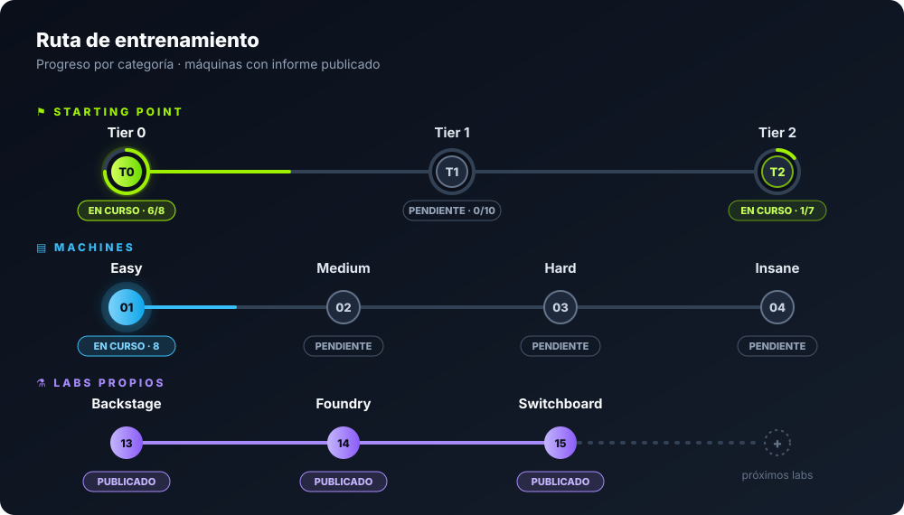
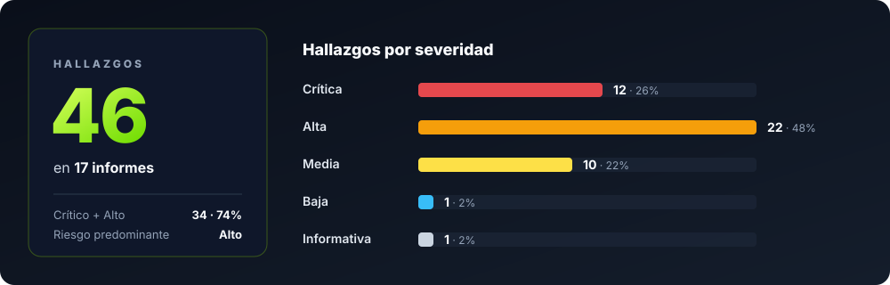
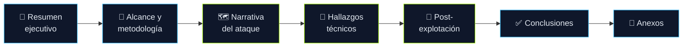

<div align="center">



<br/>


<p>
  <a href="#-sobre-el-proyecto"><b>Sobre el proyecto</b></a> ·
  <a href="#-ruta-de-entrenamiento"><b>Ruta</b></a> ·
  <a href="#-informes"><b>Informes</b></a> ·
  <a href="#-labs-propios"><b>Labs propios</b></a> ·
  <a href="#-estadísticas"><b>Estadísticas</b></a> ·
  <a href="#%EF%B8%8F-estructura-del-repositorio"><b>Estructura</b></a> ·
  <a href="#%EF%B8%8F-flujo-de-trabajo"><b>Flujo de trabajo</b></a> ·
  <a href="#%EF%B8%8F-aviso-legal"><b>Aviso legal</b></a>
</p>

</div>


## 🎯 Sobre el proyecto

<p align="justify">
Este repositorio es mi <b>bitácora de práctica ofensiva en Hack The Box</b>. No son <i>write-ups</i> de "pegá este comando y listo": cada máquina se entrega como un <b>informe de prueba de penetración</b> con el formato que recibiría un cliente, con resumen ejecutivo, narrativa del ataque, hallazgos con severidad y remediación.
</p>

<div align="center">

| Característica                 | Detalle                                                                                                |
| :----------------------------- | :----------------------------------------------------------------------------------------------------- |
| 🧾 **Formato profesional**     | Resumen ejecutivo para no técnicos + detalle técnico para el equipo                                    |
| 🔎 **Evidencia real**          | Salidas de herramientas, capturas y _loot_ guardados junto a cada informe                              |
| 🧮 **Hallazgos clasificados**  | Severidad, CVSS y recomendación de mitigación por cada vulnerabilidad                                  |
| 🗺️ **Narrativa del ataque**    | Reconocimiento → acceso inicial → escalada, paso a paso                                                |
| 🧱 **Estructura reproducible** | Plantilla única y script que arma cada máquina nueva                                                   |
| 🧪 **Labs propios**            | Máquinas vulnerables que construyo yo mismo en Docker, con informe y guía — ver [`02-labs/`](02-labs/) |

</div>


## 🧭 Ruta de entrenamiento

<div align="center">
  
</div>

<br/>

<div align="center">

<table>
  <thead>
    <tr>
      <th align="center"></th>
      <th align="center">Categoría</th>
      <th align="center">Plataforma</th>
      <th align="center">Estado</th>
      <th align="center">Informes</th>
    </tr>
  </thead>
  <tbody>
    <tr>
      <td align="center"></td>
      <td><a href="#-starting-point"><b>Starting Point</b></a></td>
      <td align="center">Hack The Box</td>
      <td align="center"></td>
      <td align="center">7 · Tier 0 y Tier 2</td>
    </tr>
    <tr>
      <td align="center"></td>
      <td><a href="#%EF%B8%8F-machines--easy"><b>Machines — Easy</b></a></td>
      <td align="center">Hack The Box</td>
      <td align="center"></td>
      <td align="center">7</td>
    </tr>
    <tr>
      <td align="center"></td>
      <td><a href="#-labs-propios"><b>Labs propios</b></a></td>
      <td align="center">Docker (local)</td>
      <td align="center"></td>
      <td align="center">3</td>
    </tr>
    <tr>
      <td align="center"></td>
      <td><b>Machines — Medium · Hard · Insane</b></td>
      <td align="center">Hack The Box</td>
      <td align="center"></td>
      <td align="center">—</td>
    </tr>
  </tbody>
</table>

</div>


## 📚 Informes

### 🚩 Starting Point

<div align="center">
  
</div>

#### Tier 0

<div align="center">

|    ID     |                             Máquina                              |                               Dificultad                               | Técnica clave                          |   Riesgo   |
| :-------: | :--------------------------------------------------------------: | :--------------------------------------------------------------------: | :------------------------------------- | :--------: |
| `HO-0001` |        [Meow](00-starting-point/tier-0/00-meow/README.md)        |  | Telnet con credenciales por defecto    | 🔴 Crítico |
| `HO-0002` |        [Fawn](00-starting-point/tier-0/01-fawn/README.md)        |  | FTP con login anónimo                  |  🟠 Alto   |
| `HO-0003` |    [Redeemer](00-starting-point/tier-0/03-redeemer/README.md)    |  | Redis sin autenticación                | 🔴 Crítico |
| `HO-0004` | [Preignition](00-starting-point/tier-0/05-preignition/README.md) |  | Panel web con credenciales por defecto | 🔴 Crítico |
| `HO-0005` |      [Mongod](00-starting-point/tier-0/06-mongod/README.md)      |  | MongoDB sin autenticación              | 🔴 Crítico |
| `HO-0006` |      [Synced](00-starting-point/tier-0/07-synced/README.md)      |  | Rsync sin autenticación                |  🟠 Alto   |

</div>

#### Tier 2

<div align="center">

|    ID     |                      Máquina                       |                               Dificultad                               | Técnica clave                                                                                  |   Riesgo   |
| :-------: | :------------------------------------------------: | :--------------------------------------------------------------------: | :--------------------------------------------------------------------------------------------- | :--------: |
| `HO-0011` | [Base](00-starting-point/tier-2/06-base/README.md) |  | Type Juggling (bypass de login) → webshell (RCE) → reutilización de credenciales → `sudo find` | 🔴 Crítico |

</div>

### 🖥️ Machines — Easy

<div align="center">
  
</div>

<br/>

<div align="center">

|    ID     |                             Máquina                             |                           Dificultad                            | Técnica clave                                                                                                  |   Riesgo   |
| :-------: | :-------------------------------------------------------------: | :-------------------------------------------------------------: | :------------------------------------------------------------------------------------------------------------- | :--------: |
| `HO-0007` |           [Cap](01-machines/01-easy/00-cap/README.md)           |  | IDOR → PCAP con credenciales FTP → _Linux capabilities_                                                        | 🔴 Crítico |
| `HO-0008` |    [FriendZone](01-machines/01-easy/01-frienzone/README.md)     |  | Transferencia de zona DNS → SMB → LFI → _module hijacking_                                                     | 🔴 Crítico |
| `HO-0009` |        [Inject](01-machines/01-easy/02-inject/README.md)        |  | LFI → Spring Cloud Function RCE → Ansible privesc                                                              | 🔴 Crítico |
| `HO-0010` |       [Shocker](01-machines/01-easy/03-shocker/README.md)       |  | Shellshock en `cgi-bin` → `sudo` mal configurado                                                               | 🔴 Crítico |
| `HO-0012` | [Bounty Hunter](01-machines/01-easy/04-bounty-hunter/README.md) |  | XXE → lectura de archivos → reutilización de credenciales → inyección en `eval()` vía `sudo`                   |  🟠 Alto   |
| `HO-0016` |     [Traverxec](01-machines/01-easy/05-traverxec/README.md)     |  | RCE en Nostromo 1.9.6 (CVE-2019-16278) → clave SSH en backup accesible → `sudo journalctl` + `less` (GTFOBins) | 🔴 Crítico |
| `HO-0017` |     [Valentine](01-machines/01-easy/06-valentine/README.md)     |  | Heartbleed (CVE-2014-0160) → contraseña en memoria + clave SSH en directorio web → socket de `tmux` como root  |  🟠 Alto   |

</div>

### 🧪 Labs propios

<div align="center">
  
</div>

<br/>

<p align="justify">
Laboratorios <b>que construyo yo mismo</b>, estilo HTB, para correr en local con Docker. Cada uno trae su <code>Dockerfile</code>, <code>docker-compose.yml</code>, informe y guía por pistas. Ver <a href="02-labs/"><code>02-labs/</code></a>.
</p>

<div align="center">

|    ID     |                      Lab                      |                           Dificultad                            | Técnica clave                                                                                                     |   Riesgo   |
| :-------: | :-------------------------------------------: | :-------------------------------------------------------------: | :---------------------------------------------------------------------------------------------------------------- | :--------: |
| `HO-0013` |   [Backstage](02-labs/backstage/informe.md)   |  | `.htpasswd` filtrado → crack offline (`john`) → SSH → `sudo find` (GTFOBins)                                      |  🟠 Alto   |
| `HO-0014` |     [Foundry](02-labs/foundry/informe.md)     |  | _Autoindex_ en nginx → clave SSH en artefacto de build → `cap_setuid` en Python                                   | 🔴 Crítico |
| `HO-0015` | [Switchboard](02-labs/switchboard/informe.md) |  | `.git/` expuesto en el webroot (`git-dumper`) → credencial en el historial → SSH → grupo `shadow` → crack offline | 🔴 Crítico |

</div>

> [!NOTE]
> Medium, Hard e Insane ya tienen su carpeta lista; se irán completando.
> El Tier 1 y el resto del Tier 2 de Starting Point están creados y pendientes de documentar.
> Más labs propios en camino.


## 📊 Estadísticas

<div align="center">
  
</div>

<br/>

<div align="center">

| Informes | Hallazgos totales | 🔴 Críticos | 🟠 Altos | 🟡 Medios | 🔵 Bajos | ⚪ Informativos |
| :------: | :---------------: | :---------: | :------: | :-------: | :------: | :-------------: |
|  **17**  |      **46**       |   **12**    |  **22**  |  **10**   |  **1**   |      **1**      |

</div>

<details>
<summary><b>🧩 Vulnerabilidades que más se repiten</b></summary>

<br/>

| Patrón                                                 | Dónde aparece                                                                                                |
| :----------------------------------------------------- | :----------------------------------------------------------------------------------------------------------- |
| **Servicio expuesto sin autenticación**                | Fawn, Redeemer, Mongod, Synced                                                                               |
| **Credenciales por defecto o débiles**                 | Meow, Preignition, Base, Bounty Hunter, Backstage                                                            |
| **Crackeo offline de credenciales** (`john`/`hashcat`) | Backstage, Foundry, Switchboard, Traverxec                                                                   |
| **Ejecución de código remoto (RCE)**                   | Inject, Shocker, FriendZone, Base, Traverxec                                                                 |
| **Escalada de privilegios por mala configuración**     | Cap, Shocker, Inject, FriendZone, Base, Bounty Hunter, Backstage, Foundry, Switchboard, Traverxec, Valentine |
| **Divulgación de información / LFI / XXE**             | Cap, FriendZone, Inject, Base, Bounty Hunter, Backstage, Foundry, Switchboard, Valentine                     |

</details>


## 🗂️ Estructura del repositorio

```text
hacker-odyssey/
├── 📁 00-starting-point/              # Starting Point (Tier 0, 1 y 2)
│   └── 📁 tier-0/
│       └── 📁 00-meow/
│           ├── 📄 README.md           # Informe completo
│           ├── 📁 loot/               # Salidas de nmap, ping, flags, etc.
│           └── 📁 scripts/            # Exploits y herramientas usadas
├── 📁 01-machines/                    # Máquinas por dificultad
│   ├── 📁 01-easy/
│   ├── 📁 02-medium/
│   ├── 📁 03-hard/
│   └── 📁 04-insane/
├── 📁 02-labs/                        # Labs propios vulnerables (Docker)
│   ├── 📄 teoria.md                   # Guía de conceptos (sin spoilers)
│   ├── 📁 backstage/                  # Dockerfile + informe.md + guia.md
│   ├── 📁 foundry/
│   └── 📁 switchboard/
├── 📁 assets/
│   ├── 📁 branding/                   # Banner y separador (SVG)
│   ├── 📁 diagrams/                   # Ruta de entrenamiento y estadísticas (SVG)
│   ├── 📁 icons/                      # Íconos por categoría y herramienta (SVG)
│   └── 📁 images/screenshots/         # Capturas referenciadas en los informes
├── 📁 utils/
│   ├── 📜 new-machine.sh              # Genera la estructura de una máquina nueva
│   └── 📁 _template/                  # Plantilla del informe
└── 📁 .claude/skills/                 # Skill que convierte evidencia en informe
```


## 📝 Anatomía de un informe

<p align="justify">
Todos los informes comparten la misma estructura, con metadatos en <i>front matter</i> (ID, objetivo, OS, dificultad, etiquetas).
</p>

<div align="center">



|          Sección          | Qué contiene                                                                    |
| :-----------------------: | :------------------------------------------------------------------------------ |
|   **Resumen ejecutivo**   | Resultado en lenguaje claro, nivel de riesgo global y distribución de hallazgos |
| **Alcance y metodología** | Objetivo, tipo de prueba (caja negra) y herramientas                            |
| **Narrativa del ataque**  | Reconocimiento, acceso inicial y escalada con evidencia                         |
|  **Hallazgos técnicos**   | Descripción, impacto, CVSS y remediación de cada vulnerabilidad                 |
|   **Post-explotación**    | Estado final del sistema y cómo se obtuvo cada flag                             |
| **Conclusiones y anexos** | Recomendaciones generales, comandos y referencias                               |

</div>


## ⚙️ Flujo de trabajo

**1. Crear la estructura de una máquina nueva**

```bash
cd utils
./new-machine.sh <ruta-maquina> <S.O> <dificultad> <IP>
```

Genera `README.md` desde la plantilla, junto con las carpetas `loot/` y `scripts/` y el directorio de capturas.

**2. Documentar la evidencia** en `loot/` y `scripts/` mientras se trabaja la máquina.

**3. Redactar el informe** con la skill `informe-pentest` de Claude Code, que convierte comandos, salidas y notas en un informe terminado y **no inventa datos**: lo que falta queda marcado como `⚠️ PENDIENTE`.

<details>
<summary><b>✅ Checklist después de publicar un informe</b></summary>

<br/>

- [ ] Sumar la fila en la tabla de [Informes](#-informes) con su ID `HO-XXXX`.
- [ ] Actualizar los badges de informes y hallazgos y la tabla de [Estadísticas](#-estadísticas).
- [ ] Actualizar `assets/diagrams/severidad.svg` (totales, barras y porcentajes).
- [ ] Actualizar `assets/diagrams/roadmap.svg` (progreso de la categoría).

</details>


## 🧰 Herramientas habituales

<div align="center">

<table>
  <tr>
    <td align="center" width="20%"><a href="https://nmap.org"></a><br/><b>Nmap</b><br/><sub>Escaneo de puertos</sub></td>
    <td align="center" width="20%"><a href="https://github.com/OJ/gobuster"></a><br/><b>Gobuster</b><br/><sub>Fuzzing web y DNS</sub></td>
    <td align="center" width="20%"><a href="https://portswigger.net/burp"></a><br/><b>Burp Suite</b><br/><sub>Proxy web</sub></td>
    <td align="center" width="20%"><a href="https://www.wireshark.org"></a><br/><b>Wireshark</b><br/><sub>Análisis de tráfico</sub></td>
    <td align="center" width="20%"><a href="https://github.com/DominicBreuker/pspy"></a><br/><b>pspy</b><br/><sub>Espiar procesos</sub></td>
  </tr>
  <tr>
    <td align="center" width="20%"><a href="https://www.openwall.com/john/"></a><br/><b>John the Ripper</b><br/><sub>Crackeo de hashes</sub></td>
    <td align="center" width="20%"><a href="https://hashcat.net"></a><br/><b>Hashcat</b><br/><sub>Crackeo por GPU</sub></td>
    <td align="center" width="20%"><a href="https://www.docker.com"></a><br/><b>Docker</b><br/><sub>Labs propios</sub></td>
    <td align="center" width="20%"><a href="https://www.gnu.org/software/bash/"></a><br/><b>Bash</b><br/><sub>Scripting</sub></td>
    <td align="center" width="20%"><a href="https://www.python.org"></a><br/><b>Python</b><br/><sub>Exploits</sub></td>
  </tr>
</table>

</div>


## ⚠️ Aviso legal

> [!WARNING]
> Todo el contenido de este repositorio se produjo sobre **entornos de laboratorio autorizados**
> (Hack The Box) y, en el caso de las máquinas, sobre **máquinas retiradas**. Tiene fines
> **exclusivamente educativos**. Ninguna técnica aquí descrita debe aplicarse sobre sistemas
> sin autorización expresa y por escrito de su propietario.


<div align="center">

Hecho con muchas horas de terminal por [**Francisco Nieto · @NiettoFrann**](https://github.com/NiettoFrann)


</div>
