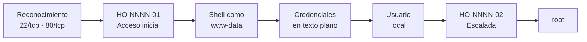

# Informe de Prueba de Penetración — NombreMaquina

| | |
|---|---|
| **ID de informe** | HO-NNNN-00 |
| **Objetivo** | NombreMaquina (`10.10.11.XXX`) |
| **Plataforma** | Hack The Box — máquina retirada |
| **Tipo de prueba** | Caja negra (black box) |
| **Fecha de ejecución** | AAAA-MM-DD |
| **Autor** | Francisco Nieto — [@NiettoFrann](https://github.com/NiettoFrann) |
| **Versión** | 1.0 |
| **Clasificación** | Público — uso educativo |

> **Aviso legal.** Las pruebas se realizaron sobre un entorno de laboratorio autorizado
> (Hack The Box) y sobre una máquina retirada. Ninguna técnica descrita debe aplicarse
> sobre sistemas sin autorización expresa por escrito de su propietario.

### Control de versiones

| Versión | Fecha | Descripción |
|---------|-------|-------------|
| 1.0 | AAAA-MM-DD | Versión inicial |

---

## Índice

1. [Resumen ejecutivo](#1-resumen-ejecutivo)
2. [Alcance y metodología](#2-alcance-y-metodología)
3. [Narrativa del ataque](#3-narrativa-del-ataque)
4. [Hallazgos técnicos](#4-hallazgos-técnicos)
5. [Post-explotación](#5-post-explotación)
6. [Conclusiones](#6-conclusiones)
7. [Anexos](#7-anexos)

---

## 1. Resumen ejecutivo

### 1.1 Objetivo

Evaluar la seguridad del host **NombreMaquina** simulando un atacante externo sin
credenciales ni conocimiento previo del entorno, con el fin de obtener el máximo nivel
de privilegios posible.

### 1.2 Resultado

> Párrafo de 3 a 5 líneas, sin tecnicismos, pensado para alguien no técnico.
> Ejemplo: *Se obtuvo control total del servidor. Un fallo en la aplicación web permitió
> ejecutar comandos de forma remota y una configuración incorrecta del sistema permitió
> escalar a administrador. Un atacante real podría robar o destruir toda la información
> alojada en el equipo.*

**Nivel de riesgo global:** `CRÍTICO` <!-- CRÍTICO | ALTO | MEDIO | BAJO -->

### 1.3 Distribución de hallazgos

| Crítica | Alta | Media | Baja | Informativa |
|:-------:|:----:|:-----:|:----:|:-----------:|
| 0 | 0 | 0 | 0 | 0 |

### 1.4 Resumen de hallazgos

| ID | Hallazgo | Severidad | CVSS |
|----|----------|-----------|------|
| [HO-NNNN-01](#ho-nnnn-01--título-del-hallazgo) | Título del hallazgo | Crítica | 9.8 |
| [HO-NNNN-02](#ho-nnnn-02--título-del-hallazgo) | Título del hallazgo | Alta | 7.8 |

### 1.5 Recomendaciones prioritarias

1. Acción más urgente (corrige el acceso inicial).
2. Segunda acción (corrige la escalada).
3. Medida general de hardening.

---

## 2. Alcance y metodología

### 2.1 Alcance

| Activo | Dirección | Incluido |
|--------|-----------|:--------:|
| NombreMaquina | `10.10.11.XXX` | Sí |

**Fuera de alcance:** ataques de denegación de servicio, infraestructura de la
plataforma y otros jugadores.

### 2.2 Metodología

La prueba siguió las fases del estándar **PTES** (Penetration Testing Execution
Standard), apoyándose en **OWASP WSTG** para los componentes web:

1. **Reconocimiento** — descubrimiento de puertos y servicios.
2. **Enumeración** — identificación de versiones, tecnologías y superficie de ataque.
3. **Análisis de vulnerabilidades** — validación manual de posibles fallos.
4. **Explotación** — obtención de acceso inicial.
5. **Post-explotación** — escalada de privilegios y movimiento lateral.
6. **Reporte** — documentación de hallazgos y recomendaciones.

### 2.3 Entorno del auditor

| Componente | Detalle |
|------------|---------|
| Sistema | Distribución / versión |
| Conexión | VPN de Hack The Box |
| Herramientas | nmap, whatweb, ffuf, Burp Suite, netcat, linpeas |

### 2.4 Clasificación de severidad

Las vulnerabilidades se puntúan con **CVSS v3.1** (ver tabla de criterios estándar).

---

## 3. Narrativa del ataque

### 3.1 Cadena de compromiso



### 3.2 Reconocimiento

Descubrimiento de puertos abiertos:

```bash
sudo nmap -p- --open -sS --min-rate 5000 -n -Pn 10.10.11.XXX -oG allPorts
```

Detección de servicios y versiones:

```bash
nmap -sCV -p22,80 10.10.11.XXX -oN targeted
```

| Puerto | Servicio | Versión | Observaciones |
|--------|----------|---------|---------------|
| 22/tcp | SSH | OpenSSH X.X | Sin credenciales; se descarta como vector inicial. |
| 80/tcp | HTTP | nginx X.X | Aplicación web; principal superficie de ataque. |

> Salida completa en el [Anexo A](#a-salida-completa-de-escaneos).

### 3.3 Enumeración

Describir en prosa qué se encontró y **por qué** se tomó cada decisión
(tecnologías detectadas, rutas, subdominios, versiones vulnerables).

```bash
ffuf -u http://10.10.11.XXX/FUZZ -w /usr/share/seclists/Discovery/Web-Content/raft-medium-directories.txt
```


*Figura 1 — Descripción de la captura.*

### 3.4 Acceso inicial

Resumen del paso y referencia al hallazgo: ver **[HO-NNNN-01](#ho-nnnn-01--título-del-hallazgo)**.

### 3.5 Movimiento lateral

Cómo se pasó de un usuario de servicio a un usuario del sistema (si aplica).

### 3.6 Escalada de privilegios

Resumen del paso y referencia al hallazgo: ver **[HO-NNNN-02](#ho-nnnn-02--título-del-hallazgo)**.

---

## 4. Hallazgos técnicos

### HO-NNNN-01 — Título del hallazgo

| | |
|---|---|
| **Severidad** | Crítica |
| **CVSS v3.1** | 9.8 — `CVSS:3.1/AV:N/AC:L/PR:N/UI:N/S:U/C:H/I:H/A:H` |
| **CWE** | [CWE-89](https://cwe.mitre.org/data/definitions/89.html) — Nombre de la debilidad |
| **CVE** | CVE-XXXX-XXXXX *(si aplica)* |
| **Componente afectado** | `http://10.10.11.XXX/ruta` — parámetro `x` |
| **Estado** | Explotada |

#### Descripción

Qué es la vulnerabilidad y por qué existe en este sistema (causa raíz).

#### Prueba de concepto

**Paso 1.** Descripción.

```http
POST /login HTTP/1.1
Host: 10.10.11.XXX
Content-Type: application/x-www-form-urlencoded

user=admin'-- -&pass=x
```

**Paso 2.** Descripción.

```bash
# comando
```


*Figura 2 — Evidencia de explotación.*

#### Impacto

Qué puede hacer un atacante gracias a esta vulnerabilidad (confidencialidad,
integridad y disponibilidad).

#### Remediación

- **Corto plazo:** medida inmediata.
- **Largo plazo:** corrección de fondo.

#### Referencias

- [OWASP — referencia](https://owasp.org/)
- [CWE-XX](https://cwe.mitre.org/)

---

### HO-NNNN-02 — Título del hallazgo

| | |
|---|---|
| **Severidad** | Alta |
| **CVSS v3.1** | 7.8 — `CVSS:3.1/AV:L/AC:L/PR:L/UI:N/S:U/C:H/I:H/A:H` |
| **CWE** | [CWE-XXX](https://cwe.mitre.org/) — Nombre de la debilidad |
| **CVE** | — |
| **Componente afectado** | `/ruta/al/binario` |
| **Estado** | Explotada |

#### Descripción

#### Prueba de concepto

```bash
```

#### Impacto

#### Remediación

#### Referencias

---

## 5. Post-explotación

### 5.1 Acceso obtenido

| Nivel | Usuario | Método | Prueba |
|-------|---------|--------|--------|
| Usuario | `usuario` | HO-NNNN-01 | `user.txt` — `a1b2c3d4************************` |
| Administrador | `root` | HO-NNNN-02 | `root.txt` — `e5f6g7h8************************` |

### 5.2 Información sensible expuesta

| Tipo | Ubicación | Observación |
|------|-----------|-------------|
| Credenciales | `/var/www/app/config.php` | Contraseña reutilizada en SSH. |

> Las credenciales y flags se muestran parcialmente censuradas.

### 5.3 Limpieza

| Artefacto | Ubicación | Estado |
|-----------|-----------|--------|
| Script de enumeración | `/tmp/linpeas.sh` | Eliminado |

---

## 6. Conclusiones

### 6.1 Conclusión técnica

Párrafo final: qué falló en la postura de seguridad del sistema (por ejemplo,
validación de entradas, gestión de secretos, mínimo privilegio) y cómo las
vulnerabilidades se encadenaron para lograr el compromiso total.

### 6.2 Aprendizajes del auditor

- Técnica o concepto nuevo aplicado.
- Error cometido o callejón sin salida, y cómo se resolvió.
- Qué se haría distinto la próxima vez.

---

## 7. Anexos

### A. Salida completa de escaneos

<details>
<summary>nmap — escaneo de servicios</summary>

```text
pegar salida completa
```

</details>

### B. Scripts y exploits

<details>
<summary>exploit.py</summary>

```python
#!/usr/bin/env python3
```

</details>

### C. Mapeo MITRE ATT&CK

| Táctica | Técnica | ID |
|---------|---------|----|
| Initial Access | Exploit Public-Facing Application | [T1190](https://attack.mitre.org/techniques/T1190/) |
| Privilege Escalation | Abuse Elevation Control Mechanism | [T1548](https://attack.mitre.org/techniques/T1548/) |

### D. Referencias generales

- [PTES — Penetration Testing Execution Standard](http://www.pentest-standard.org/)
- [OWASP Web Security Testing Guide](https://owasp.org/www-project-web-security-testing-guide/)
- [Calculadora CVSS v3.1 — FIRST](https://www.first.org/cvss/calculator/3.1)
- [MITRE ATT&CK](https://attack.mitre.org/)
